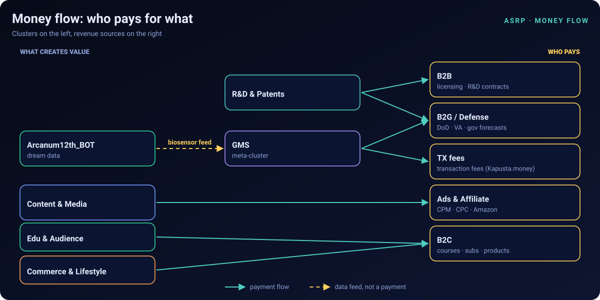
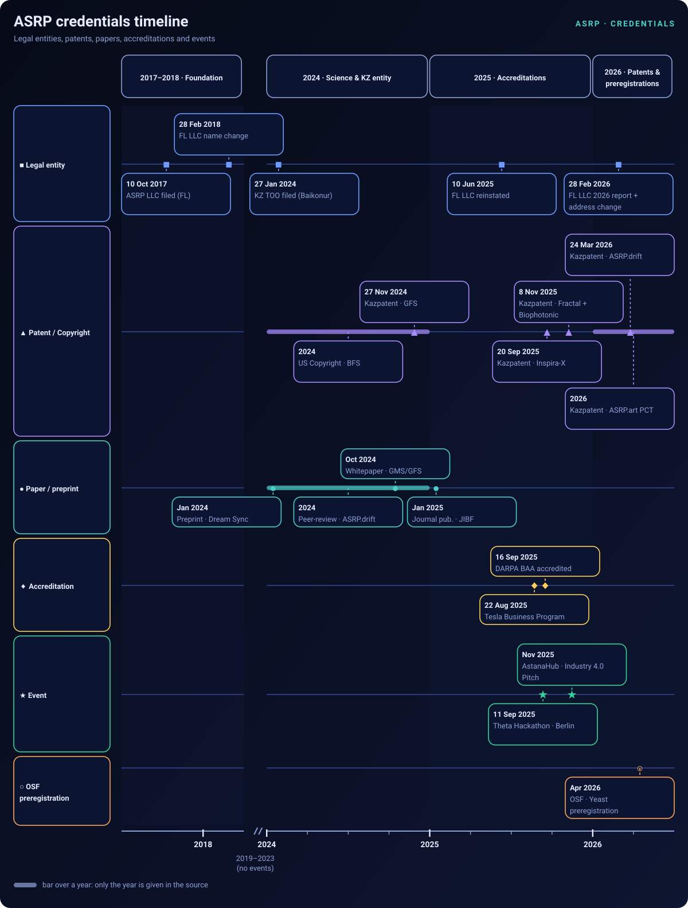
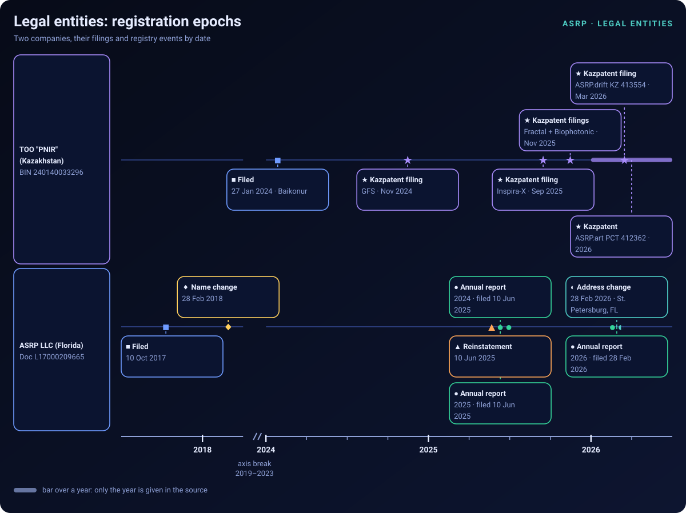
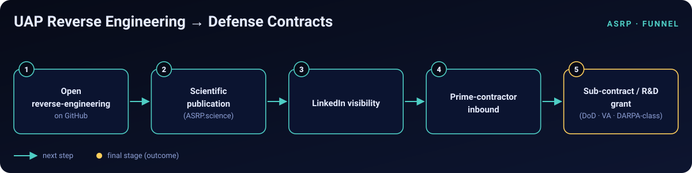
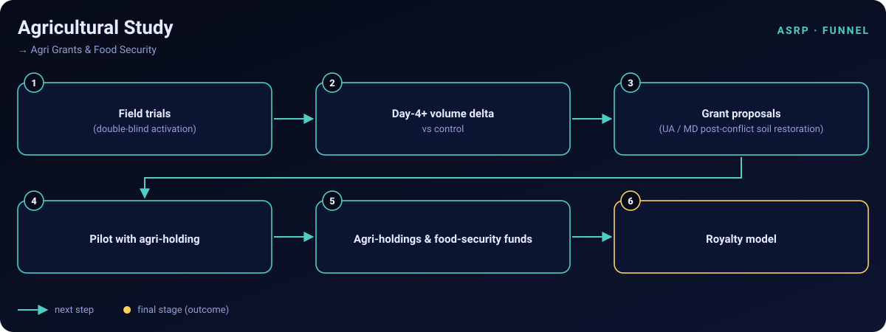
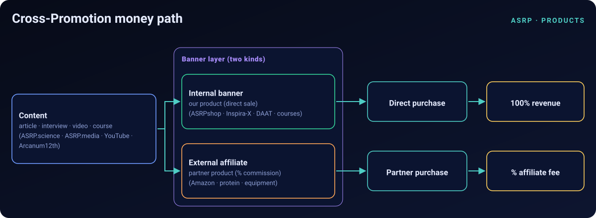
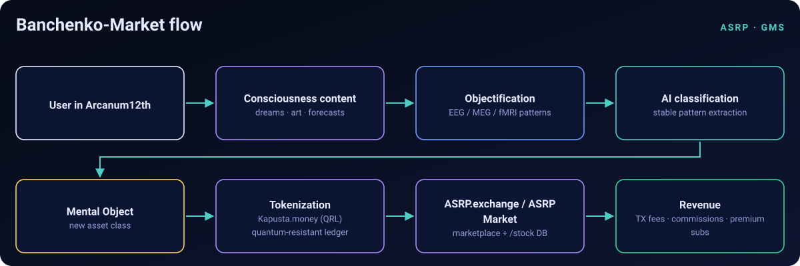
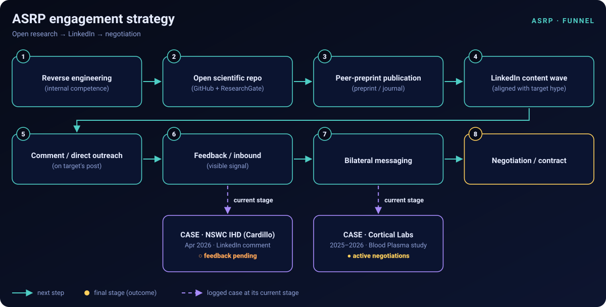
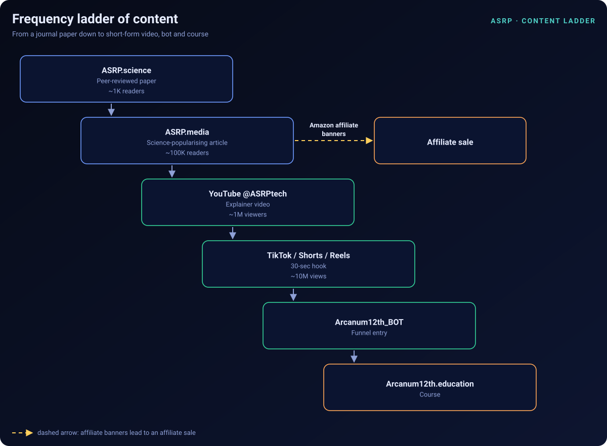
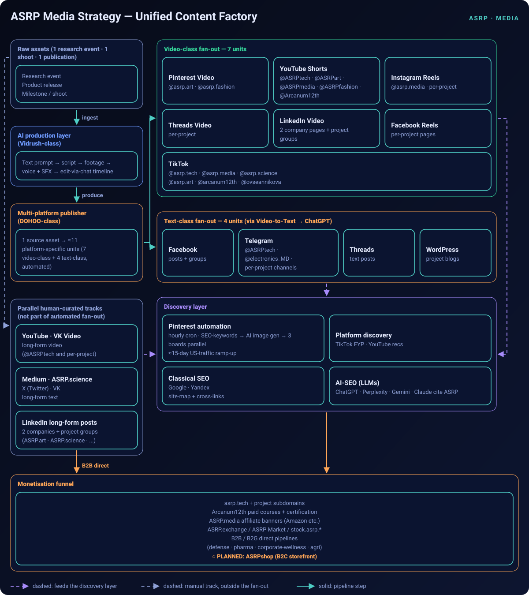

**English | [Русский](README.ru.md)**

<div align="center">


# ASRP Ecosystem — Marketing & Monetization Hub

**Advanced Scientific Research Projects (ASRP)** — Unified research, education, science, media & deep-tech ecosystem.


[](https://asrp.tech)
[](https://asrp-graph.surge.sh/preview.html)

[](https://asrp.tech/en/patrons)

</div>

<!-- legacy-anchors --><a name="asrp-ecosystem--marketing--monetization-hub--экосистема-asrp--маркетинг-и-монетизация-"></a><a name="-table-of-contents--содержание"></a>
## At a glance

- **What it is.** ASRP is an early-stage private research group (Florida LLC since 2017, Kazakhstan LLP
  since 2024, a UK entity being reinstated). Its research lines are unconventional: hyperbolic-field effects
  on blood plasma, seeds and yeast; forecasting from dream and biosensor data (GFS); UAP reverse engineering.
  Around them it runs education, a journal site, media and commerce as one cross-linked system. This
  repository is the single entry point for people outside it.
- **What exists today.** 4 public services online, 12 components listed as in active development, 3
  planned, and 7 research studies: 4 with open repositories on GitHub, 1 in a private repository, 2 at the
  planned-preregistration stage.
- **What backs it.** Checked on 17 November 2026: 4 public study repositories and 7 public
  patent-documentation repositories. Stated by the project and linked, not re-checked: 8 publications
  listed on ResearchGate (7 journal articles, 1 technical report), 6 Kazpatent applications + 1 PCT + 1 US
  copyright, two legal entities with registry numbers, ≈$165 k from 22 named patrons. Evidence and check
  status per item: [Proof points](#proof-points).
- **What this page does not claim.** No revenue figures, no signed customers, no clinical or regulatory
  claims. The first isolated sales the project reports (an affiliate commission, crystals bought for a pilot)
  are unverified and carry no figures. Outreach targets are targets, contacts are contacts, and the DARPA
  item is portal access, not an award. The detail pages carry the project's own wording, dated 2026-Q2.
- **Who is behind it.** Founders: Denis Banchenko (CEO), Valeria Ovseannicova, Mykhailo Kapustin.
  [Team](docs/TEAM.md).
- **What to do next.** Write to `info@asrp.tech`. Investors and B2B / B2G partners: paths to money for
  [research](docs/PATHS_TO_MONEY_RESEARCH.md) and [products](docs/PATHS_TO_MONEY_PRODUCTS.md); no equity
  round is described here, only co-operation models without share transfer. Patrons:
  [asrp.tech/en/patrons](https://asrp.tech/en/patrons). Researchers:
  [Research, patents and accreditations](docs/RESEARCH_AND_IP.md) and the [whitepapers](whitepaper/README.md).

<div align="center">

</div>

*How the pieces fit, as the project describes its own model.* Each box carries its status in words. Solid
arrows are flows that already run: the bot and pilot courses feed research, research is published, patrons
fund the work. Dashed arrows are the commercial loop the ecosystem is built for; the project reports first
isolated sales but publishes no revenue figures. Details:
[Ecosystem map and component status](docs/ECOSYSTEM.md).

> 💛 **If this work is useful to you — support us:** **<https://asrp.tech/en/patrons>** · 7 patron tiers from
> Principal Philanthropist to Individual Contributor.
> Investor relations (co-operation models without share transfer): <https://asrp.tech/en/investors>

---

## Language

**English | [Русский](README.ru.md).** Every page exists in two language versions: `*.md` (English) and
`*.ru.md` (Russian); graphics as `*.en.svg` / `*.ru.svg`. Languages are not mixed in the body text.

---

## Quick navigation

| &nbsp;&nbsp;Icon&nbsp;&nbsp; | Section | What is inside |
|:---:|---|---|
|  | **[Ecosystem](docs/ECOSYSTEM.md)** | strategic thesis, six clusters, taxonomy / data-flow / money-flow diagrams, status of every component |
|  | **[Research and IP](docs/RESEARCH_AND_IP.md)** | flagship papers, patent applications with numbers and exam status, accreditations, timeline |
|  | **[Whitepapers](whitepaper/README.md)** | complete publication list, abstracts, authors, external scientific references |
|  | **[Paths to money: research](docs/PATHS_TO_MONEY_RESEARCH.md)** | UAP reverse engineering, blood plasma / hyperbolic biomed, agricultural study, GFS forecasting |
|  | **[Paths to money: products](docs/PATHS_TO_MONEY_PRODUCTS.md)** | ASRP.art, ASRP.drift, ASRP.media, Arcanum12th, cross-promotion, ASRP.dance, ASRP.fashion, DAAT Crystals, GMS |
|  | **[Track record](docs/TRACK_RECORD.md)** | nine documented cases, including the ones that did not work out |
|  | **[Outreach](docs/OUTREACH.md)** | engagement funnel and the log of external reactions |
|  | **[Funding and patrons](docs/FUNDING.md)** | seven funding streams with status, patron tiers and current patrons, how to support |
|  | **[Media and channels](docs/MEDIA_AND_CHANNELS.md)** | frequency ladder, content-factory pipeline, channel inventory with reach, press topics |
|  | **[Target markets](docs/TARGET_MARKETS.md)** | companies ASRP intends to approach, by vertical (targets, not partners) |
|  | **[Roadmap](docs/ROADMAP.md)** | five-phase product and R&D rollout |
|  | **[Team](docs/TEAM.md)** | leadership team and roles |
|  | **[Legal entities](docs/LEGAL_ENTITIES.md)** | Florida LLC and Kazakhstan LLP registry data, ownership and UBO note |
|  | **[Partnerships and terms](docs/PARTNERSHIPS_AND_TERMS.md)** | what we offer and seek per partner type, contacts, important notes, license |
|  | **[Interactive graph](graph/README.md)** | browser map of entities and connections, money-flow notes, source data |

Full list: [documentation index](docs/README.md).

**On this page:** [Proof points](#proof-points) · [About](#about) · [Ecosystem map](#ecosystem-map) · [Component status](#component-status) ·
[Research and patents](#research-and-patents) · [Accreditations and timeline](#accreditations-and-timeline) ·
[Legal entities](#legal-entities) · [Paths to money](#paths-to-money) · [Track record](#track-record) ·
[Outreach](#outreach) · [Funding](#funding) · [Media and channels](#media-and-channels) ·
[Target markets](#target-markets) · [Roadmap](#roadmap) · [Team](#team) · [Partnerships](#partnerships) ·
[Interactive graph](#interactive-graph) · [Contact](#contact)

---

## Proof points

Check status legend: **VERIFIED** = checked by an automated request on 17 November 2026;
**STATED** = taken from the source documents with a public link you can follow, not re-checked;
**NOT VERIFIED** = no public evidence in this repository.

| What | Evidence | Check status |
|---|---|---|
| Open study repositories: [UAP Reverse Engineering](https://github.com/AdvancedScientificResearchProjects/UAP_Reverse_Engineering_Study), [Blood Plasma](https://github.com/AdvancedScientificResearchProjects/Hyperbolic_Field_BloodPlasma_Study), [Agricultural](https://github.com/AdvancedScientificResearchProjects/Hyperbolic_Field_Agricultural_Study), [Yeast](https://github.com/AdvancedScientificResearchProjects/Hyperbolic_Field_SaccharomycesCerevisiae_Study) | public GitHub repositories | **VERIFIED** public. Scientific results inside them were not reviewed here |
| 6 Kazpatent applications + 1 PCT, 1 US copyright (TXu002116250) | application numbers and 7 public documentation repositories in [Research and IP](docs/RESEARCH_AND_IP.md#research--patents-portfolio) | Repositories **VERIFIED** public. Registry status of each application: **STATED** |
| 8 canonical publications | ResearchGate records and DOIs in [whitepaper/README.md](whitepaper/README.md) | **STATED**. 8 rows in the list: 7 journal articles, 1 technical report. The OSF DOI opens and the second DOI redirects to the publisher; ResearchGate refuses automated checks |
| Legal entities: Florida LLC `L17000209665`, Kazakhstan LLP BIN `240140033296` | registry links in [Legal entities](docs/LEGAL_ENTITIES.md) | **STATED**. No registry link could be opened automatically (SunBiz refuses automated requests, one Kazakhstan link is gone, the other did not respond); a manual look-up is required |
| Interactive graph, 147 entities | [`graph/asrp_kumu.json`](graph/asrp_kumu.json), [live viewer](https://asrp-graph.surge.sh/preview.html) | **VERIFIED** by counting the data file (147 entities, 256 connections; earlier texts said 245 connections) |
| Patron funding, cumulative ≈$165 k from 22 named patrons | [asrp.tech/en/patrons](https://asrp.tech/en/patrons), table in [Funding](docs/FUNDING.md) | **STATED**. The listed amounts add up to $164.1 k. The source speaks of 7 tiers; its table lists 6 |
| DARPA BAA proposal-portal access (16 Sep 2025), Tesla Business Program registration (22 Aug 2025) | [Accreditations](docs/RESEARCH_AND_IP.md#accreditations--credentials) | **NOT VERIFIED**. The DARPA item is access to submit proposals, not a merit-based award |
| External contacts: talks with Cortical Labs (last stated update: the company is reviewing the study), LinkedIn-level exchanges with individuals at NSWC IHD and Stanford / Nolan Lab, an inferred first read of the UAP repository from a U.S. Department of Energy network | [Outreach](docs/OUTREACH.md), [Track record](docs/TRACK_RECORD.md) | **NOT VERIFIED**. No counterparty has confirmed these publicly; none is a partnership or a contract |
| Channel reach, e.g. TikTok `@asrp.tech` 6 014 followers | [Media and channels](docs/MEDIA_AND_CHANNELS.md) | **STATED** as of 2026-Q2, not re-measured |

Every detail page ends with its own "Evidence status" table that does the same for the statements on that
page. The full list of unverified statements is in the
[verification report](reports/MARKETING_UPDATE_REPORT.md#not-verified).

---

## Who this is for

| You are | Start here | Then |
|---|---|---|
| **Investor** | [At a glance](#at-a-glance), [Proof points](#proof-points) | [Paths to money: research](docs/PATHS_TO_MONEY_RESEARCH.md) and [products](docs/PATHS_TO_MONEY_PRODUCTS.md), [Funding](docs/FUNDING.md), [Legal entities](docs/LEGAL_ENTITIES.md) |
| **B2B / B2G partner** | [Target markets](docs/TARGET_MARKETS.md), [Partnerships and terms](docs/PARTNERSHIPS_AND_TERMS.md) | [Track record](docs/TRACK_RECORD.md), [Roadmap](docs/ROADMAP.md) |
| **Patron** | [Funding and patrons](docs/FUNDING.md) | <https://asrp.tech/en/patrons> · one-off donations: <https://asrp.tech/en/donate/asrp> · <https://asrp.tech/ru/donate/asrp> |
| **Researcher** | [Research and IP](docs/RESEARCH_AND_IP.md), [whitepapers](whitepaper/README.md) | the open study repositories listed in [Proof points](#proof-points) |
| **Media, course author** | [Media and channels](docs/MEDIA_AND_CHANNELS.md) | [Partnerships and terms](docs/PARTNERSHIPS_AND_TERMS.md) |

---

<!-- legacy-anchors --><a name="-about--о-проекте"></a><a name="-strategic-thesis--стратегический-тезис"></a><a name="-why-this-hub-exists--зачем-этот-хаб-нужен"></a>
## About

<!-- excerpt ECOSYSTEM 0 -->
**ASRP (Advanced Scientific Research Projects)** is a modular ecosystem that combines education, science, media, R&D / deep tech, consciousness technology and commerce into one cross-linked system.

**One account = access to every service** — the moment a user registers in ASRP.media, they simultaneously gain access to the journal (ASRP.science), the school (Arcanum12th), the bot, and the marketplace layer.

All sub-products reinforce each other: the bot feeds data to the forecasting system, the journal links to project repos, the media turns research into mass content, and B2B/B2G contracts convert the R&D into revenue.

A meta-cluster — **Global Mental System (GMS)** — binds GFS, Arcanum12th, ASRP.Exchange, ASRP.art and Kapusta.money into a single consciousness-economy layer.

The organisation holds **active DARPA BAA proposal-portal access and a Tesla Business Program accreditation** (see [Accreditations](docs/RESEARCH_AND_IP.md) for the distinction), plus 6 Kazpatent filings, 1 PCT, 1 US Copyright and a peer-reviewed ASRP.drift publication.

### Strategic thesis

As AI and robotics progressively displace mid-skill labour (accounting, law, translation, then manufacturing), economic value migrates toward **complex cognitive processes** that machines cannot yet reproduce — consciousness research, lucid dreaming, forecasting, art valuation, deep science. ASRP's bet is on the layer above that shift: **measure cognitive states, tokenise them, and trade them** as a new asset class. Every ASRP product (DAAT Crystal, ASRP.dance, ASRP.fashion, Inspira-X, GMS, ASRP.exchange, Kapusta.money) is an instrument within that single thesis — cognitive-enhancement hardware on one side, consciousness-state marketplace on the other.

### Why this hub exists

ASRP's public surface is fragmented across sites, repos, papers and social channels — which has historically blocked serious conversations with investors and partners. This repository consolidates **the full monetisation narrative** in one place so marketers, investors, prime contractors and new team members get a coherent entry point without a 10-thread chat.

> ⚠️ EN/RU divergence in the source — see [open questions](reports/MARKETING_UPDATE_REPORT.md#open-questions).

**Core clusters:**

- 🎓 **Education** — Arcanum12th platform, Telegram bot, courses, certification.
- 🔬 **Science** — peer-reviewed journal, research repositories, IP portfolio (6 KZ patents + 1 PCT + 1 US copyright).
- 📰 **Media** — official media outlet with ad-based monetization and affiliate integrations.
- ⚙️ **R&D / Deep Tech** — UAP reverse engineering, hyperbolic field studies, forecasting, neurointerfaces, biomed, AI.
- 🎨 **Consciousness Technology** — ASRP.art, ASRP.drift (PlayOne), Global Mental System, ASRP.dance.
- 💱 **Commerce & Lifestyle** — ASRP.exchange, ASRP.fashion, Kapusta.money, Body Food System.
<!-- /excerpt -->

---

<!-- legacy-anchors --><a name="️-ecosystem-map--карта-экосистемы"></a><a name="a-taxonomy--main-clusters--таксономия--основные-кластеры"></a><a name="b-money-flow--who-pays-for-what--поток-денег--кто-за-что-платит"></a>
## Ecosystem map

<!-- excerpt ECOSYSTEM 1 -->
Two separate views for clarity: **what we have** (taxonomy) and **how money moves** (flow).

### A. Taxonomy — main clusters


> **Edu & Audience is also a raw-data source for the ecosystem.** Arcanum12th courses (extrasensory perception, expanded cognitive perception, TORO, bodybuilding, etc.) collect **raw biological data** from enrolled students: genetic analysis, EEG, electrodermal / skin-galvanic response, parasympathetic / autonomic nervous-system metrics, medical workup. Together with the Arcanum12th_BOT dream-and-biosensor stream, these flows feed the analytical layer that produces **scientific publications, GFS forecasts, and GMS consciousness-state tokens**. The clusters are not isolated silos — Edu → R&D → Content & Media → Commerce is a single data-and-revenue pipeline.


> The diagram above shows the **data semantics the taxonomy above does not**: Arcanum12 courses + Arcanum12th_BOT feed the analytical layer → three downstream outputs (publications, GFS forecasts, GMS tokens) → the **Kapusta rating substrate** closes the loop by filtering low-quality forecasts, promoting accurate contributors, and motivating biological sensors (documented in the GFS patent).

### B. Money flow — who pays for what



> One dashed flow is shown explicitly: the bot supplies biosensor data to R&D (feeding GFS). The full flow chain from research to media and audience lives in the separate [Frequency Ladder](docs/MEDIA_AND_CHANNELS.md) diagram below.
<!-- /excerpt -->

Full page: [Ecosystem map and component status](docs/ECOSYSTEM.md).

---

<!-- legacy-anchors --><a name="-component-status--статус-компонентов"></a><a name="-live--ready-to-scale--работает-и-готово-к-масштабированию"></a><a name="-active-development--в-активной-разработке"></a><a name="-planned--планируется"></a><a name="-meta-cluster--global-mental-system-gms--мета-кластер--global-mental-system-gms"></a><a name="-research-repositories--исследовательские-репозитории"></a>
## Component status

<div align="center">

</div>

"Live" means a public service that is online. "Active development" is the project's own label for components
with a working prototype, IP protection or an active pilot; it includes a YouTube channel and research-stage
programmes, and it is not the same as a shipped product. Of the 7 studies, 4 have public repositories, 1 is
recruiting in a private repository, and 2 are listed with preregistration planned. The tables below are the
project's own, dated 2026-Q2.

<!-- excerpt ECOSYSTEM 2 -->
### Live & Ready to Scale

| Component | Link | Purpose | Monetization |
|---|---|---|---|
| 🤖 **Arcanum12th_BOT** | [@Arcanum12th_BOT](https://t.me/Arcanum12th_BOT) | Dreams journal → lead & biosensor data for GFS | Lead gen, tripwire |
| 📰 **ASRP.media** | [asrp.media](https://asrp.media) | Official media, science-popularising content | CPM/CPC ads, native, Amazon affiliate |
| 🔬 **ASRP.science** | [asrp.science](https://asrp.science) | Peer-review scientific journal | Paid publications, subscriptions |
| ⚙️ **asrp.tech** | [asrp.tech](https://asrp.tech) | Projects & patents portfolio | B2B leads, licensing inquiries |

> ⚠️ EN/RU divergence in the source — see [open questions](reports/MARKETING_UPDATE_REPORT.md#open-questions).

### Active Development

> Products with working prototypes, IP protection, or active pilots.

| Component | Link | Focus | Monetization Target |
|---|---|---|---|
| 🎓 **Arcanum12th.education** | [arcanum12th.education](https://arcanum12th.education) | Educational platform | Course sales, certification |
| ▶️ **YouTube @ASRPtech** | [@ASRPtech](https://www.youtube.com/@ASRPtech) | Science & research video | AdSense, sponsorships |
| 🎨 **ASRP.art** | [asrp.tech/projects](https://asrp.tech/ru/projects) · [repo](https://github.com/AdvancedScientificResearchProjects/Axionetic_Sensing_Reactions_Platform_in_Art) | Neurophysiological art valuation | Art marketplaces, galleries |
| 🧠 **ASRP.drift (PlayOne)** | [asrp.tech/projects](https://asrp.tech/ru/projects) | Neurointegration for team synchronization | B2B clinical, defense, sports |
| 🌐 **GFS — Global Forecasting System** | [asrp.tech/projects](https://asrp.tech/ru/projects) · [repo (code private)](https://github.com/AdvancedScientificResearchProjects/gfs-model) | Dream + biosensor analysis → forecasts · **product narrative fully public** (see [GFS path to money](docs/PATHS_TO_MONEY_RESEARCH.md)) · source code private for security | B2G, B2B forecasts + Kapusta-rewarded user bets |
| 🧘 **Global Mental System** | [asrp.tech/projects](https://asrp.tech/ru/projects) | Cognitive process synchronization | Enterprise performance, wellness |
| 🥗 **Body Food System** | [patent repo](https://github.com/denisbanchenko/Kazpatent_Body_Food_System_Patent) | Genetics-based personalized nutrition (US Copyright TXu002116250) | B2C, licensing |
| 💓 **Inspira-X** | [patent repo](https://github.com/denisbanchenko/Kazpatent_Inspira-X_Respiratory_Analysis_Patent) · [asrp.tech](https://asrp.tech/ru/projects/inspira-x) | Dual-channel pneumograph + ECG, 22 breathing methodics · **primary placement: DAAT Crystal cognitive-enhancement stack** (respiratory biosensor) · also serves as an ASRP.drift module | DAAT Crystal bundle + medical B2B + crowdfunding planned |
| 💃 **ASRP.dance** | [asrp.tech](https://asrp.tech/ru/projects/asrp.dance) | Movement neuroscience — cortical activation via ritual/complex motion sequences | B2B clinics, sports, wellness |
| 👗 **ASRP.fashion** | [asrp.tech](https://asrp.tech/ru/projects/asrp.fashion) · [YouTube @ASRPfashion](https://www.youtube.com/@ASRPfashion) | Living biocompatible textiles grown from plants/bacteria/fungi under hyperbolic + quantum field exposure | Premium fashion, medical textiles, licensing |
| 💎 **DAAT Crystal** (product) | [repo](https://github.com/AdvancedScientificResearchProjects/Hyperbolic_Field_DAAT_Crystal_Study) · [asrp.tech](https://asrp.tech/ru/projects) | Premium cognitive-enhancement device (crystal + Inspira-X + neurointerface stack) | Premium B2C + B2B executive wellness |
| 🔄 **ASRP.exchange / ASRP Market** | [asrp.tech](https://asrp.tech/ru/projects/asrp.exchange) | Consciousness-state marketplace (`/stock` subdomain = Mental Objects DB) | Exchange commissions, TX fees via Kapusta.money |

### Planned

> Domains acquired and product scope defined; technical launch pending.

| Component | Status | Purpose |
|---|---|---|
| 🛒 **ASRPshop** | 🟡 Planned | B2C storefront for DAAT crystals and ASRP.fashion items |
| 📊 **ASRP Market `/stock` subdomain** | 🟡 Planned | Consciousness-state database, connected to neurointerface ingest |
| 🚀 **Inspira-X crowdfunding** | 🟡 Planned | Kickstarter-class campaign |

### Meta-Cluster — Global Mental System (GMS)

**GMS is an umbrella ecosystem that binds GFS, Arcanum12th, ASRP.Exchange, ASRP.art and Kapusta.money into a single consciousness-economy layer.**

| Component | Link | Role in GMS |
|---|---|---|
| 🌐 **GFS** | [asrp.tech](https://asrp.tech/ru/projects/global_foresight_system) | Forecasts as tradable asset |
| 🎓 **Arcanum12th** | [asrp.tech](https://asrp.tech/ru/projects/arcanum12th) | Certification of consciousness specialists |
| 🔄 **ASRP.exchange** | [asrp.tech](https://asrp.tech/ru/projects/asrp.exchange) | Mental-state exchange (dreams, predictions, art) |
| 🎨 **ASRP.art** | [asrp.tech](https://asrp.tech/ru/projects/asrp.art) | Consciousness-state art certification |
| 💰 **Kapusta.money** | [asrp.tech](https://asrp.tech/ru/projects/kapusta.money) | **Rating-system substrate** (not just a settlement currency) — centralised + decentralised layers; status rises with accurate forecasts (+ more Kapusta credited), falls with inaccurate ones; produces three outcomes at scale: (a) accurate forecasts, (b) high-precision biological sensors (humans), (c) system reliability · mechanism documented in the GFS patent |

### Research Repositories

| Repository | Focus | Stage | Target Client |
|---|---|---|---|
| [UAP Reverse Engineering](https://github.com/AdvancedScientificResearchProjects/UAP_Reverse_Engineering_Study) | Aerospace reverse engineering | 🔐 Public w/ NDA-tier materials | Defense contractors, DoD |
| [Hyperbolic Field Blood Plasma](https://github.com/AdvancedScientificResearchProjects/Hyperbolic_Field_BloodPlasma_Study) | Blood plasma coagulation | 🧪 Lab results published | Pharma, Stanford-class centers |
| [Hyperbolic Field Agricultural](https://github.com/AdvancedScientificResearchProjects/Hyperbolic_Field_Agricultural_Study) | Germination, plant yield | 🧪 Field trials (Day 4+) | Agri-holdings, UA/MD grants |
| [Hyperbolic Field Yeast](https://github.com/AdvancedScientificResearchProjects/Hyperbolic_Field_SaccharomycesCerevisiae_Study) | Fermentation kinetics | 🧪 OSF registered | Food industry, biopharma |
| [DAAT Crystal Study](https://github.com/AdvancedScientificResearchProjects/Hyperbolic_Field_DAAT_Crystal_Study) | Crystal-human interaction, cognitive enhancement research | 🧪 Recruitment | Premium B2C + B2B — see [DAAT Crystal Path to Money](docs/PATHS_TO_MONEY_PRODUCTS.md) |
| Hyperbolic Field Plants Study | Germination, growth kinetics, yield modulation on expanded species list | 🟡 OSF preregistration planned (2026-04-22) | Agri-holdings, food-security grants |
| Hyperbolic Field Fish Caviar Study | Aquaculture embryonic-development kinetics under hyperbolic-field exposure | 🟡 OSF preregistration planned (2026-04-22) | Aquaculture industry, biopharma |

> ⚠️ EN/RU divergence in the source — see [open questions](reports/MARKETING_UPDATE_REPORT.md#open-questions).

> 🔐 Some materials require NDA.
<!-- /excerpt -->

---

<!-- legacy-anchors --><a name="-scientific-whitepapers--научные-статьи"></a><a name="-research--patents-portfolio--портфель-исследований-и-патентов"></a>
## Research and patents

### Scientific whitepapers

<!-- excerpt RESEARCH_AND_IP 0 -->
The ASRP business model and scientific foundation are documented across **a family of peer-reviewed publications on ResearchGate** — each carrying a complete history of rejections (typically 4–5) before acceptance. Every canonical work has been published in a journal **except the BCI / Neural-Interfaces Technical Report**, which is currently issued as a report and will be released as a journal article shortly. Three flagship works are summarised below; the complete publication list (8+ canonical works including multiple versions) lives in [`whitepaper/README.md → Complete publication list`](whitepaper/README.md#-complete-publication-list--полный-список-публикаций).

**GMS / GFS architectural whitepaper (October 2024 → January 2025):**
> Banchenko D., Kapustin M., Bilovodenko V., Ovseannicova V., Savelev I., Sepehri A., Grivtsova I. *«Technological transformations, formation of GMS (Global Mental System) and GFS (Global Forecasting System) — right-brain technologies based on biological entities with consciousness, artificial intelligence, quantum computing, and blockchain: Banchenko-Market (Global Market of Lucid Dreams and Other Transcendental States of Consciousness)»* · Preprint: [RG 384668260](https://www.researchgate.net/publication/384668260) (October 2024) · Extended preprint: [RG 384706504](https://www.researchgate.net/publication/384706504) · **Published article: [RG 388438082](https://www.researchgate.net/publication/388438082)** in *Journal of Investment Banking and Finance*, January 2025 · [DOI: 10.17605/OSF.IO/P9KHU](https://doi.org/10.17605/OSF.IO/P9KHU) · License: CC BY-NC-ND 4.0.

**Banchenko-Market economic whitepaper (2024):**
> Banchenko D., Ovseannicova V., Kapustin M., Bilovodenko V., Savelev I., Grivtsova I. *«Funding for Fundamental Science Research Based on Blockchain Technologies — Banchenko-Market (Global Market of Lucid Dreams and Other Transcendental States of Consciousness Market)»* · [RG 378492156](https://www.researchgate.net/publication/378492156) · License: CC BY-NC-ND 4.0.
> *Publication note. This paper describes the blockchain-funding model for fundamental-science research and was refused by mainstream venues (KZ, UA, US Stanford-affiliated, UK Oxford-affiliated) before being accepted by the journal that agreed to publish the unconventional framing.*

**Dream-synchronisation methodology (January 2024 preprint → published article):**
> Banchenko D., Kapustin M., Burilova T., Shishkin L. *«Application of the Banchenko Dream Synchronization Mnemonics Method for Joint Synchronization of Dream Elements (including Lucid Dreams) within the Blokhin Dream Network Concept and Analysis of Results based on the Kapustin Dream Match Search AI Model»* · Preprint: [RG 377492383](https://www.researchgate.net/publication/377492383) (January 2024) · **Published article: [RG 378492219](https://www.researchgate.net/publication/378492219)** · License: CC BY-NC-ND 4.0.

See [`whitepaper/README.md`](whitepaper/README.md) for the **complete publication list**, full bilingual abstracts, author roles, README-section mapping and foundational methods list.
<!-- /excerpt -->

### Patent applications and copyright

<!-- excerpt RESEARCH_AND_IP 1 -->
**All patents are filed through Kazpatent (Republic of Kazakhstan).** Public documentation repositories for each patent are listed below.

| # | Patent | App № | Status | Public Repo |
|---|---|---|---|---|
| 1 | **GFS — Global Forecasting System** | KZ 2025/1096.1 | ✅ Formal exam done → Substantive exam | [patent repo](https://github.com/denisbanchenko/Kazpatent_Global_Forecasting_System_Patent) |
| 2 | **ASRP.drift — Advanced Synchro Resonance Platform** | KZ 413554 | 🟡 Registration pending | [patent repo](https://github.com/denisbanchenko/Kazpatent_Advanced_Synchro_Resonance_Platform_For_Deep_Resonant_Patent) |
| 3 | **ASRP.art — Axionetic Sensing Reactions Platform in Art** | KZ 2025/0592.1 + PCT 412362 | ✅ Substantive exam | [patent repo](https://github.com/denisbanchenko/Kazpatent_Axionetic_Sensing_Reactions_Platform_in_Art_Patent) |
| 4 | **Biophotonic Neurodiagnostic System** | KZ 2025/1097.1 | ✅ Formal exam done → Substantive | [patent repo](https://github.com/denisbanchenko/Kazpatent_Biophotonic_Neurodiagnostic_System_Patent) |
| 5 | **Fractal Biomedical Hyperbolic Field System** | KZ 2025/1095.1 | ✅ Formal exam done → Substantive | [patent repo](https://github.com/denisbanchenko/Kazpatent_Fractal_Biomedical_System_Patent) |
| 6 | **Inspira-X — Respiratory Analysis** | KZ 2025/0914.1 (399693) | ✅ Formal exam done → Substantive pending | [patent repo](https://github.com/denisbanchenko/Kazpatent_Inspira-X_Respiratory_Analysis_Patent) |
| 7 | **Body Food System** | US Copyright TXu002116250 | ✅ Registered (US) | [patent repo](https://github.com/denisbanchenko/Kazpatent_Body_Food_System_Patent) |

> ⚠️ EN/RU divergence in the source — see [open questions](reports/MARKETING_UPDATE_REPORT.md#open-questions).

**Inventors on patents:** Ovseannicova V.A. (MD), Kapustin M.M. (DE), Banchenko D.Y. (KZ).
<!-- /excerpt -->

Complete publication list: [whitepaper/README.md](whitepaper/README.md).

---

<!-- legacy-anchors --><a name="️-accreditations--credentials--аккредитации-и-регистрации"></a><a name="epochs--chronology-of-registrations-filings-and-events--эпохи--хронология-регистраций-подач-и-событий"></a>
## Accreditations and timeline

<!-- excerpt RESEARCH_AND_IP 2 -->
**External credentials we hold — these are the trust signals an investor or prime contractor verifies before the first serious conversation.** The top-line headline is **active DARPA BAA proposal-portal access (U.S. defense R&D solicitations)** paired with a **Tesla Business Program accreditation (U.S. corporate enterprise)** — plus patent-office, copyright and peer-review signals below. The DARPA item grants authenticated access to submit and track Broad Agency Announcement proposals; it is not a merit-based award and should not be presented as one.

| Authority | Program | Date | Reference |
|---|---|---|---|
| 🇺🇸 **DARPA** (U.S. Defense Advanced Research Projects Agency) | BAA Proposal-Portal Access | **16 Sep 2025** | Extranet account active (login provided under NDA) |
| 🇺🇸 **Tesla, Inc.** | Tesla Business Program | **22 Aug 2025** | Registered entity: ASRP LLC (FL) · Email: `info@asrp.tech` |
| 🇰🇿 **Kazpatent** (Ministry of Justice of RK) | 6 patent filings + 1 PCT | 2024–2026 | See [Research & Patents Portfolio](docs/RESEARCH_AND_IP.md#research--patents-portfolio) |
| 🇺🇸 **U.S. Copyright Office** | Body Food System | 2024 | TXu002116250 |
| 🌐 **OSF Registry** | Yeast study preregistration | 2026 | [osf.io/Jgt3h](https://osf.io/Jgt3h) |
| 📝 **International Internal Medicine Journal** | ASRP.drift peer-reviewed publication | 2024 | Linked from [asrp.tech/projects/asrp.drift](https://asrp.tech/ru/projects/asrp.drift) |
| 🧪 **ResearchGate** | Institutional lab page | Active | [researchgate.net](https://www.researchgate.net/lab/Advanced-Scientific-Research-Projects-Denis-Banchenko) |

### Epochs — chronology of registrations, filings and events

> The timeline below tracks **five event classes** — company registrations and re-instatements (SunBiz/KZ registries), patent filings and copyright registrations, scientific publications and preregistrations, accreditations (DARPA · Tesla · OSF), and public events (hackathons, pitch battles).


<!-- /excerpt -->

---

<!-- legacy-anchors --><a name="-legal-entities--registry-verification--юр-лица-и-публичная-верификация"></a><a name="-advanced-scientific-research-projects-llc-florida-usa--ооо-asrp-флорида-сша"></a><a name="-asrp-llp--тоо-перспективные-научно-исследовательские-разработки-kazakhstan--казахстан"></a><a name="ownership-ubo-and-corporate-affiliation-disclaimer--оговорка-о-структуре-владения-бенефициарном-контроле-и-корпоративной-принадлежности"></a>
## Legal entities

<!-- excerpt LEGAL_ENTITIES 0 stop=^#### -->
**ASRP operates as a multi-jurisdiction group.** The three legal entities currently in scope are: the U.S. operational **ASRP LLC** (Florida, active since 2017), the Kazakhstan research-and-patent **ТОО** (Baikonur, 2024), and a **United Kingdom entity** (currently on corporate-status reinstatement). The Florida and Kazakhstan entities are verifiable through public registries; the UK entity is in the reinstatement stage and is documented here as part of the group's ongoing legal consolidation (see UBO note below).



### Advanced Scientific Research Projects LLC (Florida, USA)

| Field | Value |
|---|---|
| **Entity type** | Florida Limited Liability Company |
| **Document #** | L17000209665 |
| **FEI / EIN** | provided to verified counterparties · public via Florida SunBiz registry |
| **Date Filed** | **10 October 2017** |
| **Status** | ACTIVE |
| **Last Event** | REINSTATEMENT — 10 Jun 2025 |
| **Name change** | 28 Feb 2018 |
| **Principal address** | 7901 4th St N, Ste 300, St. Petersburg, FL 33702 (changed 28 Feb 2026) |
| **Registered Agent** | Registered Agents Inc |
| **Authorized Members** | Valeria Ovseannicova · Mykhailo Kapustin · Denis Banchenko |
| **Annual Reports** | 2024 (filed 10 Jun 2025) · 2025 (filed 10 Jun 2025) · 2026 (filed 28 Feb 2026) |
| **Public registry** | [search.sunbiz.org — Florida Division of Corporations](https://search.sunbiz.org/Inquiry/CorporationSearch/SearchResultDetail?inquirytype=EntityName&directionType=Initial&searchNameOrder=ADVANCEDSCIENTIFICRESEARCHPROJ%20L170002096650&aggregateId=flal-l17000209665-9ae2294a-abd3-46c7-944f-b49e0eb2f7f4&searchTerm=ADVANCED%20SCIENTIFIC%20RESEARCH%20PROJECTS%20LLC&listNameOrder=ADVANCEDSCIENTIFICRESEARCHPROJ%20L170002096650) |

### ASRP LLP (Kazakhstan)

| Field | Value |
|---|---|
| **Entity type** | Limited Liability Partnership |
| **BIN** | 240140033296 |
| **Registration** | **27 January 2024** |
| **OKED** | 72199 — Other research and development in natural and technical sciences |
| **Legal address** | Komarova St., 37, apt. 56, Baikonur, Kyzylorda region, 468320, Republic of Kazakhstan |
| **KATO code** | 431910000 (Baikonur) |
| **Director** | Denis Banchenko |
| **Public registries** | [infostats.co](https://infostats.co/companies/kz/3235213) · [kyc.kz](https://kyc.kz/search/bin/240140033296) |

> ⚠️ EN/RU divergence in the source — see [open questions](reports/MARKETING_UPDATE_REPORT.md#open-questions).

> The Kazakhstan entity holds the **patent portfolio** (6 Kazpatent filings + 1 PCT); the Florida LLC is the **operational / commercial** entity (Tesla Business Program, DARPA BAA, USD contracting).
<!-- /excerpt -->

The ownership, UBO and corporate-affiliation disclaimer is on the full page:
[Legal entities and registry verification](docs/LEGAL_ENTITIES.md#ownership-ubo-and-corporate-affiliation-disclaimer).

---

<!-- legacy-anchors --><a name="-paths-to-money--пути-к-деньгам"></a><a name="-uap-reverse-engineering--defense-contracts--реверс-uap--оборонные-подряды"></a><a name="-blood-plasma--hyperbolic-biomed--medical-centers--плазма-крови--гиперболический-биомед--медцентры"></a><a name="-primary-pathogenic-factor-hypothesis--temporal-desynchronization--гипотеза-первичного-патогенного-фактора--темпоральная-десинхронизация"></a><a name="-agricultural-study--agri-grants--food-security--агро-исследование--агро-гранты-и-продовольственная-безопасность"></a><a name="-gfs--global-forecasting-system--forecast-sales--гсп--глобальная-система-прогнозирования--продажа-прогнозов"></a><a name="-asrpart--objective-art-valuation--asrpart--объективная-оценка-искусства"></a><a name="-asrpdrift--neurointegrative-platform--asrpdrift--нейроинтегративная-платформа"></a><a name="-asrpmedia--ads--affiliate--asrpmedia--реклама--партнёрка"></a><a name="-arcanum12th--b2c-learning--arcanum12th--b2c-образование"></a><a name="-cross-promotion-pattern--паттерн-кросс-промо"></a><a name="-asrpdance--movement-neuroscience--asrpdance--нейронаука-движений"></a><a name="-asrpfashion--living-biocompatible-textiles--asrpfashion--живые-биосовместимые-ткани"></a><a name="-daat-crystals--premium-cognitive-enhancement--daat-кристаллы--премиум-когнитивное-усиление"></a><a name="-gms--banchenko-market--gms--banchenko-market"></a>
## Paths to money

Each direction has its own funnel from research to revenue. The diagrams below are the project's own; click
one to open the section with client, offer, proof and channel. Research tracks:

<!-- excerpt PATHS_TO_MONEY_RESEARCH 0 mode=images -->
<a href="docs/PATHS_TO_MONEY_RESEARCH.md#uap-reverse-engineering--defense-contracts"></a>

<a href="docs/PATHS_TO_MONEY_RESEARCH.md#blood-plasma--hyperbolic-biomed--medical-centers"></a>

<a href="docs/PATHS_TO_MONEY_RESEARCH.md#agricultural-study--agri-grants--food-security"></a>

<a href="docs/PATHS_TO_MONEY_RESEARCH.md#gfs--global-forecasting-system--forecast-sales"></a>

<!-- /excerpt -->

<!-- excerpt PATHS_TO_MONEY_RESEARCH 0 mode=headings -->
- [UAP Reverse Engineering → Defense Contracts](docs/PATHS_TO_MONEY_RESEARCH.md#uap-reverse-engineering--defense-contracts)
- [Blood Plasma / Hyperbolic Biomed → Medical Centers](docs/PATHS_TO_MONEY_RESEARCH.md#blood-plasma--hyperbolic-biomed--medical-centers)
- [Agricultural Study → Agri Grants & Food Security](docs/PATHS_TO_MONEY_RESEARCH.md#agricultural-study--agri-grants--food-security)
- [GFS — Global Forecasting System → Forecast Sales](docs/PATHS_TO_MONEY_RESEARCH.md#gfs--global-forecasting-system--forecast-sales)
<!-- /excerpt -->

Products and platforms:

<!-- excerpt PATHS_TO_MONEY_PRODUCTS 4 mode=images -->
<a href="docs/PATHS_TO_MONEY_PRODUCTS.md#cross-promotion-pattern"></a>

<!-- /excerpt -->
<!-- excerpt PATHS_TO_MONEY_PRODUCTS 7 mode=images -->
<a href="docs/PATHS_TO_MONEY_PRODUCTS.md#daat-crystals--premium-cognitive-enhancement"></a>

<a href="docs/PATHS_TO_MONEY_PRODUCTS.md#daat-crystals--premium-cognitive-enhancement"></a>

<!-- /excerpt -->
<!-- excerpt PATHS_TO_MONEY_PRODUCTS 8 mode=images -->
<a href="docs/PATHS_TO_MONEY_PRODUCTS.md#gms--banchenko-market"></a>

<!-- /excerpt -->

- [ASRP.art → Objective Art Valuation](docs/PATHS_TO_MONEY_PRODUCTS.md#asrpart--objective-art-valuation)
- [ASRP.drift → Neurointegrative Platform](docs/PATHS_TO_MONEY_PRODUCTS.md#asrpdrift--neurointegrative-platform)
- [ASRP.media → Ads + Affiliate](docs/PATHS_TO_MONEY_PRODUCTS.md#asrpmedia--ads--affiliate)
- [Arcanum12th → B2C Learning](docs/PATHS_TO_MONEY_PRODUCTS.md#arcanum12th--b2c-learning)
- [Cross-Promotion Pattern](docs/PATHS_TO_MONEY_PRODUCTS.md#cross-promotion-pattern)
- [ASRP.dance → Movement Neuroscience](docs/PATHS_TO_MONEY_PRODUCTS.md#asrpdance--movement-neuroscience)
- [ASRP.fashion → Living Biocompatible Textiles](docs/PATHS_TO_MONEY_PRODUCTS.md#asrpfashion--living-biocompatible-textiles)
- [DAAT Crystals → Premium Cognitive Enhancement](docs/PATHS_TO_MONEY_PRODUCTS.md#daat-crystals--premium-cognitive-enhancement)
- [GMS → Banchenko-Market](docs/PATHS_TO_MONEY_PRODUCTS.md#gms--banchenko-market)

---

<!-- legacy-anchors --><a name="-track-record--case-studies--кейсы-и-доказательства"></a><a name="1-uap-repo--us-department-of-energy-first-reader--репозиторий-uap--первый-читатель-из-минэнерго-сша"></a><a name="2-blood-plasma-study--cortical-labs-negotiations--исследование-плазмы-крови--переговоры-с-cortical-labs"></a><a name="3-gfs--early-flags-on-major-events--gfs--ранние-флаги-по-крупным-событиям"></a><a name="4-agricultural-day-4-signal--сигнал-4-го-дня-в-агроисследовании"></a><a name="5-kosmopoisk--chernobrov-archival-cross-reference--lazar-lineage--архивные-перекрёстные-ссылки-космопоиск--чернобров--линия-lazar"></a><a name="6-public-events--gfs-presentations--публичные-события--презентации-gfs"></a><a name="7-daat-crystal-pilots--bank-executives--forbes-list-wearers--пилоты-daat-crystal--руководители-банка-и-носители-из-списка-forbes"></a><a name="8-neurointerface-affiliate-sale--proof-of-mechanism-for-cross-promotion--партнёрская-продажа-нейроинтерфейса--доказательство-механизма-кросс-промо"></a><a name="9-nci-sbir-fy26--pediatric--rare-cancers-application-aug-2025--oct-2025-systemic-cancellation--nci-sbir-fy26--заявка-по-детским-и-редким-формам-рака-август-2025--системная-отмена-в-октябре-2025"></a>
## Track record

Nine documented cases, including the ones that did not work out. None of the external parties has confirmed
them publicly; see [Proof points](#proof-points).

<!-- excerpt TRACK_RECORD 0 mode=headings -->
- [1. UAP repo → U.S. Department of Energy first-reader](docs/TRACK_RECORD.md#1-uap-repo--us-department-of-energy-first-reader)
- [2. Blood-plasma study → Cortical Labs negotiations](docs/TRACK_RECORD.md#2-blood-plasma-study--cortical-labs-negotiations)
- [3. GFS — early flags on major events](docs/TRACK_RECORD.md#3-gfs--early-flags-on-major-events)
- [4. Agricultural Day-4 signal](docs/TRACK_RECORD.md#4-agricultural-day-4-signal)
- [5. Kosmopoisk / Chernobrov archival cross-reference + Lazar lineage](docs/TRACK_RECORD.md#5-kosmopoisk--chernobrov-archival-cross-reference--lazar-lineage)
- [6. Public events — GFS presentations](docs/TRACK_RECORD.md#6-public-events--gfs-presentations)
- [7. DAAT Crystal pilots — bank executives + Forbes-list wearers](docs/TRACK_RECORD.md#7-daat-crystal-pilots--bank-executives--forbes-list-wearers)
- [8. Neurointerface affiliate sale — proof-of-mechanism for cross-promotion](docs/TRACK_RECORD.md#8-neurointerface-affiliate-sale--proof-of-mechanism-for-cross-promotion)
- [9. NCI SBIR FY26 — Pediatric & Rare Cancers application (Aug 2025 → Oct 2025 systemic cancellation)](docs/TRACK_RECORD.md#9-nci-sbir-fy26--pediatric--rare-cancers-application-aug-2025--oct-2025-systemic-cancellation)
<!-- /excerpt -->

---

<!-- legacy-anchors --><a name="-outreach-dynamics--динамика-аутрича"></a><a name="engagement-strategy--стратегия-аутрича"></a><a name="1-nswcihd-us-navy--april-2026--nswcihd-вмс-сша--апрель-2026"></a><a name="2-cortical-labs--ongoing-since-2025--cortical-labs--с-2025-в-процессе"></a><a name="3-stanford--nolan-lab--linkedin-inbound--admin-follow-up-feb-2026--stanford--лаборатория-nolan--входящий-в-linkedin--переписка-с-админом-февраль-2026"></a><a name="4-investor-outreach-log--pending-source-list--журнал-аутрича-к-инвесторам--ожидает-исходного-списка"></a>
## Outreach

<!-- excerpt OUTREACH 0 stop=^###\s1\. -->
**External reactions to ASRP publications — profile-relevant actors who engaged with our repos. Log of observable public signals, updated as new events occur.**

### Engagement strategy

**The same funnel drives every contact — reverse-engineering competence → open scientific repository → preprint / journal publication → LinkedIn content wave timed to the target's own hype window → comment or direct outreach → inbound response → bilateral messaging → negotiation.** The three cases logged below (NSWC IHD, Cortical Labs, Stanford / Nolan Lab) are instances of this pipeline at different stages.


<!-- /excerpt -->

Logged cases:

<!-- excerpt OUTREACH 0 mode=headings -->
- [Engagement strategy](docs/OUTREACH.md#engagement-strategy)
- [1. NSWCIHD (U.S. Navy) — April 2026](docs/OUTREACH.md#1-nswcihd-us-navy--april-2026)
- [2. Cortical Labs — ongoing since 2025](docs/OUTREACH.md#2-cortical-labs--ongoing-since-2025)
- [3. Stanford / Nolan Lab — LinkedIn inbound → admin follow-up (Feb 2026)](docs/OUTREACH.md#3-stanford--nolan-lab--linkedin-inbound--admin-follow-up-feb-2026)
- [4. Investor outreach log — pending source list](docs/OUTREACH.md#4-investor-outreach-log--pending-source-list)
<!-- /excerpt -->

---

<!-- legacy-anchors --><a name="-funding-sources--источники-финансирования"></a><a name="funding-stack--стек-финансирования"></a><a name="current-patrons--текущие-меценаты"></a><a name="-support--поддержать"></a>
## Funding

<!-- excerpt FUNDING 0 stop=^###\sCurrent -->
**ASRP deliberately diversifies funding across 7 streams — this is how we survived 3+ years of research-heavy work and stay independent.**

| Source | Status | Notes |
|---|---|---|
| 💝 **Patrons** | ✅ Active | 7 tiers on [asrp.tech/ru/patrons](https://asrp.tech/ru/patrons); lead patron $100 k; cumulative confirmed ≈$165 k |
| 💼 **Investors (non-equity)** | ✅ Open | Co-operation models without share transfer — [asrp.tech/ru/investors](https://asrp.tech/ru/investors) |
| 🚀 **Crowdfunding** | 🟡 Planned under Inspira-X | Kickstarter-class campaign in preparation; donate link already live at `asrp.tech/ru/donate/asrp` |
| 🏛️ **Government contracts** | 🎯 Target | Civilian and defense tenders (DoD primes, VA, DARPA-class) |
| 📜 **Research grants** | 🔄 In pipeline | Agri grants UA / MD; foundation outbound (neurodegenerative, cultured meat) |
| 💼 **B2B licensing** | 🔄 In pipeline | Active talks — Cortical Labs (blood plasma) |
| 📰 **Ads & Affiliate** | ✅ Active | ASRP.media CPM / CPC + Amazon affiliate via banner placements |

> ⚠️ EN/RU divergence in the source — see [open questions](reports/MARKETING_UPDATE_REPORT.md#open-questions).

### Funding stack


<!-- /excerpt -->

Patron tiers, current patrons and ways to support: [Funding sources and patrons](docs/FUNDING.md#current-patrons).

---

<!-- legacy-anchors --><a name="-frequency-ladder--частотная-лестница-контента"></a><a name="-media-strategy--unified-content-factory--медиа-стратегия--единый-контент-завод"></a><a name="content-factory-pipeline--конвейер-контент-завода"></a><a name="automation-tooling-classes--классы-инструментов-автоматизации"></a><a name="channel-taxonomy--таксономия-каналов"></a><a name="domain-naming-convention--конвенция-именования-доменов"></a><a name="why-linkedin-gets-special-emphasis--почему-linkedin--отдельно"></a><a name="-distribution-channels--каналы-дистрибуции"></a><a name="-press-mentions--упоминания-в-прессе"></a>
## Media and channels

<!-- excerpt MEDIA_AND_CHANNELS 0 -->
**Same research, different complexity, different audience.**



- Journal builds credibility.
- Media translates for general audience.
- YouTube gives depth + monetization.
- Short-form brings scale.
- Bot + school convert attention into revenue.
<!-- /excerpt -->

<!-- excerpt MEDIA_AND_CHANNELS 1 mode=images -->
<a href="docs/MEDIA_AND_CHANNELS.md#media-strategy--unified-content-factory"></a>

<!-- /excerpt -->

Content-factory pipeline, channel inventory with reach figures and press topics:
[Media strategy and distribution channels](docs/MEDIA_AND_CHANNELS.md).

---

<!-- legacy-anchors --><a name="-target-markets--outreach--целевые-рынки-и-аутрич"></a><a name="-cultured-meat--cell-based-nutrition--клеточное-мясо-и-клеточное-питание"></a><a name="-agri-holdings-seeds--mushroom-verticals--агрохолдинги-семена-и-грибные-вертикальные-фермы"></a><a name="-bioreactors--spirulina-chlorella-microalgae--биореакторы--спирулина-хлорелла-микроводоросли"></a><a name="-pharma-supplements--probiotics--фарма-бад-и-пробиотики"></a><a name="-neurogenesis--biohybrid-compute--нейрогенез-и-биогибридные-вычисления"></a><a name="-gut-healing-functional-beverages--функциональные-напитки-для-жкт"></a><a name="-military--defense-wound-healing--военные-технологии-заживления"></a><a name="-sports-nutrition--protein--recovery--спортивное-питание--протеин-и-восстановление"></a><a name="-body-food-system-synergy--синергия-с-body-food-system"></a>
## Target markets

Companies ASRP intends to approach, by vertical. These are outreach targets, not partners or clients.

<!-- excerpt TARGET_MARKETS 0 mode=headings -->
- [Cultured meat & cell-based nutrition](docs/TARGET_MARKETS.md#cultured-meat--cell-based-nutrition)
- [Agri-holdings, seeds & mushroom verticals](docs/TARGET_MARKETS.md#agri-holdings-seeds--mushroom-verticals)
- [Bioreactors — spirulina, chlorella, microalgae](docs/TARGET_MARKETS.md#bioreactors--spirulina-chlorella-microalgae)
- [Pharma, supplements & probiotics](docs/TARGET_MARKETS.md#pharma-supplements--probiotics)
- [Neurogenesis & biohybrid compute](docs/TARGET_MARKETS.md#neurogenesis--biohybrid-compute)
- [Gut-healing functional beverages](docs/TARGET_MARKETS.md#gut-healing-functional-beverages)
- [Military & defense wound-healing](docs/TARGET_MARKETS.md#military--defense-wound-healing)
- [Sports nutrition — protein + recovery](docs/TARGET_MARKETS.md#sports-nutrition--protein--recovery)
- [Body Food System synergy](docs/TARGET_MARKETS.md#body-food-system-synergy)
<!-- /excerpt -->

---

<!-- legacy-anchors --><a name="️-product--rd-rollout--продуктовая-и-rd-дорожная-карта"></a>
## Roadmap

<!-- excerpt ROADMAP 0 -->
**5 phases — from research proof-of-concept to pharma and defense-grade deployments.**

```text
🧪 Phase 1  ·  0–3 months  ·  Prove the effect
├─ ✅ Hyperbolic Field Blood Plasma Study (published)
├─ 🔄 Yeast study (OSF registered)
├─ 🔄 Agricultural field trials Day-4+
├─ 🔄 Cortical Labs — ongoing talks continue
└─ 🎯 Reproducibility dataset + peer-review submission

💰 Phase 2  ·  3–9 months  ·  First revenue
├─ 🎯 Probiotics & fermentation partnerships
├─ 🎯 Sports-nutrition licensing talks
├─ 🎯 ASRP.media growth + ASRPshop beta (soft launch to patrons & community)
├─ 🎯 First B2G forecast sale (GFS)
└─ 🎯 Inspira-X crowdfunding campaign

🧬 Phase 3  ·  6–18 months  ·  Body Food System MVP
├─ 🚀 BFS — genetics + microbiome integration
├─ 🚀 Functional-drinks pilots: Nestlé Health Science, Danone
├─ 🚀 Sports-nutrition pilots: Abbott Laboratories, DSM-Firmenich
└─ 🚀 Arcanum12th.education full launch + subscription stack

🧠 Phase 4  ·  12–24 months  ·  Neurogenesis & cognitive systems
├─ 🎯 Cortical Labs joint research (extension of active talks)
├─ 🎯 Koniku — biohybrid neural-silicon integration
├─ 🎯 ASRP.art institutional partnerships (top-tier auction houses)
└─ 🎯 GMS + Banchenko-Market pilot launch

🏛 Phase 5  ·  2+ years  ·  Pharma, clinical, defense
├─ 🌍 Pharma partnerships: scar-resorption ointments, oncology-adjunct protocols
├─ 🌍 Gut-healing functional beverages (17-ch modulation)
├─ 🌍 Military wound-healing protocols (Gulf War Syndrome track)
└─ 🌍 DARPA-class R&D subcontracts (UAP reverse-engineering)
```

> Marketing operations (email campaigns, CRM rollout, YouTube AdSense, landing pages, annual reports) run in parallel across all phases and are tracked internally rather than duplicated here.
<!-- /excerpt -->

---

<!-- legacy-anchors --><a name="-leadership-team--команда-руководства"></a>
## Team

<!-- excerpt TEAM 0 -->
> Source: [asrp.tech/ru/team](https://asrp.tech/ru/team) · the live site is the source of truth.
>
> **Relocation-ready.** Core team members are open to relocation contingent on partnership/funding outcomes — active tracks include Australia (via the Cortical Labs pipeline), United States (via DARPA BAA / Tesla / DoE tracks), United Kingdom (via the reinstated UK entity), and Canada.
>
> **Whitepaper authorship differs.** The flagship GMS/GFS and economic whitepapers credit seven co-authors — the four Leadership Team members listed here, plus Vlada Bilovodenko (CRO, per preprint credit), Alireza Sepehri (CPO, Iran, per preprint credit) and Irina Grivtsova (Stress Relief Center "Strategy", Tomsk). See [`whitepaper/README.md → Complete publication list`](whitepaper/README.md#-complete-publication-list--полный-список-публикаций) for every ASRP paper with authors and publication status.

| Role | Name | Notes |
|---|---|---|
| **CBE, Co-Founder** | Valeria Ovseannicova | Chief Biomedical Engineer — plasma/agri/yeast protocol authorship, reproduction |
| **CTO, Co-Founder** | Mykhailo Kapustin | Chief Technology Officer |
| **CSO** | Ivan Savelyev | Chief Scientific Officer |
| **SAIE** | Kyryl Zmiienko | Senior AI Engineer — research analysis, repositories, AI pipelines |
| **LFED** | Andrii Kryliuk | Lead Front-End Developer |
| **LBED** | Aleksandr Gromyko | Lead Backend Developer |
| **CEO, Founder** | Denis Banchenko | Founder, strategic direction |
<!-- /excerpt -->

---

<!-- legacy-anchors --><a name="-partnerships--contacts--партнёрство-и-контакты"></a>
## Partnerships

<!-- excerpt PARTNERSHIPS_AND_TERMS 0 stop=^\*\*Contacts -->
| Partnership Type | We Offer | We Seek |
|---|---|---|
| 🎓 Course Authors | Audience, platform, promotion | Experts with unique knowledge |
| 🔬 Researchers | Journal, peer review, indexing | Quality research, reviewers |
| 💼 Business & Investors | Patents, tech, pilot projects | Funding, implementation, scale |
| 📢 Media & Influencers | Exclusive content, topics | Reach, promotion, cross-collabs |
| 🏛️ Government / Defense | Reverse engineering, forecasting, biomed | Contracts, grants, facility access |
<!-- /excerpt -->

Contacts are [below](#contact); the important notes and the license are in
[Partnerships, contacts and terms](docs/PARTNERSHIPS_AND_TERMS.md#important-notes).

---

## Interactive graph

> 🌐 **Interactive ecosystem graph (browser, EN/RU):** **<https://asrp-graph.surge.sh/preview.html>** — 147
> entities · 256 connections (earlier texts said 245) · click to explore relationships, filter by type, search, export PNG. Source: [`graph/`](graph/).

The money-flow reading of the same graph is in [`graph/MONEY_FLOW.md`](graph/MONEY_FLOW.md).

---

## Repository structure

```
ASRP_ecosystem_marketing/
├── README.md / README.ru.md          # this showcase, two languages
├── CHANGELOG(.ru).md                 # change history
├── LICENSE                           # all rights reserved; exceptions listed inside
├── .asrp/project.yaml                # ASRP project manifest
├── docs/
│   ├── README(.ru).md                # documentation index
│   ├── ECOSYSTEM(.ru).md             # thesis, clusters, diagrams, component status
│   ├── RESEARCH_AND_IP(.ru).md       # papers, patent applications, accreditations
│   ├── TEAM(.ru).md                  # leadership team
│   ├── LEGAL_ENTITIES(.ru).md        # registry data, ownership and UBO note
│   ├── PATHS_TO_MONEY_RESEARCH(.ru).md
│   ├── PATHS_TO_MONEY_PRODUCTS(.ru).md
│   ├── TRACK_RECORD(.ru).md          # nine cases
│   ├── OUTREACH(.ru).md              # engagement funnel and log
│   ├── FUNDING(.ru).md               # funding streams, patrons, support
│   ├── MEDIA_AND_CHANNELS(.ru).md    # media strategy, channels, press topics
│   ├── TARGET_MARKETS(.ru).md        # outreach targets by vertical
│   ├── ROADMAP(.ru).md               # five-phase rollout
│   ├── PARTNERSHIPS_AND_TERMS(.ru).md
│   └── assets/                       # banner, infographics, diagrams, icons (generated SVG)
├── assets/diagrams/                  # original PNG diagrams
├── whitepaper/                       # publication list and abstracts (README.md / README.ru.md)
├── graph/                            # interactive graph: data, viewer, generator, money-flow notes
├── archive/                          # earlier README versions, kept verbatim
├── reports/                          # verification report, inventories, check output
├── tools/                            # inventory, no-loss check, visual generators
└── tests/                            # regression gate for the no-loss check
```

Rebuild the visuals: `python3 tools/build_visuals.py` and `python3 tools/build_diagrams.py`. Re-run the loss check:
`python3 tools/verify_no_loss.py`. Run the tests: `python3 -m unittest discover -s tests`.

---

<!-- legacy-anchors --><a name="️-important-notes--важные-примечания"></a>
## Disclaimer

This repository describes an early-stage ecosystem. It is not a public offer; use of the intellectual
property requires written permission. Research hypotheses described in the detail pages, including
biomedical ones, are working hypotheses, and this page makes no regulatory or clinical-efficacy claim. The
detail pages carry the project's own wording, which in places is stronger than the evidence shown; those places are
listed in the [verification report](reports/MARKETING_UPDATE_REPORT.md#not-verified). Some defense-facing
materials require an NDA. The full notes are in
[Partnerships and terms](docs/PARTNERSHIPS_AND_TERMS.md#important-notes).

<!-- legacy-anchors --><a name="-license--лицензия"></a>
## Contact

| Field | Value |
|---|---|
| Website | [asrp.tech](https://asrp.tech) |
| Email | `info@asrp.tech` |
| Telegram | [@Arcanum12th_BOT](https://t.me/Arcanum12th_BOT) |
| GitHub | [AdvancedScientificResearchProjects](https://github.com/AdvancedScientificResearchProjects) |
| Patrons | <https://asrp.tech/en/patrons> · <https://asrp.tech/ru/patrons> |
| Investors | <https://asrp.tech/en/investors> · <https://asrp.tech/ru/investors> |

---

<div align="center">

**© 2023–2026 ASRP LLC + ТОО «Перспективные Научно-Исследовательские Разработки». All rights reserved.**

Last updated: 17 November 2026 · **Languages:** [EN](README.md) · [RU](README.ru.md)

</div>
