# ASRP Ecosystem — Marketing & Monetization Hub **/** Экосистема ASRP — Маркетинг и монетизация 🌐

<!-- asrp.memory:passport -->
> **Passport / Паспорт:** `ASRP_ecosystem_marketing` · status `active` · classification `PUBLIC` · mounted in [asrp.memory](https://github.com/AdvancedScientificResearchProjects/asrp.memory) at `sources/ecosystem-map` · machine-readable: [`metadata.yaml`](./metadata.yaml)

> **Advanced Scientific Research Projects (ASRP)** — Unified research, education, science, media & deep-tech ecosystem.
>
> **Advanced Scientific Research Projects (ASRP)** — единая экосистема исследований, образования, науки, медиа и глубоких технологий.


[](https://asrp.tech)
[](https://asrp-graph.surge.sh/preview.html)
[](https://asrp.tech/en/patrons)

> 🌐 **Interactive ecosystem graph (browser, EN/RU):** **<https://asrp-graph.surge.sh/preview.html>** — 147 entities · 245 connections · click to explore relationships, filter by type, search, export PNG. Source: [`graph/`](graph/). **/** Интерактивный граф экосистемы (браузер, EN/RU): **<https://asrp-graph.surge.sh/preview.html>** — 147 сущностей · 245 связей · кликни для изучения связей, фильтр по типу, поиск, экспорт в PNG. Исходники: [`graph/`](graph/).

> 💛 **If this work is useful to you — support us **/** Если эта работа вам полезна — поддержите нас:** **<https://asrp.tech/en/patrons>** · 7 patron tiers from Principal Philanthropist to Individual Contributor. **/** 7 уровней меценатства — от Главного Филантропа до Индивидуального Вкладчика.

---

## 🧭 TABLE OF CONTENTS **/** СОДЕРЖАНИЕ

- [🎯 About **/** О проекте](#-about--о-проекте)
- [🏗️ Ecosystem Map **/** Карта экосистемы](#️-ecosystem-map--карта-экосистемы)
- [📊 Component Status **/** Статус компонентов](#-component-status--статус-компонентов)
- [🔬 Research & Patents Portfolio **/** Портфель исследований и патентов](#-research--patents-portfolio--портфель-исследований-и-патентов)
- [👥 Leadership Team **/** Команда руководства](#-leadership-team--команда-руководства)
- [🏛️ Accreditations & Credentials **/** Аккредитации и регистрации](#️-accreditations--credentials--аккредитации-и-регистрации)
- [🏢 Legal Entities & Registry Verification **/** Юр. лица и публичная верификация](#-legal-entities--registry-verification--юр-лица-и-публичная-верификация)
- [💰 Paths to Money **/** Пути к деньгам](#-paths-to-money--пути-к-деньгам)
- [📈 Track Record & Case Studies **/** Кейсы и доказательства](#-track-record--case-studies--кейсы-и-доказательства)
- [📡 Outreach Dynamics **/** Динамика аутрича](#-outreach-dynamics--динамика-аутрича)
- [💵 Funding Sources **/** Источники финансирования](#-funding-sources--источники-финансирования)
- [📡 Frequency Ladder **/** Частотная лестница контента](#-frequency-ladder--частотная-лестница-контента)
- [📺 Media Strategy — Unified Content Factory **/** Медиа-стратегия — единый контент-завод](#-media-strategy--unified-content-factory--медиа-стратегия--единый-контент-завод)
- [📢 Distribution Channels **/** Каналы дистрибуции](#-distribution-channels--каналы-дистрибуции)
- [📰 Press Mentions **/** Упоминания в прессе](#-press-mentions--упоминания-в-прессе)
- [🎯 Target Markets & Outreach **/** Целевые рынки и аутрич](#-target-markets--outreach--целевые-рынки-и-аутрич)
- [🗓️ Product & R&D Rollout **/** Продуктовая и R&D дорожная карта](#️-product--rd-rollout--продуктовая-и-rd-дорожная-карта)
- [🤝 Partnerships & Contacts **/** Партнёрство и контакты](#-partnerships--contacts--партнёрство-и-контакты)
- [⚠️ Important Notes **/** Важные примечания](#️-important-notes--важные-примечания)
- [📄 License **/** Лицензия](#-license--лицензия)

---

## 🎯 About **/** О проекте

**ASRP (Advanced Scientific Research Projects)** is a modular ecosystem that combines education, science, media, R&D / deep tech, consciousness technology and commerce into one cross-linked system. **/** **ASRP (Перспективные Научно-Исследовательские Разработки)** — модульная экосистема, соединяющая образование, науку, медиа, R&D / deep tech, технологии сознания и коммерцию в одну связанную систему.

**One account = access to every service** — the moment a user registers in ASRP.media, they simultaneously gain access to the journal (ASRP.science), the school (Arcanum12th), the bot, and the marketplace layer. **/** **Один аккаунт = доступ ко всем сервисам** — зарегистрировавшись в ASRP.media, пользователь одновременно получает доступ в журнал (ASRP.science), школу (Arcanum12th), бот и рыночный слой.

All sub-products reinforce each other: the bot feeds data to the forecasting system, the journal links to project repos, the media turns research into mass content, and B2B/B2G contracts convert the R&D into revenue. **/** Все продукты усиливают друг друга: бот поставляет данные в систему прогнозирования, журнал ссылается на репозитории проектов, медиа превращает исследования в массовый контент, а B2B/B2G контракты монетизируют R&D.

A meta-cluster — **Global Mental System (GMS)** — binds GFS, Arcanum12th, ASRP.Exchange, ASRP.art and Kapusta.money into a single consciousness-economy layer. **/** Мета-кластер **Global Mental System (GMS)** объединяет GFS, Arcanum12th, ASRP.Exchange, ASRP.art и Kapusta.money в единый слой экономики сознания.

The organisation holds **active DARPA BAA proposal-portal access and a Tesla Business Program accreditation** (see [Accreditations](#️-accreditations--credentials--аккредитации-и-регистрации) for the distinction), plus 6 Kazpatent filings, 1 PCT, 1 US Copyright and a peer-reviewed ASRP.drift publication. **/** Организация держит **активный доступ к порталу DARPA BAA и аккредитацию Tesla Business Program** (различие — см. раздел «Аккредитации»), плюс 6 патентных заявок Казпатент, 1 PCT, 1 авторское свидетельство США и рецензируемую публикацию по ASRP.drift.

### 🌐 Strategic thesis **/** Стратегический тезис

As AI and robotics progressively displace mid-skill labour (accounting, law, translation, then manufacturing), economic value migrates toward **complex cognitive processes** that machines cannot yet reproduce — consciousness research, lucid dreaming, forecasting, art valuation, deep science. ASRP's bet is on the layer above that shift: **measure cognitive states, tokenise them, and trade them** as a new asset class. Every ASRP product (DAAT Crystal, ASRP.dance, ASRP.fashion, Inspira-X, GMS, ASRP.exchange, Kapusta.money) is an instrument within that single thesis — cognitive-enhancement hardware on one side, consciousness-state marketplace on the other. **/** По мере того как ИИ и робототехника вытесняют труд среднего уровня (бухгалтерия, юриспруденция, перевод, затем производство), экономическая ценность смещается к **сложным когнитивным процессам**, которые машины пока не воспроизводят — исследования сознания, осознанные сновидения, прогнозирование, оценка искусства, фундаментальная наука. ASRP делает ставку на слой выше этого сдвига: **измерять состояния сознания, токенизировать их и торговать ими** как новым классом активов. Каждый продукт ASRP (DAAT Crystal, ASRP.dance, ASRP.fashion, Inspira-X, GMS, ASRP.exchange, Kapusta.money) — инструмент внутри этого тезиса: с одной стороны оборудование для усиления когнитивных способностей, с другой — биржа состояний сознания.

### 📌 Why this hub exists **/** Зачем этот хаб нужен

ASRP's public surface is fragmented across sites, repos, papers and social channels — which has historically blocked serious conversations with investors and partners. This repository consolidates **the full monetisation narrative** in one place so marketers, investors, prime contractors and new team members get a coherent entry point without a 10-thread chat. **/** Публичная поверхность ASRP разбросана по сайтам, репозиториям, статьям и соцканалам — и это исторически блокировало серьёзные разговоры с инвесторами и партнёрами. Этот репозиторий собирает **полный монетизационный нарратив** в одном месте, чтобы маркетологи, инвесторы, prime-подрядчики и новые члены команды получали связную точку входа без длинной переписки.

**Core clusters **/** Ключевые кластеры:**

- 🎓 **Education **/** Образование** — Arcanum12th platform, Telegram bot, courses, certification. **/** Платформа Arcanum12th, Telegram-бот, курсы, сертификация.
- 🔬 **Science **/** Наука** — peer-reviewed journal, research repositories, IP portfolio (6 KZ patents + 1 PCT + 1 US copyright). **/** Рецензируемый журнал, исследовательские репозитории, портфель ИС (6 патентов KZ + 1 PCT + 1 авторское свидетельство США).
- 📰 **Media **/** Медиа** — official media outlet with ad-based monetization and affiliate integrations. **/** Официальное СМИ с рекламной монетизацией и партнёрскими интеграциями.
- ⚙️ **R&D / Deep Tech** — UAP reverse engineering, hyperbolic field studies, forecasting, neurointerfaces, biomed, AI. **/** Реверс UAP, исследования гиперболических полей, прогнозирование, нейроинтерфейсы, биомед, AI.
- 🎨 **Consciousness Technology **/** Технологии сознания** — ASRP.art, ASRP.drift (PlayOne), Global Mental System, ASRP.dance.
- 💱 **Commerce & Lifestyle **/** Коммерция и Lifestyle** — ASRP.exchange, ASRP.fashion, Kapusta.money, Body Food System.

### 📄 Scientific whitepapers **/** Научные статьи

The ASRP business model and scientific foundation are documented across **a family of peer-reviewed publications on ResearchGate** — each carrying a complete history of rejections (typically 4–5) before acceptance. Every canonical work has been published in a journal **except the BCI / Neural-Interfaces Technical Report**, which is currently issued as a report and will be released as a journal article shortly. Three flagship works are summarised below; the complete publication list (8+ canonical works including multiple versions) lives in [`whitepaper/README.md → Complete publication list`](whitepaper/README.md#-complete-publication-list--полный-список-публикаций). **/** Бизнес-модель и научная основа ASRP задокументированы **семьёй рецензируемых публикаций на ResearchGate** — у каждой работы полный историй отказов (обычно 4–5 штук) до принятия в журнал. **Все канонические работы опубликованы в журналах**, кроме **технического отчёта по BCI / нейроинтерфейсам**, который сейчас выпущен как отчёт и в скором времени будет опубликован как статья. Три флагманских работы — ниже; полный список публикаций (8+ канонических работ с учётом разных версий) — в [`whitepaper/README.md → Полный список публикаций`](whitepaper/README.md#-complete-publication-list--полный-список-публикаций).

**GMS / GFS architectural whitepaper **/** Архитектурная статья GMS / GFS (October 2024 → January 2025):**
> Banchenko D., Kapustin M., Bilovodenko V., Ovseannicova V., Savelev I., Sepehri A., Grivtsova I. *«Technological transformations, formation of GMS (Global Mental System) and GFS (Global Forecasting System) — right-brain technologies based on biological entities with consciousness, artificial intelligence, quantum computing, and blockchain: Banchenko-Market (Global Market of Lucid Dreams and Other Transcendental States of Consciousness)»* · Preprint: [RG 384668260](https://www.researchgate.net/publication/384668260) (October 2024) · Extended preprint: [RG 384706504](https://www.researchgate.net/publication/384706504) · **Published article: [RG 388438082](https://www.researchgate.net/publication/388438082)** in *Journal of Investment Banking and Finance*, January 2025 · [DOI: 10.17605/OSF.IO/P9KHU](https://doi.org/10.17605/OSF.IO/P9KHU) · License: CC BY-NC-ND 4.0.

**Banchenko-Market economic whitepaper **/** Экономическая статья Banchenko-Market (2024):**
> Banchenko D., Ovseannicova V., Kapustin M., Bilovodenko V., Savelev I., Grivtsova I. *«Funding for Fundamental Science Research Based on Blockchain Technologies — Banchenko-Market (Global Market of Lucid Dreams and Other Transcendental States of Consciousness Market)»* · [RG 378492156](https://www.researchgate.net/publication/378492156) · License: CC BY-NC-ND 4.0.
> *Publication note. This paper describes the blockchain-funding model for fundamental-science research and was refused by mainstream venues (KZ, UA, US Stanford-affiliated, UK Oxford-affiliated) before being accepted by the journal that agreed to publish the unconventional framing.* **/** *Примечание к публикации. Статья описывает блокчейн-модель финансирования фундаментальных исследований; ряд крупных журналов (КЗ, UA, US Stanford-affiliated, UK Oxford-affiliated) отказались её публиковать — вышла в журнале, согласившемся с нестандартной рамкой.*

**Dream-synchronisation methodology **/** Методология синхронизации сновидений (January 2024 preprint → published article):**
> Banchenko D., Kapustin M., Burilova T., Shishkin L. *«Application of the Banchenko Dream Synchronization Mnemonics Method for Joint Synchronization of Dream Elements (including Lucid Dreams) within the Blokhin Dream Network Concept and Analysis of Results based on the Kapustin Dream Match Search AI Model»* · Preprint: [RG 377492383](https://www.researchgate.net/publication/377492383) (January 2024) · **Published article: [RG 378492219](https://www.researchgate.net/publication/378492219)** · License: CC BY-NC-ND 4.0.

See [`whitepaper/README.md`](whitepaper/README.md) for the **complete publication list**, full bilingual abstracts, author roles, README-section mapping and foundational methods list. **/** Полный список публикаций, полные двуязычные абстракты, роли авторов, карта соответствия с README и список фундаментальных методов — в [`whitepaper/README.md`](whitepaper/README.md).

---

## 🏗️ Ecosystem Map **/** Карта экосистемы

Two separate views for clarity: **what we have** (taxonomy) and **how money moves** (flow).
Две отдельные схемы для ясности: **что у нас есть** (таксономия) и **как идут деньги** (поток).

### A. Taxonomy — main clusters **/** Таксономия — основные кластеры

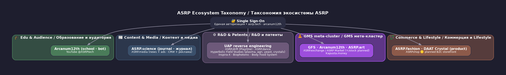

> **Edu & Audience is also a raw-data source for the ecosystem **/** Edu & Audience — это также источник сырых данных для экосистемы.** Arcanum12th courses (extrasensory perception, expanded cognitive perception, TORO, bodybuilding, etc.) collect **raw biological data** from enrolled students: genetic analysis, EEG, electrodermal / skin-galvanic response, parasympathetic / autonomic nervous-system metrics, medical workup. Together with the Arcanum12th_BOT dream-and-biosensor stream, these flows feed the analytical layer that produces **scientific publications, GFS forecasts, and GMS consciousness-state tokens**. The clusters are not isolated silos — Edu → R&D → Content & Media → Commerce is a single data-and-revenue pipeline. **/** Курсы Arcanum12th (экстрасенсорное восприятие, расширенное когнитивное восприятие, ТОРО, бодибилдинг и т.д.) собирают **сырые биологические данные** со студентов: генетический анализ, ЭЭГ, кожно-гальваническая реакция, показатели парасимпатической и автономной нервной системы, медицинское обследование. Вместе с потоком снов и биосенсоров из Arcanum12th_BOT эти данные питают аналитический слой, производящий **научные публикации, прогнозы GFS и токены состояний сознания GMS**. Кластеры не изолированы — Edu → R&D → Content & Media → Commerce — это единый data-and-revenue конвейер.

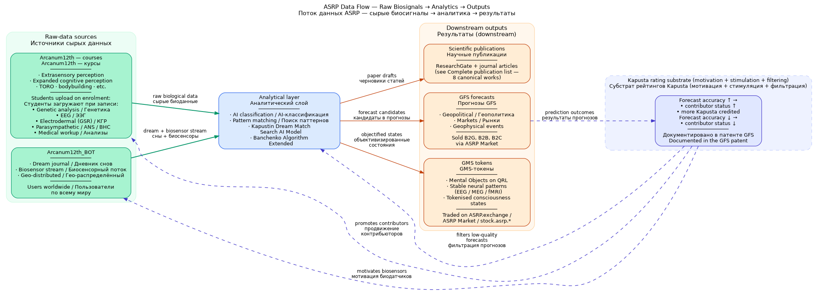

> The diagram above shows the **data semantics the taxonomy above does not**: Arcanum12 courses + Arcanum12th_BOT feed the analytical layer → three downstream outputs (publications, GFS forecasts, GMS tokens) → the **Kapusta rating substrate** closes the loop by filtering low-quality forecasts, promoting accurate contributors, and motivating biological sensors (documented in the GFS patent). **/** Диаграмма выше показывает **семантику данных, которой нет в таксономии**: курсы Arcanum12 + бот питают аналитический слой → три результата на выходе (публикации, прогнозы GFS, GMS-токены) → **субстрат рейтингов Kapusta** замыкает петлю — фильтрует слабые прогнозы, продвигает точных контрибьюторов, мотивирует биологические датчики (задокументировано в патенте GFS).

### B. Money flow — who pays for what **/** Поток денег — кто за что платит

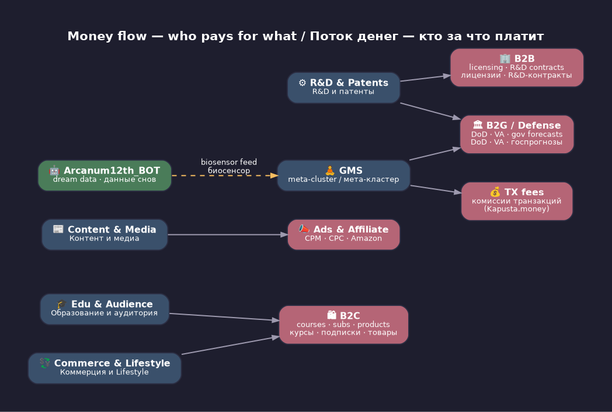

> One dashed flow is shown explicitly: the bot supplies biosensor data to R&D (feeding GFS). The full flow chain from research to media and audience lives in the separate [Frequency Ladder](#-frequency-ladder--частотная-лестница-контента) diagram below.
> Пунктиром показан единственный кросс-поток: бот кормит R&D-блок биосенсорными данными (для GFS). Полная цепочка от исследования к медиа и аудитории — в отдельной схеме [Frequency Ladder](#-frequency-ladder--частотная-лестница-контента) ниже.

---

## 📊 Component Status **/** Статус компонентов

### 🟢 Live & Ready to Scale **/** Работает и готово к масштабированию

| Component **/** Компонент | Link | Purpose **/** Назначение | Monetization **/** Монетизация |
|---|---|---|---|
| 🤖 **Arcanum12th_BOT** | [@Arcanum12th_BOT](https://t.me/Arcanum12th_BOT) | Dreams journal → lead & biosensor data for GFS **/** Дневник снов → лид + биодатчик для GFS | Lead gen, tripwire **/** Лид-ген, трипваер |
| 📰 **ASRP.media** | [asrp.media](https://asrp.media) | Official media, science-popularising content **/** СМИ, популяризация науки | CPM/CPC ads, native, Amazon affiliate **/** Реклама, нативка, Amazon |
| 🔬 **ASRP.science** | [asrp.science](https://asrp.science) | Peer-review scientific journal **/** Рецензируемый научный журнал | Paid publications, subscriptions **/** Платные публикации, подписка |
| ⚙️ **asrp.tech** | [asrp.tech](https://asrp.tech) | Projects & patents portfolio **/** Портфолио проектов и патентов | B2B leads, licensing inquiries **/** B2B-лиды, лицензирование |

### 🟡 Active Development **/** В активной разработке

> Products with working prototypes, IP protection, or active pilots. **/** Продукты с работающими прототипами, защитой ИС или активными пилотами.

| Component **/** Компонент | Link | Focus **/** Фокус | Monetization Target **/** Цель монетизации |
|---|---|---|---|
| 🎓 **Arcanum12th.education** | [arcanum12th.education](https://arcanum12th.education) | Educational platform **/** Образовательная платформа | Course sales, certification **/** Продажа курсов, сертификация |
| ▶️ **YouTube @ASRPtech** | [@ASRPtech](https://www.youtube.com/@ASRPtech) | Science & research video **/** Видео о науке | AdSense, sponsorships **/** AdSense, спонсорство |
| 🎨 **ASRP.art** | [asrp.tech/projects](https://asrp.tech/ru/projects) · [repo](https://github.com/AdvancedScientificResearchProjects/Axionetic_Sensing_Reactions_Platform_in_Art) | Neurophysiological art valuation **/** Нейрофизиологическая оценка искусства | Art marketplaces, galleries **/** Арт-площадки, галереи |
| 🧠 **ASRP.drift (PlayOne)** | [asrp.tech/projects](https://asrp.tech/ru/projects) | Neurointegration for team synchronization **/** Нейроинтеграция для синхронизации команд | B2B clinical, defense, sports **/** B2B клиника, оборонка, спорт |
| 🌐 **GFS — Global Forecasting System** | [asrp.tech/projects](https://asrp.tech/ru/projects) · [repo (code private)](https://github.com/AdvancedScientificResearchProjects/gfs-model) | Dream + biosensor analysis → forecasts · **product narrative fully public** (see [GFS path to money](#-gfs--global-forecasting-system--forecast-sales--гсп--глобальная-система-прогнозирования--продажа-прогнозов)) · source code private for security **/** Сны + биосенсоры → прогнозы · **продуктовый нарратив полностью публичен** · исходный код закрыт по соображениям безопасности | B2G, B2B forecasts + Kapusta-rewarded user bets **/** B2G, B2B прогнозы + пользовательские ставки с начислением Kapusta |
| 🧘 **Global Mental System** | [asrp.tech/projects](https://asrp.tech/ru/projects) | Cognitive process synchronization **/** Синхронизация когнитивных процессов | Enterprise performance, wellness **/** Корпоративные программы, wellness |
| 🥗 **Body Food System** | [patent repo](https://github.com/denisbanchenko/Kazpatent_Body_Food_System_Patent) | Genetics-based personalized nutrition (US Copyright TXu002116250) **/** Персональное питание по генетике (Авторское право США TXu002116250) | B2C, licensing **/** B2C, лицензирование |
| 💓 **Inspira-X** | [patent repo](https://github.com/denisbanchenko/Kazpatent_Inspira-X_Respiratory_Analysis_Patent) · [asrp.tech](https://asrp.tech/ru/projects/inspira-x) | Dual-channel pneumograph + ECG, 22 breathing methodics · **primary placement: DAAT Crystal cognitive-enhancement stack** (respiratory biosensor) · also serves as an ASRP.drift module **/** Двухканальный пневмограф + ЭКГ, 22 дыхательные методики · **основное место в стеке DAAT Crystal** (респираторный биосенсор) · также используется как модуль ASRP.drift | DAAT Crystal bundle + medical B2B + crowdfunding planned **/** Бандл с DAAT Crystal + медицинский B2B + краудфандинг планируется |
| 💃 **ASRP.dance** | [asrp.tech](https://asrp.tech/ru/projects/asrp.dance) | Movement neuroscience — cortical activation via ritual/complex motion sequences **/** Нейронаука движений — активация коры через сложные **/** ритуальные последовательности | B2B clinics, sports, wellness **/** B2B клиники, спорт, wellness |
| 👗 **ASRP.fashion** | [asrp.tech](https://asrp.tech/ru/projects/asrp.fashion) · [YouTube @ASRPfashion](https://www.youtube.com/@ASRPfashion) | Living biocompatible textiles grown from plants/bacteria/fungi under hyperbolic + quantum field exposure **/** Живые биосовместимые ткани из растений/бактерий/грибов под гиперболическими и квантовыми полями | Premium fashion, medical textiles, licensing **/** Премиум-мода, медицинский текстиль, лицензирование |
| 💎 **DAAT Crystal** (product) | [repo](https://github.com/AdvancedScientificResearchProjects/Hyperbolic_Field_DAAT_Crystal_Study) · [asrp.tech](https://asrp.tech/ru/projects) | Premium cognitive-enhancement device (crystal + Inspira-X + neurointerface stack) **/** Премиум-устройство когнитивного усиления (кристалл + Inspira-X + нейроинтерфейс) | Premium B2C + B2B executive wellness **/** Премиум B2C + B2B для топ-менеджмента |
| 🔄 **ASRP.exchange / ASRP Market** | [asrp.tech](https://asrp.tech/ru/projects/asrp.exchange) | Consciousness-state marketplace (`/stock` subdomain = Mental Objects DB) **/** Биржа состояний сознания (субдомен `/stock` = БД ментальных объектов) | Exchange commissions, TX fees via Kapusta.money **/** Комиссии биржи, TX-комиссии Kapusta.money |

### 🟠 Planned **/** Планируется

> Domains acquired and product scope defined; technical launch pending. **/** Домены куплены и scope определён; технический запуск в ожидании.

| Component **/** Компонент | Status **/** Статус | Purpose **/** Назначение |
|---|---|---|
| 🛒 **ASRPshop** | 🟡 Planned **/** Планируется | B2C storefront for DAAT crystals and ASRP.fashion items **/** B2C-витрина для DAAT-кристаллов и изделий ASRP.fashion |
| 📊 **ASRP Market `/stock` subdomain** | 🟡 Planned **/** Планируется | Consciousness-state database, connected to neurointerface ingest **/** База состояний сознания, ингест через нейроинтерфейс |
| 🚀 **Inspira-X crowdfunding** | 🟡 Planned **/** Планируется | Kickstarter-class campaign **/** Kickstarter-класс кампания |

### 🧘 Meta-Cluster — Global Mental System (GMS) **/** Мета-кластер — Global Mental System (GMS)

**GMS is an umbrella ecosystem that binds GFS, Arcanum12th, ASRP.Exchange, ASRP.art and Kapusta.money into a single consciousness-economy layer.**
**GMS — зонтичная экосистема, связывающая GFS, Arcanum12th, ASRP.Exchange, ASRP.art и Kapusta.money в единый слой экономики сознания.**

| Component **/** Компонент | Link | Role in GMS **/** Роль в GMS |
|---|---|---|
| 🌐 **GFS** | [asrp.tech](https://asrp.tech/ru/projects/global_foresight_system) | Forecasts as tradable asset **/** Прогнозы как торгуемый актив |
| 🎓 **Arcanum12th** | [asrp.tech](https://asrp.tech/ru/projects/arcanum12th) | Certification of consciousness specialists **/** Сертификация специалистов сознания |
| 🔄 **ASRP.exchange** | [asrp.tech](https://asrp.tech/ru/projects/asrp.exchange) | Mental-state exchange (dreams, predictions, art) **/** Биржа ментальных состояний (сны, прогнозы, искусство) |
| 🎨 **ASRP.art** | [asrp.tech](https://asrp.tech/ru/projects/asrp.art) | Consciousness-state art certification **/** Сертификация искусства в ИСС |
| 💰 **Kapusta.money** | [asrp.tech](https://asrp.tech/ru/projects/kapusta.money) | **Rating-system substrate** (not just a settlement currency) — centralised + decentralised layers; status rises with accurate forecasts (+ more Kapusta credited), falls with inaccurate ones; produces three outcomes at scale: (a) accurate forecasts, (b) high-precision biological sensors (humans), (c) system reliability · mechanism documented in the GFS patent **/** **Субстрат системы рейтингов** (не просто расчётная валюта) — централизованный + децентрализованный слои; статус повышается за точные прогнозы (+ больше Kapusta), понижается за неточные; на больших данных даёт (а) точные прогнозы, (б) высокоточные биологические датчики (люди), (в) надёжность системы · механизм задокументирован в патенте GFS |

### 🔬 Research Repositories **/** Исследовательские репозитории

| Repository **/** Репозиторий | Focus **/** Направление | Stage **/** Стадия | Target Client **/** Клиент |
|---|---|---|---|
| [UAP Reverse Engineering](https://github.com/AdvancedScientificResearchProjects/UAP_Reverse_Engineering_Study) **/** Реверс-инжиниринг UAP | Aerospace reverse engineering **/** Реверс аэрокосмических технологий | 🔐 Public w/ NDA-tier materials **/** Публичный + материалы под NDA | Defense contractors, DoD **/** Оборонка, Минобороны США |
| [Hyperbolic Field Blood Plasma](https://github.com/AdvancedScientificResearchProjects/Hyperbolic_Field_BloodPlasma_Study) **/** Плазма крови в гиперболическом поле | Blood plasma coagulation **/** Свёртывание плазмы | 🧪 Lab results published **/** Опубликованы | Pharma, Stanford-class centers **/** Фарма, центры уровня Стэнфорда |
| [Hyperbolic Field Agricultural](https://github.com/AdvancedScientificResearchProjects/Hyperbolic_Field_Agricultural_Study) **/** Агро-исследование в гиперболическом поле | Germination, plant yield **/** Прорастание, урожайность | 🧪 Field trials (Day 4+) **/** Полевые (день 4+) | Agri-holdings, UA/MD grants **/** Агрохолдинги, гранты UA/MD |
| [Hyperbolic Field Yeast](https://github.com/AdvancedScientificResearchProjects/Hyperbolic_Field_SaccharomycesCerevisiae_Study) **/** Дрожжи в гиперболическом поле | Fermentation kinetics **/** Кинетика ферментации | 🧪 OSF registered **/** OSF зарегистрировано | Food industry, biopharma **/** Пищевая промышленность, биофарма |
| [DAAT Crystal Study](https://github.com/AdvancedScientificResearchProjects/Hyperbolic_Field_DAAT_Crystal_Study) **/** Исследование DAAT-кристалла | Crystal-human interaction, cognitive enhancement research **/** Взаимодействие кристалл-человек, исследование когнитивного усиления | 🧪 Recruitment **/** Набор участников | Premium B2C + B2B — see [DAAT Crystal Path to Money](#-daat-crystals--premium-cognitive-enhancement--daat-кристаллы--премиум-когнитивное-усиление) **/** Премиум B2C + B2B — см. Path to Money |
| Hyperbolic Field Plants Study **/** Исследование растений в гиперболическом поле | Germination, growth kinetics, yield modulation on expanded species list **/** Прорастание, кинетика роста, модуляция урожайности на расширенном списке видов | 🟡 OSF preregistration planned (2026-04-22) **/** Предрегистрация OSF планируется (22.04.2026) | Agri-holdings, food-security grants **/** Агрохолдинги, гранты по продовольственной безопасности |
| Hyperbolic Field Fish Caviar Study **/** Исследование икры рыбы в гиперболическом поле | Aquaculture embryonic-development kinetics under hyperbolic-field exposure **/** Кинетика эмбрионального развития в аквакультуре под воздействием гиперболического поля | 🟡 OSF preregistration planned (2026-04-22) **/** Предрегистрация OSF планируется (22.04.2026) | Aquaculture industry, biopharma **/** Аквакультура, биофарма |

> 🔐 Some materials require NDA. **/** Часть материалов требует NDA.

---

## 🔬 Research & Patents Portfolio **/** Портфель исследований и патентов

**All patents are filed through Kazpatent (Republic of Kazakhstan).** Public documentation repositories for each patent are listed below.
**Все патенты поданы через Казпатент (Республика Казахстан).** Публичные репозитории с документацией ниже.

| # | Patent **/** Патент | App № | Status **/** Статус | Public Repo **/** Публичный репо |
|---|---|---|---|---|
| 1 | **GFS — Global Forecasting System **/** ГСП** | KZ 2025/1096.1 | ✅ Formal exam done → Substantive exam **/** Ответ на формальную экспертизу отправлен | [patent repo](https://github.com/denisbanchenko/Kazpatent_Global_Forecasting_System_Patent) |
| 2 | **ASRP.drift — Advanced Synchro Resonance Platform **/** ПНИР.дрифт** | KZ 413554 | 🟡 Registration pending **/** Ожидает регистрации | [patent repo](https://github.com/denisbanchenko/Kazpatent_Advanced_Synchro_Resonance_Platform_For_Deep_Resonant_Patent) |
| 3 | **ASRP.art — Axionetic Sensing Reactions Platform in Art **/** ПНИР.искусство** | KZ 2025/0592.1 + PCT 412362 | ✅ Substantive exam **/** Экспертиза по существу | [patent repo](https://github.com/denisbanchenko/Kazpatent_Axionetic_Sensing_Reactions_Platform_in_Art_Patent) |
| 4 | **Biophotonic Neurodiagnostic System **/** Биофотонная Нейродиагностика** | KZ 2025/1097.1 | ✅ Formal exam done → Substantive **/** Формальная → по существу | [patent repo](https://github.com/denisbanchenko/Kazpatent_Biophotonic_Neurodiagnostic_System_Patent) |
| 5 | **Fractal Biomedical Hyperbolic Field System **/** ФБСГП** | KZ 2025/1095.1 | ✅ Formal exam done → Substantive **/** Формальная → по существу | [patent repo](https://github.com/denisbanchenko/Kazpatent_Fractal_Biomedical_System_Patent) |
| 6 | **Inspira-X — Respiratory Analysis **/** Инспира-Х** | KZ 2025/0914.1 (399693) | ✅ Formal exam done → Substantive pending **/** Ожидает | [patent repo](https://github.com/denisbanchenko/Kazpatent_Inspira-X_Respiratory_Analysis_Patent) |
| 7 | **Body Food System **/** Система Питания Тела** | US Copyright TXu002116250 | ✅ Registered (US) **/** Зарегистрировано (США) | [patent repo](https://github.com/denisbanchenko/Kazpatent_Body_Food_System_Patent) |

**Inventors on patents:** Ovseannicova V.A. (MD), Kapustin M.M. (DE), Banchenko D.Y. (KZ).
**Авторы патентов:** Овсянникова В.А. (MD), Капустин М.М. (DE), Банченко Д.Ю. (KZ).

---

## 👥 Leadership Team **/** Команда руководства

> Source **/** Источник: [asrp.tech/ru/team](https://asrp.tech/ru/team) · the live site is the source of truth. **/** Актуальные данные — на сайте.
>
> **Relocation-ready **/** Готовы к релокации.** Core team members are open to relocation contingent on partnership/funding outcomes — active tracks include Australia (via the Cortical Labs pipeline), United States (via DARPA BAA / Tesla / DoE tracks), United Kingdom (via the reinstated UK entity), and Canada. **/** Основной состав открыт к релокации при соответствующих партнёрствах и финансировании — активные треки: Австралия (через линию Cortical Labs), США (через DARPA BAA / Tesla / DoE), Великобритания (через восстановленное UK-юрлицо), Канада.
>
> **Whitepaper authorship differs **/** Состав авторов статьи отличается.** The flagship GMS/GFS and economic whitepapers credit seven co-authors — the four Leadership Team members listed here, plus Vlada Bilovodenko (CRO, per preprint credit), Alireza Sepehri (CPO, Iran, per preprint credit) and Irina Grivtsova (Stress Relief Center "Strategy", Tomsk). See [`whitepaper/README.md → Complete publication list`](whitepaper/README.md#-complete-publication-list--полный-список-публикаций) for every ASRP paper with authors and publication status. **/** В составе авторов флагманских статей (GMS/GFS и экономической) семь соавторов — четверо из Leadership Team выше плюс Влада Биловоденко (CRO по препринту), Алиреза Сепехри (CPO, Иран — по препринту) и Ирина Гривцова (центр «Стратегия», Томск). Полный список всех статей ASRP с авторами и статусом публикации — в [`whitepaper/README.md → Полный список публикаций`](whitepaper/README.md#-complete-publication-list--полный-список-публикаций).

| Role **/** Должность | Name **/** Имя | Notes **/** Примечания |
|---|---|---|
| **CBE, Co-Founder** | Valeria Ovseannicova **/** Валерия Овсянникова | Chief Biomedical Engineer — plasma/agri/yeast protocol authorship, reproduction **/** Главный биомедицинский инженер — авторство и воспроизведение протоколов (плазма/агро/дрожжи) |
| **CTO, Co-Founder** | Mykhailo Kapustin **/** Михаил Капустин | Chief Technology Officer **/** Технический директор |
| **CSO** | Ivan Savelyev **/** Иван Савельев | Chief Scientific Officer **/** Научный директор |
| **SAIE** | Kyryl Zmiienko **/** Кирилл Змиенко | Senior AI Engineer — research analysis, repositories, AI pipelines **/** Старший AI-инженер — анализ исследований, репозитории, AI-пайплайны |
| **LFED** | Andrii Kryliuk **/** Андрей Крылюк | Lead Front-End Developer **/** Ведущий Front-End разработчик |
| **LBED** | Aleksandr Gromyko **/** Александр Громыко | Lead Backend Developer **/** Ведущий Backend разработчик |
| **CEO, Founder** | Denis Banchenko **/** Денис Банченко | Founder, strategic direction **/** Основатель, стратегия |

---

## 🏛️ Accreditations & Credentials **/** Аккредитации и регистрации

**External credentials we hold — these are the trust signals an investor or prime contractor verifies before the first serious conversation.** The top-line headline is **active DARPA BAA proposal-portal access (U.S. defense R&D solicitations)** paired with a **Tesla Business Program accreditation (U.S. corporate enterprise)** — plus patent-office, copyright and peer-review signals below. The DARPA item grants authenticated access to submit and track Broad Agency Announcement proposals; it is not a merit-based award and should not be presented as one. **/** **Внешние регистрации и аккредитации — это доверительные сигналы, которые инвестор или подрядчик проверяет до первого серьёзного разговора.** Главный заголовок — **активный доступ к порталу подачи заявок DARPA BAA (оборонные R&D-конкурсы США)** плюс **аккредитация Tesla Business Program (корпоративный сегмент США)** — плюс патентные, авторско-правовые и рецензионные сигналы ниже. DARPA-пункт даёт аутентифицированный доступ для подачи и трекинга предложений по BAA; это не merit-based награда и не должно подаваться как она.

| Authority **/** Орган | Program **/** Программа | Date **/** Дата | Reference **/** Идентификатор |
|---|---|---|---|
| 🇺🇸 **DARPA** (U.S. Defense Advanced Research Projects Agency) **/** DARPA (Агентство передовых оборонных исследовательских проектов США) | BAA Proposal-Portal Access **/** Доступ к порталу подачи заявок BAA | **16 Sep 2025 **/** 16 сен. 2025** | Extranet account active (login provided under NDA) **/** Экстранет-аккаунт активен (логин предоставляется под NDA) |
| 🇺🇸 **Tesla, Inc.** | Tesla Business Program **/** Бизнес-программа Tesla | **22 Aug 2025 **/** 22 авг. 2025** | Registered entity **/** Зарегистрированное юр. лицо: ASRP LLC (FL) · Email: `info@asrp.tech` |
| 🇰🇿 **Kazpatent** (Ministry of Justice of RK) **/** Казпатент (Минюст РК) | 6 patent filings + 1 PCT **/** 6 патентных заявок + 1 PCT | 2024–2026 | See [Research & Patents Portfolio](#-research--patents-portfolio--портфель-исследований-и-патентов) **/** см. раздел «Портфель исследований и патентов» |
| 🇺🇸 **U.S. Copyright Office** **/** Бюро по авторским правам США | Body Food System **/** Система Питания Тела | 2024 | TXu002116250 |
| 🌐 **OSF Registry** **/** Реестр OSF | Yeast study preregistration **/** Предрегистрация дрожжевого исследования | 2026 | [osf.io/Jgt3h](https://osf.io/Jgt3h) |
| 📝 **International Internal Medicine Journal** **/** Международный журнал внутренней медицины | ASRP.drift peer-reviewed publication **/** Рецензируемая публикация ASRP.drift | 2024 | Linked from **/** ссылка с [asrp.tech/projects/asrp.drift](https://asrp.tech/ru/projects/asrp.drift) |
| 🧪 **ResearchGate** | Institutional lab page **/** Страница лаборатории | Active **/** Активно | [researchgate.net](https://www.researchgate.net/lab/Advanced-Scientific-Research-Projects-Denis-Banchenko) |

### Epochs — chronology of registrations, filings and events **/** Эпохи — хронология регистраций, подач и событий

> The timeline below tracks **five event classes** — company registrations and re-instatements (SunBiz/KZ registries), patent filings and copyright registrations, scientific publications and preregistrations, accreditations (DARPA · Tesla · OSF), and public events (hackathons, pitch battles). **/** Ниже показаны **пять классов событий** — регистрации и восстановления компаний (реестры SunBiz и КЗ), подачи патентов и регистрации авторских прав, научные публикации и предрегистрации, аккредитации (DARPA · Tesla · OSF), публичные события (хакатоны, pitch-battle).

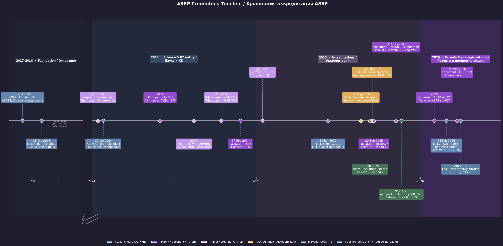

---

## 🏢 Legal Entities & Registry Verification **/** Юр. лица и публичная верификация

**ASRP operates as a multi-jurisdiction group.** The three legal entities currently in scope are: the U.S. operational **ASRP LLC** (Florida, active since 2017), the Kazakhstan research-and-patent **ТОО** (Baikonur, 2024), and a **United Kingdom entity** (currently on corporate-status reinstatement). The Florida and Kazakhstan entities are verifiable through public registries; the UK entity is in the reinstatement stage and is documented here as part of the group's ongoing legal consolidation (see UBO note below). **/** **ASRP — мультиюрисдикционная группа.** В текущий периметр входят три юридических лица: операционный US LLC **ASRP LLC** (Флорида, с 2017), исследовательско-патентное **ТОО** (Байконур, 2024) и компания в **Великобритании** (на стадии восстановления корпоративного статуса — reinstatement). Florida LLC и ТОО верифицируются через публичные реестры; UK-компания — на стадии восстановления и отражена здесь в рамках продолжающейся консолидации группы (см. UBO-примечание ниже).

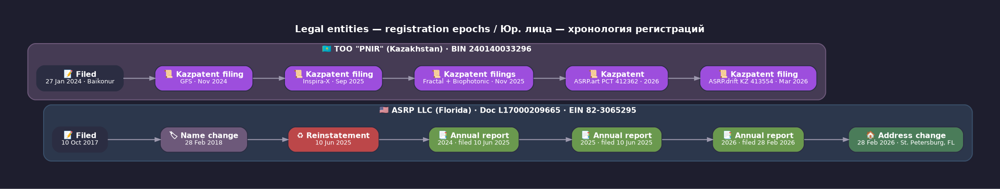

### 🇺🇸 Advanced Scientific Research Projects LLC (Florida, USA) **/** ООО «ASRP» (Флорида, США)

| Field **/** Поле | Value **/** Значение |
|---|---|
| **Entity type **/** Тип** | Florida Limited Liability Company **/** Компания с ограниченной ответственностью штата Флорида |
| **Document # / Номер** | L17000209665 |
| **FEI / EIN** | provided to verified counterparties · public via Florida SunBiz registry |
| **Date Filed **/** Дата регистрации** | **10 October 2017 / 10 октября 2017** |
| **Status **/** Статус** | ACTIVE **/** ДЕЙСТВУЮЩАЯ |
| **Last Event **/** Последнее событие** | REINSTATEMENT — 10 Jun 2025 **/** Восстановление — 10 июня 2025 |
| **Name change **/** Смена названия** | 28 Feb 2018 **/** 28 февраля 2018 |
| **Principal address **/** Юр. адрес** | 7901 4th St N, Ste 300, St. Petersburg, FL 33702 (changed 28 Feb 2026 **/** изменён 28 февраля 2026) |
| **Registered Agent **/** Регистрационный агент** | Registered Agents Inc |
| **Authorized Members **/** Учредители** | Valeria Ovseannicova · Mykhailo Kapustin · Denis Banchenko |
| **Annual Reports **/** Годовые отчёты** | 2024 (filed 10 Jun 2025 **/** подан 10 июня 2025) · 2025 (filed 10 Jun 2025 **/** подан 10 июня 2025) · 2026 (filed 28 Feb 2026 **/** подан 28 февраля 2026) |
| **Public registry **/** Публичный реестр** | [search.sunbiz.org — Florida Division of Corporations](https://search.sunbiz.org/Inquiry/CorporationSearch/SearchResultDetail?inquirytype=EntityName&directionType=Initial&searchNameOrder=ADVANCEDSCIENTIFICRESEARCHPROJ%20L170002096650&aggregateId=flal-l17000209665-9ae2294a-abd3-46c7-944f-b49e0eb2f7f4&searchTerm=ADVANCED%20SCIENTIFIC%20RESEARCH%20PROJECTS%20LLC&listNameOrder=ADVANCEDSCIENTIFICRESEARCHPROJ%20L170002096650) |

### 🇰🇿 ASRP LLP **/** ТОО «Перспективные Научно-Исследовательские Разработки» (Kazakhstan **/** Казахстан)

| Field **/** Поле | Value **/** Значение |
|---|---|
| **Entity type **/** Тип** | Товарищество с ограниченной ответственностью **/** Limited Liability Partnership |
| **BIN **/** БИН** | 240140033296 |
| **Registration **/** Регистрация** | **27 January 2024** |
| **OKED **/** ОКЭД** | 72199 — Other research and development in natural and technical sciences **/** Прочие исследования и разработки в естественных и технических науках |
| **Legal address **/** Юр. адрес** | Komarova St., 37, apt. 56, Baikonur, Kyzylorda region, 468320, Republic of Kazakhstan **/** ул. Комарова, 37, кв. 56, г. Байконыр, Кызылординская обл., Республика Казахстан |
| **KATO code **/** Код КАТО** | 431910000 (Baikonur) |
| **Director **/** Руководитель** | Denis Banchenko **/** Банченко Денис Юрьевич |
| **Public registries **/** Публичные реестры** | [infostats.co](https://infostats.co/companies/kz/3235213) · [kyc.kz](https://kyc.kz/search/bin/240140033296) |

> The Kazakhstan entity holds the **patent portfolio** (6 Kazpatent filings + 1 PCT); the Florida LLC is the **operational / commercial** entity (Tesla Business Program, DARPA BAA, USD contracting). **/** Казахстанская компания держит **патентный портфель** (6 заявок Казпатент + 1 PCT); Florida LLC — **операционная/коммерческая** компания (Tesla Business Program, DARPA BAA, расчёты в USD).

#### Ownership, UBO and corporate-affiliation disclaimer **/** Оговорка о структуре владения, бенефициарном контроле и корпоративной принадлежности

> This note accompanies the Kazakhstan entity above and applies to the multi-jurisdiction group as a whole (US + KZ + UK). **/** Это примечание относится к казахстанскому юр. лицу выше и к мультиюрисдикционной группе в целом (US + KZ + UK).

This confirms that the legal entity registered in the Republic of Kazakhstan is part of the international ASRP group of companies (the "Group"), which also includes legal entities and corporate structures in the **United States** and the **United Kingdom** (including an entity currently undergoing corporate-status reinstatement). **/** Настоящим подтверждается, что указанное юридическое лицо, зарегистрированное в Республике Казахстан, является частью международной группы компаний ASRP (далее — «Группа»), включающей также юридические лица и корпоративные структуры в **США** и **Великобритании** (включая компанию, находящуюся на стадии восстановления корпоративного статуса — reinstatement).

Due to national-law constraints — including founder-residency requirements and specifics of Kazakhstan corporate regulation — the KZ entity is formally registered on **Denis Banchenko**, who currently acts as the nominal founder and/or sole executive body (director). **/** В силу ограничений национального законодательства, в том числе требований к резидентности учредителей и особенностей корпоративного регулирования в Республике Казахстан, регистрация данного юридического лица осуществлена на **Дениса Банченко**, который на текущий момент выступает формальным учредителем и/или единоличным исполнительным органом (директором).

This registration is strictly of a **legal-technical and operational** character and **does not reflect the actual structure of ownership, control or economic-interest distribution** within the Group. **/** При этом указанная регистрация носит исключительно **юридико-технический и операционный** характер и **не отражает фактическую структуру владения, контроля и распределения экономических интересов** внутри Группы.

The **actual beneficial owners (UBO)** — and the persons exercising joint strategic and management control over the Group's assets and activities — are: **/** **Фактическими бенефициарными владельцами (UBO)**, а также лицами, осуществляющими совместный стратегический и управленческий контроль над активами и деятельностью Группы ASRP, являются:
- **Valeria A. Ovseannicova **/** Валерия Александровна Овсянникова**
- **Mykhailo M. Kapustin **/** Михаил Михайлович Капустин**
- **Denis Y. Banchenko **/** Денис Юрьевич Банченко**

These individuals act as co-owners and partners within a unified corporate and investment strategy of the ASRP Group, independent of the formal distribution of shares in individual jurisdictions. **/** Указанные лица действуют как совладельцы и партнёры в рамках единой корпоративной и инвестиционной стратегии Группы, вне зависимости от формального распределения долей в отдельных юрисдикциях.

Any discrepancies between the legal registration of specific companies and the actual ownership structure are attributable to the **current stage of corporate restructuring** and to the need to comply with the applicable legislation of the relevant jurisdictions (including, but not limited to, questions of tax residency, currency control and corporate law). **/** Любые расхождения между юридической регистрацией отдельных компаний и фактической структурой владения обусловлены **текущим этапом корпоративной реструктуризации**, а также необходимостью соблюдения требований применимого законодательства в соответствующих юрисдикциях (включая, но не ограничиваясь, вопросами налогового резидентства, валютного контроля и корпоративного права).

The ASRP Group is executing a **phased model** of consolidating assets and legal structure — including the possible formation of holding companies, formalisation of cross-jurisdictional links (via share-ownership mechanisms, shareholders' agreements, joint-activity agreements and other instruments), and synchronisation of beneficial control. Until these processes are completed, all legal entities within the Group — regardless of their formal registration — are regarded as interconnected and operating within a unified economic model and in the interests of the ASRP Group. **/** Группа ASRP реализует **поэтапную модель** консолидации активов и юридической структуры, включая возможное учреждение холдинговых компаний, оформление межюрисдикционных связей (в том числе через механизмы владения долями, акционерные соглашения, договоры о совместной деятельности и иные инструменты), а также синхронизацию бенефициарного контроля. До завершения указанных процессов все входящие в Группу юридические лица, вне зависимости от их формальной регистрации, рассматриваются как взаимосвязанные и действующие в рамках единой экономической модели и в интересах Группы ASRP.

---

## 💰 Paths to Money **/** Пути к деньгам

**Each direction has a concrete monetization funnel — not theory, but a documented route from research to revenue.**
**У каждого направления есть конкретная воронка монетизации — не теория, а задокументированный путь от исследования к выручке.**

### 🛸 UAP Reverse Engineering → Defense Contracts **/** Реверс UAP → Оборонные подряды

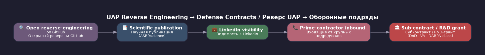

- **Client **/** Клиент:** DoD primes — named engagement tracks: **Boeing** (reverse-engineering patents and DoD reverse-engineering spend under congressional scrutiny), **Stanford (Nolan Lab)** for Gulf War Syndrome veterans treatment, **DoE / Los Alamos National Laboratory** (UAP-adjacent reverse-engineering side that funded IBM-supercomputer simulations), plus DARPA-class R&D funds and VA (Gulf War Syndrome programs). **/** Подрядчики Минобороны США с конкретными треками: **Boeing** (патенты по реверс-инжинирингу под парламентским расследованием), **Stanford (лаборатория Nolan)** по программе Gulf War Syndrome, **DoE / Лос-Аламосская национальная лаборатория** (UAP-adjacent сторона, финансировавшая симуляции на суперкомпьютерах IBM), R&D-фонды уровня DARPA и VA (программы Gulf War Syndrome).
- **Offer **/** Оффер:** Proven reverse-engineering capability — demonstrated through **open public research** (UAP study + Hyperbolic Field Blood Plasma) rather than claimed competence → subcontracts on engineered-object research. **/** Подтверждённая компетенция по реверс-инжинирингу — доказанная **через открытые публичные исследования** (UAP + плазма крови), а не заявленная на словах → субконтракты на исследование инженерных объектов.
- **Proof **/** Доказательство:** `UAP_Reverse_Engineering_Study` repo, Hyperbolic Field Blood Plasma study, ECP-2026-04-04 session results; **U.S. Department of Energy read the UAP repository within hours of publication** (first tracked federal reader) — independently confirms the work is read at target level. **/** Репозиторий `UAP_Reverse_Engineering_Study`, исследование плазмы крови, результаты сессии ECP-2026-04-04; **Министерство энергетики США прочитало UAP-репозиторий в течение нескольких часов после публикации** (первый зафиксированный федеральный читатель) — независимо подтверждает, что работа читается на целевом уровне.
- **Channel **/** Канал:** LinkedIn + direct intros + scientific publications + public repositories timed to industry hype windows. **/** LinkedIn + прямые контакты + научные публикации + публичные репозитории, синхронизированные с хайп-окнами отрасли.
- **Scale context (illustrative, per founder) **/** Масштаб (иллюстративно, по CEO):** Boeing-class DoD reverse-engineering spend is tracked to **~$40 M / year** on single technology lines (per congressional disclosure patterns); a first-tier subcontractor in the same flow can realistically target **~$2 M / year** on entry-level R&D subcontracts. Figures are order-of-magnitude indicators, not committed amounts. **/** DoD-расходы класса Boeing на реверс-инжиниринг отдельных технологических линий оцениваются в **~$40 млн/год** (по паттернам парламентских раскрытий); подрядчик первого уровня в этой цепочке реалистично целится на **~$2 млн/год** на входные R&D-субконтракты. Цифры — ориентировочные, не подтверждённые контракты.

### 🩸 Blood Plasma / Hyperbolic Biomed → Medical Centers **/** Плазма крови / Гиперболический биомед → Медцентры

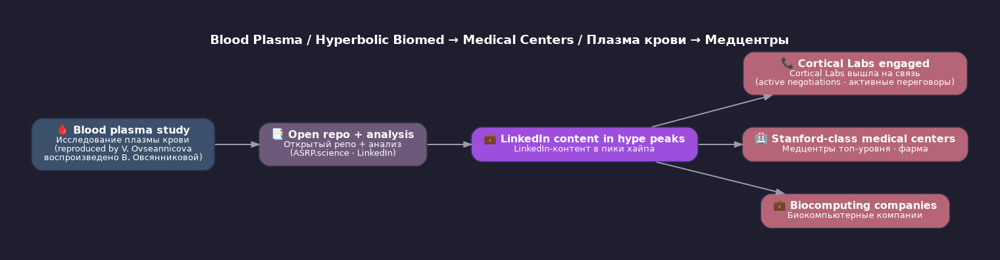

- **Client **/** Клиент:** Biocomputing companies (**Cortical Labs — active negotiations, 2026-Q2 under review** · contact: Natasha), top-tier medical centers, pharma. **/** Биокомпьютерные компании (**Cortical Labs — активные переговоры, на Q2 2026 под рассмотрением**, контакт: Natasha), медцентры топ-уровня, фарма.
- **Offer **/** Оффер:** Hyperbolic-field modulation protocols for coagulation and regeneration research (acceleration **/** deceleration kinetics tracks), plus bio-signal layer for neural compute platforms. **/** Протоколы модуляции гиперболическим полем для исследования свёртывания и регенерации (треки кинетики ускорения / замедления), плюс слой биосигнала для нейрокомпьютерных платформ.
- **Proof **/** Доказательство:** `Hyperbolic_Field_BloodPlasma_Study` — reproduced by V. Ovseannicova (after extended training; initial attempts failed); raw data → analysed by K. Zmiienko; unified public repository published on GitHub. **/** Репозиторий `Hyperbolic_Field_BloodPlasma_Study` — воспроизведён В. Овсянниковой (после длительного обучения; первые попытки не удавались); сырые данные проанализированы К. Змиенко; единый публичный репозиторий опубликован на GitHub.
- **Channel — canonical ASRP engagement playbook (Cortical Labs template) **/** Канал — канонический playbook аутрича ASRP (шаблон Cortical Labs):** (1) internal capability built (Valeria trained on the protocol) → (2) reproduction attempts (initial failures; protocol successfully reproduced after extended training) → (3) raw data → analysis by team → (4) public GitHub repository published → (5) direct outreach to target (Cortical Labs) — **no response** initially → (6) wait for target's own hype-window (Cortical Labs' DishBrain neuron-silicon game announcement) → (7) **post repository as LinkedIn content during the hype peak** → (8) target engages → negotiation (ongoing, Q2 2026). This same algorithm is used for every defense / biotech engagement track — see [Engagement funnel diagram](#-outreach-dynamics--динамика-аутрича). **/** (1) внутренняя компетенция выстроена (Валерия обучена протоколу) → (2) попытки воспроизведения (первичные провалы; после длительного обучения протокол успешно воспроизведён) → (3) сырые данные → анализ командой → (4) публикация на GitHub → (5) прямой аутрич к цели (Cortical Labs) — **без ответа** в первый раз → (6) ожидание профильного хайп-окна цели (анонс игры Cortical Labs на нейрон-кремниевой платформе DishBrain) → (7) **публикация репозитория как LinkedIn-контента в пик хайпа** → (8) цель выходит на связь → переговоры (идут, Q2 2026). Этот же алгоритм применяется для каждого оборонного/биотех-трека — см. диаграмму воронки аутрича.

#### 🧬 Primary pathogenic-factor hypothesis — temporal desynchronization **/** Гипотеза первичного патогенного фактора — темпоральная десинхронизация

> For the UAP-adjacent oncology and pre-oncology subclass, ASRP proceeds from the working hypothesis that the **primary pathogenic factor is temporal desynchronization of biological processes**, not classical mutagenic damage. Therapy is therefore framed as **targeted correction of process kinetics** (restoration of coherence at the biofield ↔ spacetime interface), not cytotoxic intervention. Preliminary internal experimental observations (not yet peer-reviewed; pending IP resolution) suggest the approach warrants further investigation. ⚠️ These are pre-publication research observations under a working hypothesis; **no regulatory or clinical-efficacy claim is made** in this document. This is the same hypothesis carried into the Dr. Garry Nolan / Stanford dialogue (see [Outreach Dynamics #3](#3-stanford--nolan-lab--linkedin-inbound--admin-follow-up-feb-2026--stanford--лаборатория-nolan--входящий-в-linkedin--переписка-с-админом-февраль-2026)).
> **/** Для UAP-adjacent онкологического и предонкологического подкласса ASRP исходит из рабочей гипотезы, что **первичный патогенный фактор — темпоральная десинхронизация биологических процессов**, а не классическое мутагенное повреждение. Терапия поэтому формулируется как **целевая коррекция кинетики процессов** (восстановление когерентности на интерфейсе биополе ↔ пространство-время), а не цитотоксическое воздействие. Предварительные доклинические наблюдения — измеримая регрессия опухолей в экспериментальных моделях, нормализация иммунных сигнальных путей, отсутствие цитотоксических побочных эффектов, характерных для стандартных методов, — пока не опубликованы (ожидается закрытие IP-вопросов). Та же гипотеза перенесена в диалог с д-ром Гарри Ноланом / Stanford (см. Outreach Dynamics #3).

**Temporal-regime notation (ASRP → external) **/** Нотация темпоральных режимов (ASRP → внешняя):**

| Sample **/** Образец | Temporal regime **/** Режим | Internal taxonomy **/** Внутренняя таксономия |
|---|---|---|
| `T₀` | Control — baseline temporal flow **/** Контроль — базовый темпоральный поток | — |
| `T₊` | Accelerated kinetics (Δt > 0) **/** Ускоренная кинетика (Δt > 0) | **Channel 19** (acceleration **/** ускорение) |
| `T₋` | Decelerated kinetics (Δt < 0) **/** Замедленная кинетика (Δt < 0) | **Channel 21** (deceleration **/** замедление) |

**Relation **/** Соотношение:** `T₊ ≫ T₀ ≫ T₋` — reproducible plasma-fibrin clot phenotypes obtained **without thermal, chemical or ionizing exposure**. The T-notation is the public-facing label used in external correspondence (e.g. the Nolan LinkedIn follow-up, 4 Feb 2026); the Channel-19 / Channel-21 taxonomy is the equivalent internal label used within the rest of this document. **/** Соотношение `T₊ ≫ T₀ ≫ T₋` — воспроизводимые фенотипы сгустков плазмы/фибрина, получаемые **без термического, химического или ионизирующего воздействия**. Нотация T — публичная, используется во внешней переписке (например, в follow-up Nolan 4 фев. 2026); таксономия Channel-19 / Channel-21 — эквивалентная внутренняя, используется в остальной части этого документа.

**Theoretical anchor **/** Теоретическая опора:** The temporal-kinetic framework above is formally tractable within the *Three-Dimensional Time* mathematical apparatus (World Scientific, [DOI 10.1142/S2424942425500045](https://www.worldscientific.com/doi/epdf/10.1142/S2424942425500045)) — an external peer-reviewed framework that extends physical time from one dimension to three, giving "localized spacetime curvature at biological scales" a rigorous physics backbone rather than a metaphorical one. See [whitepaper/README.md → External scientific references](whitepaper/README.md#-external-scientific-references--внешние-научные-ссылки) for the citation. **/** Темпорально-кинетическая рамка выше формально разрешима в рамках математического аппарата *Three-Dimensional Time* (World Scientific, DOI 10.1142/S2424942425500045) — внешней рецензируемой работы, расширяющей физическое время с одной до трёх размерностей, что даёт «локализованной кривизне пространства-времени на биологических масштабах» строгую физическую, а не метафорическую основу. Цитирование — в `whitepaper/README.md` → «External scientific references».

**Geophysical-correlation context (research input, not product claim) **/** Геофизический контекст (исследовательский ввод, не продуктовая претензия):** Kazakhstan — where ASRP's core field work is registered — overlaps historically with a cluster of documented radiation and geophysical anomalies: Semipalatinsk test-site legacy, Baikonur-area military infrastructure, and active geofault zones. Mainstream geophysics literature documents physical mechanisms in these conditions — radon-driven ionization, plasma formation along geofaults, pre-seismic electromagnetic anomalies — which overlap directly with ASRP's hyperbolic-field research domain. The overlap motivates the specific regional focus of our field studies; it is cited here as **environmental context** for the research programme, not as a product-level claim. Alongside the geophysics baseline, Soviet-era and post-Soviet ufology catalogues list the same region as a high-density UAP-observation zone (secondary, ufology-literature context: [UFO Sightings Over Kazakhstan](https://nexusmagazine.com/product/ufo-sightings-over-kazakhstan/) · [r/UFOs_Archive discussion thread](https://www.reddit.com/r/UFOs_Archive/comments/1qaqibp/ufos_in_kazakhstan/)). **/** Казахстан — где зарегистрированы основные полевые работы ASRP — исторически пересекается с кластером задокументированных радиационных и геофизических аномалий: наследие Семипалатинского полигона, инфраструктура вокруг Байконура, активные георазломные зоны. Мейнстрим-геофизическая литература описывает в этих условиях конкретные физические механизмы — радоновую ионизацию, формирование плазмы вдоль георазломов, пресейсмические электромагнитные аномалии, — которые напрямую пересекаются с исследовательским доменом ASRP по гиперболическим полям. Это пересечение мотивирует конкретный региональный фокус наших полевых работ; приводится как **средовой контекст** исследовательской программы, не как продуктовая претензия. Параллельно с геофизической базой советские и постсоветские уфологические каталоги указывают тот же регион как зону высокой плотности UAP-наблюдений (вторичный уфологический контекст: Nexus Magazine и ветка r/UFOs_Archive, ссылки выше).

### 🌱 Agricultural Study → Agri Grants & Food Security **/** Агро-исследование → Агро-гранты и продовольственная безопасность

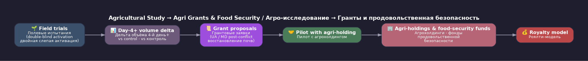

- **Client **/** Клиент:** UA/MD post-conflict soil-restoration grants, agri-holdings, food-security funds. **/** Гранты UA/MD на восстановление почв после конфликта, агрохолдинги, фонды продовольственной безопасности.
- **Offer **/** Оффер:** Hyperbolic-field treatment increases germination and yield (early data: Day-4 volume delta vs control). **/** Обработка гиперболическим полем повышает всхожесть и урожайность (ранние данные: дельта объёма на 4-й день против контроля).
- **Proof **/** Доказательство:** `Hyperbolic_Field_Agricultural_Study` field trials (ongoing, double-blind activation). **/** Полевые испытания `Hyperbolic_Field_Agricultural_Study` (в процессе, двойная слепая активация).
- **Channel **/** Канал:** Grant proposals → pilot with agri-holding → royalty model. **/** Грантовые заявки → пилот с агрохолдингом → роялти-модель.
- **Scale example (projected) **/** Пример масштаба (оценочно):** +10% soy yield on a 1 M-person food base = projected extra supply for ~100 k people (city-district scale). **/** +10% урожая сои при базовом потреблении 1 млн человек = проекция дополнительного питания на ~100 тыс. (масштаб городского района).

### 🌐 GFS — Global Forecasting System → Forecast Sales **/** ГСП — Глобальная Система Прогнозирования → Продажа прогнозов

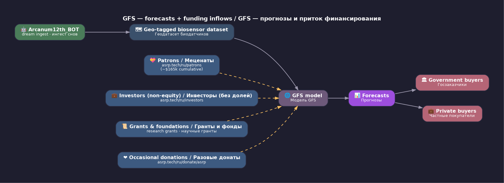

> Extended funnel: GFS forecasts flow right to buyers; patrons, investors, grants and occasional donations flow into the model itself (left, dashed). **/** Расширенная воронка: прогнозы GFS уходят направо к покупателям; меценаты, инвесторы, гранты и разовые донаты — налево в саму модель (пунктир).

- **Client **/** Клиент:** governments (geophysical **/** military threat forecasts), private desks (markets, commodities, securities), and individual users placing bets on the Market. **/** Государства (геофизические **/** военные прогнозы угроз), частные дески (рынки, сырьё, ценные бумаги), индивидуальные пользователи, делающие ставки на Market.
- **Offer **/** Оффер:** High-signal forecasts based on distributed human bio-sensors (Arcanum12th_BOT data stream is **non-optional** — GFS cannot function without the bot's dream/biosensor input) + open environmental data. **/** Высокосигнальные прогнозы на основе распределённых биосенсоров (поток данных из Arcanum12th_BOT **не является опциональным** — без бота GFS не работает) и открытых данных окружающей среды.
- **User funnel **/** Пользовательская воронка:** Arcanum12th_BOT + Arcanum12th courses collect dream and biosensor data (genetic, EEG, electrodermal, autonomic nervous-system) → GFS ingests → **Kapusta rating substrate** motivates, stimulates and filters: accurate forecasts raise contributor status + credit more Kapusta, inaccurate ones lower status → validated forecasts publish to **ASRP.exchange / ASRP Market** → users place stakes → on fulfilment, payouts split across taxes, team premiums, shareholders, and contributor rewards. Over large data the mechanism yields (a) accurate forecasts, (b) high-precision biological sensors, (c) system reliability — all documented in the GFS patent. **/** Arcanum12th_BOT + курсы Arcanum12th собирают сны и биосенсорные данные (генетика, ЭЭГ, кожно-гальваника, вегетативная нервная система) → GFS принимает → **Kapusta как субстрат рейтингов** мотивирует, стимулирует и фильтрует: точные прогнозы поднимают статус контрибьютора и начисляют больше Kapusta, неточные понижают статус → проверенные прогнозы публикуются на **ASRP.exchange / ASRP Market** → пользователи делают ставки → при исполнении выплаты распределяются между налогами, премиями команды, акционерами и вознаграждениями контрибьюторов. На больших данных механизм даёт (а) точные прогнозы, (б) высокоточные биологические датчики, (в) надёжность системы — всё задокументировано в патенте GFS.
- **Proof **/** Доказательство:** Historical forecast track with early flags on geopolitical events — **two non-trivial forecasts are currently on trajectory: (a) tactical-nuclear weapon employment risk, (b) extraterrestrial-contact signal**. Both were dismissed as fantasy when originally logged; current geopolitical context shows gradual convergence toward both (see Case Studies). **/** Исторические прогнозы с ранними флагами по геополитическим событиям — **два нетривиальных прогноза сейчас на траектории исполнения: (a) риск применения тактического ядерного оружия, (b) сигнал контакта с внеземной цивилизацией**. Оба изначально расценивались как фантазия; текущий геополитический контекст показывает постепенную сходимость к обоим (см. раздел Кейсы).
- **Channel **/** Канал:** B2G direct, B2B terminal-style API, and B2C via the ASRP.exchange/Market betting UI. **/** B2G напрямую, B2B API в стиле терминала, B2C через UI ставок ASRP.exchange/Market.

### 🎨 ASRP.art → Objective Art Valuation **/** ASRP.art → Объективная оценка искусства

**Market context **/** Контекст рынка.** Global art market turnover ≈ **$600 B / year**. ASRP.art introduces a new measurable layer — *Sensing Platform of Reactions* (SPR) — producing objective, reproducible reaction metrics for artworks. Mental-state imprinting becomes a quantifiable attribute, complementing provenance. **/** Оборот мирового арт-рынка ≈ **$600 млрд / год**. ASRP.art вводит новый измеримый слой — *Sensing Platform of Reactions* (SPR) — производящий объективные, воспроизводимые метрики реакции на произведения. Отпечаток ментального состояния становится квантифицируемым атрибутом, дополняющим provenance.

- **Client **/** Клиент:** mid-tier artists (fastest entry), galleries (key multiplier), collectors (risk reduction), top-tier international auction houses (later stage; names withheld pre-contact). **/** Художники mid-tier (быстрый вход), галереи (ключевой мультипликатор), коллекционеры (снижение риска), аукционные дома высшего эшелона (поздняя стадия; имена не раскрываются до первого контакта).
- **Offer **/** Оффер:** Objective scoring via consciousness-state imprinting measurement; positioned as **an additional valuation layer** (not a market-disruption narrative) — "like provenance, but for state". **/** Объективная оценка через измерение отпечатка состояния сознания; позиционируется как **дополнительный слой оценки** (не как disruption-нарратив) — «как provenance, но для состояния».
- **Proof **/** Доказательство:** Patent PCT 412362, prototype platform, research base, bilingual podcast on [asrp.tech/projects/asrp.art](https://asrp.tech/ru/projects/asrp.art). **/** Патент PCT 412362, прототип платформы, исследовательская база, двуязычный подкаст на asrp.tech.
- **Channel **/** Канал:** Bottom-up pressure (artists → galleries → public cases) → private introductions via curators **/** advisory boards → pilot integration with 5-10 works in auction flow. **/** Давление снизу (художники → галереи → публичные кейсы) → private-introductions через кураторов и advisory boards → пилотная интеграция 5–10 работ в аукционном потоке.

**Go-to-Market rollout **/** Таймлайн выкатки:**

| Phase **/** Фаза | Milestone **/** Веха |
|---|---|
| 🔹 **0–3 mo / 0–3 мес** — *«Prove it works»* | Pilot cohort of 10–30 artists, 30–50 works · basic SPR (emotional **/** cognitive reaction, repeatability) · controlled testing with 20–50 viewers · first dataset & case studies («work X triggers response Y in 70% of viewers»). **/** Пилот на 10–30 художниках, 30–50 работах · базовый SPR · контролируемые тесты с 20–50 зрителями · первый датасет и кейсы. |
| 🔹 **3–6 mo / 3–6 мес** — *«Enter the market»* | 3–5 gallery partnerships · SPR as a premium pricing layer · public exhibitions with SPR metrics · **paid SPR certification** — first real revenue & brand awareness. **/** 3–5 партнёрств с галереями · SPR как премиум-слой ценообразования · публичные выставки с SPR-метриками · **платная SPR-сертификация** — первые реальные деньги и узнаваемость. |
| 🔹 **6–12 mo / 6–12 мес** — *«Become the standard»* | Top-tier auction-house institutional partnerships · 500+ certified works, 1000+ users · data layer for collectors, funds, galleries. **/** Институциональные партнёрства аукционных домов высшего эшелона · 500+ сертифицированных работ, 1000+ пользователей · data-layer для коллекционеров, фондов, галерей. |

**Target-customer order **/** Порядок атаки клиентов:**
1. **Artists **/** Художники** (fastest entry, open to experiments) — «you are the first artist with measurable impact». **/** «ты первый художник с измеряемым воздействием».
2. **Galleries **/** Галереи** (key multiplier) — «we increase your sales through data». **/** «мы увеличим ваши продажи через данные».
3. **Collectors **/** Коллекционеры** (risk reduction, investment logic) — «it is not just art — it is a measured asset». **/** «это не просто искусство — это измеренный актив».
4. **Auction houses **/** Аукционные дома** (later) — framed as «additional valuation layer», not «we change the market». **/** подаётся как «дополнительный слой оценки», не как «мы меняем рынок».

**Top-tier auction house — 4-step entry **/** Как зайти в аукционный дом высшего эшелона за 4 шага:**
1. **Bottom-up pressure **/** Давление снизу** — artists use SPR → galleries sell with SPR → public cases accumulate.
2. **Public cases **/** Публичные кейсы** — stories like «work rose in value after SPR» **/** «SPR explained the value».
3. **Private outreach / Private-подход** — via curators, sales directors, advisory boards.
4. **Pilot **/** Пилот** — 5–10 works, SPR-scored, compared to normal sales. If +X% price → we are in. **/** Если +X% к цене → мы внутри.

> Long-term civilizational vision for ASRP.art (inter-species art-as-currency framing, GMS + GFS + Kapusta.money + hyperbolic-field links) is documented in [`whitepaper/README.md`](whitepaper/README.md) — deliberately kept outside the commercial pitch. **/** Долгосрочное цивилизационное видение для ASRP.art (art-as-currency для межвидового обмена, связка GMS + GFS + Kapusta.money + гиперболические поля) задокументировано в `whitepaper/README.md` — намеренно вынесено за пределы коммерческого питча.

### 🧠 ASRP.drift → Neurointegrative Platform **/** ASRP.drift → Нейроинтегративная платформа

- **Client **/** Клиент:** Clinical research, sports science, defense (augmentation programs). **/** Клинические исследования, спортивная наука, оборонка (программы усиления).
- **Offer **/** Оффер:** Deep resonant integration of fielded thought — for high-performance teams. **/** Глубокая резонансная интеграция полевой мысли — для высокоэффективных команд.
- **Proof **/** Доказательство:** Patent KZ 413554, R&D prototypes. **/** Патент KZ 413554, R&D-прототипы.
- **Channel **/** Канал:** Institutional partnerships after clinical validation. **/** Институциональные партнёрства после клинической валидации.

### 📰 ASRP.media → Ads + Affiliate **/** ASRP.media → Реклама + партнёрка

- **Streams **/** Потоки:** Direct ads (CPM/CPC), native/sponsored posts, Amazon-affiliate deep links (sleep masks, neurointerfaces, supplements). **/** Прямая реклама (CPM/CPC), нативные/спонсорские посты, Amazon-партнёрские deep-линки (маски для сна, нейроинтерфейсы, БАДы).
- **Proof **/** Доказательство:** Own TikTok channel (`@asrp.media` — 325 followers, 2.5K likes) + active content pipeline. **/** Собственный TikTok-канал (`@asrp.media` — 325 подписчиков, 2.5K лайков) + активная контентная воронка.
- **Channel **/** Канал:** Organic traffic from journal + YouTube + Telegram funnel. **/** Органический трафик из журнала + YouTube + Telegram-воронка.

### 🎓 Arcanum12th → B2C Learning **/** Arcanum12th → B2C-образование

- **Streams **/** Потоки:** Paid courses ($9–499), premium subs ($5–50/mo), certificates ($29–99), author revenue-share (30–70%). **/** Платные курсы ($9–499), премиум-подписки ($5–50/мес), сертификаты ($29–99), revenue-share с авторами (30–70%).
- **Proof **/** Доказательство:** ~10 courses in pilot, direct-sales infrastructure ready. **/** ~10 курсов в пилоте, инфраструктура прямых продаж готова.
- **Channel **/** Канал:** Email rollouts, YouTube → course landings, bot-to-course upsell + cross-promotion banners (see below). **/** Email-рассылки, YouTube → лендинги курсов, upsell из бота в курсы + кросс-промо баннеры (см. ниже).

### 🔁 Cross-Promotion Pattern **/** Паттерн кросс-промо

**Every piece of content — article, interview, video, course — carries a targeted banner. Two kinds:**
**Каждая единица контента — статья, интервью, видео, курс — несёт таргетированный баннер. Двух видов:**

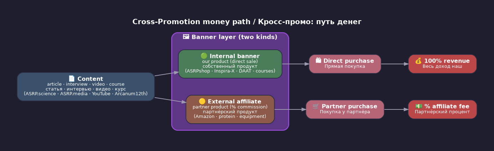

- 🟢 **Internal banner **/** Внутренний баннер** — our own product (direct sale, 100% revenue) **/** собственный продукт (прямая продажа, 100% дохода). Examples **/** Примеры:
  - ASRP.science article on Inspira-X → banner → purchase via ASRPshop. **/** Статья в ASRP.science про Inspira-X → баннер → покупка через ASRPshop.
  - Arcanum12th course on lucid dreaming → banner → DAAT Crystal purchase. **/** Курс в Arcanum12th про осознанные сновидения → баннер → покупка DAAT-кристалла.
  - ASRP.media interview on sleep science → banner → Arcanum12th course upsell. **/** Интервью в ASRP.media про науку сна → баннер → допродажа курса Arcanum12th.
- 🟡 **External affiliate **/** Внешний партнёрский** — partner product (% commission) **/** партнёрский продукт (процент с продаж). Examples **/** Примеры:
  - Arcanum12th course on bodybuilding → protein-brand banner → affiliate %. **/** Курс в Arcanum12th про бодибилдинг → баннер протеинового бренда → партнёрский %.
  - ASRP.media article on sleep masks **/** neurointerfaces → Amazon affiliate link → %. **/** Статья в ASRP.media про маски для сна **/** нейроинтерфейсы → Amazon affiliate-линк → %.
  - ASRP.science yeast study → lab-equipment vendor banner → B2B affiliate %. **/** Дрожжевое исследование в ASRP.science → баннер поставщика лабораторного оборудования → B2B-партнёрский %.

This pattern applies consistently across **ASRP.science, ASRP.media, YouTube, Arcanum12th, ASRP.art** — every content channel becomes a funnel for either own-product sales or commission income. **/** Этот паттерн применяется единообразно ко всем контентным каналам ASRP: каждый канал превращается в воронку либо прямых продаж, либо комиссионного дохода.

> **Proof-of-mechanism (already realised) **/** Доказательство механизма (уже реализовано):** ASRP.media ran a banner ad for a neurointerface device; a reader clicked through and completed a purchase; ASRP received the affiliate commission. This is the canonical worked example of the cross-promotion model — the mechanism is not theoretical. **/** В ASRP.media размещён баннер на нейроинтерфейс; читатель перешёл по ссылке и купил; ASRP получила партнёрскую комиссию. Это канонический рабочий пример кросс-промо — механизм не теоретический.

### 💃 ASRP.dance → Movement Neuroscience **/** ASRP.dance → Нейронаука движений

**Concept **/** Концепция.** Each body part — fingers, limbs, specific articulations — maps to a distinct cortical representation area; executing complex, algorithmic movement sequences selectively activates those cortical regions and recruits inter-area blood flow. ASRP.dance is a research programme that investigates whether **complex choreographic dynamics and algorithmic movement sequences** can be used to expand and strengthen human cognitive capacity — operating in parallel to the DAAT Crystal pathway: **both target cognitive enhancement, but through different routes** (dance = motor-cortex-mediated activation of otherwise-dormant regions; crystal = field-signature-mediated EEG/autonomic modulation). **/** Каждая часть тела — пальцы, конечности, отдельные артикуляции — имеет выделенное представительство в коре головного мозга; выполнение сложных алгоритмических последовательностей движений избирательно активирует эти корковые зоны и подключает межзональный кровоток. ASRP.dance — исследовательская программа, изучающая можно ли использовать **сложную хореографическую динамику и алгоритмические движенческие последовательности** для расширения и усиления когнитивных способностей человека — параллельно треку DAAT Crystal: **обе линии нацелены на когнитивное усиление, но разными путями** (танец — через моторно-кортикальную активацию обычно-неактивных областей; кристалл — через EEG- и автономно-нервную модуляцию подписью поля).

- **Client **/** Клиент:** Neurology & rehab clinics, high-performance sports teams, wellness studios, cognitive-neuroscience labs. **/** Клиники неврологии и реабилитации, спортивные команды высокого уровня, wellness-студии, лаборатории когнитивной нейронауки.
- **Offer **/** Оффер:** Structured movement protocols (Toltec magical passes, Gurdjieff movements, Dervish dances) with real-time EEG **/** myography / hyperbolic-field monitoring → measurable cortical activation (target: activation of cortical areas normally inactive during routine movement). **/** Структурированные движенческие протоколы (магические пасы Толтеков, Движения Гурджиева, Танцы Дервишей) с real-time мониторингом ЭЭГ / миографии **/** гиперболических полей → измеримая активация коры (целевой маркер: активация областей, обычно неактивных при рутинном движении).
- **Proof **/** Доказательство:** Project page [asrp.tech/ru/projects/asrp.dance](https://asrp.tech/ru/projects/asrp.dance) · connection to ASRP.drift BCI platform · research-project stage (no published study yet). **/** Страница проекта на asrp.tech · связь с платформой BCI ASRP.drift · стадия научно-исследовательского проекта (публикаций пока нет).
- **Channel **/** Канал:** Institutional pilots → whitelabel protocols → certification via Arcanum12th. **/** Институциональные пилоты → whitelabel протоколов → сертификация через Arcanum12th.

### 👗 ASRP.fashion → Living Biocompatible Textiles **/** ASRP.fashion → Живые биосовместимые ткани

**Concept **/** Концепция.** ASRP.fashion produces **fully-living biocompatible textiles** — not biodegradable, but *actively alive* — grown from plants, bacteria and fungal mycelium under hyperbolic- and quantum-field exposure. Garments retain the "field signature" imprint and interact with the wearer's body throughout use; dedicated designers handle the aesthetic layer. **/** ASRP.fashion создаёт **полностью живые биосовместимые ткани** — не биоразлагаемые, а *живые* — выращенные из растений, бактерий и мицелия грибов под воздействием гиперболических и квантовых полей. Одежда сохраняет «подпись поля» и взаимодействует с телом носителя в процессе носки; специальные дизайнеры отвечают за эстетический слой.

- **Client **/** Клиент:** Premium fashion brands, wellness retail, medical textiles (anti-thrombosis apparel), space/defense textile R&D. **/** Премиум fashion-бренды, wellness-ритейл, медицинский текстиль (антитромбозная одежда), космический/оборонный textile R&D.
- **Offer **/** Оффер:** Fabrics grown from plants, bacteria and fungi under hyperbolic + quantum field exposure — bioenergetic, biocompatible, **charge-preserving**. **/** Ткани, выращенные из растений, бактерий и грибов под гиперболическими и квантовыми полями — биоэнергетические, биосовместимые, **сохраняющие заряд**.
- **Scientific rationale (founder-stated mechanism) **/** Научное обоснование (механизм по CEO):** Synthetic garments accumulate triboelectric positive charge during wear; this charge draws negative charge from skin cells and, by extension, from the surface of erythrocytes in blood. Erythrocytes rely on their native negative surface charge to repel one another and pass single-file through narrow capillaries. Loss of that charge reduces mutual electrostatic repulsion, increases aggregation risk and contributes to thrombotic events (the "anti-thrombosis apparel" positioning follows from this mechanism). Plant/bacterium/mycelium living textiles preserve erythrocyte charge stability by design — "living cloth on living body". Supporting literature citation pending. **/** Синтетическая одежда накапливает трибоэлектрический положительный заряд при носке; этот заряд вытягивает отрицательный заряд из клеток кожи и — по цепочке — с поверхности эритроцитов в крови. Эритроциты удерживают своё движение в капиллярах за счёт собственного отрицательного заряда, отталкиваясь друг от друга. Потеря этого заряда снижает взаимное электростатическое отталкивание, повышает риск агрегации и вклад в тромботические процессы (позиционирование «антитромбозной одежды» вытекает из этого механизма). Живые ткани из растений, бактерий и мицелия сохраняют устойчивость заряда эритроцитов — «живое на живом выносит». Ссылки на литературу — следует дополнить.
- **Proof **/** Доказательство:** Project page [asrp.tech/ru/projects/asrp.fashion](https://asrp.tech/ru/projects/asrp.fashion) · YouTube [@ASRPfashion](https://www.youtube.com/@ASRPfashion) · scientific base via Fractal Biomedical Hyperbolic Field System patent (KZ 2025/1095.1). **/** Страница проекта · YouTube [@ASRPfashion](https://www.youtube.com/@ASRPfashion) · научная база по патенту Фрактальной Биомедицинской Системы Гиперболических Полей (KZ 2025/1095.1).
- **Channel **/** Канал:** Pilot collections with independent designers → bio-fabric technology licensing. **/** Пилотные коллекции с независимыми дизайнерами → лицензирование технологии биотканей.

### 💎 DAAT Crystals → Premium Cognitive Enhancement **/** DAAT-кристаллы → Премиум когнитивное усиление

**Positioning **/** Позиционирование.** DAAT crystals are **not** an optical or aesthetic product — they are the focusing element of a cognitive-enhancement stack (crystal + Inspira-X neurobreath + neurointerface + ASRP.drift AI). **/** Кристаллы DAAT — **не** оптический или эстетический продукт, это фокусирующий элемент стека когнитивного усиления (кристалл + нейродыхание Inspira-X + нейроинтерфейс + AI ASRP.drift).

- **Client **/** Клиент:** Premium B2C (high-load professionals, tech visionaries) + B2B corporate (executive wellness programs for top management, high-performance teams). **/** Премиум B2C (профессионалы высокой нагрузки, технические визионеры) + B2B корпоративный сегмент (wellness-программы для топ-менеджмента, высокоэффективные команды).
- **Offer **/** Оффер:** Certified DAAT crystal (grown over ~1 month from copper sulfate in a non-stop hyperbolic-geometry field, preserves "field signature") integrated with Inspira-X respiratory biosensor + neurointerface (EEG, electrodermal/skin-galvanic response) + ASRP.drift AI interpretation. **Measured endpoints** (monitored during use): EEG waveform analysis (gamma/alpha ratio), heart-rate variability (HRV), electrodermal response, autonomic nervous system (SNS/PNS) balance, pre/post cognitive tests. **Target outcomes: working-memory expansion, mental-noise reduction, cognitive-load capacity increase** — still pending full study results, but measurement instrumentation is concrete, not aspirational. **/** Сертифицированный кристалл DAAT (выращивается ~1 месяц из медного купороса в нон-стоп поле с гиперболической геометрией, сохраняет «подпись поля») в связке с респираторным биосенсором Inspira-X + нейроинтерфейсом (ЭЭГ, кожно-гальваническая реакция) + AI-интерпретацией ASRP.drift. **Измеряемые endpoint-ы** (мониторинг при использовании): ЭЭГ (соотношение гамма/альфа), вариабельность сердечного ритма (HRV), кожно-гальваническая реакция, баланс автономной нервной системы (СНС/ПНС), когнитивные тесты до/после. **Целевые результаты: расширение рабочей памяти, снижение ментального шума, рост способности нести когнитивную нагрузку** — полные результаты исследования ожидаются, но инструментарий измерений конкретен, а не декларативен.
- **Pricing tier **/** Ценовая категория:** Premium tier — the crystal is **not a low-cost product**. Individual B2C purchase for high-load professionals; emerging corporate-buyer pattern where companies acquire crystals for their top-manager cohort (so executives can sustain elevated cognitive load). Specific dollar range pending founder confirmation. **/** Премиум-категория — кристалл **не дешёвый продукт**. Индивидуальные B2C-покупки у профессионалов высокой нагрузки; формирующийся B2B-паттерн: компании закупают кристаллы для своих топ-менеджеров (чтобы те могли выдерживать повышенную когнитивную нагрузку). Конкретный ценовой диапазон — ожидает подтверждения.
- **B2B pilots (public signal) **/** B2B-пилоты (публичный сигнал):** Bank-executive testing programme — crystals already acquired by top-management at a financial institution (institution name undisclosed; testing phase). Individual wearers include persons **on the Forbes list** (publicly announced by the founder in a broadcast Telegram post on 2026-04-20, views:288 · forwards:2 — names not disclosed). These are early pilot signals, not revenue-stage pipelines. **/** Программа тестирования топ-менеджерами банка — кристаллы уже закуплены руководством финансового учреждения (название не раскрывается; этап тестирования). Среди индивидуальных носителей — люди **из списка Forbes** (публично объявлено основателем в Telegram-канале 2026-04-20, просмотры:288 · форварды:2 — имена не раскрыты). Это ранние пилотные сигналы, не revenue-стадия.
- **Scientific basis **/** Научная база:** neuroplasticity (LTP, gamma oscillations, synaptic reinforcement), adult neurogenesis (BDNF, NGF, IGF-1, VEGF surrogate markers), heart-brain coherence (HRV), neuroendocrine axes (pineal, pituitary, thalamus, vagus nerve). **/** Нейропластичность (LTP, гамма-осцилляции, синаптическое усиление), взрослый нейрогенез (маркеры BDNF, NGF, IGF-1, VEGF), когерентность сердце-мозг (HRV), нейроэндокринные оси (эпифиз, гипофизарная ось, таламус, блуждающий нерв).
- **Proof **/** Доказательство:** [Hyperbolic_Field_DAAT_Crystal_Study](https://github.com/AdvancedScientificResearchProjects/Hyperbolic_Field_DAAT_Crystal_Study) (recruitment phase), patents KZ 2025/1095.1 (FBHFS) + KZ 413554 (ASRP.drift). **/** Репозиторий исследования (фаза набора), патенты KZ 2025/1095.1 (ФБСГП) + KZ 413554 (ASRP.drift).
- **Channel **/** Канал:** Premium direct sales via `asrp.tech` + **ASRPshop** (🟡 domain reportedly acquired, final URL pending · B2C storefront for crystals and ASRP.fashion items) + Arcanum12th community + ASRP.media **/** ASRP.art content marketing. **/** Премиум прямые продажи через asrp.tech + **ASRPshop** (🟡 домен предположительно куплен, финальный URL — позже · B2C-витрина для кристаллов и изделий ASRP.fashion) + сообщество Arcanum12th + контент-маркетинг через ASRP.media **/** ASRP.art.
- **Strategic positioning **/** Стратегическое позиционирование:** As AI advances displace cognitive-routine labour, DAAT Crystal + Inspira-X + neurointerface becomes a **mass-market candidate for biological-intelligence amplification** — one of the highest-potential monetisable technologies inside ASRP's portfolio. **/** По мере того как ИИ вытесняет когнитивно-рутинный труд, связка DAAT Crystal + Inspira-X + нейроинтерфейс становится **кандидатом на массовый продукт усиления биологического интеллекта** — одной из наиболее монетизируемых технологий портфеля ASRP.

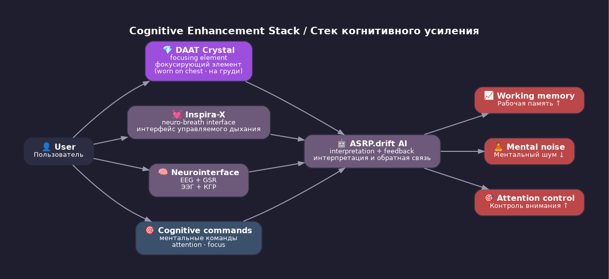

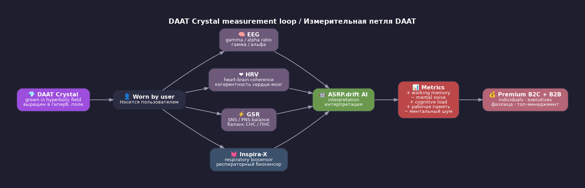

### 🧘 GMS → Banchenko-Market **/** GMS → Banchenko-Market

**Driver **/** Драйвер.** As AI and robotics progressively displace mid-skill labour, cognitive and consciousness states become the new scarcity-anchored value class. GMS is ASRP's infrastructure bet on that shift. **/** По мере того как ИИ и робототехника вытесняют труд среднего уровня, когнитивные состояния и состояния сознания становятся новым классом ценности, привязанным к дефициту. GMS — инфраструктурная ставка ASRP на этот сдвиг.

**Concept.** *Banchenko-Market* — the internal name for the Global Market of Lucid Dreams and Other Transcendental States of Consciousness. Consciousness states are recorded via neurointerface, objectified as stable neural patterns (EEG **/** MEG / fMRI), classified by AI, tokenized on a quantum-resistant ledger and traded on the marketplace layer. **Naming **/** Названия.** `ASRP.exchange`, `ASRP Market` and `stock.asrp.*` are three public aliases used interchangeably for the **same product** (the CEO uses all three in conversation; unified branding to be fixed later). A Mental Object is framed as a **proposed new asset class** — conceptually analogous to tokenized real estate or securities, but with consciousness state as the underlying asset (priced similarly to how tokenized music or tokenized real estate is traded).
**Концепция.** *Banchenko-Market* — внутреннее название глобального рынка осознанных сновидений и иных трансцендентальных состояний сознания. Состояния сознания снимаются нейроинтерфейсом, объективизируются как устойчивые нейро-паттерны (ЭЭГ **/** МЭГ / фМРТ), классифицируются AI, токенизируются на квантово-устойчивом ledger-е и торгуются на маркет-слое. **Названия.** `ASRP.exchange`, `ASRP Market` и `stock.asrp.*` — три публичных алиаса, используемых взаимозаменяемо для **одного и того же продукта** (CEO использует все три в разговоре; единый бренд будет закреплён позже). Ментальный Объект позиционируется как **предлагаемый новый класс активов** — концептуально аналогичен токенизированной недвижимости или ценным бумагам, но базовым активом является состояние сознания (ценообразование аналогично торгуемой токенизированной музыке или недвижимости).


- **Client **/** Клиент:** End-users (dreamers, artists, forecasters), platforms buying mental-state content, enterprises running GMS-based internal programs. **/** Конечные пользователи (сновидцы, художники, прогнозисты), платформы, закупающие контент ментальных состояний, корпорации с GMS-программами.
- **Offer **/** Оффер:** Unified marketplace (ASRP.exchange **/** ASRP Market) + crypto settlement layer (Kapusta.money, quantum-resistant) + education & certification (Arcanum12th) + forecast layer (GFS) + art certification (ASRP.art). **/** Единая биржа (ASRP.exchange **/** ASRP Market) + расчётный крипто-слой (Kapusta.money, квантово-устойчивый) + обучение и сертификация (Arcanum12th) + слой прогнозов (GFS) + сертификация искусства (ASRP.art).
- **Proof **/** Доказательство:** All 5 components live or in active development; scientific foundation in the [whitepapers](#-scientific-whitepapers--научные-статьи); GMS umbrella page at [asrp.tech](https://asrp.tech/ru/projects/gms). **/** Все 5 компонентов работают или в активной разработке; научная основа — в научных статьях; зонтичная страница на asrp.tech.
- **Channel **/** Канал:** Transaction fees on Kapusta.money + exchange commissions + Arcanum12th certification fees + premium content subscriptions. **/** Комиссии транзакций Kapusta.money + комиссии биржи + комиссии за сертификацию Arcanum12th + премиум-подписки на контент.

---

## 📈 Track Record & Case Studies **/** Кейсы и доказательства

> Concrete events that prove the ecosystem is not paper. **/** Конкретные события, доказывающие, что экосистема не на бумаге.

### 1. UAP repo → U.S. Department of Energy first-reader **/** Репозиторий UAP → первый читатель из Минэнерго США
- Within hours of publishing `UAP_Reverse_Engineering_Study`, tracked access from a U.S. federal IP range was observed — identified as the **Department of Energy (DoE) / Los Alamos National Laboratory** segment (the same institutional track that historically commissioned IBM-supercomputer simulations on UAP-adjacent research). DoE was **the first federal reader**, landing on the repository nearly immediately after publication. **/** В течение нескольких часов после публикации `UAP_Reverse_Engineering_Study` зафиксирован заход с федерального IP-диапазона США — идентифицирован как сегмент **Министерства энергетики США / Лос-Аламосской национальной лаборатории** (та же институциональная цепочка, которая исторически заказывала симуляции на суперкомпьютерах IBM по UAP-adjacent исследованиям). Минэнерго стало **первым федеральным читателем**, зайдя на репозиторий почти сразу после публикации.

### 2. Blood-plasma study → Cortical Labs negotiations **/** Исследование плазмы крови → переговоры с Cortical Labs
- V. Ovseannicova reproduced the hyperbolic-field protocol on blood plasma; raw data passed to analysis → unified public repo. **/** В. Овсянникова воспроизвела протокол гиперболического поля на плазме крови; сырые данные → анализ → единый публичный репозиторий.
- Repo initially sent to Cortical Labs (Australian biocomputing company) — no response at first. **/** Репозиторий изначально направлен в Cortical Labs (австралийская биокомпьютерная компания) — первичной реакции не было.
- When Cortical Labs announced their neuron-computing game and hype spiked, ASRP posted the plasma study as content on LinkedIn. Cortical Labs engaged, and negotiations are ongoing (last update: Cortical Labs is reviewing the study). **/** Когда Cortical Labs анонсировала свою нейрон-игру и вокруг неё поднялся хайп, ASRP разместила плазменное исследование как контент в LinkedIn. Cortical Labs вышла на связь; переговоры продолжаются (последний апдейт: Cortical Labs рассматривает исследование).

### 3. GFS — early flags on major events **/** GFS — ранние флаги по крупным событиям
- Tactical nuclear weapon use — early flag matched subsequent public events. **/** Тактическое применение ядерного оружия — ранний флаг совпал с последующими публичными событиями.
- Additional disclosure-class signals under observation. **/** Дополнительные сигналы класса disclosure — под наблюдением.

### 4. Agricultural Day-4 signal **/** Сигнал 4-го дня в агроисследовании
- Double-blind activation: irradiated seeds show increased volume and moisture vs control. **/** Двойная слепая активация: облучённые семена показывают больший объём и влажность по сравнению с контролем.
- Projected scale (estimate): +10% soybean yield → food for an additional ~100 k people per 1 M-person baseline. **/** Проекция масштаба (оценка): +10% урожая сои → питание для дополнительных ~100 тыс. человек при базовом потреблении 1 млн.

### 5. Kosmopoisk / Chernobrov archival cross-reference + Lazar lineage **/** Архивные перекрёстные ссылки «Космопоиск» / Чернобров + линия Lazar
- `chernobrov-archive` inside UAP study cross-references Vadim Chernobrov's field data (post-landing measurements, **quartz-resonator frequency-deviation instrument** deployed at landing sites, time-dilation measurements with controls) with modern reverse-engineering work. **/** Архив `chernobrov-archive` внутри UAP-исследования сопоставляет полевые данные Вадима Черноброва (измерения в местах посадок, **инструмент на кварцевых резонаторах для измерения отклонений частоты** в местах посадки с контролем, замеры временных отклонений) с современной реверс-работой.
- **Research lineage note **/** Научная родословная.** Lazar worked directly on intact UAP craft (U.S. government programmes); Kosmopoisk (with Chernobrov) worked only on fragments and landing-site residue, documenting post-landing physical-field anomalies. Both paths converge on the same hyperbolic-field phenomena now investigated by ASRP — Lazar via the craft's power systems, Kosmopoisk via the environmental imprint. Chernobrov's later work documented prototype time-dilation apparatus (with measured deviations), continuing the Lazar-style reverse-engineering path on a materials-limited scale. Denis's relocation within Kazakhstan — to Baikonur (Kyzylorda region) — was an explicit move to continue that research trail. **/** Lazar работал непосредственно с целыми аппаратами UAP (в программах правительства США); Космопоиск (с Чернобровом) работал только с обломками и следами мест посадки, фиксируя аномалии физических полей. Обе линии сходятся на одних и тех же гиперболических полевых феноменах, которые сейчас исследует ASRP — Lazar через энергосистемы аппаратов, Космопоиск через след во внешней среде. Поздние работы Черноброва зафиксировали прототип аппарата с измеренной деформацией времени — продолжение Lazar-линии реверс-инжиниринга в условиях ограниченности материала. Переезд Дениса внутри Казахстана — в Байконур (Кызылординская область) — был осознанным шагом для продолжения этого исследовательского следа.

### 6. Public events — GFS presentations **/** Публичные события — презентации GFS
- **Theta Network Hackathon**, Berlin, 11 Sep 2025 — GFS presented at European conference and hackathon. **/** **Theta Network Hackathon**, Берлин, 11 сен. 2025 — GFS представлен на европейской конференции и хакатоне.
- **Industry 4.0 Pitch Battle** at AstanaHub (Digital Bridge 2025) — GFS submitted for industrial pitching; did not pass the selection stage. Application documented on project page. **/** **Industry 4.0 Pitch Battle** на AstanaHub (Digital Bridge 2025) — GFS подан на питчинг; не прошёл отборочный этап. Заявка задокументирована на странице проекта.

### 7. DAAT Crystal pilots — bank executives + Forbes-list wearers **/** Пилоты DAAT Crystal — руководители банка и носители из списка Forbes
- **Bank top-management pilot — testing phase.** Crystals acquired by the executive cohort of a financial institution (institution name undisclosed; under high-load concentration-support rationale). **/** **Пилот с топ-менеджерами банка — этап тестирования.** Кристаллы закуплены руководящим составом финансового учреждения (название не раскрывается; обоснование — поддержка концентрации при высокой нагрузке).
- **Forbes-list wearers.** Individual wearers include persons from the Forbes list — publicly announced by the founder in a broadcast Telegram channel post on 2026-04-20 (views: 288, forwards: 2). Names not disclosed. **/** **Носители из списка Forbes.** В число индивидуальных носителей входят люди из списка Forbes — публично объявлено основателем в Telegram-канале 2026-04-20 (просмотры: 288, форварды: 2). Имена не раскрыты.
- Both are early pilot-tier signals, not revenue-stage pipelines. **/** Оба сигнала — ранние пилотные, не revenue-стадия.

### 8. Neurointerface affiliate sale — proof-of-mechanism for cross-promotion **/** Партнёрская продажа нейроинтерфейса — доказательство механизма кросс-промо
- ASRP.media ran a banner ad for a neurointerface device embedded in related editorial content; a reader converted through the banner and completed a purchase; ASRP received the affiliate commission. **This is the worked example** underpinning the [Cross-Promotion Pattern](#-cross-promotion-pattern--паттерн-кросс-промо) — the ecosystem monetisation mechanism is not theoretical. **/** В ASRP.media размещён баннер на нейроинтерфейс внутри смежного редакционного контента; читатель перешёл по баннеру и завершил покупку; ASRP получила партнёрскую комиссию. **Это рабочий пример** в основе [паттерна кросс-промо](#-cross-promotion-pattern--паттерн-кросс-промо) — механизм монетизации экосистемы не теоретический.

### 9. NCI SBIR FY26 — Pediatric & Rare Cancers application (Aug 2025 → Oct 2025 systemic cancellation) **/** NCI SBIR FY26 — заявка по детским и редким формам рака (август 2025 → системная отмена в октябре 2025)
- **Application **/** Заявка.** On 22 Aug 2025, ASRP CEO Denis Banchenko formally contacted the NIH/NCI Contracting Specialist (via the official NIH SBIR portal) for the NCI SBIR Innovative Concept Award Program under **Notice ID `75N91025R00005`**, proposing a novel therapeutic approach for pediatric and rare cancers based on controlled interactions of hyperbolic fields and space-time curvature. The letter confirmed an existing experimental device prototype, preliminary tests, and opened IP/NDA discussion. **/** 22 августа 2025 CEO ASRP Денис Банченко формально обратился к Contracting Specialist NIH/NCI (через официальный портал NIH SBIR) по программе NCI SBIR Innovative Concept Award (**Notice ID `75N91025R00005`**), предложив новую терапевтическую технологию для детских и редких форм рака на основе контролируемых взаимодействий гиперболических полей и кривизны пространства-времени. В письме заявлены существующий прототип устройства, предварительные тесты и открыт вопрос IP/NDA.
- **Progress **/** Прогресс.** Registration in the eCPS submission system was completed (screenshot on file, 2 Oct 2025); proposal preparation tracked against the official solicitation checklist (46-page solicitation + Attachment_1 Technical Proposal Form). **/** Регистрация в системе подачи eCPS выполнена (скриншот от 2 окт. 2025 сохранён); подготовка заявки велась по официальному чек-листу (46-страничный solicitation + Attachment_1 Technical Proposal Form).
- **Outcome **/** Исход.** In October 2025, NCI cancelled solicitation `75N91025R00005` system-wide following **expiration of the federal SBIR/STTR statutory authorization, effective 1 October 2025**. The cancellation was **systemic** — it affected every interested party and was **not based on merit, peer review or technical evaluation** of any submitted proposal. ASRP retains the fully prepared materials for re-submission once SBIR/STTR authorization is restored. **/** В октябре 2025 NCI отменил конкурс `75N91025R00005` системно — вследствие **истечения федеральной авторизации программы SBIR/STTR с 1 октября 2025**. Отмена **системная** — затронула всех участников и **не связана с merit-оценкой или рецензированием** каких-либо поданных заявок. ASRP сохраняет полностью подготовленные материалы для повторной подачи после восстановления авторизации SBIR/STTR.
- **Relevance **/** Значимость.** This is a documented example of ASRP operating inside formal U.S. federal research-procurement processes. The same scientific position (temporal-desynchronization framing — see [Blood Plasma path](#-blood-plasma--hyperbolic-biomed--medical-centers--плазма-крови--гиперболический-биомед--медцентры)) is now being carried forward via the Dr. Garry Nolan / Stanford LinkedIn track (see Outreach Dynamics below). **/** Это задокументированный пример работы ASRP внутри формальных процессов федеральных научных закупок США. Та же научная позиция (рамка темпоральной десинхронизации — см. раздел по плазме крови) сейчас продолжается через трек Dr. Garry Nolan / Stanford в LinkedIn (см. раздел Outreach Dynamics ниже).

---

## 📡 Outreach Dynamics **/** Динамика аутрича

**External reactions to ASRP publications — profile-relevant actors who engaged with our repos. Log of observable public signals, updated as new events occur.**
**Внешние реакции на публикации ASRP — профильные игроки, взаимодействовавшие с нашими репозиториями. Журнал публично наблюдаемых сигналов, обновляется по мере новых событий.**

### Engagement strategy **/** Стратегия аутрича

**The same funnel drives every contact — reverse-engineering competence → open scientific repository → preprint / journal publication → LinkedIn content wave timed to the target's own hype window → comment or direct outreach → inbound response → bilateral messaging → negotiation.** The three cases logged below (NSWC IHD, Cortical Labs, Stanford / Nolan Lab) are instances of this pipeline at different stages. **/** **Одна и та же воронка работает на каждый контакт:** компетенция реверс-инжиниринга → открытый научный репозиторий → препринт/журнальная публикация → волна LinkedIn-контента в момент профильного хайпа цели → комментарий или прямой аутрич → входящий отклик → двусторонняя переписка → переговоры. Три кейса ниже (NSWC IHD, Cortical Labs, Stanford / лаборатория Nolan) — воплощения этой воронки на разных стадиях.

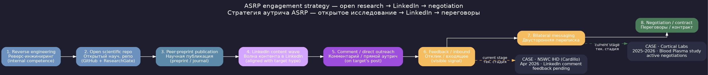

### 1. NSWCIHD (U.S. Navy) — April 2026 **/** NSWCIHD (ВМС США) — апрель 2026

| Field **/** Поле | Value **/** Значение |
|---|---|
| **Date observed **/** Дата наблюдения** | 22 April 2026 **/** 22 апреля 2026 |
| **Actor **/** Участник** | Robert Cardillo — Configuration Management (CCMP · CISCM) **/** Роберт Кардилло — управление конфигурацией (CCMP · CISCM) |
| **Organisation **/** Организация** | **Naval Surface Warfare Center Indian Head Division (NSWC IHD)** — one of 8 NAVSEA Warfare Centers; U.S. Navy RDT&E hub for energetics, EOD, propulsion and CBR defense; parent command NAVSEA / U.S. Department of Defense **/** Центр NSWC IHD (подразделение Индиан-Хед) — одно из 8 подразделений NAVSEA Warfare Centers; центр R&D ВМС США по энергетике, EOD, двигательным установкам и защите от ХБР-угроз; вышестоящая структура NAVSEA / Министерство обороны США |
| **Scale / rating **/** Масштаб / рейтинг** | Tier-1 DoD RDT&E facility · largest energetics R&D laboratory in the U.S. Department of Defense · approx. 1,900 federal employees + extensive contractor base; historic annual operating budget in the **~$1 B range** across RDT&E and working-capital fund lines (public DoD budget disclosures). **/** DoD RDT&E центр уровня Tier-1 · крупнейшая энергетическая R&D-лаборатория МО США · ~1 900 федеральных сотрудников плюс обширная подрядная база; исторический годовой операционный бюджет — **порядка $1 млрд** в сумме по линиям RDT&E и оборотного фонда (публичные бюджетные раскрытия DoD). |
| **Department **/** Подразделение** | Warfighter Defense & Systems Integration Department (W), Conventional Ammunition Division (W7) **/** Департамент по обороне и системной интеграции боевого применения (W), Подразделение обычных боеприпасов (W7) |
| **Channel **/** Канал** | [LinkedIn post](https://www.linkedin.com/posts/robert-cardillo-63893234_11-case-cluster-of-missing-and-deceased-scientists-activity-7452502607727845376-sHGl) — "Gabriella Rev A" analytical framework applied to an 11-case cluster of deaths/disappearances among scientists linked to sensitive U.S. nuclear, aerospace and UAP-adjacent research (2022–2026) **/** пост в LinkedIn — аналитический фреймворк "Gabriella Rev A" по кластеру 11 смертей/исчезновений учёных, связанных с чувствительными ядерными, аэрокосмическими и UAP-adjacent программами США (2022–2026) |
| **Cited institutions **/** Упомянутые институты** | Los Alamos NL · NASA JPL · Kansas City NSC · MIT Plasma Science & Fusion Center · Caltech/IPAC · AFRL @ Wright-Patterson AFB · FBI / DoE / NNSA "holistic review" **/** Лос-Аламосская национальная лаборатория · NASA JPL · Kansas City NSC · MIT Plasma Science & Fusion Center · Caltech/IPAC · AFRL на базе Райт-Паттерсон · ФБР / Минэнерго / NNSA «holistic review» |
| **Reaction type **/** Тип реакции** | Public LinkedIn engagement on Cardillo's post thread — **comment-level interaction visible in the post's comment section** (provisional: Denis pointed Kyryl to "look at the comments", which is consistent with a comment-class reaction rather than a silent like/view). **/** Публичное взаимодействие на ветке Cardillo в LinkedIn — **комментарийная реакция, видимая в секции комментариев поста** (предварительно: Денис направил внимание на «смотрите комментарии», что согласуется с реакцией класса комментария, а не с молчаливым like/view). |
| **ASRP response **/** Отклик ASRP** | References to `UAP_Reverse_Engineering_Study` and `Hyperbolic_Field_BloodPlasma_Study` repositories were provided. **/** Были предоставлены ссылки на репозитории `UAP_Reverse_Engineering_Study` и `Hyperbolic_Field_BloodPlasma_Study`. |
| **Feedback **/** Обратная связь** | Feedback received; further engagement pending. **/** Обратная связь получена; дальнейшее взаимодействие ожидается. |

### 2. Cortical Labs — ongoing since 2025 **/** Cortical Labs — с 2025 (в процессе)

| Field **/** Поле | Value **/** Значение |
|---|---|
| **Actor **/** Участник** | Cortical Labs — established biocomputing company (well-known in the biological-AI sector; not a no-name actor — details publicly discoverable) **/** Cortical Labs — известная компания в биокомпьютерном секторе (не no-name; детали — в открытых источниках) |
| **Organisation **/** Организация** | Melbourne, Australia · biocomputing pioneer (organoid-on-silicon) · DishBrain platform (neuron-silicon hybrid compute) **/** Мельбурн, Австралия · пионер биокомпьютинга (органоид-на-кремнии) · платформа DishBrain (нейрон-кремниевый гибридный вычислитель) |
| **Channel **/** Канал** | GitHub publication of `Hyperbolic_Field_BloodPlasma_Study` → LinkedIn content distribution aligned with Cortical Labs' own sector hype window **/** Публикация `Hyperbolic_Field_BloodPlasma_Study` на GitHub → LinkedIn-дистрибуция в момент профильного хайпа вокруг Cortical Labs |
| **Engagement strategy **/** Стратегия входа** | (1) open scientific publication (`Hyperbolic_Field_BloodPlasma_Study`, reproduced by V. Ovseannicova, raw data + analysis public) → (2) LinkedIn content wave during Cortical Labs' own hype window → (3) comment **/** direct outreach → (4) inbound response → (5) active negotiations. **/** (1) открытая научная публикация (`Hyperbolic_Field_BloodPlasma_Study`, воспроизведено В. Овсянниковой, сырые данные и анализ открыты) → (2) волна LinkedIn-контента в момент профильного хайпа Cortical Labs → (3) комментарий **/** прямой аутрич → (4) входящий отклик → (5) активные переговоры. |
| **Trigger **/** Триггер** | ASRP plasma-coagulation dataset (reproduced by V. Ovseannicova) surfaced during the hype cycle; alignment with Cortical Labs' biological-substrate work **/** Плазменный датасет ASRP (воспроизведён В. Овсянниковой) всплыл в момент хайпа; пересечение с работой Cortical Labs по биологическим субстратам |
| **ASRP entry **/** Вход ASRP** | LinkedIn content wave + direct outreach **/** волна LinkedIn-контента + прямой аутрич |
| **Signal **/** Сигнал** | Two-way engagement initiated — bilateral messaging active **/** Двустороннее взаимодействие начато — двусторонняя переписка идёт |
| **Status **/** Статус** | Active negotiations (as of 2026-Q2) **/** Активные переговоры (на Q2 2026) |

### 3. Stanford / Nolan Lab — LinkedIn inbound → admin follow-up (Feb 2026) **/** Stanford / лаборатория Nolan — входящий в LinkedIn → переписка с админом (февраль 2026)

| Field **/** Поле | Value **/** Значение |
|---|---|
| **Date observed **/** Дата наблюдения** | 4 February 2026 **/** 4 февраля 2026 |
| **Actor **/** Участник** | Dr. Garry Nolan — Stanford University · life sciences, bioinformatics, cancer research; publicly engaged on UAP-related oncology / immunology (notably via *The Phenomenon of Disclosure*). **/** Д-р Гарри Нолан — Стэнфордский университет · науки о жизни, биоинформатика, онкология; публично ведёт темы UAP-связанной онкологии и иммунологии (в т.ч. в фильме *The Phenomenon of Disclosure*). |
| **Channel **/** Канал** | LinkedIn direct message from Denis Banchenko (ASRP CEO) → Nolan reply within 3 minutes. **/** Личное сообщение в LinkedIn от Дениса Банченко (CEO ASRP) → ответ Nolan в течение 3 минут. |
| **Trigger **/** Триггер** | ASRP positioning around rare cancers with atypical field-mediated pathology (including UAP-associated cases) + documented NCI SBIR FY26 track (see Track Record #9). **/** Позиционирование ASRP по редким формам рака с атипичной field-mediated патологией (включая UAP-associated случаи) + задокументированный трек NCI SBIR FY26 (см. Track Record #9). |
| **Denis → Nolan (11:39) **/** Денис → Nolan** | *"Dr. Nolan, I lead ASRP, researching rare cancers with atypical field-mediated pathology (incl. UAP-associated cases). We sought NCI SBIR FY26 before its cancellation. Would value a brief exchange."* |
| **Nolan → Denis (11:42) **/** Nolan → Денис** | *"Sounds interesting. You'll have to contact me through my admin. Time is limited. [admin contact provided privately — withheld from public repo]. She manages my time."* |
| **Follow-up to admin **/** Переписка с админом** | Same-day detailed scientific-position letter sent to Ms. Dalton outlining ASRP's hypothesis (temporal desynchronization as primary pathogenic factor in UAP-adjacent oncology), NCI submission backstory, and current experimental status (prototypes, documented data, publication deliberately delayed for IP reasons). **/** В тот же день отправлено развёрнутое письмо Ms. Dalton: научная позиция ASRP (темпоральная десинхронизация как первичный патогенный фактор в UAP-adjacent онкологии), бэкстори подачи NCI, текущее состояние экспериментов (прототипы, задокументированные данные, публикация отложена по IP-соображениям). |
| **Artefact sent **/** Прикреплённый артефакт** | Photo of three plasma-fibrin test tubes illustrating temporal regimes: `T₀` (control) · `T₊` (accelerated kinetics, Δt > 0) · `T₋` (decelerated kinetics, Δt < 0); relation `T₊ ≫ T₀ ≫ T₋`. Effects reproducible without thermal, chemical or ionizing exposure. This notation maps 1:1 onto ASRP's internal Channel-19 (acceleration) and Channel-21 (deceleration) taxonomy. **/** Фото трёх пробирок плазменного фибрина, иллюстрирующих темпоральные режимы: `T₀` (контроль) · `T₊` (ускоренная кинетика, Δt > 0) · `T₋` (замедленная кинетика, Δt < 0); соотношение `T₊ ≫ T₀ ≫ T₋`. Эффекты воспроизводятся без термического, химического или ионизирующего воздействия. Нотация один-к-одному соответствует внутренней таксономии Channel-19 (ускорение) и Channel-21 (замедление). |
| **Status **/** Статус** | Awaiting response from Dr. Nolan's office (via Ms. Dalton) as of 2026-Q2. **/** Ожидается ответ офиса д-ра Nolan (через Ms. Dalton) на Q2 2026. |

### 4. Investor outreach log — pending source list **/** Журнал аутрича к инвесторам — ожидает исходного списка

> Parallel log covering investor, venture-capital and family-office meetings (structure mirrors the Cortical Labs / Stanford entries above). Each row will capture: date, fund **/** individual, channel, ASRP offer, response, status. **Content to be populated once the founder shares the full list** — founder stated on 2026-04-22: «с какими инвесторами провели переговоры, с какими инвестфондами были переговоры, что нам сказали». **/** Параллельный журнал встреч с инвесторами, VC-фондами и family-office (структура соответствует блокам Cortical Labs / Stanford выше). Каждая запись содержит: дата, фонд **/** лицо, канал, оффер ASRP, ответ, статус. **Контент будет заполнен когда CEO пришлёт полный список** — по состоянию на 2026-04-22: «с какими инвесторами провели переговоры, с какими инвестфондами были переговоры, что нам сказали».

> **Methodology **/** Методика.** Each entry captures an observable public signal (a comment, like, engagement, or documented inbound). Active outreach pipelines (MJFF, cultured-meat companies, etc.) with no public reaction yet are tracked internally and promoted here when a public signal appears. **/** Каждая запись фиксирует публично наблюдаемый сигнал (комментарий, реакция, engagement, входящее сообщение). Активные аутрич-пайплайны (MJFF, компании клеточного мяса и т.д.) без пока публичной реакции — трекаются внутри и переносятся сюда при появлении публичного сигнала.

---

## 💵 Funding Sources **/** Источники финансирования

**ASRP deliberately diversifies funding across 7 streams — this is how we survived 3+ years of research-heavy work and stay independent.**
**ASRP намеренно диверсифицирует финансирование по 7 потокам — так мы выжили 3+ года исследований и остаёмся независимыми.**

| Source **/** Источник | Status **/** Статус | Notes **/** Примечания |
|---|---|---|
| 💝 **Patrons **/** Меценаты** | ✅ Active **/** Активно | 7 tiers on [asrp.tech/ru/patrons](https://asrp.tech/ru/patrons); lead patron $100 k; cumulative confirmed ≈$165 k **/** 7 уровней на /ru/patrons; ведущий меценат $100k; накопленно ≈$165k |
| 💼 **Investors (non-equity) **/** Инвесторы (без долей)** | ✅ Open **/** Открыто | Co-operation models without share transfer — [asrp.tech/ru/investors](https://asrp.tech/ru/investors) **/** Модели сотрудничества без передачи долей |
| 🚀 **Crowdfunding **/** Краудфандинг** | 🟡 Planned under Inspira-X **/** Планируется под Inspira-X | Kickstarter-class campaign in preparation; donate link already live at `asrp.tech/ru/donate/asrp` **/** Кампания готовится; донат-линк уже работает |
| 🏛️ **Government contracts **/** Госзаказы** | 🎯 Target **/** Цель | Civilian and defense tenders (DoD primes, VA, DARPA-class) **/** Гражданские и оборонные тендеры (подрядчики DoD, VA, DARPA-уровень) |
| 📜 **Research grants **/** Научные гранты** | 🔄 In pipeline **/** В работе | Agri grants UA / MD; foundation outbound (neurodegenerative, cultured meat) **/** Агро-гранты UA/MD; аутбаунд в профильные фонды |
| 💼 **B2B licensing **/** Лицензирование** | 🔄 In pipeline **/** В работе | Active talks — Cortical Labs (blood plasma) **/** Активные переговоры — Cortical Labs (плазма крови) |
| 📰 **Ads & Affiliate **/** Реклама и партнёрка** | ✅ Active **/** Активно | ASRP.media CPM / CPC + Amazon affiliate via banner placements **/** ASRP.media CPM/CPC + Amazon-партнёрка через баннеры |

### Funding stack **/** Стек финансирования

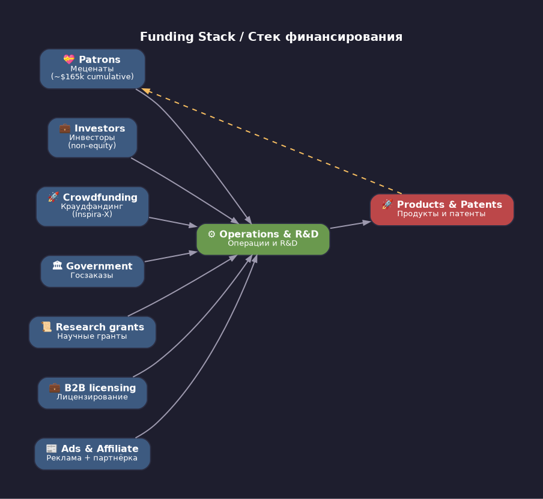

### Current patrons **/** Текущие меценаты

**Full live list with photos on [asrp.tech/ru/patrons](https://asrp.tech/ru/patrons). **/** Полный актуальный список с фото на /ru/patrons.**

> All patrons listed below have consented to public attribution on `asrp.tech/ru/patrons`; this table mirrors that public registry. **/** Все меценаты ниже дали согласие на публичное упоминание на `asrp.tech/ru/patrons`; таблица отражает публичный реестр.

| Tier **/** Уровень | Range **/** Диапазон | Patrons **/** Меценаты |
|---|---|---|
| 👑 **Principal Philanthropist **/** Главный Филантроп** | $50 k – $100 k | Alexander Ovsyannikov **/** Александр Овсянников ($100 k) |
| ⭐ **Senior Patron **/** Старший Патрон** | $20 k – $50 k | Chirkova Olesia **/** Чиркова Олеся ($20 k) |
| 🔷 **Major Benefactor **/** Крупный Благотворитель** | $10 k – $20 k | Yulia Khomyak **/** Юлия Хомяк ($15 k) · Vlada Bilovodenko **/** Влада Биловоденко ($10 k) |
| 🟢 **Supporting Donor **/** Поддерживающий Донор** | $5 k – $10 k | Dmitriy Kapustin **/** Дмитрий Капустин ($5 k) · Tatyana Burilova **/** Татьяна Бурилова ($5 k) |
| 🟡 **Contributing Participant **/** Вносящий Участник** | $1 k – $5 k | Pavel Ivanushko **/** Павел Иванушко · Olena Mutsalkhanova-Yushchenko **/** Олена Муцалханова-Ющенко · Anna Budanova **/** Анна Буданова · Irina Bukach **/** Ирина Букач · Tatyana Krestyanova **/** Татьяна Крестьянова · Lev Shishkin **/** Лев Шишкин · Igor Siberia **/** Игорь Сибирия (each $1 k **/** каждый по $1 k) |
| 🔵 **Individual Contributor **/** Индивидуальный Вкладчик** | $100 – $1 k | Zhanderbek Berik **/** Жандербек Берик ($400) · Marina Kutsina **/** Марина Куцина ($500) · Vadim Kazakov **/** Вадим Казаков ($500) · Irina Grivtsova **/** Ирина Гривцова ($200) · Irina Zayukova **/** Ирина Заюкова · Natalia Voloshina **/** Наталья Волошина · Anton Liapesha **/** Антон Ляпеша · Uladzislau **/** Владислав · Olga **/** Ольга (each $100 **/** каждый по $100) |

> Inspired by the tradition of historical patronage — Lorenzo de' Medici, Cosimo de' Medici, Eleonora de Toledo, Andrew Carnegie, John D. Rockefeller — as referenced on the live site.
> Вдохновляясь исторической традицией меценатства — Лоренцо де Медичи, Козимо де Медичи, Элеонора де Толедо, Эндрю Карнеги, Джон Д. Рокфеллер — как отмечено на живом сайте.

---

## 📡 Frequency Ladder **/** Частотная лестница контента

**Same research, different complexity, different audience.**
**Одно и то же исследование, разная сложность, разная аудитория.**

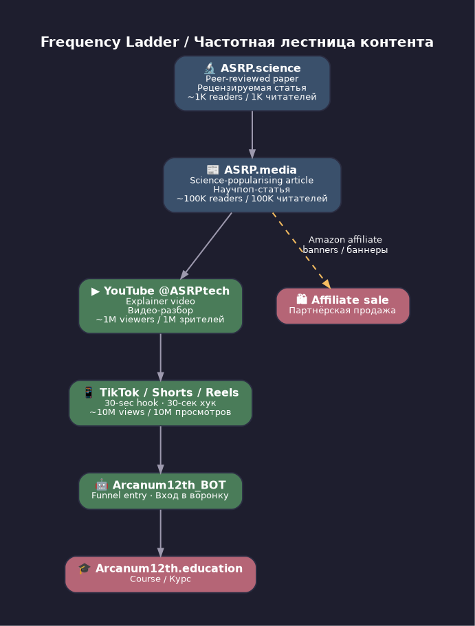

- Journal builds credibility. **/** Журнал строит доверие.
- Media translates for general audience. **/** Медиа переводит для массовой аудитории.
- YouTube gives depth + monetization. **/** YouTube даёт глубину + монетизацию.
- Short-form brings scale. **/** Короткие форматы дают масштаб.
- Bot + school convert attention into revenue. **/** Бот + школа конвертируют внимание в деньги.

---

## 📺 Media Strategy — Unified Content Factory **/** Медиа-стратегия — единый контент-завод

**Not one channel — one system.** ASRP's media surface is not a collection of independent accounts; it is a **cross-platform content factory** in which every project (ASRP.art, ASRP.science, ASRP.fashion, ASRP.drift, ASRP.media, Arcanum12th, GMS, Inspira-X, Kapusta.money, BFS) has its own presence on every available channel, and the channels are orchestrated to feed a single discovery-and-monetisation funnel. **/** **Не один канал — одна система.** Медиа-поверхность ASRP — это не набор независимых аккаунтов, а **кросс-платформенный контент-завод**, в котором у каждого проекта (ASRP.art, ASRP.science, ASRP.fashion, ASRP.drift, ASRP.media, Arcanum12th, GMS, Inspira-X, Kapusta.money, BFS) своё присутствие на каждой доступной платформе, а каналы оркестрированы под общую воронку открытия и монетизации.

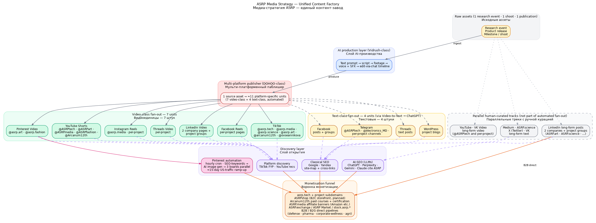

### Content-factory pipeline **/** Конвейер контент-завода

**Fan-out target **/** Цель фан-аута:** the architecture is designed to fan out every raw asset (1 research event or 1 shoot) into **≈11 automated content units across ≈10 platforms** — 7 video-class + 4 text-class — via tooling, not manual posting. Long-form video (YouTube, VK Video) and LinkedIn long-form posts are produced on separate, human-curated tracks alongside the automated fan-out. **/** Архитектура спроектирована так, чтобы фан-аутить каждый исходный ассет (1 исследовательское событие или 1 съёмка) в **≈11 автоматических единиц контента на ≈10 платформах** — 7 видеоединиц + 4 текстовых — через инструменты, не ручной постинг. Long-form видео (YouTube, VK Video) и LinkedIn long-form посты идут отдельными, human-curated треками параллельно автоматическому фан-ауту.

```
Raw asset (1 research event · 1 shoot · 1 publication)
       │
       ▼
AI production layer — Vidrush-class (text → script → footage → voice + SFX)
       │
       ▼
Multi-platform publisher — DOHOO-class (automated fan-out)
       │
       ├── Video-class (7 units) ──► TikTok · YouTube Shorts · Instagram Reels ·
       │                              Facebook Reels · Threads Video · LinkedIn Video ·
       │                              Pinterest Video
       │
       └── Text-class (4 units, via Video-to-Text + ChatGPT) ──► Facebook ·
                                      Telegram · Threads · WordPress (project blogs)

       ─ ─ ─ ─ ─ ─ ─ ─ ─ ─ ─ ─ ─ ─ ─ ─ ─ ─ ─ ─ ─ ─ ─ ─ ─ ─ ─ ─ ─ ─ ─ ─ ─
       Parallel human-curated tracks (not part of the automated fan-out):
       ├── Long-form video (mastered separately) ──► YouTube · VK Video
       ├── Long-form text ──► Medium · ASRP.science · X (Twitter) · VK
       └── B2B long-form ──► LinkedIn posts (2 companies + project groups)
       │
       ▼
Discovery layer
       │
       ├── Classical SEO (Google, Yandex) — site-map + per-channel cross-links
       ├── Platform discovery — TikTok FYP, YouTube recommendations
       ├── Pinterest automation (hourly cron · SEO-driven images · 3 boards parallel)
       │   → US-heavy traffic engine; ramp-up ≈15 days to first measurable traffic
       └── AI-SEO — LLMs (ChatGPT, Perplexity, Gemini, Claude) cite ASRP research /
            products when users ask about hyperbolic fields, consciousness economy,
            lucid-dream technology, biological-AI interaction, etc.
       │
       ▼
Funnel to monetisation
       │
       ├── asrp.tech (main site) + project subdomains
       ├── ASRPshop (🟡 planned) — direct product sales (DAAT Crystal + ASRP.fashion)
       ├── Arcanum12th — paid courses + certification
       ├── ASRP.media affiliate banners — Amazon / partner-product commissions
       ├── ASRP.exchange / ASRP Market / stock.asrp.* — consciousness-state trading
       └── B2B / B2G direct pipelines — defense, pharma, corporate-wellness, agri
```

### Automation tooling classes **/** Классы инструментов автоматизации

The pipeline is intentionally tool-agnostic — three tooling classes are required; the specific vendor in each slot can change without breaking the architecture. **/** Pipeline намеренно tool-agnostic — нужны три класса инструментов; конкретный вендор в каждом слоте можно менять без перестройки архитектуры.

| Class **/** Класс | Function **/** Функция | Reference example **/** Референсный пример |
|---|---|---|
| **AI production** | Text prompt → full script + footage search + motion graphics + voice-over + SFX + edit-via-chat timeline | **Vidrush** — single-prompt documentary-video generation |
| **Multi-platform publisher** | 1 source asset → ≈11 platform-specific distribution points (Video-class + Text-class fan-out) | **DOHOO** — cross-platform auto-posting with Video-to-Text branch → ChatGPT → per-platform text adaptation |
| **SEO discovery automation** | Keyword table → hourly AI content generation → image + title + hashtags → auto-post to parallel boards → compounding traffic | **Pinterest automation** (hourly cron, 3 boards in parallel, ≈15-day ramp-up to first measurable US traffic) |

### Channel taxonomy **/** Таксономия каналов

| Tier **/** Уровень | Platforms **/** Платформы | Purpose **/** Назначение | Per-project split **/** По-проектное разделение |
|---|---|---|---|
| **Short-form video** | TikTok, YouTube Shorts, Instagram Reels, VK Clips | Mass discovery + algorithmic virality **/** Массовое открытие + алгоритмическая виральность | `@asrp.tech`, `@asrp.media`, `@asrp.science`, `@asrp.art`, `@arcanum12th`, `@ovseannikova` + per-project planned rollouts (`asrp.drift`, `asrp.fashion`, `kapusta.money`, `inspira-x`, `body_food_system`) |
| **Long-form video** | YouTube, VK Video | Depth content + interviews + lectures **/** Глубокий контент + интервью + лекции | `@ASRPtech`, `@ASRPart`, `@ASRPmedia`, `@ASRPfashion`, `@Arcanum12th` |
| **Image / visual** | Instagram, Pinterest, Matador, Facebook | Brand identity + visual-search anchors · Pinterest also operates as a dedicated SEO discovery engine — see [Automation tooling classes](#automation-tooling-classes--классы-инструментов-автоматизации) **/** Визуальная айдентика + якоря для visual-search · Pinterest дополнительно работает как отдельный SEO-движок — см. «Классы инструментов автоматизации» | per-project Instagram + Pinterest boards for `asrp.art`, `asrp.fashion`; Matador for project previews |
| **Long-form text** | Medium, ASRP.science, Facebook Notes | Positioning + SEO + thought leadership **/** Позиционирование + SEO + thought leadership | Medium publications per project; ASRP.science for peer-style articles |
| **Announcements / community** | Telegram, X (Twitter), VK | Broadcast + community feedback **/** Вещание + обратная связь | `@ASRPtech` Telegram main + project-specific channels + `@electronics_MD` technical |
| **B2B / BD** | LinkedIn | Prime contractors, academia, investors **/** Prime-подрядчики, академия, инвесторы | **Two LinkedIn companies** + per-project groups (`ASRP.art`, `ASRP.science`, …) — statistically one of the highest-yield promotion sources for ASRP |
| **AI-SEO (emerging)** | ChatGPT, Perplexity, Gemini, Claude | LLM answers cite ASRP when relevant **/** LLM-ответы ссылаются на ASRP по профильным запросам | Per-project content indexed across the web; LLM discovery is downstream of classical SEO + academic preprints |

### Domain-naming convention **/** Конвенция именования доменов

Platform restrictions force different handle forms for the same project — TikTok accepts `@asrp.tech` (dot allowed), YouTube uses `@ASRPtech` (no dot allowed in handle), Facebook group paths use `/asrp.tech/`, Telegram uses `@ASRPtech`. A project's identity is the **concept**, not the handle — the same ASRP.drift appears as `asrp-drift` on some platforms, `asrpdrift` on others, `asrp.drift` on platforms that permit it. Linking between handles is maintained manually in channel bios and in this table to provide canonical cross-references. **/** Ограничения платформ вынуждают использовать разные формы handle для одного и того же проекта — TikTok допускает `@asrp.tech` (точка разрешена), YouTube `@ASRPtech` (точка в handle запрещена), Facebook — путь `/asrp.tech/`, Telegram — `@ASRPtech`. Идентичность проекта — это **концепт**, а не handle: один и тот же ASRP.drift появляется как `asrp-drift` на одних площадках, `asrpdrift` на других, `asrp.drift` там, где это допустимо. Связь между handle поддерживается вручную в био каналов и в таблице ниже.

### Why LinkedIn gets special emphasis **/** Почему LinkedIn — отдельно

LinkedIn is the **highest-yield single channel** in the ASRP stack for three reasons: (1) the audience self-identifies by role and organisation, making prime-contractor/academic/investor targeting straightforward; (2) every published case lands in front of decision-makers by default — this is how the Cortical Labs, NSWC IHD (Cardillo) and Stanford / Nolan tracks all opened (see [Outreach Dynamics](#-outreach-dynamics--динамика-аутрича)); (3) the platform rewards expert long-form content, which matches ASRP's research-heavy material. ASRP maintains **two LinkedIn company pages** plus **per-project groups** (`ASRP.art`, `ASRP.science`, etc.) — each acts as an independent discovery surface for a different segment. **/** LinkedIn — **канал с самой высокой конверсией** в стеке ASRP по трём причинам: (1) аудитория сама себя идентифицирует по роли и организации, что делает таргетинг prime-подрядчик/академия/инвестор прямолинейным; (2) каждый опубликованный кейс по умолчанию попадает к ЛПР — именно так открылись треки Cortical Labs, NSWC IHD (Cardillo) и Stanford / Nolan (см. раздел Outreach Dynamics); (3) платформа поощряет экспертный long-form контент, что совпадает с исследовательским профилем ASRP. ASRP держит **две компании на LinkedIn** плюс **группы по проектам** (`ASRP.art`, `ASRP.science`, и т.д.) — каждая работает как отдельная discovery-поверхность для своего сегмента.

---

## 📢 Distribution Channels **/** Каналы дистрибуции

**Per-subproject social media matrix — each line of work has (or will have) its own voice.**
**Матрица соцмедиа по подпроектам — у каждого направления есть (или будет) свой голос.**

> This table is the **inventory** — the strategy that orchestrates these channels is described above in [Media Strategy — Unified Content Factory](#-media-strategy--unified-content-factory--медиа-стратегия--единый-контент-завод). **/** Эта таблица — **инвентарь**; стратегия, оркестрирующая эти каналы, описана выше в разделе «Медиа-стратегия — единый контент-завод».

| Channel **/** Канал | Link **/** Ссылка | Reach **/** Охват | Purpose **/** Назначение |
|---|---|---|---|
| 🎥 TikTok `@asrp.tech` | [tiktok.com/@asrp.tech](https://www.tiktok.com/@asrp.tech) | 6 014 followers · 51.4 K likes **/** 6 014 подписчиков · 51,4 тыс. лайков | Main — ecosystem highlights **/** Главный — обзор экосистемы |
| 🎥 TikTok `@asrp.media` | [tiktok.com/@asrp.media](https://www.tiktok.com/@asrp.media) | 325 followers · 2 499 likes **/** 325 подписчиков · 2 499 лайков | Science pop content **/** Научпоп-контент |
| 🎥 TikTok `@asrp.science` | [tiktok.com/@asrp.science](https://www.tiktok.com/@asrp.science) | 20 followers · 353 likes **/** 20 подписчиков · 353 лайка | Peer-review teasers **/** Тизеры журнала |
| 🎥 TikTok `@asrp.art` | [tiktok.com/@asrp.art](https://www.tiktok.com/@asrp.art) | 12 followers · 34 likes **/** 12 подписчиков · 34 лайка | Art in altered states **/** Искусство в ИСС |
| 🎥 TikTok `@arcanum12th` | [tiktok.com/@arcanum12th](https://www.tiktok.com/@arcanum12th) | New **/** Новый | School content **/** Контент школы |
| 🎥 TikTok `@ovseannikova` | [tiktok.com/@ovseannikova](https://www.tiktok.com/@ovseannikova) | Personal **/** Личный | Valeria Ovseannicova (CBE, co-founder) **/** Валерия Овсянникова (CBE, со-основатель) |
| ▶️ YouTube `@ASRPtech` | [youtube.com/@ASRPtech](https://www.youtube.com/@ASRPtech) | 447 subs · 22 videos · 27 K views **/** 447 подписчиков · 22 видео · 27 тыс. просмотров | Main + collabs (Enigma) · since Jan 2018 **/** Главный + коллабы (Enigma), с янв. 2018 |
| ▶️ YouTube `@ASRPart` | [youtube.com/@ASRPart](https://www.youtube.com/@ASRPart) | Active **/** Активный | Art videos **/** Видео об искусстве |
| ▶️ YouTube `@ASRPmedia` | [youtube.com/@ASRPmedia](https://www.youtube.com/@ASRPmedia) | 18 subs **/** 18 подписчиков | Media content **/** Медиа-контент |
| ▶️ YouTube `@ASRPfashion` | [youtube.com/@ASRPfashion](https://www.youtube.com/@ASRPfashion) | Active **/** Активный | Fashion reels **/** Fashion-ролики |
| ▶️ YouTube `@Arcanum12th` | [youtube.com/@Arcanum12th](https://www.youtube.com/@Arcanum12th) | Active **/** Активный | Lectures **/** Лекции |
| 📢 Telegram `@ASRPtech` | [t.me/ASRPtech](https://t.me/ASRPtech) | Main **/** Главный | Announcements **/** Анонсы |
| 📢 Telegram `@electronics_MD` | [t.me/electronics_MD](https://t.me/electronics_MD) | Technical **/** Технический | Engineering updates **/** Инженерные апдейты |
| 🧪 ResearchGate Lab **/** Лаборатория ResearchGate | [researchgate.net/lab/...Denis-Banchenko](https://www.researchgate.net/lab/Advanced-Scientific-Research-Projects-Denis-Banchenko) | Academic **/** Академический | Scientific profile **/** Научный профиль |
| 💼 LinkedIn Company **/** LinkedIn (компания) | `ADVANCED SCIENTIFIC RESEARCH PROJECTS LLC` | 50+ followers **/** 50+ подписчиков | B2B outreach **/** B2B-работа |
| 📘 Facebook | [facebook.com/asrp.tech](https://www.facebook.com/asrp.tech/) — "ASRP. AI technologies" **/** «ASRP. AI-технологии» | Active **/** Активно | Cross-industry AI solutions page **/** Страница AI-решений для разных отраслей |
| 🐦 X (Twitter) | [@ASRPtech](https://x.com/ASRPtech) — "Advanced Scientific Research Projects" **/** «Advanced Scientific Research Projects» | Active **/** Активно | News & announcements **/** Новости и анонсы |
| 📷 Instagram | [@asrp.media](https://www.instagram.com/asrp.media/) (login-gated preview) **/** (превью доступно только после входа) | Active **/** Активно | Media content cross-post **/** Кросс-посты медиа-контента |

> **Gaps **/** Пробелы.** The inventory above is a **public-surface sample**, not a complete matrix. Per-project TikTok **/** YouTube channels for `asrp.drift`, `asrp.exchange`, `asrp.fashion` (TikTok only), `kapusta.money`, `body_food_system`, `inspira-x` are not yet launched. Platforms not yet represented in the public matrix but in scope for Media Strategy: **Pinterest** (visual discovery for `asrp.art`, `asrp.fashion`), **Medium** (long-form per-project publications), **Matador** (visual/story-driven), **VK** (RU-speaking audience for all projects), **LinkedIn project-level groups** (`ASRP.art`, `ASRP.science`, etc. under the 2 company pages). Planned alongside the GMS content push. **/** Матрица выше — **публичная выборка**, не полный инвентарь. По-проектные TikTok **/** YouTube-каналы для `asrp.drift`, `asrp.exchange`, `asrp.fashion` (только TikTok), `kapusta.money`, `body_food_system`, `inspira-x` ещё не запущены. Платформы, которых пока нет в публичной матрице, но которые входят в Медиа-стратегию: **Pinterest** (визуальное открытие для `asrp.art`, `asrp.fashion`), **Medium** (long-form по проектам), **Matador** (visual/story-driven), **VK** (русскоязычная аудитория по всем проектам), **LinkedIn-группы по проектам** (`ASRP.art`, `ASRP.science`, и т.д. под 2 компаниями). Запуск — вместе с контентной кампанией GMS.

---

## 📰 Press Mentions **/** Упоминания в прессе

**Selected topics featured in external media.** Full list on [asrp.tech/ru/about](https://asrp.tech/ru/about) under «О нас говорят».
**Темы, освещённые во внешней прессе.** Полный список — на /ru/about в блоке «О нас говорят».

| # | Topic **/** Тема |
|---|---|
| 1 | «Dream economy — how dreams shape global markets» **/** «Экономика сновидений — как сны влияют на мировые рынки» |
| 2 | «Brain biorhythm synchronisation — entering a shared dream?» **/** «Синхронизация биоритмов мозга — попасть в общий сон?» |
| 3 | «Goods and services in the lucid-dream market» **/** «Товары и услуги на рынке осознанных снов» |
| 4 | «From pet project to real research» **/** «От пет-проекта к настоящему исследованию» |
| 5 | «4 future technologies that will change the world» **/** «4 технологии будущего, которые изменят мир» |
| 6 | «Sleep and code — how vivid dreams inspire programmers» **/** «Сон и код — как яркие сны вдохновляют программистов» |
| 7 | «The exchange — how it works and how you earn on it» (ASRP.exchange expert comment) **/** «Биржа — виды площадок и как на них зарабатывать» (экспертный коммент по ASRP.exchange) |

---

## 🎯 Target Markets & Outreach **/** Целевые рынки и аутрич

**Concrete outreach targets for the core hyperbolic-field modulation platform** (commercial framing: *biological response modulation **/** kinetics* — acceleration / deceleration / tissue-healing tracks). **/** **Конкретные цели для аутрича по ядру платформы гиперболической полевой модуляции** (коммерческая рамка: *модуляция биологического отклика **/** кинетика* — треки ускорения / замедления / заживления тканей).

### 🥩 Cultured meat & cell-based nutrition **/** Клеточное мясо и клеточное питание

Target companies — FDA/EU-accredited or rapidly scaling cultured-meat producers, including for animal nutrition. **/** Целевые компании — производители клеточного мяса с аккредитацией FDA/EU или быстро растущие, в т.ч. для питания животных.

- **UPSIDE Foods** ([upsidefoods.com](https://upsidefoods.com)) — US, FDA-cleared **/** США, одобрено FDA
- **GOOD Meat (Eat Just)** ([goodmeat.co](https://goodmeat.co)) — first regulatory approval (Singapore, then USA) **/** первое регуляторное одобрение (Сингапур, затем США)
- **BlueNalu** ([bluenalu.com](https://bluenalu.com)) — cell-cultured seafood **/** клеточно-культивированные морепродукты
- **Mosa Meat** ([mosameat.com](https://mosameat.com)) — EU-based, cultivated beef **/** ЕС, культивированная говядина
- **Aleph Farms** ([aleph-farms.com](https://aleph-farms.com)) — Israeli cultivated-meat leader **/** израильский лидер по культивированному мясу
- **Meatly** ([meatly.co](https://meatly.co)) — UK-approved cultivated pet food **/** одобренный в UK культивированный корм для питомцев
- **MIRAI Foods AG** ([miraifoods.com](https://www.miraifoods.com)) — Swiss cultivated beef, potential EU entry **/** швейцарское культивированное мясо, потенциальный вход в ЕС
- 🇨🇿 **Czech pizza-meat partner** — contacted (entry via existing relationship) **/** Чешский партнёр по пицца-мясу — контакт есть

**Entry pitch:** `biological response modulation → shorter doubling time → lower media cost per kg` (quantifiable KPIs for their pilot teams). **/** **Пич:** модуляция биологического отклика → сокращение времени удвоения → снижение стоимости среды на кг.

### 🌾 Agri-holdings, seeds & mushroom verticals **/** Агрохолдинги, семена и грибные вертикальные фермы

- **Syngenta** ([syngenta.com](https://www.syngenta.com)) — seeds + crop protection **/** семена + защита урожая
- **Bayer Crop Science** ([cropscience.bayer.com](https://www.cropscience.bayer.com)) — seeds, traits, crop protection **/** семена, трейты, защита культур
- **Corteva Agriscience** ([corteva.com](https://www.corteva.com)) — seeds + agrochemicals **/** семена и агрохимия
- **Limagrain** ([limagrain.com](https://www.limagrain.com)) — seed-fund supplier **/** поставщик семенного фонда
- **AeroFarms** ([aerofarms.com](https://www.aerofarms.com)) — vertical farming **/** вертикальное фермерство
- **Monterey Mushrooms** ([montereymushrooms.com](https://www.montereymushrooms.com)) — vertical mushroom leader **/** лидер вертикального грибоводства
- **Promyc (ex-Mycorena)** ([promyc.com](https://www.promyc.com)) — mycoprotein fermentation (rebranded after 2024 reorganisation) **/** ферментация микопротеина (ребрендинг после реорганизации 2024)
- **MycoTechnology** ([mycotechnology.com](https://www.mycotechnology.com)) — mycelium-based ingredients (US) **/** ингредиенты на основе мицелия (США)

### 🦠 Bioreactors — spirulina, chlorella, microalgae **/** Биореакторы — спирулина, хлорелла, микроводоросли

- **AlgaTechnologies (AlgaTech)** ([algatech.com](https://www.algatech.com)) — astaxanthin & microalgae nutraceuticals **/** астаксантин и нутрицевтики из микроводорослей
- **Cyanotech** ([cyanotech.com](https://cyanotech.com)) — spirulina + astaxanthin **/** спирулина + астаксантин
- **DIC Corporation / Earthrise Nutritionals** ([earthrise.com](https://www.earthrise.com)) — world's largest spirulina farm **/** крупнейшая в мире ферма спирулины

### 💊 Pharma, supplements & probiotics **/** Фарма, БАД и пробиотики

Potential directions (each requires case-by-case IRB/regulatory design): scar-resorption ointments, probiotic potentiation, oncology-adjunct protocols (deceleration of pathological cell growth — **biological response modulation, deceleration kinetics**), drug manufacturing process optimization. **/** Возможные направления (каждое с отдельной разработкой IRB/регуляторики): мази для рассасывания шрамов, усиление пробиотиков, онко-сопроводительные протоколы (замедление патологического роста — **модуляция биологического отклика, кинетика замедления**), оптимизация процессов производства лекарств.

- **Nestlé Health Science** ([nestlehealthscience.com](https://www.nestlehealthscience.com)) — functional drinks + probiotics **/** функциональные напитки и пробиотики
- **Danone** ([danone.com](https://www.danone.com)) — dairy + probiotic portfolio **/** молочка и пробиотики
- **Abbott Laboratories** ([abbott.com](https://www.abbott.com)) — nutrition + diagnostics **/** нутриция и диагностика
- **DSM-Firmenich** ([dsm-firmenich.com](https://www.dsm-firmenich.com)) — nutritional ingredients **/** нутрициональные ингредиенты
- **Chr. Hansen** ([chr-hansen.com](https://www.chr-hansen.com)) — probiotic cultures **/** пробиотические культуры
- **BASF Nutrition & Health** ([nutrition.basf.com](https://nutrition.basf.com)) — nutrition active ingredients **/** активные ингредиенты для нутриции

### 🧠 Neurogenesis & biohybrid compute **/** Нейрогенез и биогибридные вычисления

Strategic tech partners for the cognitive-enhancement stack (DAAT Crystal + Inspira-X + neurointerface). **/** Стратегические tech-партнёры по стеку когнитивного усиления (DAAT + Inspira-X + нейроинтерфейс).

- **Cortical Labs** ([corticallabs.com](https://corticallabs.com)) — active negotiations (Blood Plasma Study → LinkedIn inbound) **/** активные переговоры
- **Koniku** ([koniku.com](https://www.koniku.com)) — biohybrid neural-silicon systems **/** биогибридные нейронно-кремниевые системы
- **Neurable** ([neurable.com](https://neurable.com)) — consumer neurointerfaces **/** потребительские нейроинтерфейсы
- **Paradromics** ([paradromics.com](https://www.paradromics.com)) — high-bandwidth BCI **/** высокопропускные BCI

### 🥤 Gut-healing functional beverages **/** Функциональные напитки для ЖКТ

Tissue-healing **biological response (healing-kinetics track)** applied to beverages for gastrointestinal recovery (ulcers, inflammatory bowel conditions). Initial partner overlap with the pharma list above (Nestlé Health Science, Danone). **/** Биологический отклик заживления (трек кинетики заживления) в напитках для восстановления ЖКТ (язвы, воспалительные состояния). Первоначальный пул партнёров — тот же, что и по фарме.

### 🛡 Military & defense wound-healing **/** Военные технологии заживления

Target: accelerated wound healing for service personnel, leveraging the acceleration-kinetics response. Entry through DARPA BAA pipeline (proposal-portal access already active), VA Gulf War Syndrome adjacency. **/** Цель: ускоренное заживление ранений у военнослужащих, через acceleration-модуляцию. Вход через DARPA BAA (доступ к порталу подачи заявок уже активен) и смежный трек VA Gulf War Syndrome.

### 🏋 Sports nutrition — protein + recovery **/** Спортивное питание — протеин и восстановление

Positioning: **not** «direct muscle-mass boost» — framed as **improved protein absorption, accelerated recovery, optimized metabolism**. **/** Позиционирование: **не** «прирост мышечной массы напрямую», а **улучшение усвоения белка, ускоренное восстановление, оптимизация метаболизма**.

- Primary **/** Приоритетные: **Abbott Laboratories**, **DSM-Firmenich**, **Glanbia Performance Nutrition** ([glanbia.com](https://www.glanbia.com))
- Direct-to-consumer channels via ASRPshop (🟡 planned) + ASRP.media content. **/** Прямые B2C-каналы через ASRPshop (🟡 планируется) + контент ASRP.media.

### 🧬 Body Food System synergy **/** Синергия с Body Food System

BFS stacks genetics + microbiome + biological-response modulation into an adaptive, personalized nutrition layer. **/** BFS объединяет генетику + микробиом + модуляцию биологического отклика в адаптивный персональный слой питания.

> Potential flagship product: **«adaptive nutrition + cognitive modulation system»** — BFS + Cortical Labs **/** Koniku gut-brain axis + Nestlé Health Science functional drinks. Combines three revenue streams (B2C nutrition, B2B microbiome tech, B2B cognitive-enhancement licensing — *subject to clinical validation*).
> Потенциальный флагман: **«adaptive nutrition + cognitive modulation system»** — BFS + gut-brain axis через Cortical Labs **/** Koniku + функциональные напитки Nestlé Health Science. Объединяет три потока выручки (B2C-питание, B2B-микробиом, B2B-лицензирование когнитивных технологий — *при условии клинической валидации*).

---

## 🗓️ Product & R&D Rollout **/** Продуктовая и R&D дорожная карта

**5 phases — from research proof-of-concept to pharma and defense-grade deployments.**
**5 этапов — от научного доказательства к фарме и оборонке.**

```text
🧪 Phase 1 **/** Этап 1  ·  0–3 months  ·  Prove the effect **/** Фиксация эффекта
├─ ✅ Hyperbolic Field Blood Plasma Study (published **/** опубликовано)
├─ 🔄 Yeast study (OSF registered) **/** Дрожжевое исследование (OSF)
├─ 🔄 Agricultural field trials Day-4+ **/** Полевые агро-испытания (4-й день+)
├─ 🔄 Cortical Labs — ongoing talks continue **/** Cortical Labs — продолжение текущих переговоров
└─ 🎯 Reproducibility dataset + peer-review submission **/** Датасет воспроизводимости + подача в журнал

💰 Phase 2 **/** Этап 2  ·  3–9 months  ·  First revenue **/** Первая выручка
├─ 🎯 Probiotics & fermentation partnerships **/** Партнёрства — пробиотики и ферментация
├─ 🎯 Sports-nutrition licensing talks **/** Переговоры по лицензированию спортивного питания
├─ 🎯 ASRP.media growth + ASRPshop beta (soft launch to patrons & community) **/** Рост ASRP.media + ASRPshop beta (soft-launch для меценатов и сообщества)
├─ 🎯 First B2G forecast sale (GFS) **/** Первая B2G-продажа прогноза (GFS)
└─ 🎯 Inspira-X crowdfunding campaign **/** Краудфандинг Inspira-X

🧬 Phase 3 **/** Этап 3  ·  6–18 months  ·  Body Food System MVP **/** MVP персонализированного питания
├─ 🚀 BFS — genetics + microbiome integration **/** BFS — интеграция генетики и микробиома
├─ 🚀 Functional-drinks pilots: Nestlé Health Science, Danone **/** Пилоты: Nestlé Health Science, Danone
├─ 🚀 Sports-nutrition pilots: Abbott Laboratories, DSM-Firmenich **/** Пилоты: Abbott Laboratories, DSM-Firmenich
└─ 🚀 Arcanum12th.education full launch + subscription stack **/** Полный запуск школы и подписки

🧠 Phase 4 **/** Этап 4  ·  12–24 months  ·  Neurogenesis & cognitive systems **/** Нейрогенез и когнитивные системы
├─ 🎯 Cortical Labs joint research (extension of active talks) **/** Совместные исследования с Cortical Labs (развитие текущих переговоров)
├─ 🎯 Koniku — biohybrid neural-silicon integration **/** Koniku — биогибридная интеграция нейронов и кремния
├─ 🎯 ASRP.art institutional partnerships (top-tier auction houses) **/** Институциональные партнёрства ASRP.art (аукционные дома высшего эшелона)
└─ 🎯 GMS + Banchenko-Market pilot launch **/** Пилотный запуск GMS + Banchenko-Market

🏛 Phase 5 **/** Этап 5  ·  2+ years  ·  Pharma, clinical, defense **/** Фарма, клиника, оборонка
├─ 🌍 Pharma partnerships: scar-resorption ointments, oncology-adjunct protocols **/** Фарма: мази для рассасывания шрамов, онко-сопроводительные протоколы
├─ 🌍 Gut-healing functional beverages (17-ch modulation) **/** Напитки для ЖКТ (17-канальная модуляция)
├─ 🌍 Military wound-healing protocols (Gulf War Syndrome track) **/** Военные протоколы заживления (трек Gulf War Syndrome)
└─ 🌍 DARPA-class R&D subcontracts (UAP reverse-engineering) **/** R&D-субконтракты DARPA-класса (реверс UAP)
```

> Marketing operations (email campaigns, CRM rollout, YouTube AdSense, landing pages, annual reports) run in parallel across all phases and are tracked internally rather than duplicated here. **/** Маркетинговые операции (email-кампании, CRM, YouTube AdSense, лендинги, годовые отчёты) идут параллельно всем фазам и трекаются внутренне, чтобы не дублировать здесь.

---

## 🤝 Partnerships & Contacts **/** Партнёрство и контакты

| Partnership Type **/** Тип партнёрства | We Offer **/** Предлагаем | We Seek **/** Ищем |
|---|---|---|
| 🎓 Course Authors **/** Авторы курсов | Audience, platform, promotion **/** Аудитория, платформа, продвижение | Experts with unique knowledge **/** Эксперты с уникальным знанием |
| 🔬 Researchers **/** Учёные | Journal, peer review, indexing **/** Журнал, рецензирование, индексация | Quality research, reviewers **/** Качественные работы, рецензенты |
| 💼 Business & Investors **/** Бизнес и инвесторы | Patents, tech, pilot projects **/** Патенты, технологии, пилоты | Funding, implementation, scale **/** Финансирование, внедрение, масштаб |
| 📢 Media & Influencers **/** Медиа и инфлюенсеры | Exclusive content, topics **/** Эксклюзивный контент, темы | Reach, promotion, cross-collabs **/** Охват, продвижение, кросс-коллабы |
| 🏛️ Government **/** Defense **/** Госсектор и оборонка | Reverse engineering, forecasting, biomed **/** Реверс, прогнозирование, биомед | Contracts, grants, facility access **/** Контракты, гранты, доступ к объектам |

**Contacts **/** Контакты:**
- 🌐 Website **/** Сайт: [asrp.tech](https://asrp.tech)
- 📧 Email: `info@asrp.tech`
- 💬 Telegram: [@Arcanum12th_BOT](https://t.me/Arcanum12th_BOT)
- 💻 GitHub: [AdvancedScientificResearchProjects](https://github.com/AdvancedScientificResearchProjects)
- 📍 Entities **/** Юр. лица: **ASRP LLC** (US / Florida, operational **/** операционная) + ТОО «Перспективные Научно-Исследовательские Разработки», Komarova St. 37/56, Baikonur, 468320, Kazakhstan (patent-holding **/** патентодержатель) + **UK entity** (reinstatement stage **/** на стадии восстановления корпоративного статуса). See [Legal Entities — UBO disclaimer](#-legal-entities--registry-verification--юр-лица-и-публичная-верификация) for beneficial-ownership note. **/** См. раздел «Юр. лица — UBO-оговорка».

---

## ⚠️ Important Notes **/** Важные примечания

1. **Early stage **/** Ранняя стадия.** Quality over scale. **/** Качество важнее масштаба.
2. **Single entry point **/** Единая точка входа.** All campaigns route through `asrp.tech` or `arcanum12th.education`. **/** Все кампании ведут на `asrp.tech` или `arcanum12th.education`.
3. **Compliance **/** Соответствие закону.** Double opt-in for email, GDPR/152-ФЗ for PII. **/** Double opt-in, GDPR/152-ФЗ.
4. **A/B before scale / A/B до масштаба.** Any mass activity starts at 1–2% audience. **/** Любая массовая активность стартует на 1–2%.
5. **NDA tier **/** Уровень NDA.** Some defense-facing materials require NDA. **/** Часть оборонных материалов требует NDA.
6. **No public offer **/** Не публичная оферта.** This repo describes the ecosystem; use of IP requires written permission. **/** Этот репо описывает экосистему; использование ИС — только с письменного согласия.

---

## 💛 Support **/** Поддержать

If this repository is useful to you — research, investor walk-throughs, OSINT exploration, or just because you appreciate what ASRP is building — please consider supporting our work. Recurring patronage funds the labs, the open-source tooling, and the bilingual documentation you are reading right now.

Если этот репозиторий вам полезен — для исследования, разговора с инвесторами, OSINT-разбора, или просто потому что вам близко то, что делает ASRP — пожалуйста, поддержите нашу работу. Регулярное меценатство финансирует лаборатории, open-source инструменты и эту двуязычную документацию.

→ **<https://asrp.tech/en/patrons>** · 7 patron tiers · Principal Philanthropist · Strategic Partner · Major Patron · Patron · Senior Contributor · Contributor · Individual Contributor

→ **<https://asrp.tech/ru/patrons>** · 7 уровней меценатства · от Главного Филантропа до Индивидуального Вкладчика

→ **<https://asrp.tech/ru/donate/asrp>** · one-off donations / Inspira-X crowdfunding pre-launch **/** разовые пожертвования / предлончевый донат под Inspira-X

---

## 📄 License **/** Лицензия

© 2023–2026 ASRP LLC + ТОО «Перспективные Научно-Исследовательские Разработки». All rights reserved. **/** Все права защищены.

> 💡 **Contributing **/** Как внести вклад:**
> To suggest improvements, propose a course, or become a partner — contact us via [asrp.tech/contacts](https://asrp.tech/contacts) or the Telegram bot.
> Чтобы предложить улучшения, создать курс или стать партнёром — напишите через [asrp.tech/contacts](https://asrp.tech/contacts) или через Telegram-бот.
