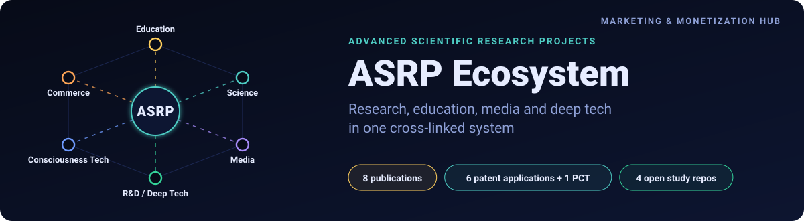
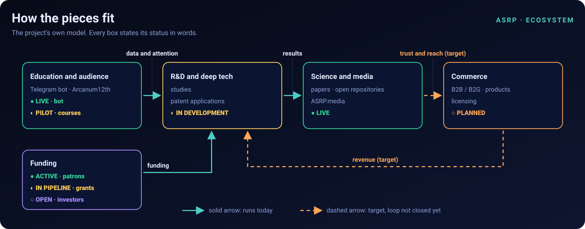
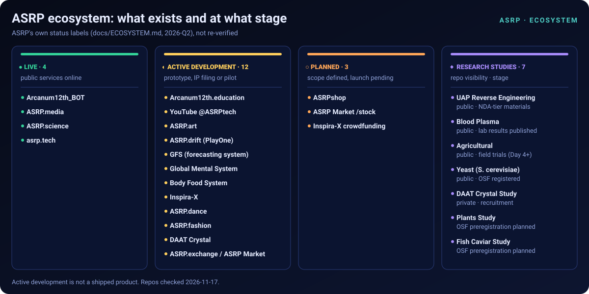

**English | [Русский](README.ru.md)**

<div align="center">



# ASRP Ecosystem — Marketing & Monetization Hub

**Advanced Scientific Research Projects (ASRP)** — Unified research, education, science, media & deep-tech ecosystem.


[](https://asrp.tech)
[](https://asrp-graph.surge.sh/preview.html)

[](https://asrp.tech/en/patrons)

</div>

## At a glance

- **What it is.** ASRP is an early-stage private research group (Florida LLC since 2017, Kazakhstan LLP
  since 2024, a UK entity being reinstated). Its research lines are unconventional: hyperbolic-field effects
  on blood plasma, seeds and yeast; forecasting from dream and biosensor data (GFS); UAP reverse engineering.
  Around them it runs education, a journal site, media and commerce as one cross-linked system. This
  repository is the single entry point for people outside it.
- **What exists today.** 4 public services online, 12 components listed as in active development, 3
  planned, and 7 research studies: 4 with open repositories on GitHub, 1 in a private repository, 2 at the
  planned-preregistration stage.
- **What backs it.** Checked during this update: 4 public study repositories and 7 public
  patent-documentation repositories. Stated by the project and linked, not re-checked: 8 publications
  listed on ResearchGate (7 journal articles, 1 technical report), 6 Kazpatent applications + 1 PCT + 1 US
  copyright, two legal entities with registry numbers, ≈$165 k from 22 named patrons. Evidence and check
  status per item: [Proof points](#proof-points).
- **What this page does not claim.** No revenue figures, no signed customers, no clinical or regulatory
  claims. The first isolated sales the project reports (an affiliate commission, crystals bought for a pilot)
  are unverified and carry no figures. Outreach targets are targets, contacts are contacts, and the DARPA
  item is portal access, not an award. The detail pages reproduce the project's earlier wording unchanged,
  dated 2026-Q2.
- **Who is behind it.** Founders: Denis Banchenko (CEO), Valeria Ovseannicova, Mykhailo Kapustin.
  [Team](docs/TEAM.md).
- **What to do next.** Write to `info@asrp.tech`. Investors and B2B / B2G partners: paths to money for
  [research](docs/PATHS_TO_MONEY_RESEARCH.md) and [products](docs/PATHS_TO_MONEY_PRODUCTS.md); no equity
  round is described here, only co-operation models without share transfer. Patrons:
  [asrp.tech/en/patrons](https://asrp.tech/en/patrons). Researchers:
  [Research, patents and accreditations](docs/RESEARCH_AND_IP.md) and the [whitepapers](whitepaper/README.md).

<div align="center">

</div>

*How the pieces fit, as the project describes its own model.* Each box carries its status in words. Solid
arrows are flows that already run: the bot and pilot courses feed research, research is published, patrons
fund the work. Dashed arrows are the commercial loop the ecosystem is built for; the project reports first
isolated sales but publishes no revenue figures. Details:
[Ecosystem map and component status](docs/ECOSYSTEM.md).

> 💛 **If this work is useful to you — support us:** **<https://asrp.tech/en/patrons>** · 7 patron tiers from
> Principal Philanthropist to Individual Contributor.
> Investor relations (co-operation models without share transfer): <https://asrp.tech/en/investors>

---

## Language

**English | [Русский](README.ru.md).** Every page exists in two language versions: `*.md` (English) and
`*.ru.md` (Russian); graphics as `*.en.svg` / `*.ru.svg`. Languages are not mixed in the body text.
Exceptions: [`whitepaper/README.md`](whitepaper/README.md) and the pages in [`graph/`](graph/README.md) still
use the previous mixed layout and were left untouched by this update, and the
[update report](reports/MARKETING_UPDATE_REPORT.md) exists in Russian only.

---

## Quick navigation

| | Section | What is inside | Document |
|---|---|---|---|
|  | **Ecosystem** | strategic thesis, six clusters, taxonomy / data-flow / money-flow diagrams, status of every component | [docs/ECOSYSTEM.md](docs/ECOSYSTEM.md) |
|  | **Research and IP** | flagship papers, patent applications with numbers and exam status, accreditations, timeline | [docs/RESEARCH_AND_IP.md](docs/RESEARCH_AND_IP.md) |
|  | **Whitepapers** | complete publication list, abstracts, authors, external scientific references | [whitepaper/README.md](whitepaper/README.md) |
|  | **Paths to money: research** | UAP reverse engineering, blood plasma / hyperbolic biomed, agricultural study, GFS forecasting | [docs/PATHS_TO_MONEY_RESEARCH.md](docs/PATHS_TO_MONEY_RESEARCH.md) |
|  | **Paths to money: products** | ASRP.art, ASRP.drift, ASRP.media, Arcanum12th, cross-promotion, ASRP.dance, ASRP.fashion, DAAT Crystals, GMS | [docs/PATHS_TO_MONEY_PRODUCTS.md](docs/PATHS_TO_MONEY_PRODUCTS.md) |
|  | **Track record** | nine documented cases, including the ones that did not work out | [docs/TRACK_RECORD.md](docs/TRACK_RECORD.md) |
|  | **Outreach** | engagement funnel and the log of external reactions | [docs/OUTREACH.md](docs/OUTREACH.md) |
|  | **Funding and patrons** | seven funding streams with status, patron tiers and current patrons, how to support | [docs/FUNDING.md](docs/FUNDING.md) |
|  | **Media and channels** | frequency ladder, content-factory pipeline, channel inventory with reach, press topics | [docs/MEDIA_AND_CHANNELS.md](docs/MEDIA_AND_CHANNELS.md) |
|  | **Target markets** | companies ASRP intends to approach, by vertical (targets, not partners) | [docs/TARGET_MARKETS.md](docs/TARGET_MARKETS.md) |
|  | **Roadmap** | five-phase product and R&D rollout | [docs/ROADMAP.md](docs/ROADMAP.md) |
|  | **Team** | leadership team and roles | [docs/TEAM.md](docs/TEAM.md) |
|  | **Legal entities** | Florida LLC and Kazakhstan LLP registry data, ownership and UBO note | [docs/LEGAL_ENTITIES.md](docs/LEGAL_ENTITIES.md) |
|  | **Partnerships and terms** | what we offer and seek per partner type, contacts, important notes, license | [docs/PARTNERSHIPS_AND_TERMS.md](docs/PARTNERSHIPS_AND_TERMS.md) |
|  | **Interactive graph** | browser map of entities and connections, money-flow notes, source data | [graph/](graph/README.md) |
|  | **Update report** | what moved where, loss check, open questions | [reports/MARKETING_UPDATE_REPORT.md](reports/MARKETING_UPDATE_REPORT.md) |

Full list: [documentation index](docs/README.md).

---

## What exists and at what stage

<div align="center">

</div>

The figure repeats the component tables of [docs/ECOSYSTEM.md](docs/ECOSYSTEM.md). "Live" means a public
service that is online. "Active development" is the project's own label for components with a working
prototype, IP protection or an active pilot; it includes a YouTube channel and research-stage programmes,
and it is not the same as a shipped product. Of the 7 studies, 4 have public repositories, 1 is recruiting
in a private repository, and 2 are listed with preregistration planned.

---

## Proof points

Check status legend: **VERIFIED** = checked by an automated request during this update (17 November 2026);
**STATED** = taken from the source documents with a public link you can follow, not re-checked;
**NOT VERIFIED** = no public evidence in this repository.

| What | Evidence | Check status |
|---|---|---|
| Open study repositories: [UAP Reverse Engineering](https://github.com/AdvancedScientificResearchProjects/UAP_Reverse_Engineering_Study), [Blood Plasma](https://github.com/AdvancedScientificResearchProjects/Hyperbolic_Field_BloodPlasma_Study), [Agricultural](https://github.com/AdvancedScientificResearchProjects/Hyperbolic_Field_Agricultural_Study), [Yeast](https://github.com/AdvancedScientificResearchProjects/Hyperbolic_Field_SaccharomycesCerevisiae_Study) | public GitHub repositories | **VERIFIED** public. Scientific results inside them were not reviewed here |
| 6 Kazpatent applications + 1 PCT, 1 US copyright (TXu002116250) | application numbers and 7 public documentation repositories in [Research and IP](docs/RESEARCH_AND_IP.md#research--patents-portfolio) | Repositories **VERIFIED** public. Registry status of each application: **STATED** |
| 8 canonical publications | ResearchGate records and DOIs in [whitepaper/README.md](whitepaper/README.md) | **STATED**. 8 rows in the list: 7 journal articles, 1 technical report. The OSF DOI opens and the second DOI redirects to the publisher; ResearchGate refuses automated checks |
| Legal entities: Florida LLC `L17000209665`, Kazakhstan LLP BIN `240140033296` | registry links in [Legal entities](docs/LEGAL_ENTITIES.md) | **STATED**. No registry link could be opened automatically (SunBiz refuses automated requests, one Kazakhstan link is gone, the other did not respond); a manual look-up is required |
| Interactive graph, 147 entities | [`graph/asrp_kumu.json`](graph/asrp_kumu.json), [live viewer](https://asrp-graph.surge.sh/preview.html) | **VERIFIED** by counting the data file (147 entities, 256 connections; earlier texts said 245 connections) |
| Patron funding, cumulative ≈$165 k from 22 named patrons | [asrp.tech/en/patrons](https://asrp.tech/en/patrons), table in [Funding](docs/FUNDING.md) | **STATED**. The listed amounts add up to $164.1 k. The source speaks of 7 tiers; its table lists 6 |
| DARPA BAA proposal-portal access (16 Sep 2025), Tesla Business Program registration (22 Aug 2025) | [Accreditations](docs/RESEARCH_AND_IP.md#accreditations--credentials) | **NOT VERIFIED**. The DARPA item is access to submit proposals, not a merit-based award |
| External contacts: talks with Cortical Labs (last stated update: the company is reviewing the study), LinkedIn-level exchanges with individuals at NSWC IHD and Stanford / Nolan Lab, an inferred first read of the UAP repository from a U.S. Department of Energy network | [Outreach](docs/OUTREACH.md), [Track record](docs/TRACK_RECORD.md) | **NOT VERIFIED**. No counterparty has confirmed these publicly; none is a partnership or a contract |
| Channel reach, e.g. TikTok `@asrp.tech` 6 014 followers | [Media and channels](docs/MEDIA_AND_CHANNELS.md) | **STATED** as of 2026-Q2, not re-measured |

The full list of unverified statements and the questions they raise is in the
[update report](reports/MARKETING_UPDATE_REPORT.md#not-verified).

---

## Who this is for

| You are | Start here | Then |
|---|---|---|
| **Investor** | [At a glance](#at-a-glance), [Proof points](#proof-points) | [Paths to money: research](docs/PATHS_TO_MONEY_RESEARCH.md) and [products](docs/PATHS_TO_MONEY_PRODUCTS.md), [Funding](docs/FUNDING.md), [Legal entities](docs/LEGAL_ENTITIES.md) |
| **B2B / B2G partner** | [Target markets](docs/TARGET_MARKETS.md), [Partnerships and terms](docs/PARTNERSHIPS_AND_TERMS.md) | [Track record](docs/TRACK_RECORD.md), [Roadmap](docs/ROADMAP.md) |
| **Patron** | [Funding and patrons](docs/FUNDING.md) | <https://asrp.tech/en/patrons> · one-off donations: <https://asrp.tech/en/donate/asrp> · <https://asrp.tech/ru/donate/asrp> |
| **Researcher** | [Research and IP](docs/RESEARCH_AND_IP.md), [whitepapers](whitepaper/README.md) | the open study repositories listed in [Proof points](#proof-points) |
| **Media, course author** | [Media and channels](docs/MEDIA_AND_CHANNELS.md) | [Partnerships and terms](docs/PARTNERSHIPS_AND_TERMS.md) |

---

## Interactive graph

> 🌐 **Interactive ecosystem graph (browser, EN/RU):** **<https://asrp-graph.surge.sh/preview.html>** — 147
> entities · 256 connections (earlier texts said 245) · click to explore relationships, filter by type, search, export PNG. Source: [`graph/`](graph/).

The money-flow reading of the same graph is in [`graph/MONEY_FLOW.md`](graph/MONEY_FLOW.md).

---

## Repository structure

```
ASRP_ecosystem_marketing/
├── README.md / README.ru.md          # this showcase, two languages
├── CHANGELOG(.ru).md                 # change history
├── docs/
│   ├── README(.ru).md                # documentation index
│   ├── ECOSYSTEM(.ru).md             # thesis, clusters, diagrams, component status
│   ├── RESEARCH_AND_IP(.ru).md       # papers, patent applications, accreditations
│   ├── TEAM(.ru).md                  # leadership team
│   ├── LEGAL_ENTITIES(.ru).md        # registry data, ownership and UBO note
│   ├── PATHS_TO_MONEY_RESEARCH(.ru).md
│   ├── PATHS_TO_MONEY_PRODUCTS(.ru).md
│   ├── TRACK_RECORD(.ru).md          # nine cases
│   ├── OUTREACH(.ru).md              # engagement funnel and log
│   ├── FUNDING(.ru).md               # funding streams, patrons, support
│   ├── MEDIA_AND_CHANNELS(.ru).md    # media strategy, channels, press topics
│   ├── TARGET_MARKETS(.ru).md        # outreach targets by vertical
│   ├── ROADMAP(.ru).md               # five-phase rollout
│   ├── PARTNERSHIPS_AND_TERMS(.ru).md
│   └── assets/                       # banner, infographics, icons (generated SVG)
├── assets/diagrams/                  # 17 PNG diagrams used by the detail pages
├── whitepaper/                       # publication list and abstracts
├── graph/                            # interactive graph: data, viewer, generator
├── archive/                          # previous root README, kept verbatim
├── reports/                          # update report, inventories, verification output
├── tools/                            # inventory, no-loss check, visual generators
└── tests/                            # regression gate for the no-loss check
```

Rebuild the visuals: `python3 tools/build_visuals.py`. Re-run the loss check:
`python3 tools/verify_no_loss.py`. Run the tests: `python3 -m unittest discover -s tests`.

---

## Team and entities

Leadership: Valeria Ovseannicova (CBE, Co-Founder), Mykhailo Kapustin (CTO, Co-Founder), Ivan Savelyev
(CSO), Kyryl Zmiienko (SAIE), Andrii Kryliuk (LFED), Aleksandr Gromyko (LBED), Denis Banchenko (CEO,
Founder). Roles and notes: [docs/TEAM.md](docs/TEAM.md).

Entities: **ASRP LLC** (US / Florida, operational), ТОО «Перспективные Научно-Исследовательские
Разработки» (Kazakhstan, patent-holding) and a UK entity at the reinstatement stage. Registry data and the
ownership note: [docs/LEGAL_ENTITIES.md](docs/LEGAL_ENTITIES.md).

---

## Disclaimer

This repository describes an early-stage ecosystem. It is not a public offer; use of the intellectual
property requires written permission. Research hypotheses described in the detail pages, including
biomedical ones, are working hypotheses, and this page makes no regulatory or clinical-efficacy claim. The
detail pages reproduce earlier wording that in places is stronger than the evidence shown; those places are
listed in the [update report](reports/MARKETING_UPDATE_REPORT.md#not-verified). Some defense-facing
materials require an NDA. The full notes are in
[Partnerships and terms](docs/PARTNERSHIPS_AND_TERMS.md#important-notes).

## Contact

| Field | Value |
|---|---|
| Website | [asrp.tech](https://asrp.tech) |
| Email | `info@asrp.tech` |
| Telegram | [@Arcanum12th_BOT](https://t.me/Arcanum12th_BOT) |
| GitHub | [AdvancedScientificResearchProjects](https://github.com/AdvancedScientificResearchProjects) |
| Patrons | <https://asrp.tech/en/patrons> · <https://asrp.tech/ru/patrons> |
| Investors | <https://asrp.tech/en/investors> · <https://asrp.tech/ru/investors> |

---

## Where the old README sections went

Before November 2026 this README was one long bilingual page. Nothing was removed: every section moved to
the page listed below, and the original text is kept verbatim in
[`archive/`](archive/README_2026-11-17_pre-marketing-update.md). Links to the old section anchors still
land in this table.

<!-- legacy-map:start -->
| Old section | Now lives in |
|---|---|
| <a name="asrp-ecosystem--marketing--monetization-hub--экосистема-asrp--маркетинг-и-монетизация-"></a>ASRP Ecosystem — Marketing & Monetization Hub | this README (title, badges, navigation) |
| <a name="-table-of-contents--содержание"></a>TABLE OF CONTENTS | this README (title, badges, navigation) |
| <a name="-about--о-проекте"></a><a name="-strategic-thesis--стратегический-тезис"></a><a name="-why-this-hub-exists--зачем-этот-хаб-нужен"></a><a name="-scientific-whitepapers--научные-статьи"></a>About | [Ecosystem](docs/ECOSYSTEM.md#about) · [Strategic thesis](docs/ECOSYSTEM.md#strategic-thesis) · [Why this hub exists](docs/ECOSYSTEM.md#why-this-hub-exists) · [Scientific whitepapers](docs/RESEARCH_AND_IP.md#scientific-whitepapers) |
| <a name="️-ecosystem-map--карта-экосистемы"></a><a name="a-taxonomy--main-clusters--таксономия--основные-кластеры"></a><a name="b-money-flow--who-pays-for-what--поток-денег--кто-за-что-платит"></a>Ecosystem Map | [Ecosystem](docs/ECOSYSTEM.md#ecosystem-map) · [A. Taxonomy — main clusters](docs/ECOSYSTEM.md#a-taxonomy--main-clusters) · [B. Money flow — who pays for what](docs/ECOSYSTEM.md#b-money-flow--who-pays-for-what) |
| <a name="-component-status--статус-компонентов"></a><a name="-live--ready-to-scale--работает-и-готово-к-масштабированию"></a><a name="-active-development--в-активной-разработке"></a><a name="-planned--планируется"></a><a name="-meta-cluster--global-mental-system-gms--мета-кластер--global-mental-system-gms"></a><a name="-research-repositories--исследовательские-репозитории"></a>Component Status | [Ecosystem](docs/ECOSYSTEM.md#component-status) · [Live & Ready to Scale](docs/ECOSYSTEM.md#live--ready-to-scale) · [Active Development](docs/ECOSYSTEM.md#active-development) · [Planned](docs/ECOSYSTEM.md#planned) · [Meta-Cluster — Global Mental System (GMS)](docs/ECOSYSTEM.md#meta-cluster--global-mental-system-gms) · [Research Repositories](docs/ECOSYSTEM.md#research-repositories) |
| <a name="-research--patents-portfolio--портфель-исследований-и-патентов"></a>Research & Patents Portfolio | [Research and IP](docs/RESEARCH_AND_IP.md#research--patents-portfolio) |
| <a name="-leadership-team--команда-руководства"></a>Leadership Team | [Team](docs/TEAM.md#leadership-team) |
| <a name="️-accreditations--credentials--аккредитации-и-регистрации"></a><a name="epochs--chronology-of-registrations-filings-and-events--эпохи--хронология-регистраций-подач-и-событий"></a>Accreditations & Credentials | [Research and IP](docs/RESEARCH_AND_IP.md#accreditations--credentials) · [Epochs — chronology of registrations, filings and events](docs/RESEARCH_AND_IP.md#epochs--chronology-of-registrations-filings-and-events) |
| <a name="-legal-entities--registry-verification--юр-лица-и-публичная-верификация"></a><a name="-advanced-scientific-research-projects-llc-florida-usa--ооо-asrp-флорида-сша"></a><a name="-asrp-llp--тоо-перспективные-научно-исследовательские-разработки-kazakhstan--казахстан"></a><a name="ownership-ubo-and-corporate-affiliation-disclaimer--оговорка-о-структуре-владения-бенефициарном-контроле-и-корпоративной-принадлежности"></a>Legal Entities & Registry Verification | [Legal entities](docs/LEGAL_ENTITIES.md#legal-entities--registry-verification) · [Advanced Scientific Research Projects LLC (Florida, USA)](docs/LEGAL_ENTITIES.md#advanced-scientific-research-projects-llc-florida-usa) · [Ownership, UBO and corporate-affiliation disclaimer](docs/LEGAL_ENTITIES.md#ownership-ubo-and-corporate-affiliation-disclaimer) |
| <a name="-paths-to-money--пути-к-деньгам"></a><a name="-uap-reverse-engineering--defense-contracts--реверс-uap--оборонные-подряды"></a><a name="-blood-plasma--hyperbolic-biomed--medical-centers--плазма-крови--гиперболический-биомед--медцентры"></a><a name="-primary-pathogenic-factor-hypothesis--temporal-desynchronization--гипотеза-первичного-патогенного-фактора--темпоральная-десинхронизация"></a><a name="-agricultural-study--agri-grants--food-security--агро-исследование--агро-гранты-и-продовольственная-безопасность"></a><a name="-gfs--global-forecasting-system--forecast-sales--гсп--глобальная-система-прогнозирования--продажа-прогнозов"></a><a name="-asrpart--objective-art-valuation--asrpart--объективная-оценка-искусства"></a><a name="-asrpdrift--neurointegrative-platform--asrpdrift--нейроинтегративная-платформа"></a><a name="-asrpmedia--ads--affiliate--asrpmedia--реклама--партнёрка"></a><a name="-arcanum12th--b2c-learning--arcanum12th--b2c-образование"></a><a name="-cross-promotion-pattern--паттерн-кросс-промо"></a><a name="-asrpdance--movement-neuroscience--asrpdance--нейронаука-движений"></a><a name="-asrpfashion--living-biocompatible-textiles--asrpfashion--живые-биосовместимые-ткани"></a><a name="-daat-crystals--premium-cognitive-enhancement--daat-кристаллы--премиум-когнитивное-усиление"></a><a name="-gms--banchenko-market--gms--banchenko-market"></a>Paths to Money | [Paths to money: research](docs/PATHS_TO_MONEY_RESEARCH.md#paths-to-money) · [UAP Reverse Engineering → Defense Contracts](docs/PATHS_TO_MONEY_RESEARCH.md#uap-reverse-engineering--defense-contracts) · [Blood Plasma / Hyperbolic Biomed → Medical Centers](docs/PATHS_TO_MONEY_RESEARCH.md#blood-plasma--hyperbolic-biomed--medical-centers) · [Primary pathogenic-factor hypothesis — temporal desynchronization](docs/PATHS_TO_MONEY_RESEARCH.md#primary-pathogenic-factor-hypothesis--temporal-desynchronization) · [Agricultural Study → Agri Grants & Food Security](docs/PATHS_TO_MONEY_RESEARCH.md#agricultural-study--agri-grants--food-security) · [GFS — Global Forecasting System → Forecast Sales](docs/PATHS_TO_MONEY_RESEARCH.md#gfs--global-forecasting-system--forecast-sales) · [ASRP.art → Objective Art Valuation](docs/PATHS_TO_MONEY_PRODUCTS.md#asrpart--objective-art-valuation) · [ASRP.drift → Neurointegrative Platform](docs/PATHS_TO_MONEY_PRODUCTS.md#asrpdrift--neurointegrative-platform) · [ASRP.media → Ads + Affiliate](docs/PATHS_TO_MONEY_PRODUCTS.md#asrpmedia--ads--affiliate) · [Arcanum12th → B2C Learning](docs/PATHS_TO_MONEY_PRODUCTS.md#arcanum12th--b2c-learning) · [Cross-Promotion Pattern](docs/PATHS_TO_MONEY_PRODUCTS.md#cross-promotion-pattern) · [ASRP.dance → Movement Neuroscience](docs/PATHS_TO_MONEY_PRODUCTS.md#asrpdance--movement-neuroscience) · [ASRP.fashion → Living Biocompatible Textiles](docs/PATHS_TO_MONEY_PRODUCTS.md#asrpfashion--living-biocompatible-textiles) · [DAAT Crystals → Premium Cognitive Enhancement](docs/PATHS_TO_MONEY_PRODUCTS.md#daat-crystals--premium-cognitive-enhancement) · [GMS → Banchenko-Market](docs/PATHS_TO_MONEY_PRODUCTS.md#gms--banchenko-market) |
| <a name="-track-record--case-studies--кейсы-и-доказательства"></a><a name="1-uap-repo--us-department-of-energy-first-reader--репозиторий-uap--первый-читатель-из-минэнерго-сша"></a><a name="2-blood-plasma-study--cortical-labs-negotiations--исследование-плазмы-крови--переговоры-с-cortical-labs"></a><a name="3-gfs--early-flags-on-major-events--gfs--ранние-флаги-по-крупным-событиям"></a><a name="4-agricultural-day-4-signal--сигнал-4-го-дня-в-агроисследовании"></a><a name="5-kosmopoisk--chernobrov-archival-cross-reference--lazar-lineage--архивные-перекрёстные-ссылки-космопоиск--чернобров--линия-lazar"></a><a name="6-public-events--gfs-presentations--публичные-события--презентации-gfs"></a><a name="7-daat-crystal-pilots--bank-executives--forbes-list-wearers--пилоты-daat-crystal--руководители-банка-и-носители-из-списка-forbes"></a><a name="8-neurointerface-affiliate-sale--proof-of-mechanism-for-cross-promotion--партнёрская-продажа-нейроинтерфейса--доказательство-механизма-кросс-промо"></a><a name="9-nci-sbir-fy26--pediatric--rare-cancers-application-aug-2025--oct-2025-systemic-cancellation--nci-sbir-fy26--заявка-по-детским-и-редким-формам-рака-август-2025--системная-отмена-в-октябре-2025"></a>Track Record & Case Studies | [Track record](docs/TRACK_RECORD.md#track-record--case-studies) · [1. UAP repo → U.S. Department of Energy first-reader](docs/TRACK_RECORD.md#1-uap-repo--us-department-of-energy-first-reader) · [2. Blood-plasma study → Cortical Labs negotiations](docs/TRACK_RECORD.md#2-blood-plasma-study--cortical-labs-negotiations) · [3. GFS — early flags on major events](docs/TRACK_RECORD.md#3-gfs--early-flags-on-major-events) · [4. Agricultural Day-4 signal](docs/TRACK_RECORD.md#4-agricultural-day-4-signal) · [5. Kosmopoisk / Chernobrov archival cross-reference + Lazar lineage](docs/TRACK_RECORD.md#5-kosmopoisk--chernobrov-archival-cross-reference--lazar-lineage) · [6. Public events — GFS presentations](docs/TRACK_RECORD.md#6-public-events--gfs-presentations) · [7. DAAT Crystal pilots — bank executives + Forbes-list wearers](docs/TRACK_RECORD.md#7-daat-crystal-pilots--bank-executives--forbes-list-wearers) · [8. Neurointerface affiliate sale — proof-of-mechanism for cross-promotion](docs/TRACK_RECORD.md#8-neurointerface-affiliate-sale--proof-of-mechanism-for-cross-promotion) · [9. NCI SBIR FY26 — Pediatric & Rare Cancers application (Aug 2025 → Oct 2025 systemic cancellation)](docs/TRACK_RECORD.md#9-nci-sbir-fy26--pediatric--rare-cancers-application-aug-2025--oct-2025-systemic-cancellation) |
| <a name="-outreach-dynamics--динамика-аутрича"></a><a name="engagement-strategy--стратегия-аутрича"></a><a name="1-nswcihd-us-navy--april-2026--nswcihd-вмс-сша--апрель-2026"></a><a name="2-cortical-labs--ongoing-since-2025--cortical-labs--с-2025-в-процессе"></a><a name="3-stanford--nolan-lab--linkedin-inbound--admin-follow-up-feb-2026--stanford--лаборатория-nolan--входящий-в-linkedin--переписка-с-админом-февраль-2026"></a><a name="4-investor-outreach-log--pending-source-list--журнал-аутрича-к-инвесторам--ожидает-исходного-списка"></a>Outreach Dynamics | [Outreach](docs/OUTREACH.md#outreach-dynamics) · [Engagement strategy](docs/OUTREACH.md#engagement-strategy) · [1. NSWCIHD (U.S. Navy) — April 2026](docs/OUTREACH.md#1-nswcihd-us-navy--april-2026) · [2. Cortical Labs — ongoing since 2025](docs/OUTREACH.md#2-cortical-labs--ongoing-since-2025) · [3. Stanford / Nolan Lab — LinkedIn inbound → admin follow-up (Feb 2026)](docs/OUTREACH.md#3-stanford--nolan-lab--linkedin-inbound--admin-follow-up-feb-2026) · [4. Investor outreach log — pending source list](docs/OUTREACH.md#4-investor-outreach-log--pending-source-list) |
| <a name="-funding-sources--источники-финансирования"></a><a name="funding-stack--стек-финансирования"></a><a name="current-patrons--текущие-меценаты"></a>Funding Sources | [Funding and patrons](docs/FUNDING.md#funding-sources) · [Funding stack](docs/FUNDING.md#funding-stack) · [Current patrons](docs/FUNDING.md#current-patrons) |
| <a name="-frequency-ladder--частотная-лестница-контента"></a>Frequency Ladder | [Media and channels](docs/MEDIA_AND_CHANNELS.md#frequency-ladder) |
| <a name="-media-strategy--unified-content-factory--медиа-стратегия--единый-контент-завод"></a><a name="content-factory-pipeline--конвейер-контент-завода"></a><a name="automation-tooling-classes--классы-инструментов-автоматизации"></a><a name="channel-taxonomy--таксономия-каналов"></a><a name="domain-naming-convention--конвенция-именования-доменов"></a><a name="why-linkedin-gets-special-emphasis--почему-linkedin--отдельно"></a>Media Strategy — Unified Content Factory | [Media and channels](docs/MEDIA_AND_CHANNELS.md#media-strategy--unified-content-factory) · [Content-factory pipeline](docs/MEDIA_AND_CHANNELS.md#content-factory-pipeline) · [Automation tooling classes](docs/MEDIA_AND_CHANNELS.md#automation-tooling-classes) · [Channel taxonomy](docs/MEDIA_AND_CHANNELS.md#channel-taxonomy) · [Domain-naming convention](docs/MEDIA_AND_CHANNELS.md#domain-naming-convention) · [Why LinkedIn gets special emphasis](docs/MEDIA_AND_CHANNELS.md#why-linkedin-gets-special-emphasis) |
| <a name="-distribution-channels--каналы-дистрибуции"></a>Distribution Channels | [Media and channels](docs/MEDIA_AND_CHANNELS.md#distribution-channels) |
| <a name="-press-mentions--упоминания-в-прессе"></a>Press Mentions | [Media and channels](docs/MEDIA_AND_CHANNELS.md#press-mentions) |
| <a name="-target-markets--outreach--целевые-рынки-и-аутрич"></a><a name="-cultured-meat--cell-based-nutrition--клеточное-мясо-и-клеточное-питание"></a><a name="-agri-holdings-seeds--mushroom-verticals--агрохолдинги-семена-и-грибные-вертикальные-фермы"></a><a name="-bioreactors--spirulina-chlorella-microalgae--биореакторы--спирулина-хлорелла-микроводоросли"></a><a name="-pharma-supplements--probiotics--фарма-бад-и-пробиотики"></a><a name="-neurogenesis--biohybrid-compute--нейрогенез-и-биогибридные-вычисления"></a><a name="-gut-healing-functional-beverages--функциональные-напитки-для-жкт"></a><a name="-military--defense-wound-healing--военные-технологии-заживления"></a><a name="-sports-nutrition--protein--recovery--спортивное-питание--протеин-и-восстановление"></a><a name="-body-food-system-synergy--синергия-с-body-food-system"></a>Target Markets & Outreach | [Target markets](docs/TARGET_MARKETS.md#target-markets--outreach) · [Cultured meat & cell-based nutrition](docs/TARGET_MARKETS.md#cultured-meat--cell-based-nutrition) · [Agri-holdings, seeds & mushroom verticals](docs/TARGET_MARKETS.md#agri-holdings-seeds--mushroom-verticals) · [Bioreactors — spirulina, chlorella, microalgae](docs/TARGET_MARKETS.md#bioreactors--spirulina-chlorella-microalgae) · [Pharma, supplements & probiotics](docs/TARGET_MARKETS.md#pharma-supplements--probiotics) · [Neurogenesis & biohybrid compute](docs/TARGET_MARKETS.md#neurogenesis--biohybrid-compute) · [Gut-healing functional beverages](docs/TARGET_MARKETS.md#gut-healing-functional-beverages) · [Military & defense wound-healing](docs/TARGET_MARKETS.md#military--defense-wound-healing) · [Sports nutrition — protein + recovery](docs/TARGET_MARKETS.md#sports-nutrition--protein--recovery) · [Body Food System synergy](docs/TARGET_MARKETS.md#body-food-system-synergy) |
| <a name="️-product--rd-rollout--продуктовая-и-rd-дорожная-карта"></a>Product & R&D Rollout | [Roadmap](docs/ROADMAP.md#product--rd-rollout) |
| <a name="-partnerships--contacts--партнёрство-и-контакты"></a>Partnerships & Contacts | [Partnerships and terms](docs/PARTNERSHIPS_AND_TERMS.md#partnerships--contacts) |
| <a name="️-important-notes--важные-примечания"></a>Important Notes | [Partnerships and terms](docs/PARTNERSHIPS_AND_TERMS.md#important-notes) |
| <a name="-support--поддержать"></a>Support | [Funding and patrons](docs/FUNDING.md#support) |
| <a name="-license--лицензия"></a>License | [Partnerships and terms](docs/PARTNERSHIPS_AND_TERMS.md#license) |
<!-- legacy-map:end -->

---

<div align="center">

**© 2023–2026 ASRP LLC + ТОО «Перспективные Научно-Исследовательские Разработки». All rights reserved.**

Last updated: 17 November 2026 · **Languages:** [EN](README.md) · [RU](README.ru.md)

</div>
