**[English](README.md) | Русский**

<div align="center">


# Экосистема ASRP — Маркетинг и монетизация

**Advanced Scientific Research Projects (ASRP)** — единая экосистема исследований, образования, науки, медиа и глубоких технологий.


[](https://asrp.tech)
[](https://asrp-graph.surge.sh/preview.html)

[](https://asrp.tech/ru/patrons)

</div>

## Коротко

- **Что это.** ASRP — частная исследовательская группа на ранней стадии (Florida LLC с 2017 года,
  казахстанское ТОО с 2024 года, компания в Великобритании на стадии восстановления). Направления
  исследований нестандартные: действие гиперболического поля на плазму крови, семена и дрожжи;
  прогнозирование по данным снов и биосенсоров (GFS); реверс-инжиниринг UAP. Вокруг них группа развивает
  образование, сайт журнала, медиа и коммерцию как одну связанную систему. Этот репозиторий — единая точка
  входа для внешнего читателя.
- **Что есть сегодня.** 4 публичных сервиса в сети, 12 компонентов, которые проект относит к активной
  разработке, 3 в планах и 7 исследований: 4 с открытыми репозиториями на GitHub, 1 в закрытом репозитории,
  2 на стадии запланированной предрегистрации.
- **Чем это подтверждено.** Проверено в ходе этого обновления: 4 публичных репозитория исследований и 7
  публичных репозиториев с патентной документацией. Заявлено проектом, со ссылками, повторно не
  проверялось: 8 публикаций в списке на ResearchGate (7 журнальных статей, 1 технический отчёт), 6 заявок в
  Казпатент + 1 PCT + 1 регистрация авторского права в США, два юридических лица с номерами в реестрах,
  ≈$165 k от 22 названных меценатов. Подтверждение и статус проверки по каждому пункту — в разделе
  [Подтверждения](#подтверждения).
- **Чего эта страница не утверждает.** Нет цифр выручки, нет подписанных клиентов, нет клинических и
  регуляторных утверждений. Первые единичные продажи, о которых сообщает проект (партнёрская комиссия,
  кристаллы, купленные для пилота), не проверены и приведены без сумм. Цели аутрича остаются целями,
  контакты — контактами, а пункт DARPA — это доступ к порталу подачи заявок, а не награда. Подробные
  страницы повторяют прежние формулировки проекта без изменений, на 2 квартал 2026.
- **Кто за этим стоит.** Основатели: Денис Банченко (CEO), Валерия Овсянникова, Михаил Капустин.
  [Команда](docs/TEAM.ru.md).
- **Что делать дальше.** Напишите на `info@asrp.tech`. Инвесторам и партнёрам B2B / B2G: пути к деньгам по
  [исследованиям](docs/PATHS_TO_MONEY_RESEARCH.ru.md) и [продуктам](docs/PATHS_TO_MONEY_PRODUCTS.ru.md);
  раунд с продажей долей здесь не описан, только модели сотрудничества без передачи долей. Меценатам:
  [asrp.tech/ru/patrons](https://asrp.tech/ru/patrons). Исследователям:
  [Исследования, патенты и аккредитации](docs/RESEARCH_AND_IP.ru.md) и [научные статьи](whitepaper/README.md).

<div align="center">

</div>

*Как связаны части — так, как проект сам описывает свою модель.* В каждом блоке статус написан словами.
Сплошные стрелки — потоки, которые уже работают: бот и пилотные курсы питают исследования, исследования
публикуются, меценаты финансируют работу. Пунктирные стрелки — коммерческий контур, ради которого
экосистема строится; проект сообщает о первых единичных продажах, но цифр выручки не публикует.
Подробнее: [Карта экосистемы и статус компонентов](docs/ECOSYSTEM.ru.md).

> 💛 **Если эта работа вам полезна — поддержите нас:** **<https://asrp.tech/ru/patrons>** · 7 уровней
> меценатства — от Главного Филантропа до Индивидуального Вкладчика.
> Инвесторам (модели сотрудничества без передачи долей): <https://asrp.tech/ru/investors>

---

## Язык

**[English](README.md) | Русский.** Каждая страница существует в двух языковых версиях: `*.md` (английская) и
`*.ru.md` (русская); графика — `*.en.svg` / `*.ru.svg`. Языки в тексте не смешиваются. Исключения:
[`whitepaper/README.md`](whitepaper/README.md) и страницы в [`graph/`](graph/README.md) пока остаются в
прежней смешанной вёрстке (это обновление их не трогало), а
[отчёт об обновлении](reports/MARKETING_UPDATE_REPORT.md) есть только на русском.

---

## Быстрая навигация

| | Раздел | Что внутри | Документ |
|---|---|---|---|
|  | **Экосистема** | стратегический тезис, шесть кластеров, схемы таксономии, потоков данных и денег, статус каждого компонента | [docs/ECOSYSTEM.ru.md](docs/ECOSYSTEM.ru.md) |
|  | **Исследования и ИС** | флагманские статьи, патентные заявки с номерами и стадией экспертизы, аккредитации, хронология | [docs/RESEARCH_AND_IP.ru.md](docs/RESEARCH_AND_IP.ru.md) |
|  | **Научные статьи** | полный список публикаций, аннотации, авторы, внешние научные ссылки | [whitepaper/README.md](whitepaper/README.md) |
|  | **Пути к деньгам: исследования** | реверс-инжиниринг UAP, плазма крови и гиперболический биомед, агроисследование, прогнозирование GFS | [docs/PATHS_TO_MONEY_RESEARCH.ru.md](docs/PATHS_TO_MONEY_RESEARCH.ru.md) |
|  | **Пути к деньгам: продукты** | ASRP.art, ASRP.drift, ASRP.media, Arcanum12th, кросс-промо, ASRP.dance, ASRP.fashion, кристаллы DAAT, GMS | [docs/PATHS_TO_MONEY_PRODUCTS.ru.md](docs/PATHS_TO_MONEY_PRODUCTS.ru.md) |
|  | **Кейсы** | девять задокументированных случаев, включая те, что не получились | [docs/TRACK_RECORD.ru.md](docs/TRACK_RECORD.ru.md) |
|  | **Аутрич** | воронка взаимодействия и журнал внешних реакций | [docs/OUTREACH.ru.md](docs/OUTREACH.ru.md) |
|  | **Финансирование и меценаты** | семь потоков финансирования со статусом, уровни меценатства и текущие меценаты, как поддержать | [docs/FUNDING.ru.md](docs/FUNDING.ru.md) |
|  | **Медиа и каналы** | частотная лестница, конвейер контент-завода, перечень каналов с охватом, темы в прессе | [docs/MEDIA_AND_CHANNELS.ru.md](docs/MEDIA_AND_CHANNELS.ru.md) |
|  | **Целевые рынки** | компании, к которым ASRP намерена выходить, по вертикалям (цели, а не партнёры) | [docs/TARGET_MARKETS.ru.md](docs/TARGET_MARKETS.ru.md) |
|  | **Дорожная карта** | пять этапов вывода продуктов и R&D | [docs/ROADMAP.ru.md](docs/ROADMAP.ru.md) |
|  | **Команда** | команда руководства и роли | [docs/TEAM.ru.md](docs/TEAM.ru.md) |
|  | **Юридические лица** | данные реестров по Florida LLC и казахстанскому ТОО, примечание о владении и UBO | [docs/LEGAL_ENTITIES.ru.md](docs/LEGAL_ENTITIES.ru.md) |
|  | **Партнёрство и условия** | что предлагаем и что ищем по типам партнёров, контакты, важные примечания, лицензия | [docs/PARTNERSHIPS_AND_TERMS.ru.md](docs/PARTNERSHIPS_AND_TERMS.ru.md) |
|  | **Интерактивный граф** | карта сущностей и связей в браузере, заметки о потоках денег, исходные данные | [graph/](graph/README.md) |
|  | **Отчёт об обновлении** | что куда переехало, проверка на потери, открытые вопросы | [reports/MARKETING_UPDATE_REPORT.md](reports/MARKETING_UPDATE_REPORT.md) |

Полный список: [указатель документации](docs/README.ru.md).

**На этой странице:** [Подтверждения](#подтверждения) · [Карта экосистемы](#карта-экосистемы) ·
[Статус компонентов](#статус-компонентов) · [Исследования и патенты](#исследования-и-патенты) ·
[Аккредитации и хронология](#аккредитации-и-хронология) · [Юридические лица](#юридические-лица) ·
[Пути к деньгам](#пути-к-деньгам) · [Кейсы](#кейсы) · [Аутрич](#аутрич) · [Финансирование](#финансирование) ·
[Медиа и каналы](#медиа-и-каналы) · [Целевые рынки](#целевые-рынки) · [Дорожная карта](#дорожная-карта) ·
[Команда](#команда) · [Партнёрство](#партнёрство) · [Интерактивный граф](#интерактивный-граф) · [Контакты](#контакты)

---

## Подтверждения

Статусы проверки: **ПРОВЕРЕНО** — проверено автоматическим запросом в ходе этого обновления (17 ноября 2026);
**ЗАЯВЛЕНО** — взято из исходных документов, есть публичная ссылка, повторно не проверялось;
**НЕ ПРОВЕРЕНО** — публичного подтверждения в этом репозитории нет.

| Что | Подтверждение | Статус проверки |
|---|---|---|
| Открытые репозитории исследований: [реверс-инжиниринг UAP](https://github.com/AdvancedScientificResearchProjects/UAP_Reverse_Engineering_Study), [плазма крови](https://github.com/AdvancedScientificResearchProjects/Hyperbolic_Field_BloodPlasma_Study), [агроисследование](https://github.com/AdvancedScientificResearchProjects/Hyperbolic_Field_Agricultural_Study), [дрожжи](https://github.com/AdvancedScientificResearchProjects/Hyperbolic_Field_SaccharomycesCerevisiae_Study) | публичные репозитории GitHub | **ПРОВЕРЕНО**: публичные. Научные результаты внутри них здесь не рецензировались |
| 6 заявок в Казпатент + 1 PCT, 1 регистрация авторского права в США (TXu002116250) | номера заявок и 7 публичных репозиториев с документацией в разделе [Исследования и ИС](docs/RESEARCH_AND_IP.ru.md#портфель-исследований-и-патентов) | Репозитории **ПРОВЕРЕНО**: публичные. Статус каждой заявки в реестре: **ЗАЯВЛЕНО** |
| 8 канонических публикаций | записи ResearchGate и DOI в [whitepaper/README.md](whitepaper/README.md) | **ЗАЯВЛЕНО**. В списке 8 строк: 7 журнальных статей и 1 технический отчёт. DOI на OSF открывается, второй DOI перенаправляет на сайт издателя; ResearchGate отклоняет автоматические запросы |
| Юридические лица: Florida LLC `L17000209665`, казахстанское ТОО, БИН `240140033296` | ссылки на реестры в разделе [Юридические лица](docs/LEGAL_ENTITIES.ru.md) | **ЗАЯВЛЕНО**. Ни одну ссылку на реестр не удалось открыть автоматически (SunBiz отклоняет автоматические запросы, одна казахстанская ссылка удалена, вторая не ответила); нужна ручная проверка |
| Интерактивный граф, 147 сущностей | [`graph/asrp_kumu.json`](graph/asrp_kumu.json), [онлайн-просмотр](https://asrp-graph.surge.sh/preview.html) | **ПРОВЕРЕНО** подсчётом по файлу данных (147 сущностей, 256 связей; в прежних текстах было 245 связей) |
| Финансирование от меценатов, накоплено ≈$165 k от 22 названных меценатов | [asrp.tech/ru/patrons](https://asrp.tech/ru/patrons), таблица в разделе [Финансирование](docs/FUNDING.ru.md) | **ЗАЯВЛЕНО**. Перечисленные суммы дают $164,1 k. Исходник говорит о 7 уровнях, в его таблице их 6 |
| Доступ к порталу подачи заявок DARPA BAA (16 сен. 2025), регистрация в Tesla Business Program (22 авг. 2025) | [Аккредитации](docs/RESEARCH_AND_IP.ru.md#аккредитации-и-регистрации) | **НЕ ПРОВЕРЕНО**. Пункт DARPA — это доступ для подачи заявок, а не награда по итогам конкурсного отбора |
| Внешние контакты: переговоры с Cortical Labs (последнее заявленное состояние: компания изучает исследование), обмен сообщениями в LinkedIn с отдельными людьми из NSWC IHD и Stanford / лаборатории Nolan, предполагаемое первое прочтение репозитория UAP из сети Министерства энергетики США | [Аутрич](docs/OUTREACH.ru.md), [Кейсы](docs/TRACK_RECORD.ru.md) | **НЕ ПРОВЕРЕНО**. Ни один контрагент не подтверждал это публично; ни один из контактов не является партнёрством или контрактом |
| Охват каналов, например TikTok `@asrp.tech` — 6 014 подписчиков | [Медиа и каналы](docs/MEDIA_AND_CHANNELS.ru.md) | **ЗАЯВЛЕНО** на 2 квартал 2026, повторно не измерялось |

Полный список непроверенных утверждений и вопросов по ним — в
[отчёте об обновлении](reports/MARKETING_UPDATE_REPORT.md#not-verified).

---

## Для кого это

| Вы | С чего начать | Дальше |
|---|---|---|
| **Инвестор** | [Коротко](#коротко), [Подтверждения](#подтверждения) | [Пути к деньгам: исследования](docs/PATHS_TO_MONEY_RESEARCH.ru.md) и [продукты](docs/PATHS_TO_MONEY_PRODUCTS.ru.md), [Финансирование](docs/FUNDING.ru.md), [Юридические лица](docs/LEGAL_ENTITIES.ru.md) |
| **Партнёр B2B / B2G** | [Целевые рынки](docs/TARGET_MARKETS.ru.md), [Партнёрство и условия](docs/PARTNERSHIPS_AND_TERMS.ru.md) | [Кейсы](docs/TRACK_RECORD.ru.md), [Дорожная карта](docs/ROADMAP.ru.md) |
| **Меценат** | [Финансирование и меценаты](docs/FUNDING.ru.md) | <https://asrp.tech/ru/patrons> · разовые пожертвования: <https://asrp.tech/ru/donate/asrp> |
| **Исследователь** | [Исследования и ИС](docs/RESEARCH_AND_IP.ru.md), [научные статьи](whitepaper/README.md) | открытые репозитории исследований из раздела [Подтверждения](#подтверждения) |
| **Медиа, автор курса** | [Медиа и каналы](docs/MEDIA_AND_CHANNELS.ru.md) | [Партнёрство и условия](docs/PARTNERSHIPS_AND_TERMS.ru.md) |

---

## Карта экосистемы

<!-- excerpt ECOSYSTEM 1 -->
Две отдельные схемы для ясности: **что у нас есть** (таксономия) и **как идут деньги** (поток).

### A. Таксономия — основные кластеры


> **Edu & Audience — это также источник сырых данных для экосистемы.** Курсы Arcanum12th (экстрасенсорное восприятие, расширенное когнитивное восприятие, ТОРО, бодибилдинг и т.д.) собирают **сырые биологические данные** со студентов: генетический анализ, ЭЭГ, кожно-гальваническая реакция, показатели парасимпатической и автономной нервной системы, медицинское обследование. Вместе с потоком снов и биосенсоров из Arcanum12th_BOT эти данные питают аналитический слой, производящий **научные публикации, прогнозы GFS и токены состояний сознания GMS**. Кластеры не изолированы — Edu → R&D → Content & Media → Commerce — это единый data-and-revenue конвейер.


> Диаграмма выше показывает **семантику данных, которой нет в таксономии**: курсы Arcanum12 + бот питают аналитический слой → три результата на выходе (публикации, прогнозы GFS, GMS-токены) → **субстрат рейтингов Kapusta** замыкает петлю — фильтрует слабые прогнозы, продвигает точных контрибьюторов, мотивирует биологические датчики (задокументировано в патенте GFS).

### B. Поток денег — кто за что платит


> Пунктиром показан единственный кросс-поток: бот кормит R&D-блок биосенсорными данными (для GFS). Полная цепочка от исследования к медиа и аудитории — в отдельной схеме [Frequency Ladder](docs/MEDIA_AND_CHANNELS.ru.md) ниже.
<!-- /excerpt -->

Полная страница: [Карта экосистемы и статус компонентов](docs/ECOSYSTEM.ru.md).

---

## Статус компонентов

<div align="center">
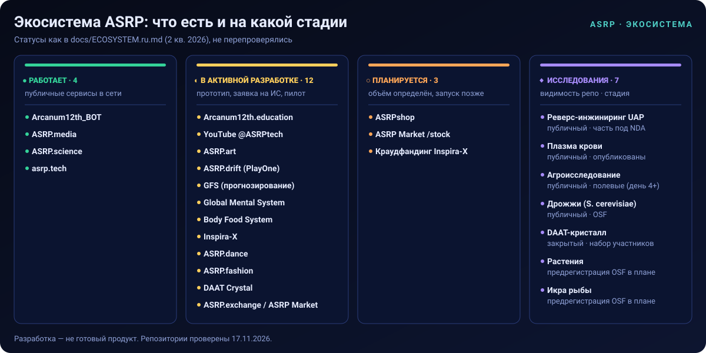
</div>

«Работает» означает публичный сервис, который доступен в сети. «В активной разработке» — собственная метка
проекта для компонентов с работающим прототипом, защитой ИС или активным пилотом; в этот список входят
YouTube-канал и программы на исследовательской стадии, и это не то же самое, что выпущенный продукт. Из 7
исследований у 4 публичные репозитории, 1 набирает участников в закрытом репозитории, у 2 предрегистрация
только запланирована. Таблицы ниже — собственные таблицы проекта на 2 квартал 2026.

<!-- excerpt ECOSYSTEM 2 -->
### Работает и готово к масштабированию

| Компонент | Ссылка | Назначение | Монетизация |
|---|---|---|---|
| 🤖 **Arcanum12th_BOT** | [@Arcanum12th_BOT](https://t.me/Arcanum12th_BOT) | Дневник снов → лид + биодатчик для GFS | Лид-ген, трипваер |
| 📰 **ASRP.media** | [asrp.media](https://asrp.media) | СМИ, популяризация науки | Реклама, нативка, Amazon |
| 🔬 **ASRP.science** | [asrp.science](https://asrp.science) | Рецензируемый научный журнал | Платные публикации, подписка |
| ⚙️ **asrp.tech** | [asrp.tech](https://asrp.tech) | Портфолио проектов и патентов | B2B-лиды, лицензирование |

> ⚠️ Расхождение EN/RU в исходнике — см. [открытые вопросы](reports/MARKETING_UPDATE_REPORT.md#open-questions).

### В активной разработке

> Продукты с работающими прототипами, защитой ИС или активными пилотами.

| Компонент | Ссылка | Фокус | Цель монетизации |
|---|---|---|---|
| 🎓 **Arcanum12th.education** | [arcanum12th.education](https://arcanum12th.education) | Образовательная платформа | Продажа курсов, сертификация |
| ▶️ **YouTube @ASRPtech** | [@ASRPtech](https://www.youtube.com/@ASRPtech) | Видео о науке | AdSense, спонсорство |
| 🎨 **ASRP.art** | [asrp.tech/projects](https://asrp.tech/ru/projects) · [репозиторий](https://github.com/AdvancedScientificResearchProjects/Axionetic_Sensing_Reactions_Platform_in_Art) | Нейрофизиологическая оценка искусства | Арт-площадки, галереи |
| 🧠 **ASRP.drift (PlayOne)** | [asrp.tech/projects](https://asrp.tech/ru/projects) | Нейроинтеграция для синхронизации команд | B2B клиника, оборонка, спорт |
| 🌐 **GFS — Global Forecasting System** | [asrp.tech/projects](https://asrp.tech/ru/projects) · [репозиторий (код закрыт)](https://github.com/AdvancedScientificResearchProjects/gfs-model) | Сны + биосенсоры → прогнозы · **продуктовый нарратив полностью публичен** (см. [путь к деньгам GFS](docs/PATHS_TO_MONEY_RESEARCH.ru.md)) · исходный код закрыт по соображениям безопасности | B2G, B2B прогнозы + пользовательские ставки с начислением Kapusta |
| 🧘 **Global Mental System** | [asrp.tech/projects](https://asrp.tech/ru/projects) | Синхронизация когнитивных процессов | Корпоративные программы, wellness |
| 🥗 **Body Food System** | [репозиторий патента](https://github.com/denisbanchenko/Kazpatent_Body_Food_System_Patent) | Персональное питание по генетике (Авторское право США TXu002116250) | B2C, лицензирование |
| 💓 **Inspira-X** | [репозиторий патента](https://github.com/denisbanchenko/Kazpatent_Inspira-X_Respiratory_Analysis_Patent) · [asrp.tech](https://asrp.tech/ru/projects/inspira-x) | Двухканальный пневмограф + ЭКГ, 22 дыхательные методики · **основное место в стеке DAAT Crystal** (респираторный биосенсор) · также используется как модуль ASRP.drift | Бандл с DAAT Crystal + медицинский B2B + краудфандинг планируется |
| 💃 **ASRP.dance** | [asrp.tech](https://asrp.tech/ru/projects/asrp.dance) | Нейронаука движений — активация коры через сложные / ритуальные последовательности | B2B клиники, спорт, wellness |
| 👗 **ASRP.fashion** | [asrp.tech](https://asrp.tech/ru/projects/asrp.fashion) · [YouTube @ASRPfashion](https://www.youtube.com/@ASRPfashion) | Живые биосовместимые ткани из растений/бактерий/грибов под гиперболическими и квантовыми полями | Премиум-мода, медицинский текстиль, лицензирование |
| 💎 **DAAT Crystal** (продукт) | [репозиторий](https://github.com/AdvancedScientificResearchProjects/Hyperbolic_Field_DAAT_Crystal_Study) · [asrp.tech](https://asrp.tech/ru/projects) | Премиум-устройство когнитивного усиления (кристалл + Inspira-X + нейроинтерфейс) | Премиум B2C + B2B для топ-менеджмента |
| 🔄 **ASRP.exchange / ASRP Market** | [asrp.tech](https://asrp.tech/ru/projects/asrp.exchange) | Биржа состояний сознания (субдомен `/stock` = БД ментальных объектов) | Комиссии биржи, TX-комиссии Kapusta.money |

### Планируется

> Домены куплены и scope определён; технический запуск в ожидании.

| Компонент | Статус | Назначение |
|---|---|---|
| 🛒 **ASRPshop** | 🟡 Планируется | B2C-витрина для DAAT-кристаллов и изделий ASRP.fashion |
| 📊 **Субдомен `/stock` ASRP Market** | 🟡 Планируется | База состояний сознания, ингест через нейроинтерфейс |
| 🚀 **Краудфандинг Inspira-X** | 🟡 Планируется | Kickstarter-класс кампания |

### Мета-кластер — Global Mental System (GMS)

**GMS — зонтичная экосистема, связывающая GFS, Arcanum12th, ASRP.Exchange, ASRP.art и Kapusta.money в единый слой экономики сознания.**

| Компонент | Ссылка | Роль в GMS |
|---|---|---|
| 🌐 **GFS** | [asrp.tech](https://asrp.tech/ru/projects/global_foresight_system) | Прогнозы как торгуемый актив |
| 🎓 **Arcanum12th** | [asrp.tech](https://asrp.tech/ru/projects/arcanum12th) | Сертификация специалистов сознания |
| 🔄 **ASRP.exchange** | [asrp.tech](https://asrp.tech/ru/projects/asrp.exchange) | Биржа ментальных состояний (сны, прогнозы, искусство) |
| 🎨 **ASRP.art** | [asrp.tech](https://asrp.tech/ru/projects/asrp.art) | Сертификация искусства в ИСС |
| 💰 **Kapusta.money** | [asrp.tech](https://asrp.tech/ru/projects/kapusta.money) | **Субстрат системы рейтингов** (не просто расчётная валюта) — централизованный + децентрализованный слои; статус повышается за точные прогнозы (+ больше Kapusta), понижается за неточные; на больших данных даёт (а) точные прогнозы, (б) высокоточные биологические датчики (люди), (в) надёжность системы · механизм задокументирован в патенте GFS |

### Исследовательские репозитории

| Репозиторий | Направление | Стадия | Клиент |
|---|---|---|---|
| [Реверс-инжиниринг UAP](https://github.com/AdvancedScientificResearchProjects/UAP_Reverse_Engineering_Study) | Реверс аэрокосмических технологий | 🔐 Публичный + материалы под NDA | Оборонка, Минобороны США |
| [Плазма крови в гиперболическом поле](https://github.com/AdvancedScientificResearchProjects/Hyperbolic_Field_BloodPlasma_Study) | Свёртывание плазмы | 🧪 Опубликованы | Фарма, центры уровня Стэнфорда |
| [Агро-исследование в гиперболическом поле](https://github.com/AdvancedScientificResearchProjects/Hyperbolic_Field_Agricultural_Study) | Прорастание, урожайность | 🧪 Полевые (день 4+) | Агрохолдинги, гранты UA/MD |
| [Дрожжи в гиперболическом поле](https://github.com/AdvancedScientificResearchProjects/Hyperbolic_Field_SaccharomycesCerevisiae_Study) | Кинетика ферментации | 🧪 OSF зарегистрировано | Пищевая промышленность, биофарма |
| [Исследование DAAT-кристалла](https://github.com/AdvancedScientificResearchProjects/Hyperbolic_Field_DAAT_Crystal_Study) | Взаимодействие кристалл-человек, исследование когнитивного усиления | 🧪 Набор участников | Премиум B2C + B2B — см. [Path to Money](docs/PATHS_TO_MONEY_PRODUCTS.ru.md) |
| Исследование растений в гиперболическом поле | Прорастание, кинетика роста, модуляция урожайности на расширенном списке видов | 🟡 Предрегистрация OSF планируется (22.04.2026) | Агрохолдинги, гранты по продовольственной безопасности |
| Исследование икры рыбы в гиперболическом поле | Кинетика эмбрионального развития в аквакультуре под воздействием гиперболического поля | 🟡 Предрегистрация OSF планируется (22.04.2026) | Аквакультура, биофарма |

> ⚠️ Расхождение EN/RU в исходнике — см. [открытые вопросы](reports/MARKETING_UPDATE_REPORT.md#open-questions).

> 🔐 Часть материалов требует NDA.
<!-- /excerpt -->

---

## Исследования и патенты

<!-- excerpt RESEARCH_AND_IP 1 -->
**Все патенты поданы через Казпатент (Республика Казахстан).** Публичные репозитории с документацией ниже.

| # | Патент | № заявки | Статус | Публичный репо |
|---|---|---|---|---|
| 1 | **ГСП** (GFS — Global Forecasting System) | KZ 2025/1096.1 | Ответ на формальную экспертизу отправлен | [репозиторий патента](https://github.com/denisbanchenko/Kazpatent_Global_Forecasting_System_Patent) |
| 2 | **ПНИР.дрифт** (ASRP.drift — Advanced Synchro Resonance Platform) | KZ 413554 | 🟡 Ожидает регистрации | [репозиторий патента](https://github.com/denisbanchenko/Kazpatent_Advanced_Synchro_Resonance_Platform_For_Deep_Resonant_Patent) |
| 3 | **ПНИР.искусство** (ASRP.art — Axionetic Sensing Reactions Platform in Art) | KZ 2025/0592.1 + PCT 412362 | ✅ Экспертиза по существу | [репозиторий патента](https://github.com/denisbanchenko/Kazpatent_Axionetic_Sensing_Reactions_Platform_in_Art_Patent) |
| 4 | **Биофотонная Нейродиагностика** (Biophotonic Neurodiagnostic System) | KZ 2025/1097.1 | ✅ Формальная → по существу | [репозиторий патента](https://github.com/denisbanchenko/Kazpatent_Biophotonic_Neurodiagnostic_System_Patent) |
| 5 | **ФБСГП** (Fractal Biomedical Hyperbolic Field System) | KZ 2025/1095.1 | ✅ Формальная → по существу | [репозиторий патента](https://github.com/denisbanchenko/Kazpatent_Fractal_Biomedical_System_Patent) |
| 6 | **Инспира-Х** (Inspira-X — Respiratory Analysis) | KZ 2025/0914.1 (399693) | Ожидает | [репозиторий патента](https://github.com/denisbanchenko/Kazpatent_Inspira-X_Respiratory_Analysis_Patent) |
| 7 | **Система Питания Тела** (Body Food System) | US Copyright TXu002116250 | ✅ Зарегистрировано (США) | [репозиторий патента](https://github.com/denisbanchenko/Kazpatent_Body_Food_System_Patent) |

> ⚠️ Расхождение EN/RU в исходнике — см. [открытые вопросы](reports/MARKETING_UPDATE_REPORT.md#open-questions).

**Авторы патентов:** Овсянникова В.А. (MD), Капустин М.М. (DE), Банченко Д.Ю. (KZ).
<!-- /excerpt -->

Флагманские статьи и полный список публикаций: [Научные статьи](docs/RESEARCH_AND_IP.ru.md#научные-статьи) ·
[whitepaper/README.md](whitepaper/README.md).

---

## Аккредитации и хронология

<!-- excerpt RESEARCH_AND_IP 2 -->
**Внешние регистрации и аккредитации — это доверительные сигналы, которые инвестор или подрядчик проверяет до первого серьёзного разговора.** Главный заголовок — **активный доступ к порталу подачи заявок DARPA BAA (оборонные R&D-конкурсы США)** плюс **аккредитация Tesla Business Program (корпоративный сегмент США)** — плюс патентные, авторско-правовые и рецензионные сигналы ниже. DARPA-пункт даёт аутентифицированный доступ для подачи и трекинга предложений по BAA; это не merit-based награда и не должно подаваться как она.

| Орган | Программа | Дата | Идентификатор |
|---|---|---|---|
| 🇺🇸 **DARPA** (Агентство передовых оборонных исследовательских проектов США) | Доступ к порталу подачи заявок BAA | **16 сен. 2025** | Экстранет-аккаунт активен (логин предоставляется под NDA) |
| 🇺🇸 **Tesla, Inc.** | Бизнес-программа Tesla | **22 авг. 2025** | Зарегистрированное юр. лицо: ASRP LLC (FL) · Email: `info@asrp.tech` |
| 🇰🇿 **Казпатент** (Минюст РК) | 6 патентных заявок + 1 PCT | 2024–2026 | см. раздел [«Портфель исследований и патентов»](docs/RESEARCH_AND_IP.ru.md#портфель-исследований-и-патентов) |
| 🇺🇸 **Бюро по авторским правам США** | Система Питания Тела | 2024 | TXu002116250 |
| 🌐 **Реестр OSF** | Предрегистрация дрожжевого исследования | 2026 | [osf.io/Jgt3h](https://osf.io/Jgt3h) |
| 📝 **Международный журнал внутренней медицины** | Рецензируемая публикация ASRP.drift | 2024 | ссылка с [asrp.tech/projects/asrp.drift](https://asrp.tech/ru/projects/asrp.drift) |
| 🧪 **ResearchGate** | Страница лаборатории | Активно | [researchgate.net](https://www.researchgate.net/lab/Advanced-Scientific-Research-Projects-Denis-Banchenko) |

### Эпохи — хронология регистраций, подач и событий

> Ниже показаны **пять классов событий** — регистрации и восстановления компаний (реестры SunBiz и КЗ), подачи патентов и регистрации авторских прав, научные публикации и предрегистрации, аккредитации (DARPA · Tesla · OSF), публичные события (хакатоны, pitch-battle).


<!-- /excerpt -->

---

## Юридические лица

<!-- excerpt LEGAL_ENTITIES 0 stop=^#### -->
**ASRP — мультиюрисдикционная группа.** В текущий периметр входят три юридических лица: операционный US LLC **ASRP LLC** (Флорида, с 2017), исследовательско-патентное **ТОО** (Байконур, 2024) и компания в **Великобритании** (на стадии восстановления корпоративного статуса — reinstatement). Florida LLC и ТОО верифицируются через публичные реестры; UK-компания — на стадии восстановления и отражена здесь в рамках продолжающейся консолидации группы (см. UBO-примечание ниже).

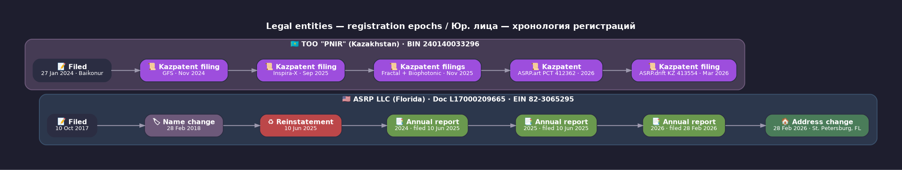

### ООО «ASRP» (Флорида, США)

| Поле | Значение |
|---|---|
| **Тип** | Компания с ограниченной ответственностью штата Флорида |
| **Номер (Document #)** | L17000209665 |
| **FEI / EIN** | предоставляется верифицированным контрагентам · публично доступен через реестр Florida SunBiz |
| **Дата регистрации** | **10 октября 2017** |
| **Статус** | ДЕЙСТВУЮЩАЯ |
| **Последнее событие** | Восстановление — 10 июня 2025 |
| **Смена названия** | 28 февраля 2018 |
| **Юр. адрес** | 7901 4th St N, Ste 300, St. Petersburg, FL 33702 (изменён 28 февраля 2026) |
| **Регистрационный агент** | Registered Agents Inc |
| **Учредители** | Valeria Ovseannicova · Mykhailo Kapustin · Denis Banchenko |
| **Годовые отчёты** | 2024 (подан 10 июня 2025) · 2025 (подан 10 июня 2025) · 2026 (подан 28 февраля 2026) |
| **Публичный реестр** | [search.sunbiz.org — Florida Division of Corporations](https://search.sunbiz.org/Inquiry/CorporationSearch/SearchResultDetail?inquirytype=EntityName&directionType=Initial&searchNameOrder=ADVANCEDSCIENTIFICRESEARCHPROJ%20L170002096650&aggregateId=flal-l17000209665-9ae2294a-abd3-46c7-944f-b49e0eb2f7f4&searchTerm=ADVANCED%20SCIENTIFIC%20RESEARCH%20PROJECTS%20LLC&listNameOrder=ADVANCEDSCIENTIFICRESEARCHPROJ%20L170002096650) |

### ТОО «Перспективные Научно-Исследовательские Разработки» (Казахстан)

| Поле | Значение |
|---|---|
| **Тип** | Товарищество с ограниченной ответственностью |
| **БИН** | 240140033296 |
| **Регистрация** | **27 января 2024** |
| **ОКЭД** | 72199 — Прочие исследования и разработки в естественных и технических науках |
| **Юр. адрес** | ул. Комарова, 37, кв. 56, г. Байконыр, Кызылординская обл., Республика Казахстан |
| **Код КАТО** | 431910000 (Байконур) |
| **Руководитель** | Банченко Денис Юрьевич |
| **Публичные реестры** | [infostats.co](https://infostats.co/companies/kz/3235213) · [kyc.kz](https://kyc.kz/search/bin/240140033296) |

> ⚠️ Расхождение EN/RU в исходнике — см. [открытые вопросы](reports/MARKETING_UPDATE_REPORT.md#open-questions).

> Казахстанская компания держит **патентный портфель** (6 заявок Казпатент + 1 PCT); Florida LLC — **операционная/коммерческая** компания (Tesla Business Program, DARPA BAA, расчёты в USD).
<!-- /excerpt -->

Оговорка о структуре владения, бенефициарном контроле и корпоративной принадлежности — на полной странице:
[Юридические лица и публичная верификация](docs/LEGAL_ENTITIES.ru.md#оговорка-о-структуре-владения-бенефициарном-контроле-и-корпоративной-принадлежности).

---

## Пути к деньгам

У каждого направления своя воронка от исследования к выручке. Схемы ниже — собственные схемы проекта; по
клику открывается раздел с клиентом, оффером, доказательством и каналом. Исследовательские направления:

<!-- excerpt PATHS_TO_MONEY_RESEARCH 0 mode=images -->
<a href="docs/PATHS_TO_MONEY_RESEARCH.ru.md#реверс-uap--оборонные-подряды">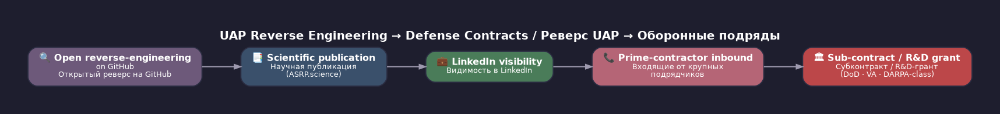</a>

<a href="docs/PATHS_TO_MONEY_RESEARCH.ru.md#плазма-крови--гиперболический-биомед--медцентры">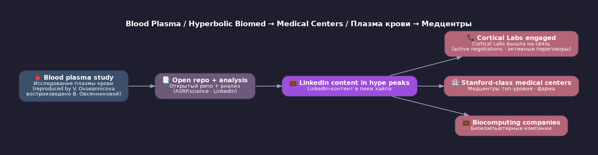</a>

<a href="docs/PATHS_TO_MONEY_RESEARCH.ru.md#агро-исследование--агро-гранты-и-продовольственная-безопасность">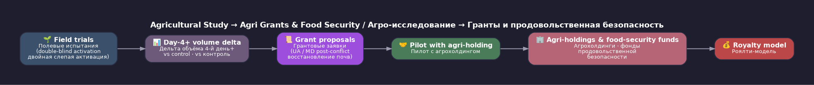</a>

<a href="docs/PATHS_TO_MONEY_RESEARCH.ru.md#гсп--глобальная-система-прогнозирования--продажа-прогнозов">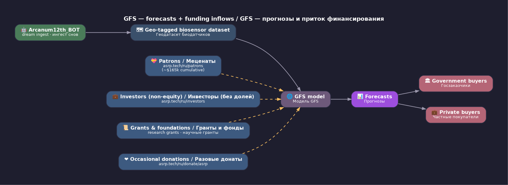</a>

<!-- /excerpt -->

<!-- excerpt PATHS_TO_MONEY_RESEARCH 0 mode=headings -->
- [Реверс UAP → Оборонные подряды](docs/PATHS_TO_MONEY_RESEARCH.ru.md#реверс-uap--оборонные-подряды)
- [Плазма крови / Гиперболический биомед → Медцентры](docs/PATHS_TO_MONEY_RESEARCH.ru.md#плазма-крови--гиперболический-биомед--медцентры)
- [Агро-исследование → Агро-гранты и продовольственная безопасность](docs/PATHS_TO_MONEY_RESEARCH.ru.md#агро-исследование--агро-гранты-и-продовольственная-безопасность)
- [ГСП — Глобальная Система Прогнозирования → Продажа прогнозов](docs/PATHS_TO_MONEY_RESEARCH.ru.md#гсп--глобальная-система-прогнозирования--продажа-прогнозов)
<!-- /excerpt -->

Продукты и платформы:

<!-- excerpt PATHS_TO_MONEY_PRODUCTS 4 mode=images -->
<a href="docs/PATHS_TO_MONEY_PRODUCTS.ru.md#паттерн-кросс-промо">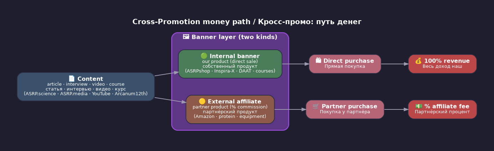</a>

<!-- /excerpt -->
<!-- excerpt PATHS_TO_MONEY_PRODUCTS 7 mode=images -->
<a href="docs/PATHS_TO_MONEY_PRODUCTS.ru.md#daat-кристаллы--премиум-когнитивное-усиление">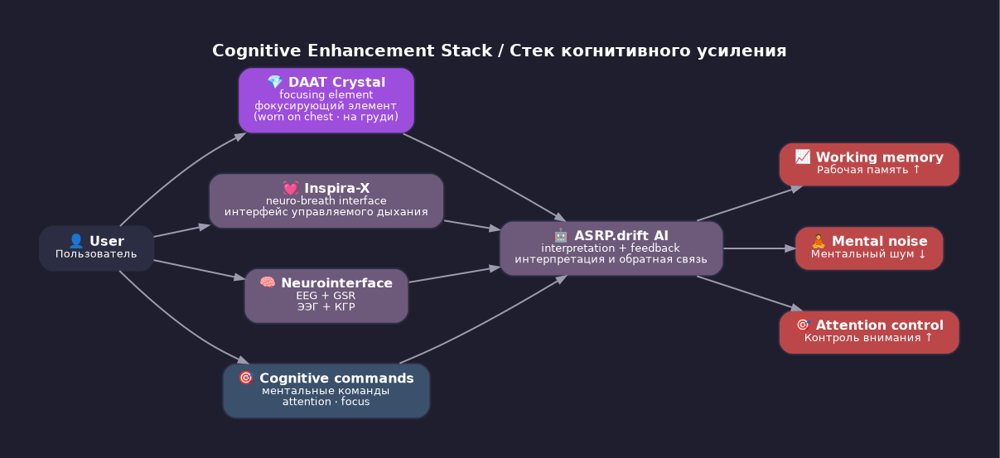</a>

<a href="docs/PATHS_TO_MONEY_PRODUCTS.ru.md#daat-кристаллы--премиум-когнитивное-усиление">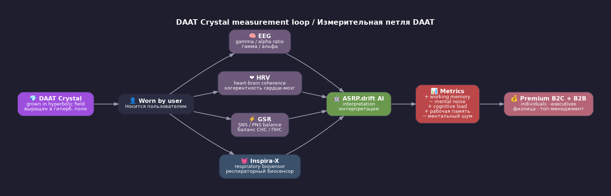</a>

<!-- /excerpt -->
<!-- excerpt PATHS_TO_MONEY_PRODUCTS 8 mode=images -->
<a href="docs/PATHS_TO_MONEY_PRODUCTS.ru.md#gms--banchenko-market"></a>

<!-- /excerpt -->

- [ASRP.art → Объективная оценка искусства](docs/PATHS_TO_MONEY_PRODUCTS.ru.md#asrpart--объективная-оценка-искусства)
- [ASRP.drift → Нейроинтегративная платформа](docs/PATHS_TO_MONEY_PRODUCTS.ru.md#asrpdrift--нейроинтегративная-платформа)
- [ASRP.media → Реклама + партнёрка](docs/PATHS_TO_MONEY_PRODUCTS.ru.md#asrpmedia--реклама--партнёрка)
- [Arcanum12th → B2C-образование](docs/PATHS_TO_MONEY_PRODUCTS.ru.md#arcanum12th--b2c-образование)
- [Паттерн кросс-промо](docs/PATHS_TO_MONEY_PRODUCTS.ru.md#паттерн-кросс-промо)
- [ASRP.dance → Нейронаука движений](docs/PATHS_TO_MONEY_PRODUCTS.ru.md#asrpdance--нейронаука-движений)
- [ASRP.fashion → Живые биосовместимые ткани](docs/PATHS_TO_MONEY_PRODUCTS.ru.md#asrpfashion--живые-биосовместимые-ткани)
- [DAAT-кристаллы → Премиум когнитивное усиление](docs/PATHS_TO_MONEY_PRODUCTS.ru.md#daat-кристаллы--премиум-когнитивное-усиление)
- [GMS → Banchenko-Market](docs/PATHS_TO_MONEY_PRODUCTS.ru.md#gms--banchenko-market)

---

## Кейсы

Девять задокументированных случаев, включая те, что не получились. Ни одна из внешних сторон не подтверждала
их публично; см. [Подтверждения](#подтверждения).

<!-- excerpt TRACK_RECORD 0 mode=headings -->
- [1. Репозиторий UAP → первый читатель из Минэнерго США](docs/TRACK_RECORD.ru.md#1-репозиторий-uap--первый-читатель-из-минэнерго-сша)
- [2. Исследование плазмы крови → переговоры с Cortical Labs](docs/TRACK_RECORD.ru.md#2-исследование-плазмы-крови--переговоры-с-cortical-labs)
- [3. GFS — ранние флаги по крупным событиям](docs/TRACK_RECORD.ru.md#3-gfs--ранние-флаги-по-крупным-событиям)
- [4. Сигнал 4-го дня в агроисследовании](docs/TRACK_RECORD.ru.md#4-сигнал-4-го-дня-в-агроисследовании)
- [5. Архивные перекрёстные ссылки «Космопоиск» / Чернобров + линия Lazar](docs/TRACK_RECORD.ru.md#5-архивные-перекрёстные-ссылки-космопоиск--чернобров--линия-lazar)
- [6. Публичные события — презентации GFS](docs/TRACK_RECORD.ru.md#6-публичные-события--презентации-gfs)
- [7. Пилоты DAAT Crystal — руководители банка и носители из списка Forbes](docs/TRACK_RECORD.ru.md#7-пилоты-daat-crystal--руководители-банка-и-носители-из-списка-forbes)
- [8. Партнёрская продажа нейроинтерфейса — доказательство механизма кросс-промо](docs/TRACK_RECORD.ru.md#8-партнёрская-продажа-нейроинтерфейса--доказательство-механизма-кросс-промо)
- [9. NCI SBIR FY26 — заявка по детским и редким формам рака (август 2025 → системная отмена в октябре 2025)](docs/TRACK_RECORD.ru.md#9-nci-sbir-fy26--заявка-по-детским-и-редким-формам-рака-август-2025--системная-отмена-в-октябре-2025)
<!-- /excerpt -->

---

## Аутрич

<!-- excerpt OUTREACH 0 stop=^###\s1\. -->
**Внешние реакции на публикации ASRP — профильные игроки, взаимодействовавшие с нашими репозиториями. Журнал публично наблюдаемых сигналов, обновляется по мере новых событий.**

### Стратегия аутрича

**Одна и та же воронка работает на каждый контакт:** компетенция реверс-инжиниринга → открытый научный репозиторий → препринт/журнальная публикация → волна LinkedIn-контента в момент профильного хайпа цели → комментарий или прямой аутрич → входящий отклик → двусторонняя переписка → переговоры. Три кейса ниже (NSWC IHD, Cortical Labs, Stanford / лаборатория Nolan) — воплощения этой воронки на разных стадиях.

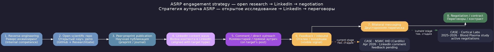
<!-- /excerpt -->

Записанные случаи:

<!-- excerpt OUTREACH 0 mode=headings -->
- [Стратегия аутрича](docs/OUTREACH.ru.md#стратегия-аутрича)
- [1. NSWCIHD (ВМС США) — апрель 2026](docs/OUTREACH.ru.md#1-nswcihd-вмс-сша--апрель-2026)
- [2. Cortical Labs — с 2025 (в процессе)](docs/OUTREACH.ru.md#2-cortical-labs--с-2025-в-процессе)
- [3. Stanford / лаборатория Nolan — входящий в LinkedIn → переписка с админом (февраль 2026)](docs/OUTREACH.ru.md#3-stanford--лаборатория-nolan--входящий-в-linkedin--переписка-с-админом-февраль-2026)
- [4. Журнал аутрича к инвесторам — ожидает исходного списка](docs/OUTREACH.ru.md#4-журнал-аутрича-к-инвесторам--ожидает-исходного-списка)
<!-- /excerpt -->

---

## Финансирование

<!-- excerpt FUNDING 0 stop=^###\sТекущие -->
**ASRP намеренно диверсифицирует финансирование по 7 потокам — так мы выжили 3+ года исследований и остаёмся независимыми.**

| Источник | Статус | Примечания |
|---|---|---|
| 💝 **Меценаты** | ✅ Активно | 7 уровней на [/ru/patrons](https://asrp.tech/ru/patrons); ведущий меценат $100k; накопленно ≈$165k |
| 💼 **Инвесторы (без долей)** | ✅ Открыто | Модели сотрудничества без передачи долей — [asrp.tech/ru/investors](https://asrp.tech/ru/investors) |
| 🚀 **Краудфандинг** | 🟡 Планируется под Inspira-X | Кампания готовится; донат-линк уже работает на `asrp.tech/ru/donate/asrp` |
| 🏛️ **Госзаказы** | 🎯 Цель | Гражданские и оборонные тендеры (подрядчики DoD, VA, DARPA-уровень) |
| 📜 **Научные гранты** | 🔄 В работе | Агро-гранты UA/MD; аутбаунд в профильные фонды |
| 💼 **Лицензирование** | 🔄 В работе | Активные переговоры — Cortical Labs (плазма крови) |
| 📰 **Реклама и партнёрка** | ✅ Активно | ASRP.media CPM/CPC + Amazon-партнёрка через баннеры |

> ⚠️ Расхождение EN/RU в исходнике — см. [открытые вопросы](reports/MARKETING_UPDATE_REPORT.md#open-questions).

### Стек финансирования

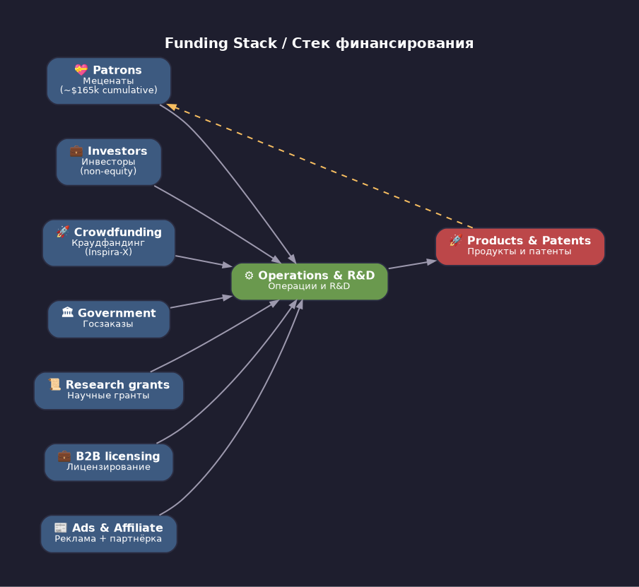
<!-- /excerpt -->

Уровни меценатства, текущие меценаты и способы поддержать:
[Источники финансирования и меценаты](docs/FUNDING.ru.md#текущие-меценаты).

---

## Медиа и каналы

<!-- excerpt MEDIA_AND_CHANNELS 0 -->
**Одно и то же исследование, разная сложность, разная аудитория.**

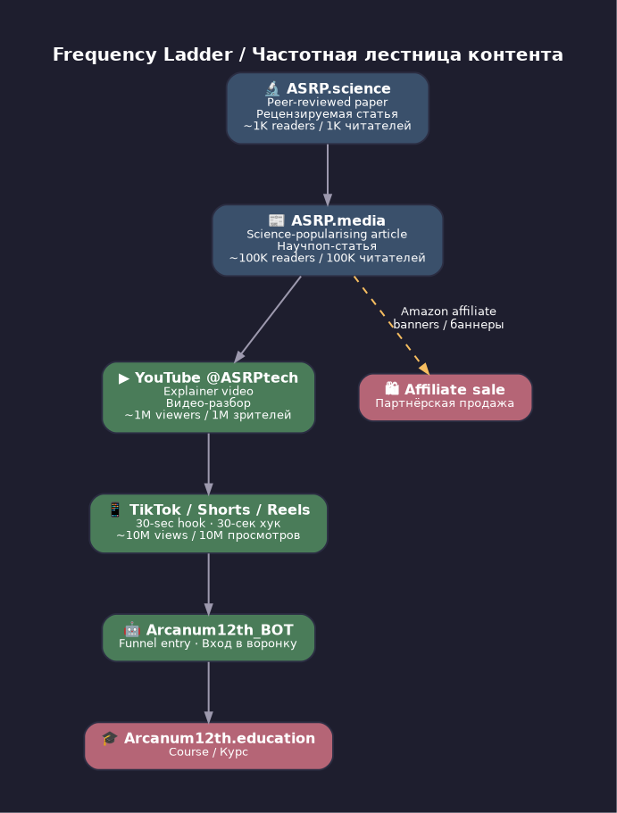

- Журнал строит доверие.
- Медиа переводит для массовой аудитории.
- YouTube даёт глубину + монетизацию.
- Короткие форматы дают масштаб.
- Бот + школа конвертируют внимание в деньги.
<!-- /excerpt -->

<!-- excerpt MEDIA_AND_CHANNELS 1 mode=images -->
<a href="docs/MEDIA_AND_CHANNELS.ru.md#медиа-стратегия--единый-контент-завод">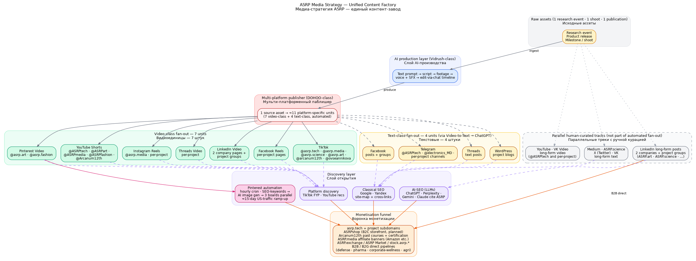</a>

<!-- /excerpt -->

Конвейер контент-завода, перечень каналов с охватами и темы в прессе:
[Медиа-стратегия и каналы дистрибуции](docs/MEDIA_AND_CHANNELS.ru.md).

---

## Целевые рынки

Компании, к которым ASRP намерена выходить, по вертикалям. Это цели аутрича, а не партнёры и не клиенты.

<!-- excerpt TARGET_MARKETS 0 mode=headings -->
- [Клеточное мясо и клеточное питание](docs/TARGET_MARKETS.ru.md#клеточное-мясо-и-клеточное-питание)
- [Агрохолдинги, семена и грибные вертикальные фермы](docs/TARGET_MARKETS.ru.md#агрохолдинги-семена-и-грибные-вертикальные-фермы)
- [Биореакторы — спирулина, хлорелла, микроводоросли](docs/TARGET_MARKETS.ru.md#биореакторы--спирулина-хлорелла-микроводоросли)
- [Фарма, БАД и пробиотики](docs/TARGET_MARKETS.ru.md#фарма-бад-и-пробиотики)
- [Нейрогенез и биогибридные вычисления](docs/TARGET_MARKETS.ru.md#нейрогенез-и-биогибридные-вычисления)
- [Функциональные напитки для ЖКТ](docs/TARGET_MARKETS.ru.md#функциональные-напитки-для-жкт)
- [Военные технологии заживления](docs/TARGET_MARKETS.ru.md#военные-технологии-заживления)
- [Спортивное питание — протеин и восстановление](docs/TARGET_MARKETS.ru.md#спортивное-питание--протеин-и-восстановление)
- [Синергия с Body Food System](docs/TARGET_MARKETS.ru.md#синергия-с-body-food-system)
<!-- /excerpt -->

---

## Дорожная карта

<!-- excerpt ROADMAP 0 -->
**5 этапов — от научного доказательства к фарме и оборонке.**

```text
🧪 Этап 1  ·  0–3 месяца  ·  Фиксация эффекта
├─ ✅ Hyperbolic Field Blood Plasma Study (опубликовано)
├─ 🔄 Дрожжевое исследование (OSF, зарегистрировано)
├─ 🔄 Полевые агро-испытания (4-й день+)
├─ 🔄 Cortical Labs — продолжение текущих переговоров
└─ 🎯 Датасет воспроизводимости + подача в журнал

💰 Этап 2  ·  3–9 месяцев  ·  Первая выручка
├─ 🎯 Партнёрства — пробиотики и ферментация
├─ 🎯 Переговоры по лицензированию спортивного питания
├─ 🎯 Рост ASRP.media + ASRPshop beta (soft-launch для меценатов и сообщества)
├─ 🎯 Первая B2G-продажа прогноза (GFS)
└─ 🎯 Краудфандинг Inspira-X

🧬 Этап 3  ·  6–18 месяцев  ·  MVP персонализированного питания (Body Food System)
├─ 🚀 BFS — интеграция генетики и микробиома
├─ 🚀 Пилоты функциональных напитков: Nestlé Health Science, Danone
├─ 🚀 Пилоты спортивного питания: Abbott Laboratories, DSM-Firmenich
└─ 🚀 Полный запуск школы Arcanum12th.education и подписки

🧠 Этап 4  ·  12–24 месяца  ·  Нейрогенез и когнитивные системы
├─ 🎯 Совместные исследования с Cortical Labs (развитие текущих переговоров)
├─ 🎯 Koniku — биогибридная интеграция нейронов и кремния
├─ 🎯 Институциональные партнёрства ASRP.art (аукционные дома высшего эшелона)
└─ 🎯 Пилотный запуск GMS + Banchenko-Market

🏛 Этап 5  ·  2+ года  ·  Фарма, клиника, оборонка
├─ 🌍 Фарма-партнёрства: мази для рассасывания шрамов, онко-сопроводительные протоколы
├─ 🌍 Функциональные напитки для ЖКТ (17-канальная модуляция)
├─ 🌍 Военные протоколы заживления (трек Gulf War Syndrome)
└─ 🌍 R&D-субконтракты DARPA-класса (реверс UAP)
```

> Маркетинговые операции (email-кампании, CRM, YouTube AdSense, лендинги, годовые отчёты) идут параллельно всем фазам и трекаются внутренне, чтобы не дублировать здесь.
<!-- /excerpt -->

---

## Команда

<!-- excerpt TEAM 0 -->
> Источник: [asrp.tech/ru/team](https://asrp.tech/ru/team) · Актуальные данные — на сайте.
>
> **Готовы к релокации.** Основной состав открыт к релокации при соответствующих партнёрствах и финансировании — активные треки: Австралия (через линию Cortical Labs), США (через DARPA BAA / Tesla / DoE), Великобритания (через восстановленное UK-юрлицо), Канада.
>
> **Состав авторов статьи отличается.** В составе авторов флагманских статей (GMS/GFS и экономической) семь соавторов — четверо из Leadership Team выше плюс Влада Биловоденко (CRO по препринту), Алиреза Сепехри (CPO, Иран — по препринту) и Ирина Гривцова (центр «Стратегия», Томск). Полный список всех статей ASRP с авторами и статусом публикации — в [`whitepaper/README.md → Полный список публикаций`](whitepaper/README.md#-complete-publication-list--полный-список-публикаций).

| Должность | Имя | Примечания |
|---|---|---|
| **CBE, сооснователь** | Валерия Овсянникова | Главный биомедицинский инженер — авторство и воспроизведение протоколов (плазма/агро/дрожжи) |
| **CTO, сооснователь** | Михаил Капустин | Технический директор |
| **CSO** | Иван Савельев | Научный директор |
| **SAIE** | Кирилл Змиенко | Старший AI-инженер — анализ исследований, репозитории, AI-пайплайны |
| **LFED** | Андрей Крылюк | Ведущий Front-End разработчик |
| **LBED** | Александр Громыко | Ведущий Backend разработчик |
| **CEO, основатель** | Денис Банченко | Основатель, стратегия |
<!-- /excerpt -->

---

## Партнёрство

<!-- excerpt PARTNERSHIPS_AND_TERMS 0 stop=^\*\*Контакты -->
| Тип партнёрства | Предлагаем | Ищем |
|---|---|---|
| 🎓 Авторы курсов | Аудитория, платформа, продвижение | Эксперты с уникальным знанием |
| 🔬 Учёные | Журнал, рецензирование, индексация | Качественные работы, рецензенты |
| 💼 Бизнес и инвесторы | Патенты, технологии, пилоты | Финансирование, внедрение, масштаб |
| 📢 Медиа и инфлюенсеры | Эксклюзивный контент, темы | Охват, продвижение, кросс-коллабы |
| 🏛️ Госсектор и оборонка | Реверс, прогнозирование, биомед | Контракты, гранты, доступ к объектам |
<!-- /excerpt -->

Контакты — [ниже](#контакты); важные примечания и лицензия — на странице
[Партнёрство, контакты и условия](docs/PARTNERSHIPS_AND_TERMS.ru.md#важные-примечания).

---

## Интерактивный граф

> 🌐 **Интерактивный граф экосистемы (браузер, EN/RU):** **<https://asrp-graph.surge.sh/preview.html>** — 147
> сущностей · 256 связей (в прежних текстах было 245) · кликни для изучения связей, фильтр по типу, поиск, экспорт в PNG. Исходники: [`graph/`](graph/).

Тот же граф с точки зрения потоков денег — в [`graph/MONEY_FLOW.md`](graph/MONEY_FLOW.md).

---

## Структура репозитория

```
ASRP_ecosystem_marketing/
├── README.md / README.ru.md          # эта витрина на двух языках
├── CHANGELOG(.ru).md                 # история изменений
├── docs/
│   ├── README(.ru).md                # указатель документации
│   ├── ECOSYSTEM(.ru).md             # тезис, кластеры, схемы, статус компонентов
│   ├── RESEARCH_AND_IP(.ru).md       # статьи, патентные заявки, аккредитации
│   ├── TEAM(.ru).md                  # команда руководства
│   ├── LEGAL_ENTITIES(.ru).md        # данные реестров, примечание о владении и UBO
│   ├── PATHS_TO_MONEY_RESEARCH(.ru).md
│   ├── PATHS_TO_MONEY_PRODUCTS(.ru).md
│   ├── TRACK_RECORD(.ru).md          # девять кейсов
│   ├── OUTREACH(.ru).md              # воронка и журнал аутрича
│   ├── FUNDING(.ru).md               # потоки финансирования, меценаты, поддержка
│   ├── MEDIA_AND_CHANNELS(.ru).md    # медиа-стратегия, каналы, темы в прессе
│   ├── TARGET_MARKETS(.ru).md        # цели аутрича по вертикалям
│   ├── ROADMAP(.ru).md               # пять этапов
│   ├── PARTNERSHIPS_AND_TERMS(.ru).md
│   └── assets/                       # баннер, инфографика, значки (генерируемые SVG)
├── assets/diagrams/                  # 17 PNG-схем для страниц с деталями
├── whitepaper/                       # список публикаций и абстракты
├── graph/                            # интерактивный граф: данные, просмотр, генератор
├── archive/                          # прежний корневой README, сохранён дословно
├── reports/                          # отчёт об обновлении, описи содержимого, результаты сверки
├── tools/                            # опись содержимого, проверка на потери, генераторы графики
└── tests/                            # регрессионная проверка на потери
```

Пересобрать графику: `python3 tools/build_visuals.py`. Повторить проверку на потери:
`python3 tools/verify_no_loss.py`. Запустить тесты: `python3 -m unittest discover -s tests`.

---

## Оговорка

Этот репозиторий описывает экосистему на ранней стадии. Это не публичная оферта; использование
интеллектуальной собственности возможно только с письменного согласия. Исследовательские гипотезы на
подробных страницах, включая биомедицинские, остаются рабочими гипотезами, и эта страница не делает
регуляторных утверждений и утверждений о клинической эффективности. Подробные страницы повторяют прежние
формулировки, которые местами сильнее показанных доказательств; такие места перечислены в
[отчёте об обновлении](reports/MARKETING_UPDATE_REPORT.md#not-verified). Часть оборонных материалов требует NDA. Полный текст примечаний — в разделе
[Партнёрство и условия](docs/PARTNERSHIPS_AND_TERMS.ru.md#важные-примечания).

## Контакты

| Поле | Значение |
|---|---|
| Сайт | [asrp.tech](https://asrp.tech) |
| Email | `info@asrp.tech` |
| Telegram | [@Arcanum12th_BOT](https://t.me/Arcanum12th_BOT) |
| GitHub | [AdvancedScientificResearchProjects](https://github.com/AdvancedScientificResearchProjects) |
| Меценатам | <https://asrp.tech/ru/patrons> · <https://asrp.tech/en/patrons> |
| Инвесторам | <https://asrp.tech/ru/investors> |

---

## Куда переехали разделы старого README

До ноября 2026 этот README был одной длинной двуязычной страницей. Ничего не удалено: каждый раздел переехал
на страницу из таблицы ниже, а исходный текст дословно сохранён в
[`archive/`](archive/README_2026-11-17_pre-marketing-update.md).

<!-- legacy-map:start -->
| Раздел старого README | Где теперь |
|---|---|
| Экосистема ASRP — Маркетинг и монетизация 🌐 | этот README (заголовок, бейджи, навигация) |
| СОДЕРЖАНИЕ | этот README (заголовок, бейджи, навигация) |
| О проекте | [Экосистема](docs/ECOSYSTEM.ru.md#о-проекте) · [Стратегический тезис](docs/ECOSYSTEM.ru.md#стратегический-тезис) · [Зачем этот хаб нужен](docs/ECOSYSTEM.ru.md#зачем-этот-хаб-нужен) · [Научные статьи](docs/RESEARCH_AND_IP.ru.md#научные-статьи) |
| Карта экосистемы | [Экосистема](docs/ECOSYSTEM.ru.md#карта-экосистемы) |
| Статус компонентов | [Экосистема](docs/ECOSYSTEM.ru.md#статус-компонентов) · [Работает и готово к масштабированию](docs/ECOSYSTEM.ru.md#работает-и-готово-к-масштабированию) · [В активной разработке](docs/ECOSYSTEM.ru.md#в-активной-разработке) · [Планируется](docs/ECOSYSTEM.ru.md#планируется) · [Мета-кластер — Global Mental System (GMS)](docs/ECOSYSTEM.ru.md#мета-кластер--global-mental-system-gms) · [Исследовательские репозитории](docs/ECOSYSTEM.ru.md#исследовательские-репозитории) |
| Портфель исследований и патентов | [Исследования и ИС](docs/RESEARCH_AND_IP.ru.md#портфель-исследований-и-патентов) |
| Команда руководства | [Команда](docs/TEAM.ru.md#команда-руководства) |
| Аккредитации и регистрации | [Исследования и ИС](docs/RESEARCH_AND_IP.ru.md#аккредитации-и-регистрации) · [Эпохи — хронология регистраций, подач и событий](docs/RESEARCH_AND_IP.ru.md#эпохи--хронология-регистраций-подач-и-событий) |
| Юр. лица и публичная верификация | [Юридические лица](docs/LEGAL_ENTITIES.ru.md#юр-лица-и-публичная-верификация) · [ООО «ASRP» (Флорида, США)](docs/LEGAL_ENTITIES.ru.md#ооо-asrp-флорида-сша) · [Оговорка о структуре владения, бенефициарном контроле и корпоративной принадлежности](docs/LEGAL_ENTITIES.ru.md#оговорка-о-структуре-владения-бенефициарном-контроле-и-корпоративной-принадлежности) |
| Пути к деньгам | [Пути к деньгам: исследования](docs/PATHS_TO_MONEY_RESEARCH.ru.md#пути-к-деньгам) · [Реверс UAP → Оборонные подряды](docs/PATHS_TO_MONEY_RESEARCH.ru.md#реверс-uap--оборонные-подряды) · [Плазма крови / Гиперболический биомед → Медцентры](docs/PATHS_TO_MONEY_RESEARCH.ru.md#плазма-крови--гиперболический-биомед--медцентры) · [Гипотеза первичного патогенного фактора — темпоральная десинхронизация](docs/PATHS_TO_MONEY_RESEARCH.ru.md#гипотеза-первичного-патогенного-фактора--темпоральная-десинхронизация) · [Агро-исследование → Агро-гранты и продовольственная безопасность](docs/PATHS_TO_MONEY_RESEARCH.ru.md#агро-исследование--агро-гранты-и-продовольственная-безопасность) · [ГСП — Глобальная Система Прогнозирования → Продажа прогнозов](docs/PATHS_TO_MONEY_RESEARCH.ru.md#гсп--глобальная-система-прогнозирования--продажа-прогнозов) · [ASRP.art → Объективная оценка искусства](docs/PATHS_TO_MONEY_PRODUCTS.ru.md#asrpart--объективная-оценка-искусства) · [ASRP.drift → Нейроинтегративная платформа](docs/PATHS_TO_MONEY_PRODUCTS.ru.md#asrpdrift--нейроинтегративная-платформа) · [ASRP.media → Реклама + партнёрка](docs/PATHS_TO_MONEY_PRODUCTS.ru.md#asrpmedia--реклама--партнёрка) · [Arcanum12th → B2C-образование](docs/PATHS_TO_MONEY_PRODUCTS.ru.md#arcanum12th--b2c-образование) · [Паттерн кросс-промо](docs/PATHS_TO_MONEY_PRODUCTS.ru.md#паттерн-кросс-промо) · [ASRP.dance → Нейронаука движений](docs/PATHS_TO_MONEY_PRODUCTS.ru.md#asrpdance--нейронаука-движений) · [ASRP.fashion → Живые биосовместимые ткани](docs/PATHS_TO_MONEY_PRODUCTS.ru.md#asrpfashion--живые-биосовместимые-ткани) · [DAAT-кристаллы → Премиум когнитивное усиление](docs/PATHS_TO_MONEY_PRODUCTS.ru.md#daat-кристаллы--премиум-когнитивное-усиление) · [GMS → Banchenko-Market](docs/PATHS_TO_MONEY_PRODUCTS.ru.md#gms--banchenko-market) |
| Кейсы и доказательства | [Кейсы](docs/TRACK_RECORD.ru.md#кейсы-и-доказательства) |
| Динамика аутрича | [Аутрич](docs/OUTREACH.ru.md#динамика-аутрича) · [Стратегия аутрича](docs/OUTREACH.ru.md#стратегия-аутрича) |
| Источники финансирования | [Финансирование и меценаты](docs/FUNDING.ru.md#источники-финансирования) · [Стек финансирования](docs/FUNDING.ru.md#стек-финансирования) · [Текущие меценаты](docs/FUNDING.ru.md#текущие-меценаты) |
| Частотная лестница контента | [Медиа и каналы](docs/MEDIA_AND_CHANNELS.ru.md#частотная-лестница-контента) |
| Медиа-стратегия — единый контент-завод | [Медиа и каналы](docs/MEDIA_AND_CHANNELS.ru.md#медиа-стратегия--единый-контент-завод) · [Конвейер контент-завода](docs/MEDIA_AND_CHANNELS.ru.md#конвейер-контент-завода) · [Классы инструментов автоматизации](docs/MEDIA_AND_CHANNELS.ru.md#классы-инструментов-автоматизации) · [Таксономия каналов](docs/MEDIA_AND_CHANNELS.ru.md#таксономия-каналов) · [Конвенция именования доменов](docs/MEDIA_AND_CHANNELS.ru.md#конвенция-именования-доменов) · [Почему LinkedIn — отдельно](docs/MEDIA_AND_CHANNELS.ru.md#почему-linkedin--отдельно) |
| Каналы дистрибуции | [Медиа и каналы](docs/MEDIA_AND_CHANNELS.ru.md#каналы-дистрибуции) |
| Упоминания в прессе | [Медиа и каналы](docs/MEDIA_AND_CHANNELS.ru.md#упоминания-в-прессе) |
| Целевые рынки и аутрич | [Целевые рынки](docs/TARGET_MARKETS.ru.md#целевые-рынки-и-аутрич) · [Клеточное мясо и клеточное питание](docs/TARGET_MARKETS.ru.md#клеточное-мясо-и-клеточное-питание) · [Агрохолдинги, семена и грибные вертикальные фермы](docs/TARGET_MARKETS.ru.md#агрохолдинги-семена-и-грибные-вертикальные-фермы) · [Биореакторы — спирулина, хлорелла, микроводоросли](docs/TARGET_MARKETS.ru.md#биореакторы--спирулина-хлорелла-микроводоросли) · [Фарма, БАД и пробиотики](docs/TARGET_MARKETS.ru.md#фарма-бад-и-пробиотики) · [Нейрогенез и биогибридные вычисления](docs/TARGET_MARKETS.ru.md#нейрогенез-и-биогибридные-вычисления) · [Функциональные напитки для ЖКТ](docs/TARGET_MARKETS.ru.md#функциональные-напитки-для-жкт) · [Военные технологии заживления](docs/TARGET_MARKETS.ru.md#военные-технологии-заживления) · [Спортивное питание — протеин и восстановление](docs/TARGET_MARKETS.ru.md#спортивное-питание--протеин-и-восстановление) · [Синергия с Body Food System](docs/TARGET_MARKETS.ru.md#синергия-с-body-food-system) |
| Продуктовая и R&D дорожная карта | [Дорожная карта](docs/ROADMAP.ru.md#продуктовая-и-rd-дорожная-карта) |
| Партнёрство и контакты | [Партнёрство и условия](docs/PARTNERSHIPS_AND_TERMS.ru.md#партнёрство-и-контакты) |
| Важные примечания | [Партнёрство и условия](docs/PARTNERSHIPS_AND_TERMS.ru.md#важные-примечания) |
| Поддержать | [Финансирование и меценаты](docs/FUNDING.ru.md#поддержать) |
| Лицензия | [Партнёрство и условия](docs/PARTNERSHIPS_AND_TERMS.ru.md#лицензия) |
<!-- legacy-map:end -->

---

<div align="center">

**© 2023–2026 ASRP LLC + ТОО «Перспективные Научно-Исследовательские Разработки». Все права защищены.**

Последнее обновление: 17 ноября 2026 · **Языки:** [EN](README.md) · [RU](README.ru.md)

</div>
