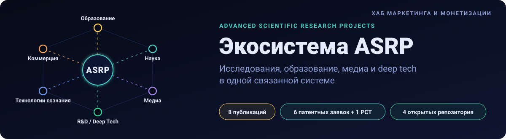
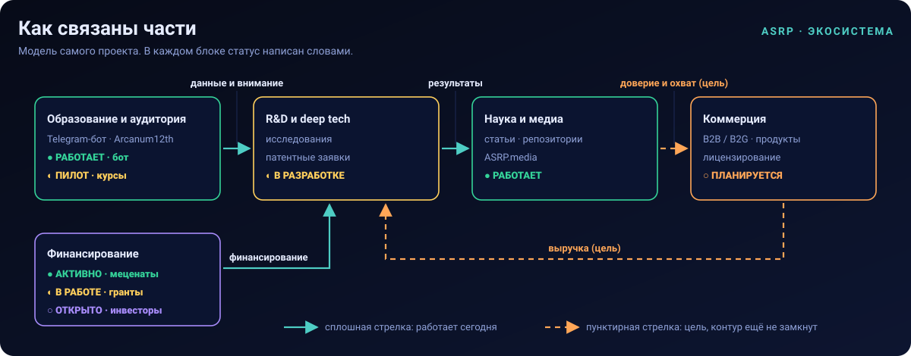

**[English](README.md) | Русский**

<div align="center">



# Экосистема ASRP — Маркетинг и монетизация

**Advanced Scientific Research Projects (ASRP)** — единая экосистема исследований, образования, науки, медиа и глубоких технологий.


[](https://asrp.tech)
[](https://asrp-graph.surge.sh/preview.html)

[](https://asrp.tech/ru/patrons)

</div>

## Коротко

- **Что это.** ASRP — частная исследовательская группа на ранней стадии (Florida LLC с 2017 года,
  казахстанское ТОО с 2024 года, компания в Великобритании на стадии восстановления). Направления
  исследований нестандартные: действие гиперболического поля на плазму крови, семена и дрожжи;
  прогнозирование по данным снов и биосенсоров (GFS); реверс-инжиниринг UAP. Вокруг них группа развивает
  образование, сайт журнала, медиа и коммерцию как одну связанную систему. Этот репозиторий — единая точка
  входа для внешнего читателя.
- **Что есть сегодня.** 4 публичных сервиса в сети, 12 компонентов, которые проект относит к активной
  разработке, 3 в планах и 7 исследований: 4 с открытыми репозиториями на GitHub, 1 в закрытом репозитории,
  2 на стадии запланированной предрегистрации.
- **Чем это подтверждено.** Проверено в ходе этого обновления: 4 публичных репозитория исследований и 7
  публичных репозиториев с патентной документацией. Заявлено проектом, со ссылками, повторно не
  проверялось: 8 публикаций в списке на ResearchGate (7 журнальных статей, 1 технический отчёт), 6 заявок в
  Казпатент + 1 PCT + 1 регистрация авторского права в США, два юридических лица с номерами в реестрах,
  ≈$165 k от 22 названных меценатов. Подтверждение и статус проверки по каждому пункту — в разделе
  [Подтверждения](#подтверждения).
- **Чего эта страница не утверждает.** Нет цифр выручки, нет подписанных клиентов, нет клинических и
  регуляторных утверждений. Первые единичные продажи, о которых сообщает проект (партнёрская комиссия,
  кристаллы, купленные для пилота), не проверены и приведены без сумм. Цели аутрича остаются целями,
  контакты — контактами, а пункт DARPA — это доступ к порталу подачи заявок, а не награда. Подробные
  страницы повторяют прежние формулировки проекта без изменений, на 2 квартал 2026.
- **Кто за этим стоит.** Основатели: Денис Банченко (CEO), Валерия Овсянникова, Михаил Капустин.
  [Команда](docs/TEAM.ru.md).
- **Что делать дальше.** Напишите на `info@asrp.tech`. Инвесторам и партнёрам B2B / B2G: пути к деньгам по
  [исследованиям](docs/PATHS_TO_MONEY_RESEARCH.ru.md) и [продуктам](docs/PATHS_TO_MONEY_PRODUCTS.ru.md);
  раунд с продажей долей здесь не описан, только модели сотрудничества без передачи долей. Меценатам:
  [asrp.tech/ru/patrons](https://asrp.tech/ru/patrons). Исследователям:
  [Исследования, патенты и аккредитации](docs/RESEARCH_AND_IP.ru.md) и [научные статьи](whitepaper/README.md).

<div align="center">

</div>

*Как связаны части — так, как проект сам описывает свою модель.* В каждом блоке статус написан словами.
Сплошные стрелки — потоки, которые уже работают: бот и пилотные курсы питают исследования, исследования
публикуются, меценаты финансируют работу. Пунктирные стрелки — коммерческий контур, ради которого
экосистема строится; проект сообщает о первых единичных продажах, но цифр выручки не публикует.
Подробнее: [Карта экосистемы и статус компонентов](docs/ECOSYSTEM.ru.md).

> 💛 **Если эта работа вам полезна — поддержите нас:** **<https://asrp.tech/ru/patrons>** · 7 уровней
> меценатства — от Главного Филантропа до Индивидуального Вкладчика.
> Инвесторам (модели сотрудничества без передачи долей): <https://asrp.tech/ru/investors>

---

## Язык

**[English](README.md) | Русский.** Каждая страница существует в двух языковых версиях: `*.md` (английская) и
`*.ru.md` (русская); графика — `*.en.svg` / `*.ru.svg`. Языки в тексте не смешиваются. Исключения:
[`whitepaper/README.md`](whitepaper/README.md) и страницы в [`graph/`](graph/README.md) пока остаются в
прежней смешанной вёрстке (это обновление их не трогало), а
[отчёт об обновлении](reports/MARKETING_UPDATE_REPORT.md) есть только на русском.

---

## Быстрая навигация

| | Раздел | Что внутри | Документ |
|---|---|---|---|
|  | **Экосистема** | стратегический тезис, шесть кластеров, схемы таксономии, потоков данных и денег, статус каждого компонента | [docs/ECOSYSTEM.ru.md](docs/ECOSYSTEM.ru.md) |
|  | **Исследования и ИС** | флагманские статьи, патентные заявки с номерами и стадией экспертизы, аккредитации, хронология | [docs/RESEARCH_AND_IP.ru.md](docs/RESEARCH_AND_IP.ru.md) |
|  | **Научные статьи** | полный список публикаций, аннотации, авторы, внешние научные ссылки | [whitepaper/README.md](whitepaper/README.md) |
|  | **Пути к деньгам: исследования** | реверс-инжиниринг UAP, плазма крови и гиперболический биомед, агроисследование, прогнозирование GFS | [docs/PATHS_TO_MONEY_RESEARCH.ru.md](docs/PATHS_TO_MONEY_RESEARCH.ru.md) |
|  | **Пути к деньгам: продукты** | ASRP.art, ASRP.drift, ASRP.media, Arcanum12th, кросс-промо, ASRP.dance, ASRP.fashion, кристаллы DAAT, GMS | [docs/PATHS_TO_MONEY_PRODUCTS.ru.md](docs/PATHS_TO_MONEY_PRODUCTS.ru.md) |
|  | **Кейсы** | девять задокументированных случаев, включая те, что не получились | [docs/TRACK_RECORD.ru.md](docs/TRACK_RECORD.ru.md) |
|  | **Аутрич** | воронка взаимодействия и журнал внешних реакций | [docs/OUTREACH.ru.md](docs/OUTREACH.ru.md) |
|  | **Финансирование и меценаты** | семь потоков финансирования со статусом, уровни меценатства и текущие меценаты, как поддержать | [docs/FUNDING.ru.md](docs/FUNDING.ru.md) |
|  | **Медиа и каналы** | частотная лестница, конвейер контент-завода, перечень каналов с охватом, темы в прессе | [docs/MEDIA_AND_CHANNELS.ru.md](docs/MEDIA_AND_CHANNELS.ru.md) |
|  | **Целевые рынки** | компании, к которым ASRP намерена выходить, по вертикалям (цели, а не партнёры) | [docs/TARGET_MARKETS.ru.md](docs/TARGET_MARKETS.ru.md) |
|  | **Дорожная карта** | пять этапов вывода продуктов и R&D | [docs/ROADMAP.ru.md](docs/ROADMAP.ru.md) |
|  | **Команда** | команда руководства и роли | [docs/TEAM.ru.md](docs/TEAM.ru.md) |
|  | **Юридические лица** | данные реестров по Florida LLC и казахстанскому ТОО, примечание о владении и UBO | [docs/LEGAL_ENTITIES.ru.md](docs/LEGAL_ENTITIES.ru.md) |
|  | **Партнёрство и условия** | что предлагаем и что ищем по типам партнёров, контакты, важные примечания, лицензия | [docs/PARTNERSHIPS_AND_TERMS.ru.md](docs/PARTNERSHIPS_AND_TERMS.ru.md) |
|  | **Интерактивный граф** | карта сущностей и связей в браузере, заметки о потоках денег, исходные данные | [graph/](graph/README.md) |
|  | **Отчёт об обновлении** | что куда переехало, проверка на потери, открытые вопросы | [reports/MARKETING_UPDATE_REPORT.md](reports/MARKETING_UPDATE_REPORT.md) |

Полный список: [указатель документации](docs/README.ru.md).

---

## Что есть и на какой стадии

<div align="center">

</div>

Схема повторяет таблицы компонентов из [docs/ECOSYSTEM.ru.md](docs/ECOSYSTEM.ru.md). «Работает» означает
публичный сервис, который доступен в сети. «В активной разработке» — собственная метка проекта для
компонентов с работающим прототипом, защитой ИС или активным пилотом; в этот список входят YouTube-канал и
программы на исследовательской стадии, и это не то же самое, что выпущенный продукт. Из 7 исследований у 4
публичные репозитории, 1 набирает участников в закрытом репозитории, у 2 предрегистрация только запланирована.

---

## Подтверждения

Статусы проверки: **ПРОВЕРЕНО** — проверено автоматическим запросом в ходе этого обновления (17 ноября 2026);
**ЗАЯВЛЕНО** — взято из исходных документов, есть публичная ссылка, повторно не проверялось;
**НЕ ПРОВЕРЕНО** — публичного подтверждения в этом репозитории нет.

| Что | Подтверждение | Статус проверки |
|---|---|---|
| Открытые репозитории исследований: [реверс-инжиниринг UAP](https://github.com/AdvancedScientificResearchProjects/UAP_Reverse_Engineering_Study), [плазма крови](https://github.com/AdvancedScientificResearchProjects/Hyperbolic_Field_BloodPlasma_Study), [агроисследование](https://github.com/AdvancedScientificResearchProjects/Hyperbolic_Field_Agricultural_Study), [дрожжи](https://github.com/AdvancedScientificResearchProjects/Hyperbolic_Field_SaccharomycesCerevisiae_Study) | публичные репозитории GitHub | **ПРОВЕРЕНО**: публичные. Научные результаты внутри них здесь не рецензировались |
| 6 заявок в Казпатент + 1 PCT, 1 регистрация авторского права в США (TXu002116250) | номера заявок и 7 публичных репозиториев с документацией в разделе [Исследования и ИС](docs/RESEARCH_AND_IP.ru.md#портфель-исследований-и-патентов) | Репозитории **ПРОВЕРЕНО**: публичные. Статус каждой заявки в реестре: **ЗАЯВЛЕНО** |
| 8 канонических публикаций | записи ResearchGate и DOI в [whitepaper/README.md](whitepaper/README.md) | **ЗАЯВЛЕНО**. В списке 8 строк: 7 журнальных статей и 1 технический отчёт. DOI на OSF открывается, второй DOI перенаправляет на сайт издателя; ResearchGate отклоняет автоматические запросы |
| Юридические лица: Florida LLC `L17000209665`, казахстанское ТОО, БИН `240140033296` | ссылки на реестры в разделе [Юридические лица](docs/LEGAL_ENTITIES.ru.md) | **ЗАЯВЛЕНО**. Ни одну ссылку на реестр не удалось открыть автоматически (SunBiz отклоняет автоматические запросы, одна казахстанская ссылка удалена, вторая не ответила); нужна ручная проверка |
| Интерактивный граф, 147 сущностей | [`graph/asrp_kumu.json`](graph/asrp_kumu.json), [онлайн-просмотр](https://asrp-graph.surge.sh/preview.html) | **ПРОВЕРЕНО** подсчётом по файлу данных (147 сущностей, 256 связей; в прежних текстах было 245 связей) |
| Финансирование от меценатов, накоплено ≈$165 k от 22 названных меценатов | [asrp.tech/ru/patrons](https://asrp.tech/ru/patrons), таблица в разделе [Финансирование](docs/FUNDING.ru.md) | **ЗАЯВЛЕНО**. Перечисленные суммы дают $164,1 k. Исходник говорит о 7 уровнях, в его таблице их 6 |
| Доступ к порталу подачи заявок DARPA BAA (16 сен. 2025), регистрация в Tesla Business Program (22 авг. 2025) | [Аккредитации](docs/RESEARCH_AND_IP.ru.md#аккредитации-и-регистрации) | **НЕ ПРОВЕРЕНО**. Пункт DARPA — это доступ для подачи заявок, а не награда по итогам конкурсного отбора |
| Внешние контакты: переговоры с Cortical Labs (последнее заявленное состояние: компания изучает исследование), обмен сообщениями в LinkedIn с отдельными людьми из NSWC IHD и Stanford / лаборатории Nolan, предполагаемое первое прочтение репозитория UAP из сети Министерства энергетики США | [Аутрич](docs/OUTREACH.ru.md), [Кейсы](docs/TRACK_RECORD.ru.md) | **НЕ ПРОВЕРЕНО**. Ни один контрагент не подтверждал это публично; ни один из контактов не является партнёрством или контрактом |
| Охват каналов, например TikTok `@asrp.tech` — 6 014 подписчиков | [Медиа и каналы](docs/MEDIA_AND_CHANNELS.ru.md) | **ЗАЯВЛЕНО** на 2 квартал 2026, повторно не измерялось |

Полный список непроверенных утверждений и вопросов по ним — в
[отчёте об обновлении](reports/MARKETING_UPDATE_REPORT.md#not-verified).

---

## Для кого это

| Вы | С чего начать | Дальше |
|---|---|---|
| **Инвестор** | [Коротко](#коротко), [Подтверждения](#подтверждения) | [Пути к деньгам: исследования](docs/PATHS_TO_MONEY_RESEARCH.ru.md) и [продукты](docs/PATHS_TO_MONEY_PRODUCTS.ru.md), [Финансирование](docs/FUNDING.ru.md), [Юридические лица](docs/LEGAL_ENTITIES.ru.md) |
| **Партнёр B2B / B2G** | [Целевые рынки](docs/TARGET_MARKETS.ru.md), [Партнёрство и условия](docs/PARTNERSHIPS_AND_TERMS.ru.md) | [Кейсы](docs/TRACK_RECORD.ru.md), [Дорожная карта](docs/ROADMAP.ru.md) |
| **Меценат** | [Финансирование и меценаты](docs/FUNDING.ru.md) | <https://asrp.tech/ru/patrons> · разовые пожертвования: <https://asrp.tech/ru/donate/asrp> |
| **Исследователь** | [Исследования и ИС](docs/RESEARCH_AND_IP.ru.md), [научные статьи](whitepaper/README.md) | открытые репозитории исследований из раздела [Подтверждения](#подтверждения) |
| **Медиа, автор курса** | [Медиа и каналы](docs/MEDIA_AND_CHANNELS.ru.md) | [Партнёрство и условия](docs/PARTNERSHIPS_AND_TERMS.ru.md) |

---

## Интерактивный граф

> 🌐 **Интерактивный граф экосистемы (браузер, EN/RU):** **<https://asrp-graph.surge.sh/preview.html>** — 147
> сущностей · 256 связей (в прежних текстах было 245) · кликни для изучения связей, фильтр по типу, поиск, экспорт в PNG. Исходники: [`graph/`](graph/).

Тот же граф с точки зрения потоков денег — в [`graph/MONEY_FLOW.md`](graph/MONEY_FLOW.md).

---

## Структура репозитория

```
ASRP_ecosystem_marketing/
├── README.md / README.ru.md          # эта витрина на двух языках
├── CHANGELOG(.ru).md                 # история изменений
├── docs/
│   ├── README(.ru).md                # указатель документации
│   ├── ECOSYSTEM(.ru).md             # тезис, кластеры, схемы, статус компонентов
│   ├── RESEARCH_AND_IP(.ru).md       # статьи, патентные заявки, аккредитации
│   ├── TEAM(.ru).md                  # команда руководства
│   ├── LEGAL_ENTITIES(.ru).md        # данные реестров, примечание о владении и UBO
│   ├── PATHS_TO_MONEY_RESEARCH(.ru).md
│   ├── PATHS_TO_MONEY_PRODUCTS(.ru).md
│   ├── TRACK_RECORD(.ru).md          # девять кейсов
│   ├── OUTREACH(.ru).md              # воронка и журнал аутрича
│   ├── FUNDING(.ru).md               # потоки финансирования, меценаты, поддержка
│   ├── MEDIA_AND_CHANNELS(.ru).md    # медиа-стратегия, каналы, темы в прессе
│   ├── TARGET_MARKETS(.ru).md        # цели аутрича по вертикалям
│   ├── ROADMAP(.ru).md               # пять этапов
│   ├── PARTNERSHIPS_AND_TERMS(.ru).md
│   └── assets/                       # баннер, инфографика, значки (генерируемые SVG)
├── assets/diagrams/                  # 17 PNG-схем для страниц с деталями
├── whitepaper/                       # список публикаций и абстракты
├── graph/                            # интерактивный граф: данные, просмотр, генератор
├── archive/                          # прежний корневой README, сохранён дословно
├── reports/                          # отчёт об обновлении, описи содержимого, результаты сверки
├── tools/                            # опись содержимого, проверка на потери, генераторы графики
└── tests/                            # регрессионная проверка на потери
```

Пересобрать графику: `python3 tools/build_visuals.py`. Повторить проверку на потери:
`python3 tools/verify_no_loss.py`. Запустить тесты: `python3 -m unittest discover -s tests`.

---

## Команда и юридические лица

Руководство: Валерия Овсянникова (CBE, сооснователь), Михаил Капустин (CTO, сооснователь), Иван Савельев
(CSO), Кирилл Змиенко (SAIE), Андрей Крылюк (LFED), Александр Громыко (LBED), Денис Банченко (CEO,
основатель). Роли и примечания: [docs/TEAM.ru.md](docs/TEAM.ru.md).

Юридические лица: **ASRP LLC** (США / Флорида, операционная), ТОО «Перспективные Научно-Исследовательские
Разработки» (Казахстан, патентообладатель) и компания в Великобритании на стадии восстановления
корпоративного статуса. Данные реестров и примечание о владении:
[docs/LEGAL_ENTITIES.ru.md](docs/LEGAL_ENTITIES.ru.md).

---

## Оговорка

Этот репозиторий описывает экосистему на ранней стадии. Это не публичная оферта; использование
интеллектуальной собственности возможно только с письменного согласия. Исследовательские гипотезы на
подробных страницах, включая биомедицинские, остаются рабочими гипотезами, и эта страница не делает
регуляторных утверждений и утверждений о клинической эффективности. Подробные страницы повторяют прежние
формулировки, которые местами сильнее показанных доказательств; такие места перечислены в
[отчёте об обновлении](reports/MARKETING_UPDATE_REPORT.md#not-verified). Часть оборонных материалов требует NDA. Полный текст примечаний — в разделе
[Партнёрство и условия](docs/PARTNERSHIPS_AND_TERMS.ru.md#важные-примечания).

## Контакты

| Поле | Значение |
|---|---|
| Сайт | [asrp.tech](https://asrp.tech) |
| Email | `info@asrp.tech` |
| Telegram | [@Arcanum12th_BOT](https://t.me/Arcanum12th_BOT) |
| GitHub | [AdvancedScientificResearchProjects](https://github.com/AdvancedScientificResearchProjects) |
| Меценатам | <https://asrp.tech/ru/patrons> · <https://asrp.tech/en/patrons> |
| Инвесторам | <https://asrp.tech/ru/investors> |

---

## Куда переехали разделы старого README

До ноября 2026 этот README был одной длинной двуязычной страницей. Ничего не удалено: каждый раздел переехал
на страницу из таблицы ниже, а исходный текст дословно сохранён в
[`archive/`](archive/README_2026-11-17_pre-marketing-update.md).

<!-- legacy-map:start -->
| Раздел старого README | Где теперь |
|---|---|
| Экосистема ASRP — Маркетинг и монетизация 🌐 | этот README (заголовок, бейджи, навигация) |
| СОДЕРЖАНИЕ | этот README (заголовок, бейджи, навигация) |
| О проекте | [Экосистема](docs/ECOSYSTEM.ru.md#о-проекте) · [Стратегический тезис](docs/ECOSYSTEM.ru.md#стратегический-тезис) · [Зачем этот хаб нужен](docs/ECOSYSTEM.ru.md#зачем-этот-хаб-нужен) · [Научные статьи](docs/RESEARCH_AND_IP.ru.md#научные-статьи) |
| Карта экосистемы | [Экосистема](docs/ECOSYSTEM.ru.md#карта-экосистемы) |
| Статус компонентов | [Экосистема](docs/ECOSYSTEM.ru.md#статус-компонентов) · [Работает и готово к масштабированию](docs/ECOSYSTEM.ru.md#работает-и-готово-к-масштабированию) · [В активной разработке](docs/ECOSYSTEM.ru.md#в-активной-разработке) · [Планируется](docs/ECOSYSTEM.ru.md#планируется) · [Мета-кластер — Global Mental System (GMS)](docs/ECOSYSTEM.ru.md#мета-кластер--global-mental-system-gms) · [Исследовательские репозитории](docs/ECOSYSTEM.ru.md#исследовательские-репозитории) |
| Портфель исследований и патентов | [Исследования и ИС](docs/RESEARCH_AND_IP.ru.md#портфель-исследований-и-патентов) |
| Команда руководства | [Команда](docs/TEAM.ru.md#команда-руководства) |
| Аккредитации и регистрации | [Исследования и ИС](docs/RESEARCH_AND_IP.ru.md#аккредитации-и-регистрации) · [Эпохи — хронология регистраций, подач и событий](docs/RESEARCH_AND_IP.ru.md#эпохи--хронология-регистраций-подач-и-событий) |
| Юр. лица и публичная верификация | [Юридические лица](docs/LEGAL_ENTITIES.ru.md#юр-лица-и-публичная-верификация) · [ООО «ASRP» (Флорида, США)](docs/LEGAL_ENTITIES.ru.md#ооо-asrp-флорида-сша) · [Оговорка о структуре владения, бенефициарном контроле и корпоративной принадлежности](docs/LEGAL_ENTITIES.ru.md#оговорка-о-структуре-владения-бенефициарном-контроле-и-корпоративной-принадлежности) |
| Пути к деньгам | [Пути к деньгам: исследования](docs/PATHS_TO_MONEY_RESEARCH.ru.md#пути-к-деньгам) · [Реверс UAP → Оборонные подряды](docs/PATHS_TO_MONEY_RESEARCH.ru.md#реверс-uap--оборонные-подряды) · [Плазма крови / Гиперболический биомед → Медцентры](docs/PATHS_TO_MONEY_RESEARCH.ru.md#плазма-крови--гиперболический-биомед--медцентры) · [Гипотеза первичного патогенного фактора — темпоральная десинхронизация](docs/PATHS_TO_MONEY_RESEARCH.ru.md#гипотеза-первичного-патогенного-фактора--темпоральная-десинхронизация) · [Агро-исследование → Агро-гранты и продовольственная безопасность](docs/PATHS_TO_MONEY_RESEARCH.ru.md#агро-исследование--агро-гранты-и-продовольственная-безопасность) · [ГСП — Глобальная Система Прогнозирования → Продажа прогнозов](docs/PATHS_TO_MONEY_RESEARCH.ru.md#гсп--глобальная-система-прогнозирования--продажа-прогнозов) · [ASRP.art → Объективная оценка искусства](docs/PATHS_TO_MONEY_PRODUCTS.ru.md#asrpart--объективная-оценка-искусства) · [ASRP.drift → Нейроинтегративная платформа](docs/PATHS_TO_MONEY_PRODUCTS.ru.md#asrpdrift--нейроинтегративная-платформа) · [ASRP.media → Реклама + партнёрка](docs/PATHS_TO_MONEY_PRODUCTS.ru.md#asrpmedia--реклама--партнёрка) · [Arcanum12th → B2C-образование](docs/PATHS_TO_MONEY_PRODUCTS.ru.md#arcanum12th--b2c-образование) · [Паттерн кросс-промо](docs/PATHS_TO_MONEY_PRODUCTS.ru.md#паттерн-кросс-промо) · [ASRP.dance → Нейронаука движений](docs/PATHS_TO_MONEY_PRODUCTS.ru.md#asrpdance--нейронаука-движений) · [ASRP.fashion → Живые биосовместимые ткани](docs/PATHS_TO_MONEY_PRODUCTS.ru.md#asrpfashion--живые-биосовместимые-ткани) · [DAAT-кристаллы → Премиум когнитивное усиление](docs/PATHS_TO_MONEY_PRODUCTS.ru.md#daat-кристаллы--премиум-когнитивное-усиление) · [GMS → Banchenko-Market](docs/PATHS_TO_MONEY_PRODUCTS.ru.md#gms--banchenko-market) |
| Кейсы и доказательства | [Кейсы](docs/TRACK_RECORD.ru.md#кейсы-и-доказательства) |
| Динамика аутрича | [Аутрич](docs/OUTREACH.ru.md#динамика-аутрича) · [Стратегия аутрича](docs/OUTREACH.ru.md#стратегия-аутрича) |
| Источники финансирования | [Финансирование и меценаты](docs/FUNDING.ru.md#источники-финансирования) · [Стек финансирования](docs/FUNDING.ru.md#стек-финансирования) · [Текущие меценаты](docs/FUNDING.ru.md#текущие-меценаты) |
| Частотная лестница контента | [Медиа и каналы](docs/MEDIA_AND_CHANNELS.ru.md#частотная-лестница-контента) |
| Медиа-стратегия — единый контент-завод | [Медиа и каналы](docs/MEDIA_AND_CHANNELS.ru.md#медиа-стратегия--единый-контент-завод) · [Конвейер контент-завода](docs/MEDIA_AND_CHANNELS.ru.md#конвейер-контент-завода) · [Классы инструментов автоматизации](docs/MEDIA_AND_CHANNELS.ru.md#классы-инструментов-автоматизации) · [Таксономия каналов](docs/MEDIA_AND_CHANNELS.ru.md#таксономия-каналов) · [Конвенция именования доменов](docs/MEDIA_AND_CHANNELS.ru.md#конвенция-именования-доменов) · [Почему LinkedIn — отдельно](docs/MEDIA_AND_CHANNELS.ru.md#почему-linkedin--отдельно) |
| Каналы дистрибуции | [Медиа и каналы](docs/MEDIA_AND_CHANNELS.ru.md#каналы-дистрибуции) |
| Упоминания в прессе | [Медиа и каналы](docs/MEDIA_AND_CHANNELS.ru.md#упоминания-в-прессе) |
| Целевые рынки и аутрич | [Целевые рынки](docs/TARGET_MARKETS.ru.md#целевые-рынки-и-аутрич) · [Клеточное мясо и клеточное питание](docs/TARGET_MARKETS.ru.md#клеточное-мясо-и-клеточное-питание) · [Агрохолдинги, семена и грибные вертикальные фермы](docs/TARGET_MARKETS.ru.md#агрохолдинги-семена-и-грибные-вертикальные-фермы) · [Биореакторы — спирулина, хлорелла, микроводоросли](docs/TARGET_MARKETS.ru.md#биореакторы--спирулина-хлорелла-микроводоросли) · [Фарма, БАД и пробиотики](docs/TARGET_MARKETS.ru.md#фарма-бад-и-пробиотики) · [Нейрогенез и биогибридные вычисления](docs/TARGET_MARKETS.ru.md#нейрогенез-и-биогибридные-вычисления) · [Функциональные напитки для ЖКТ](docs/TARGET_MARKETS.ru.md#функциональные-напитки-для-жкт) · [Военные технологии заживления](docs/TARGET_MARKETS.ru.md#военные-технологии-заживления) · [Спортивное питание — протеин и восстановление](docs/TARGET_MARKETS.ru.md#спортивное-питание--протеин-и-восстановление) · [Синергия с Body Food System](docs/TARGET_MARKETS.ru.md#синергия-с-body-food-system) |
| Продуктовая и R&D дорожная карта | [Дорожная карта](docs/ROADMAP.ru.md#продуктовая-и-rd-дорожная-карта) |
| Партнёрство и контакты | [Партнёрство и условия](docs/PARTNERSHIPS_AND_TERMS.ru.md#партнёрство-и-контакты) |
| Важные примечания | [Партнёрство и условия](docs/PARTNERSHIPS_AND_TERMS.ru.md#важные-примечания) |
| Поддержать | [Финансирование и меценаты](docs/FUNDING.ru.md#поддержать) |
| Лицензия | [Партнёрство и условия](docs/PARTNERSHIPS_AND_TERMS.ru.md#лицензия) |
<!-- legacy-map:end -->

---

<div align="center">

**© 2023–2026 ASRP LLC + ТОО «Перспективные Научно-Исследовательские Разработки». Все права защищены.**

Последнее обновление: 17 ноября 2026 · **Языки:** [EN](README.md) · [RU](README.ru.md)

</div>
