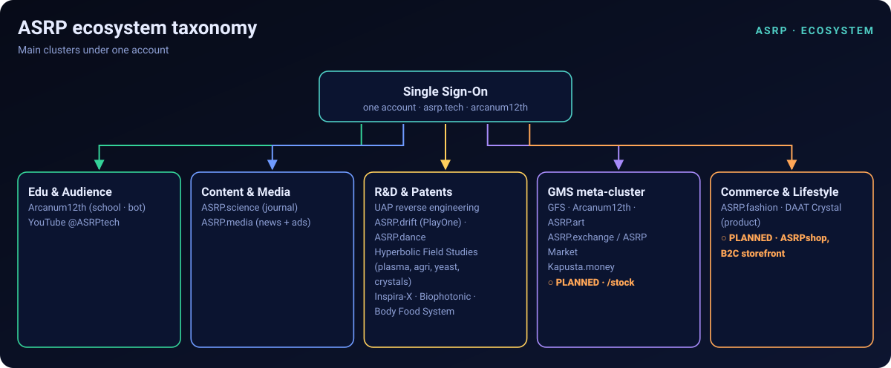
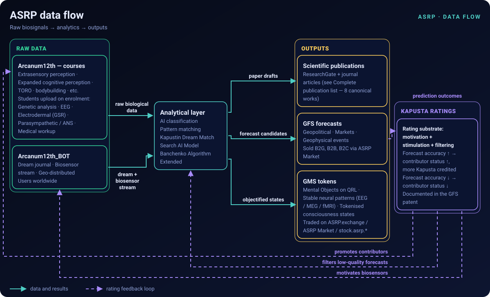
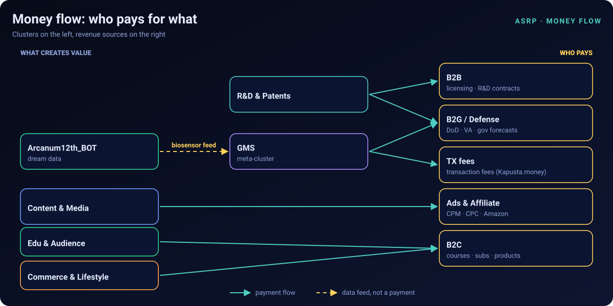

**English | [Русский](ECOSYSTEM.ru.md)**

[← ASRP Ecosystem](../README.md) · [Documentation index](README.md)

# ASRP Ecosystem — Ecosystem Map and Component Status

> Statuses and figures on this page are as of 2026-Q2 unless a date is given, and are stated by the project; they have not been independently re-verified.

---

## About

**ASRP (Advanced Scientific Research Projects)** is a modular ecosystem that combines education, science, media, R&D / deep tech, consciousness technology and commerce into one cross-linked system.

**One account = access to every service** — the moment a user registers in ASRP.media, they simultaneously gain access to the journal (ASRP.science), the school (Arcanum12th), the bot, and the marketplace layer.

All sub-products reinforce each other: the bot feeds data to the forecasting system, the journal links to project repos, the media turns research into mass content, and B2B/B2G contracts convert the R&D into revenue.

A meta-cluster — **Global Mental System (GMS)** — binds GFS, Arcanum12th, ASRP.Exchange, ASRP.art and Kapusta.money into a single consciousness-economy layer.

The organisation holds **active DARPA BAA proposal-portal access and a Tesla Business Program accreditation** (see [Accreditations](RESEARCH_AND_IP.md) for the distinction), plus 6 Kazpatent filings, 1 PCT, 1 US Copyright and a peer-reviewed ASRP.drift publication.

### Strategic thesis

As AI and robotics progressively displace mid-skill labour (accounting, law, translation, then manufacturing), economic value migrates toward **complex cognitive processes** that machines cannot yet reproduce — consciousness research, lucid dreaming, forecasting, art valuation, deep science. ASRP's bet is on the layer above that shift: **measure cognitive states, tokenise them, and trade them** as a new asset class. Every ASRP product (DAAT Crystal, ASRP.dance, ASRP.fashion, Inspira-X, GMS, ASRP.exchange, Kapusta.money) is an instrument within that single thesis — cognitive-enhancement hardware on one side, consciousness-state marketplace on the other.

### Why this hub exists

ASRP's public surface is fragmented across sites, repos, papers and social channels — which has historically blocked serious conversations with investors and partners. This repository consolidates **the full monetisation narrative** in one place so marketers, investors, prime contractors and new team members get a coherent entry point without a 10-thread chat.

> ⚠️ EN/RU divergence in the source — see [open questions](../reports/MARKETING_UPDATE_REPORT.md#open-questions).

**Core clusters:**

- 🎓 **Education** — Arcanum12th platform, Telegram bot, courses, certification.
- 🔬 **Science** — peer-reviewed journal, research repositories, IP portfolio (6 KZ patents + 1 PCT + 1 US copyright).
- 📰 **Media** — official media outlet with ad-based monetization and affiliate integrations.
- ⚙️ **R&D / Deep Tech** — UAP reverse engineering, hyperbolic field studies, forecasting, neurointerfaces, biomed, AI.
- 🎨 **Consciousness Technology** — ASRP.art, ASRP.drift (PlayOne), Global Mental System, ASRP.dance.
- 💱 **Commerce & Lifestyle** — ASRP.exchange, ASRP.fashion, Kapusta.money, Body Food System.

---

## Ecosystem Map

Two separate views for clarity: **what we have** (taxonomy) and **how money moves** (flow).

### A. Taxonomy — main clusters

> **Edu & Audience is also a raw-data source for the ecosystem.** Arcanum12th courses (extrasensory perception, expanded cognitive perception, TORO, bodybuilding, etc.) collect **raw biological data** from enrolled students: genetic analysis, EEG, electrodermal / skin-galvanic response, parasympathetic / autonomic nervous-system metrics, medical workup. Together with the Arcanum12th_BOT dream-and-biosensor stream, these flows feed the analytical layer that produces **scientific publications, GFS forecasts, and GMS consciousness-state tokens**. The clusters are not isolated silos — Edu → R&D → Content & Media → Commerce is a single data-and-revenue pipeline.

> The diagram above shows the **data semantics the taxonomy above does not**: Arcanum12 courses + Arcanum12th_BOT feed the analytical layer → three downstream outputs (publications, GFS forecasts, GMS tokens) → the **Kapusta rating substrate** closes the loop by filtering low-quality forecasts, promoting accurate contributors, and motivating biological sensors (documented in the GFS patent).

### B. Money flow — who pays for what

> One dashed flow is shown explicitly: the bot supplies biosensor data to R&D (feeding GFS). The full flow chain from research to media and audience lives in the separate [Frequency Ladder](MEDIA_AND_CHANNELS.md) diagram below.

---

## Component Status

### Live & Ready to Scale

| Component | Link | Purpose | Monetization |
|---|---|---|---|
| 🤖 **Arcanum12th_BOT** | [@Arcanum12th_BOT](https://t.me/Arcanum12th_BOT) | Dreams journal → lead & biosensor data for GFS | Lead gen, tripwire |
| 📰 **ASRP.media** | [asrp.media](https://asrp.media) | Official media, science-popularising content | CPM/CPC ads, native, Amazon affiliate |
| 🔬 **ASRP.science** | [asrp.science](https://asrp.science) | Peer-review scientific journal | Paid publications, subscriptions |
| ⚙️ **asrp.tech** | [asrp.tech](https://asrp.tech) | Projects & patents portfolio | B2B leads, licensing inquiries |

> ⚠️ EN/RU divergence in the source — see [open questions](../reports/MARKETING_UPDATE_REPORT.md#open-questions).

### Active Development

> Products with working prototypes, IP protection, or active pilots.

| Component | Link | Focus | Monetization Target |
|---|---|---|---|
| 🎓 **Arcanum12th.education** | [arcanum12th.education](https://arcanum12th.education) | Educational platform | Course sales, certification |
| ▶️ **YouTube @ASRPtech** | [@ASRPtech](https://www.youtube.com/@ASRPtech) | Science & research video | AdSense, sponsorships |
| 🎨 **ASRP.art** | [asrp.tech/projects](https://asrp.tech/ru/projects) · [repo](https://github.com/AdvancedScientificResearchProjects/Axionetic_Sensing_Reactions_Platform_in_Art) | Neurophysiological art valuation | Art marketplaces, galleries |
| 🧠 **ASRP.drift (PlayOne)** | [asrp.tech/projects](https://asrp.tech/ru/projects) | Neurointegration for team synchronization | B2B clinical, defense, sports |
| 🌐 **GFS — Global Forecasting System** | [asrp.tech/projects](https://asrp.tech/ru/projects) · [repo (code private)](https://github.com/AdvancedScientificResearchProjects/gfs-model) | Dream + biosensor analysis → forecasts · **product narrative fully public** (see [GFS path to money](PATHS_TO_MONEY_RESEARCH.md)) · source code private for security | B2G, B2B forecasts + Kapusta-rewarded user bets |
| 🧘 **Global Mental System** | [asrp.tech/projects](https://asrp.tech/ru/projects) | Cognitive process synchronization | Enterprise performance, wellness |
| 🥗 **Body Food System** | [patent repo](https://github.com/denisbanchenko/Kazpatent_Body_Food_System_Patent) | Genetics-based personalized nutrition (US Copyright TXu002116250) | B2C, licensing |
| 💓 **Inspira-X** | [patent repo](https://github.com/denisbanchenko/Kazpatent_Inspira-X_Respiratory_Analysis_Patent) · [asrp.tech](https://asrp.tech/ru/projects/inspira-x) | Dual-channel pneumograph + ECG, 22 breathing methodics · **primary placement: DAAT Crystal cognitive-enhancement stack** (respiratory biosensor) · also serves as an ASRP.drift module | DAAT Crystal bundle + medical B2B + crowdfunding planned |
| 💃 **ASRP.dance** | [asrp.tech](https://asrp.tech/ru/projects/asrp.dance) | Movement neuroscience — cortical activation via ritual/complex motion sequences | B2B clinics, sports, wellness |
| 👗 **ASRP.fashion** | [asrp.tech](https://asrp.tech/ru/projects/asrp.fashion) · [YouTube @ASRPfashion](https://www.youtube.com/@ASRPfashion) | Living biocompatible textiles grown from plants/bacteria/fungi under hyperbolic + quantum field exposure | Premium fashion, medical textiles, licensing |
| 💎 **DAAT Crystal** (product) | [repo](https://github.com/AdvancedScientificResearchProjects/Hyperbolic_Field_DAAT_Crystal_Study) · [asrp.tech](https://asrp.tech/ru/projects) | Premium cognitive-enhancement device (crystal + Inspira-X + neurointerface stack) | Premium B2C + B2B executive wellness |
| 🔄 **ASRP.exchange / ASRP Market** | [asrp.tech](https://asrp.tech/ru/projects/asrp.exchange) | Consciousness-state marketplace (`/stock` subdomain = Mental Objects DB) | Exchange commissions, TX fees via Kapusta.money |

### Planned

> Domains acquired and product scope defined; technical launch pending.

| Component | Status | Purpose |
|---|---|---|
| 🛒 **ASRPshop** | 🟡 Planned | B2C storefront for DAAT crystals and ASRP.fashion items |
| 📊 **ASRP Market `/stock` subdomain** | 🟡 Planned | Consciousness-state database, connected to neurointerface ingest |
| 🚀 **Inspira-X crowdfunding** | 🟡 Planned | Kickstarter-class campaign |

### Meta-Cluster — Global Mental System (GMS)

**GMS is an umbrella ecosystem that binds GFS, Arcanum12th, ASRP.Exchange, ASRP.art and Kapusta.money into a single consciousness-economy layer.**

| Component | Link | Role in GMS |
|---|---|---|
| 🌐 **GFS** | [asrp.tech](https://asrp.tech/ru/projects/global_foresight_system) | Forecasts as tradable asset |
| 🎓 **Arcanum12th** | [asrp.tech](https://asrp.tech/ru/projects/arcanum12th) | Certification of consciousness specialists |
| 🔄 **ASRP.exchange** | [asrp.tech](https://asrp.tech/ru/projects/asrp.exchange) | Mental-state exchange (dreams, predictions, art) |
| 🎨 **ASRP.art** | [asrp.tech](https://asrp.tech/ru/projects/asrp.art) | Consciousness-state art certification |
| 💰 **Kapusta.money** | [asrp.tech](https://asrp.tech/ru/projects/kapusta.money) | **Rating-system substrate** (not just a settlement currency) — centralised + decentralised layers; status rises with accurate forecasts (+ more Kapusta credited), falls with inaccurate ones; produces three outcomes at scale: (a) accurate forecasts, (b) high-precision biological sensors (humans), (c) system reliability · mechanism documented in the GFS patent |

### Research Repositories

| Repository | Focus | Stage | Target Client |
|---|---|---|---|
| [UAP Reverse Engineering](https://github.com/AdvancedScientificResearchProjects/UAP_Reverse_Engineering_Study) | Aerospace reverse engineering | 🔐 Public w/ NDA-tier materials | Defense contractors, DoD |
| [Hyperbolic Field Blood Plasma](https://github.com/AdvancedScientificResearchProjects/Hyperbolic_Field_BloodPlasma_Study) | Blood plasma coagulation | 🧪 Lab results published | Pharma, Stanford-class centers |
| [Hyperbolic Field Agricultural](https://github.com/AdvancedScientificResearchProjects/Hyperbolic_Field_Agricultural_Study) | Germination, plant yield | 🧪 Field trials (Day 4+) | Agri-holdings, UA/MD grants |
| [Hyperbolic Field Yeast](https://github.com/AdvancedScientificResearchProjects/Hyperbolic_Field_SaccharomycesCerevisiae_Study) | Fermentation kinetics | 🧪 OSF registered | Food industry, biopharma |
| [DAAT Crystal Study](https://github.com/AdvancedScientificResearchProjects/Hyperbolic_Field_DAAT_Crystal_Study) | Crystal-human interaction, cognitive enhancement research | 🧪 Recruitment | Premium B2C + B2B — see [DAAT Crystal Path to Money](PATHS_TO_MONEY_PRODUCTS.md) |
| Hyperbolic Field Plants Study | Germination, growth kinetics, yield modulation on expanded species list | 🟡 OSF preregistration planned (2026-04-22) | Agri-holdings, food-security grants |
| Hyperbolic Field Fish Caviar Study | Aquaculture embryonic-development kinetics under hyperbolic-field exposure | 🟡 OSF preregistration planned (2026-04-22) | Aquaculture industry, biopharma |

> ⚠️ EN/RU divergence in the source — see [open questions](../reports/MARKETING_UPDATE_REPORT.md#open-questions).

> 🔐 Some materials require NDA.

---

## Evidence status

Checked on 17 November 2026. **VERIFIED** = confirmed by an automated request or by a file in this repository; **STATED** = the project's own statement with a public link a reader can follow, not re-checked; **NOT VERIFIED** = no public evidence in this repository.

| Statement on this page | Evidence | Status |
|---|---|---|
| asrp.media, asrp.science, asrp.tech, Arcanum12th_BOT, Arcanum12th.education and YouTube @ASRPtech are live | The listed URLs returned HTTP 200 on 2026-11-17; this shows the pages exist, not what they contain or their usage | **STATED** |
| One account gives access to every service (media, journal, school, bot, marketplace layer) | none on this page | **NOT VERIFIED** |
| ASRP.science is a peer-review scientific journal | Link asrp.science returned 200; no review process, issues or editorial board shown on this page | **STATED** |
| The organisation holds active DARPA BAA proposal-portal access and a Tesla Business Program accreditation | Refers to the Research and IP page; there the DARPA login is described as provided under NDA and no public document is linked | **NOT VERIFIED** |
| 6 Kazpatent filings, 1 PCT, 1 US Copyright and a peer-reviewed ASRP.drift publication | Project statement; patent repositories and the asrp.drift page (200) are linked from the Research and IP page; no registry record was checked | **STATED** |
| Public repositories exist for the Body Food System and Inspira-X patents | Both GitHub URLs returned 200 on 2026-11-17 | **VERIFIED** |
| Arcanum12th courses collect raw biological data from students (genetic analysis, EEG, skin-galvanic response, autonomic metrics, medical workup) that feeds publications, GFS forecasts and GMS tokens | none on this page | **NOT VERIFIED** |
| The Kapusta rating mechanism (accuracy raises status, inaccuracy lowers it) is documented in the GFS patent | The GFS patent text is not on this page and was not read; the GFS patent repository is linked on the Research and IP page | **NOT VERIFIED** |
| GFS product narrative is fully public and its source code is private | Linked repository gfs-model not publicly reachable (404); no public evidence of the code or of its privacy reasons | **NOT VERIFIED** |
| The ASRP.art repository and the DAAT Crystal Study repository exist; the DAAT study is at the recruitment stage | Both repositories not publicly reachable (404); recruitment is not evidenced | **NOT VERIFIED** |
| Products under Active Development have working prototypes, IP protection or active pilots | Only asrp.tech project pages (200) are linked; no prototype, pilot or protection document is shown | **NOT VERIFIED** |
| Inspira-X is a dual-channel pneumograph plus ECG with 22 breathing methodics | Project page asrp.tech/ru/projects/inspira-x and patent repository returned 200; specifications not re-checked | **STATED** |
| Four study repositories are public: UAP Reverse Engineering, Blood Plasma, Agricultural, Yeast | All four GitHub URLs returned 200 on 2026-11-17 | **VERIFIED** |
| Blood plasma study: lab results published; Agricultural study: field trials at day 4+ | Repositories exist (200); their contents were not read | **STATED** |
| UAP study is public with NDA-tier materials | Repository exists (200); the NDA-tier materials cannot be checked from public sources | **NOT VERIFIED** |
| Yeast study is registered on OSF | Registry link osf.io/Jgt3h (given on the Research and IP page) returned 200; registration content not checked | **STATED** |
| OSF preregistration of the Plants and Fish Caviar studies is planned for 2026-04-22 | Planned date is before the check date; no registration or link on this page | **NOT VERIFIED** |
| Domains for ASRPshop, the /stock subdomain and Inspira-X crowdfunding are acquired and product scope is defined | none on this page | **NOT VERIFIED** |
| Three passages (lines 35, 81, 136) are marked as differing between the English and Russian source texts | The two language versions differ; see the report linked in the page notes; the differing wording was not resolved | **NOT VERIFIED** |
