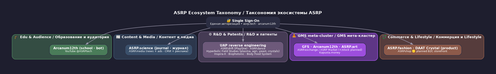
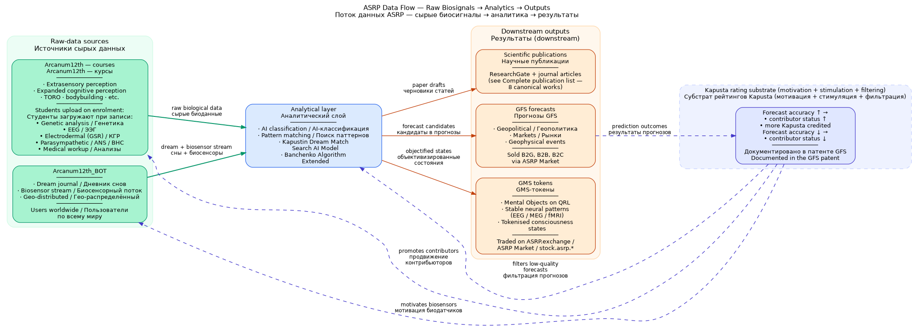
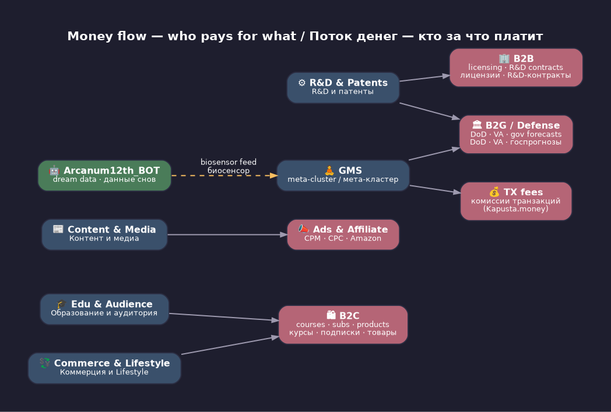

**[English](ECOSYSTEM.md) | Русский**

[← Экосистема ASRP](../README.ru.md) · [Указатель документации](README.ru.md)

# Экосистема ASRP — Карта экосистемы и статус компонентов

> Перенесено дословно из корневого README до ноября 2026 (снимок `cfd1940`, архив — в [`archive/`](../archive/README_2026-11-17_pre-marketing-update.md)). Статусы и цифры приведены как в исходнике, в основном на 2 квартал 2026, и с тех пор не перепроверялись.

---

## О проекте

**ASRP (Перспективные Научно-Исследовательские Разработки)** — модульная экосистема, соединяющая образование, науку, медиа, R&D / deep tech, технологии сознания и коммерцию в одну связанную систему.

**Один аккаунт = доступ ко всем сервисам** — зарегистрировавшись в ASRP.media, пользователь одновременно получает доступ в журнал (ASRP.science), школу (Arcanum12th), бот и рыночный слой.

Все продукты усиливают друг друга: бот поставляет данные в систему прогнозирования, журнал ссылается на репозитории проектов, медиа превращает исследования в массовый контент, а B2B/B2G контракты монетизируют R&D.

Мета-кластер **Global Mental System (GMS)** объединяет GFS, Arcanum12th, ASRP.Exchange, ASRP.art и Kapusta.money в единый слой экономики сознания.

Организация держит **активный доступ к порталу DARPA BAA и аккредитацию Tesla Business Program** (различие — см. раздел [«Аккредитации»](RESEARCH_AND_IP.ru.md)), плюс 6 патентных заявок Казпатент, 1 PCT, 1 авторское свидетельство США и рецензируемую публикацию по ASRP.drift.

### Стратегический тезис

По мере того как ИИ и робототехника вытесняют труд среднего уровня (бухгалтерия, юриспруденция, перевод, затем производство), экономическая ценность смещается к **сложным когнитивным процессам**, которые машины пока не воспроизводят — исследования сознания, осознанные сновидения, прогнозирование, оценка искусства, фундаментальная наука. ASRP делает ставку на слой выше этого сдвига: **измерять состояния сознания, токенизировать их и торговать ими** как новым классом активов. Каждый продукт ASRP (DAAT Crystal, ASRP.dance, ASRP.fashion, Inspira-X, GMS, ASRP.exchange, Kapusta.money) — инструмент внутри этого тезиса: с одной стороны оборудование для усиления когнитивных способностей, с другой — биржа состояний сознания.

### Зачем этот хаб нужен

Публичная поверхность ASRP разбросана по сайтам, репозиториям, статьям и соцканалам — и это исторически блокировало серьёзные разговоры с инвесторами и партнёрами. Этот репозиторий собирает **полный монетизационный нарратив** в одном месте, чтобы маркетологи, инвесторы, prime-подрядчики и новые члены команды получали связную точку входа без длинной переписки.

> ⚠️ Расхождение EN/RU в исходнике — см. [открытые вопросы](../reports/MARKETING_UPDATE_REPORT.md#open-questions).

**Ключевые кластеры:**

- 🎓 **Образование** — Платформа Arcanum12th, Telegram-бот, курсы, сертификация.
- 🔬 **Наука** — Рецензируемый журнал, исследовательские репозитории, портфель ИС (6 патентов KZ + 1 PCT + 1 авторское свидетельство США).
- 📰 **Медиа** — Официальное СМИ с рекламной монетизацией и партнёрскими интеграциями.
- ⚙️ **R&D / Deep Tech** — Реверс UAP, исследования гиперболических полей, прогнозирование, нейроинтерфейсы, биомед, AI.
- 🎨 **Технологии сознания** — ASRP.art, ASRP.drift (PlayOne), Global Mental System, ASRP.dance.
- 💱 **Коммерция и Lifestyle** — ASRP.exchange, ASRP.fashion, Kapusta.money, Body Food System.

---

## Карта экосистемы

Две отдельные схемы для ясности: **что у нас есть** (таксономия) и **как идут деньги** (поток).

### A. Таксономия — основные кластеры

> **Edu & Audience — это также источник сырых данных для экосистемы.** Курсы Arcanum12th (экстрасенсорное восприятие, расширенное когнитивное восприятие, ТОРО, бодибилдинг и т.д.) собирают **сырые биологические данные** со студентов: генетический анализ, ЭЭГ, кожно-гальваническая реакция, показатели парасимпатической и автономной нервной системы, медицинское обследование. Вместе с потоком снов и биосенсоров из Arcanum12th_BOT эти данные питают аналитический слой, производящий **научные публикации, прогнозы GFS и токены состояний сознания GMS**. Кластеры не изолированы — Edu → R&D → Content & Media → Commerce — это единый data-and-revenue конвейер.

> Диаграмма выше показывает **семантику данных, которой нет в таксономии**: курсы Arcanum12 + бот питают аналитический слой → три результата на выходе (публикации, прогнозы GFS, GMS-токены) → **субстрат рейтингов Kapusta** замыкает петлю — фильтрует слабые прогнозы, продвигает точных контрибьюторов, мотивирует биологические датчики (задокументировано в патенте GFS).

### B. Поток денег — кто за что платит

> Пунктиром показан единственный кросс-поток: бот кормит R&D-блок биосенсорными данными (для GFS). Полная цепочка от исследования к медиа и аудитории — в отдельной схеме [Frequency Ladder](MEDIA_AND_CHANNELS.ru.md) ниже.

---

## Статус компонентов

### Работает и готово к масштабированию

| Компонент | Ссылка | Назначение | Монетизация |
|---|---|---|---|
| 🤖 **Arcanum12th_BOT** | [@Arcanum12th_BOT](https://t.me/Arcanum12th_BOT) | Дневник снов → лид + биодатчик для GFS | Лид-ген, трипваер |
| 📰 **ASRP.media** | [asrp.media](https://asrp.media) | СМИ, популяризация науки | Реклама, нативка, Amazon |
| 🔬 **ASRP.science** | [asrp.science](https://asrp.science) | Рецензируемый научный журнал | Платные публикации, подписка |
| ⚙️ **asrp.tech** | [asrp.tech](https://asrp.tech) | Портфолио проектов и патентов | B2B-лиды, лицензирование |

> ⚠️ Расхождение EN/RU в исходнике — см. [открытые вопросы](../reports/MARKETING_UPDATE_REPORT.md#open-questions).

### В активной разработке

> Продукты с работающими прототипами, защитой ИС или активными пилотами.

| Компонент | Ссылка | Фокус | Цель монетизации |
|---|---|---|---|
| 🎓 **Arcanum12th.education** | [arcanum12th.education](https://arcanum12th.education) | Образовательная платформа | Продажа курсов, сертификация |
| ▶️ **YouTube @ASRPtech** | [@ASRPtech](https://www.youtube.com/@ASRPtech) | Видео о науке | AdSense, спонсорство |
| 🎨 **ASRP.art** | [asrp.tech/projects](https://asrp.tech/ru/projects) · [репозиторий](https://github.com/AdvancedScientificResearchProjects/Axionetic_Sensing_Reactions_Platform_in_Art) | Нейрофизиологическая оценка искусства | Арт-площадки, галереи |
| 🧠 **ASRP.drift (PlayOne)** | [asrp.tech/projects](https://asrp.tech/ru/projects) | Нейроинтеграция для синхронизации команд | B2B клиника, оборонка, спорт |
| 🌐 **GFS — Global Forecasting System** | [asrp.tech/projects](https://asrp.tech/ru/projects) · [репозиторий (код закрыт)](https://github.com/AdvancedScientificResearchProjects/gfs-model) | Сны + биосенсоры → прогнозы · **продуктовый нарратив полностью публичен** (см. [путь к деньгам GFS](PATHS_TO_MONEY_RESEARCH.ru.md)) · исходный код закрыт по соображениям безопасности | B2G, B2B прогнозы + пользовательские ставки с начислением Kapusta |
| 🧘 **Global Mental System** | [asrp.tech/projects](https://asrp.tech/ru/projects) | Синхронизация когнитивных процессов | Корпоративные программы, wellness |
| 🥗 **Body Food System** | [репозиторий патента](https://github.com/denisbanchenko/Kazpatent_Body_Food_System_Patent) | Персональное питание по генетике (Авторское право США TXu002116250) | B2C, лицензирование |
| 💓 **Inspira-X** | [репозиторий патента](https://github.com/denisbanchenko/Kazpatent_Inspira-X_Respiratory_Analysis_Patent) · [asrp.tech](https://asrp.tech/ru/projects/inspira-x) | Двухканальный пневмограф + ЭКГ, 22 дыхательные методики · **основное место в стеке DAAT Crystal** (респираторный биосенсор) · также используется как модуль ASRP.drift | Бандл с DAAT Crystal + медицинский B2B + краудфандинг планируется |
| 💃 **ASRP.dance** | [asrp.tech](https://asrp.tech/ru/projects/asrp.dance) | Нейронаука движений — активация коры через сложные / ритуальные последовательности | B2B клиники, спорт, wellness |
| 👗 **ASRP.fashion** | [asrp.tech](https://asrp.tech/ru/projects/asrp.fashion) · [YouTube @ASRPfashion](https://www.youtube.com/@ASRPfashion) | Живые биосовместимые ткани из растений/бактерий/грибов под гиперболическими и квантовыми полями | Премиум-мода, медицинский текстиль, лицензирование |
| 💎 **DAAT Crystal** (продукт) | [репозиторий](https://github.com/AdvancedScientificResearchProjects/Hyperbolic_Field_DAAT_Crystal_Study) · [asrp.tech](https://asrp.tech/ru/projects) | Премиум-устройство когнитивного усиления (кристалл + Inspira-X + нейроинтерфейс) | Премиум B2C + B2B для топ-менеджмента |
| 🔄 **ASRP.exchange / ASRP Market** | [asrp.tech](https://asrp.tech/ru/projects/asrp.exchange) | Биржа состояний сознания (субдомен `/stock` = БД ментальных объектов) | Комиссии биржи, TX-комиссии Kapusta.money |

### Планируется

> Домены куплены и scope определён; технический запуск в ожидании.

| Компонент | Статус | Назначение |
|---|---|---|
| 🛒 **ASRPshop** | 🟡 Планируется | B2C-витрина для DAAT-кристаллов и изделий ASRP.fashion |
| 📊 **Субдомен `/stock` ASRP Market** | 🟡 Планируется | База состояний сознания, ингест через нейроинтерфейс |
| 🚀 **Краудфандинг Inspira-X** | 🟡 Планируется | Kickstarter-класс кампания |

### Мета-кластер — Global Mental System (GMS)

**GMS — зонтичная экосистема, связывающая GFS, Arcanum12th, ASRP.Exchange, ASRP.art и Kapusta.money в единый слой экономики сознания.**

| Компонент | Ссылка | Роль в GMS |
|---|---|---|
| 🌐 **GFS** | [asrp.tech](https://asrp.tech/ru/projects/global_foresight_system) | Прогнозы как торгуемый актив |
| 🎓 **Arcanum12th** | [asrp.tech](https://asrp.tech/ru/projects/arcanum12th) | Сертификация специалистов сознания |
| 🔄 **ASRP.exchange** | [asrp.tech](https://asrp.tech/ru/projects/asrp.exchange) | Биржа ментальных состояний (сны, прогнозы, искусство) |
| 🎨 **ASRP.art** | [asrp.tech](https://asrp.tech/ru/projects/asrp.art) | Сертификация искусства в ИСС |
| 💰 **Kapusta.money** | [asrp.tech](https://asrp.tech/ru/projects/kapusta.money) | **Субстрат системы рейтингов** (не просто расчётная валюта) — централизованный + децентрализованный слои; статус повышается за точные прогнозы (+ больше Kapusta), понижается за неточные; на больших данных даёт (а) точные прогнозы, (б) высокоточные биологические датчики (люди), (в) надёжность системы · механизм задокументирован в патенте GFS |

### Исследовательские репозитории

| Репозиторий | Направление | Стадия | Клиент |
|---|---|---|---|
| [Реверс-инжиниринг UAP](https://github.com/AdvancedScientificResearchProjects/UAP_Reverse_Engineering_Study) | Реверс аэрокосмических технологий | 🔐 Публичный + материалы под NDA | Оборонка, Минобороны США |
| [Плазма крови в гиперболическом поле](https://github.com/AdvancedScientificResearchProjects/Hyperbolic_Field_BloodPlasma_Study) | Свёртывание плазмы | 🧪 Опубликованы | Фарма, центры уровня Стэнфорда |
| [Агро-исследование в гиперболическом поле](https://github.com/AdvancedScientificResearchProjects/Hyperbolic_Field_Agricultural_Study) | Прорастание, урожайность | 🧪 Полевые (день 4+) | Агрохолдинги, гранты UA/MD |
| [Дрожжи в гиперболическом поле](https://github.com/AdvancedScientificResearchProjects/Hyperbolic_Field_SaccharomycesCerevisiae_Study) | Кинетика ферментации | 🧪 OSF зарегистрировано | Пищевая промышленность, биофарма |
| [Исследование DAAT-кристалла](https://github.com/AdvancedScientificResearchProjects/Hyperbolic_Field_DAAT_Crystal_Study) | Взаимодействие кристалл-человек, исследование когнитивного усиления | 🧪 Набор участников | Премиум B2C + B2B — см. [Path to Money](PATHS_TO_MONEY_PRODUCTS.ru.md) |
| Исследование растений в гиперболическом поле | Прорастание, кинетика роста, модуляция урожайности на расширенном списке видов | 🟡 Предрегистрация OSF планируется (22.04.2026) | Агрохолдинги, гранты по продовольственной безопасности |
| Исследование икры рыбы в гиперболическом поле | Кинетика эмбрионального развития в аквакультуре под воздействием гиперболического поля | 🟡 Предрегистрация OSF планируется (22.04.2026) | Аквакультура, биофарма |

> ⚠️ Расхождение EN/RU в исходнике — см. [открытые вопросы](../reports/MARKETING_UPDATE_REPORT.md#open-questions).

> 🔐 Часть материалов требует NDA.
