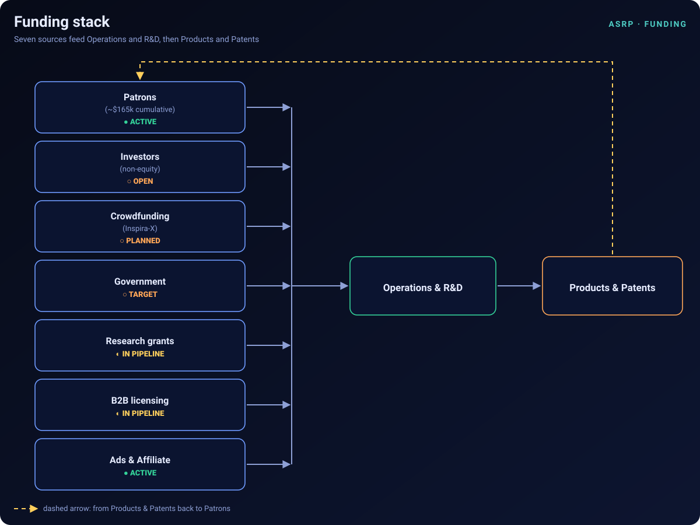

**English | [Русский](FUNDING.ru.md)**

[← ASRP Ecosystem](../README.md) · [Documentation index](README.md)

# ASRP Ecosystem — Funding Sources and Patrons

> Statuses and figures on this page are as of 2026-Q2 unless a date is given, and are stated by the project; they have not been independently re-verified.

---

## Funding Sources

**ASRP deliberately diversifies funding across 7 streams — this is how we survived 3+ years of research-heavy work and stay independent.**

| Source | Status | Notes |
|---|---|---|
| 💝 **Patrons** | ✅ Active | 7 tiers on [asrp.tech/ru/patrons](https://asrp.tech/ru/patrons); lead patron $100 k; cumulative confirmed ≈$165 k |
| 💼 **Investors (non-equity)** | ✅ Open | Co-operation models without share transfer — [asrp.tech/ru/investors](https://asrp.tech/ru/investors) |
| 🚀 **Crowdfunding** | 🟡 Planned under Inspira-X | Kickstarter-class campaign in preparation; donate link already live at `asrp.tech/ru/donate/asrp` |
| 🏛️ **Government contracts** | 🎯 Target | Civilian and defense tenders (DoD primes, VA, DARPA-class) |
| 📜 **Research grants** | 🔄 In pipeline | Agri grants UA / MD; foundation outbound (neurodegenerative, cultured meat) |
| 💼 **B2B licensing** | 🔄 In pipeline | Active talks — Cortical Labs (blood plasma) |
| 📰 **Ads & Affiliate** | ✅ Active | ASRP.media CPM / CPC + Amazon affiliate via banner placements |

> ⚠️ EN/RU divergence in the source — see [open questions](../reports/MARKETING_UPDATE_REPORT.md#open-questions).

### Funding stack

### Current patrons

**Full live list with photos on [asrp.tech/ru/patrons](https://asrp.tech/ru/patrons).**

> All patrons listed below have consented to public attribution on `asrp.tech/ru/patrons`; this table mirrors that public registry.

| Tier | Range | Patrons |
|---|---|---|
| 👑 **Principal Philanthropist** | $50 k – $100 k | Alexander Ovsyannikov ($100 k) |
| ⭐ **Senior Patron** | $20 k – $50 k | Chirkova Olesia ($20 k) |
| 🔷 **Major Benefactor** | $10 k – $20 k | Yulia Khomyak ($15 k) · Vlada Bilovodenko ($10 k) |
| 🟢 **Supporting Donor** | $5 k – $10 k | Dmitriy Kapustin ($5 k) · Tatyana Burilova ($5 k) |
| 🟡 **Contributing Participant** | $1 k – $5 k | Pavel Ivanushko · Olena Mutsalkhanova-Yushchenko · Anna Budanova · Irina Bukach · Tatyana Krestyanova · Lev Shishkin · Igor Siberia (each $1 k) |
| 🔵 **Individual Contributor** | $100 – $1 k | Zhanderbek Berik ($400) · Marina Kutsina ($500) · Vadim Kazakov ($500) · Irina Grivtsova ($200) · Irina Zayukova · Natalia Voloshina · Anton Liapesha · Uladzislau · Olga (each $100) |

> Inspired by the tradition of historical patronage — Lorenzo de' Medici, Cosimo de' Medici, Eleonora de Toledo, Andrew Carnegie, John D. Rockefeller — as referenced on the live site.

---

## Support

If this repository is useful to you — research, investor walk-throughs, OSINT exploration, or just because you appreciate what ASRP is building — please consider supporting our work. Recurring patronage funds the labs, the open-source tooling, and the bilingual documentation you are reading right now.

→ **<https://asrp.tech/en/patrons>** · 7 patron tiers · Principal Philanthropist · Strategic Partner · Major Patron · Patron · Senior Contributor · Contributor · Individual Contributor

→ **<https://asrp.tech/ru/patrons>** · 7 patron tiers · from Principal Philanthropist to Individual Contributor

→ **<https://asrp.tech/ru/donate/asrp>** · one-off donations / Inspira-X crowdfunding pre-launch

---

## Evidence status

Checked on 17 November 2026. **VERIFIED** = confirmed by an automated request or by a file in this repository; **STATED** = the project's own statement with a public link a reader can follow, not re-checked; **NOT VERIFIED** = no public evidence in this repository.

| Statement on this page | Evidence | Status |
|---|---|---|
| ASRP funds itself from 7 streams | The Funding Sources table on this page has 7 rows (count of the file) | **VERIFIED** |
| Patrons: "7 tiers" | The patron table on this page has 6 tier rows, not 7; the Support section names 7 tier names that differ from the table's names; public page asrp.tech/ru/patrons returned 200, its content was not compared | **NOT VERIFIED** |
| The listed patron amounts add up to about $165 k (22 named patrons) | Re-added from the table: 100 + 20 + 15 + 10 + 5 + 5 + 7 x 1 + (400 + 500 + 500 + 200 + 5 x 100) = $164.1 k; 22 names; the page's "≈$165 k" is this sum rounded | **VERIFIED** |
| The patrons actually paid these amounts ("cumulative confirmed") | Public list at asrp.tech/ru/patrons (returned 200); no payment records in this repository; the Russian version says "накопленно" without "confirmed" (EN/RU divergence in the source) | **STATED** |
| Lead patron gave $100 k | Same public list; no payment record in this repository | **STATED** |
| All listed patrons consented to public attribution | none on this page; no consent record in this repository | **NOT VERIFIED** |
| Non-equity investor co-operation models are open | asrp.tech/ru/investors returned 200 (page exists; terms not checked) | **STATED** |
| Crowdfunding donate link is live at asrp.tech/ru/donate/asrp | URL returned 200 on 2026-11-17 | **VERIFIED** |
| A Kickstarter-class campaign under Inspira-X is in preparation | none on this page; RU version says only "Кампания готовится" (EN/RU divergence in the source) | **NOT VERIFIED** |
| Research grants are in the pipeline (agri grants UA / MD; foundation outbound) | none on this page; no application or grantor named; RU version says only "аутбаунд в профильные фонды" (EN/RU divergence) | **NOT VERIFIED** |
| B2B licensing: active talks with Cortical Labs (blood plasma) | none on this page; counterparty has not confirmed publicly | **NOT VERIFIED** |
| ASRP.media ads (CPM / CPC) and Amazon affiliate are active | none on this page; no revenue or placement data in this repository | **NOT VERIFIED** |
| Funding was diversified so ASRP "survived 3+ years" and is independent | none on this page | **NOT VERIFIED** |
