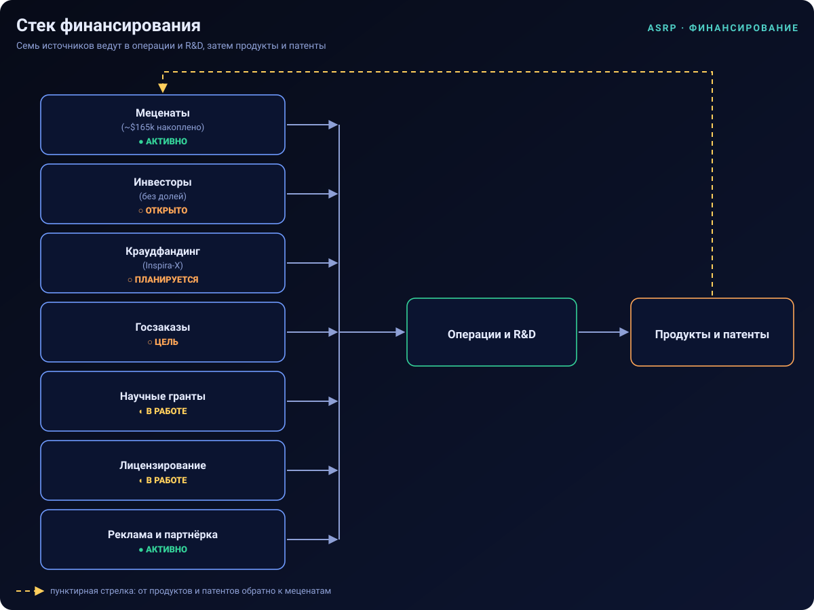

**[English](FUNDING.md) | Русский**

[← Экосистема ASRP](../README.ru.md) · [Указатель документации](README.ru.md)

# Экосистема ASRP — Источники финансирования и меценаты

> Статусы и цифры на этой странице приведены на 2 квартал 2026, если не указана другая дата, и даны со слов проекта; независимо они не перепроверялись.

---

## Источники финансирования

**ASRP намеренно диверсифицирует финансирование по 7 потокам — так мы выжили 3+ года исследований и остаёмся независимыми.**

| Источник | Статус | Примечания |
|---|---|---|
| 💝 **Меценаты** | ✅ Активно | 7 уровней на [/ru/patrons](https://asrp.tech/ru/patrons); ведущий меценат $100k; накопленно ≈$165k |
| 💼 **Инвесторы (без долей)** | ✅ Открыто | Модели сотрудничества без передачи долей — [asrp.tech/ru/investors](https://asrp.tech/ru/investors) |
| 🚀 **Краудфандинг** | 🟡 Планируется под Inspira-X | Кампания готовится; донат-линк уже работает на `asrp.tech/ru/donate/asrp` |
| 🏛️ **Госзаказы** | 🎯 Цель | Гражданские и оборонные тендеры (подрядчики DoD, VA, DARPA-уровень) |
| 📜 **Научные гранты** | 🔄 В работе | Агро-гранты UA/MD; аутбаунд в профильные фонды |
| 💼 **Лицензирование** | 🔄 В работе | Активные переговоры — Cortical Labs (плазма крови) |
| 📰 **Реклама и партнёрка** | ✅ Активно | ASRP.media CPM/CPC + Amazon-партнёрка через баннеры |

> ⚠️ Расхождение EN/RU в исходнике — см. [открытые вопросы](../reports/MARKETING_UPDATE_REPORT.md#open-questions).

### Стек финансирования

### Текущие меценаты

**Полный актуальный список с фото на [/ru/patrons](https://asrp.tech/ru/patrons).**

> Все меценаты ниже дали согласие на публичное упоминание на `asrp.tech/ru/patrons`; таблица отражает публичный реестр.

| Уровень | Диапазон | Меценаты |
|---|---|---|
| 👑 **Главный Филантроп** | $50 k – $100 k | Александр Овсянников ($100 k) |
| ⭐ **Старший Патрон** | $20 k – $50 k | Чиркова Олеся ($20 k) |
| 🔷 **Крупный Благотворитель** | $10 k – $20 k | Юлия Хомяк ($15 k) · Влада Биловоденко ($10 k) |
| 🟢 **Поддерживающий Донор** | $5 k – $10 k | Дмитрий Капустин ($5 k) · Татьяна Бурилова ($5 k) |
| 🟡 **Вносящий Участник** | $1 k – $5 k | Павел Иванушко · Олена Муцалханова-Ющенко · Анна Буданова · Ирина Букач · Татьяна Крестьянова · Лев Шишкин · Игорь Сибирия (каждый по $1 k) |
| 🔵 **Индивидуальный Вкладчик** | $100 – $1 k | Жандербек Берик ($400) · Марина Куцина ($500) · Вадим Казаков ($500) · Ирина Гривцова ($200) · Ирина Заюкова · Наталья Волошина · Антон Ляпеша · Владислав · Ольга (каждый по $100) |

> Вдохновляясь исторической традицией меценатства — Лоренцо де Медичи, Козимо де Медичи, Элеонора де Толедо, Эндрю Карнеги, Джон Д. Рокфеллер — как отмечено на живом сайте.

---

## Поддержать

Если этот репозиторий вам полезен — для исследования, разговора с инвесторами, OSINT-разбора, или просто потому что вам близко то, что делает ASRP — пожалуйста, поддержите нашу работу. Регулярное меценатство финансирует лаборатории, open-source инструменты и эту двуязычную документацию.

→ **<https://asrp.tech/en/patrons>** · 7 уровней меценатства · Principal Philanthropist · Strategic Partner · Major Patron · Patron · Senior Contributor · Contributor · Individual Contributor

→ **<https://asrp.tech/ru/patrons>** · 7 уровней меценатства · от Главного Филантропа до Индивидуального Вкладчика

→ **<https://asrp.tech/ru/donate/asrp>** · разовые пожертвования / предлончевый донат под Inspira-X

---

## Статус подтверждений

Проверено 17 ноября 2026. **ПРОВЕРЕНО** — подтверждено автоматическим запросом или файлом в этом репозитории; **ЗАЯВЛЕНО** — утверждение самого проекта с публичной ссылкой, по которой может пройти читатель, повторно не проверялось; **НЕ ПРОВЕРЕНО** — публичного подтверждения в этом репозитории нет.

| Утверждение на этой странице | Подтверждение | Статус |
|---|---|---|
| ASRP финансируется из 7 потоков | В таблице «Источники финансирования» на странице 7 строк (подсчёт по файлу) | **ПРОВЕРЕНО** |
| Меценаты: «7 уровней» | В таблице меценатов на странице 6 строк уровней, а не 7; в разделе «Поддержать» названы 7 уровней, и названия отличаются от таблицы; публичная страница asrp.tech/ru/patrons ответила 200, её содержимое не сравнивалось | **НЕ ПРОВЕРЕНО** |
| Суммы в списке меценатов дают около $165 k (22 поимённо) | Пересчитано по таблице: 100 + 20 + 15 + 10 + 5 + 5 + 7 x 1 + (400 + 500 + 500 + 200 + 5 x 100) = $164,1 k; 22 имени; «≈$165 k» на странице — это сумма с округлением | **ПРОВЕРЕНО** |
| Меценаты действительно внесли эти суммы («накопленно, подтверждено») | Публичный список asrp.tech/ru/patrons (ответ 200); платёжных документов в репозитории нет; в русской версии нет слова «подтверждено» (расхождение EN/RU в исходнике) | **ЗАЯВЛЕНО** |
| Ведущий меценат внёс $100 k | Тот же публичный список; платёжного документа в репозитории нет | **ЗАЯВЛЕНО** |
| Все перечисленные меценаты согласились на публичное указание имени | на странице нет; записи о согласии в репозитории нет | **НЕ ПРОВЕРЕНО** |
| Модели сотрудничества с инвесторами без долей открыты | asrp.tech/ru/investors ответила 200 (страница есть; условия не проверялись) | **ЗАЯВЛЕНО** |
| Ссылка для пожертвований asrp.tech/ru/donate/asrp работает | URL ответил 200 17.11.2026 | **ПРОВЕРЕНО** |
| Кампания уровня Kickstarter под Inspira-X готовится | на странице нет; в русской версии только «Кампания готовится» (расхождение EN/RU в исходнике) | **НЕ ПРОВЕРЕНО** |
| Научные гранты в работе (агро-гранты UA / MD; обращения в фонды) | на странице нет; заявки и грантодатели не названы; в русской версии только «аутбаунд в профильные фонды» (расхождение EN/RU) | **НЕ ПРОВЕРЕНО** |
| B2B-лицензирование: активные переговоры с Cortical Labs (плазма крови) | на странице нет; контрагент публично не подтверждал | **НЕ ПРОВЕРЕНО** |
| Реклама ASRP.media (CPM / CPC) и партнёрка Amazon активны | на странице нет; данных о доходе и размещениях в репозитории нет | **НЕ ПРОВЕРЕНО** |
| Диверсификация позволила ASRP «выжить 3+ года» и сохранить независимость | на странице нет | **НЕ ПРОВЕРЕНО** |
