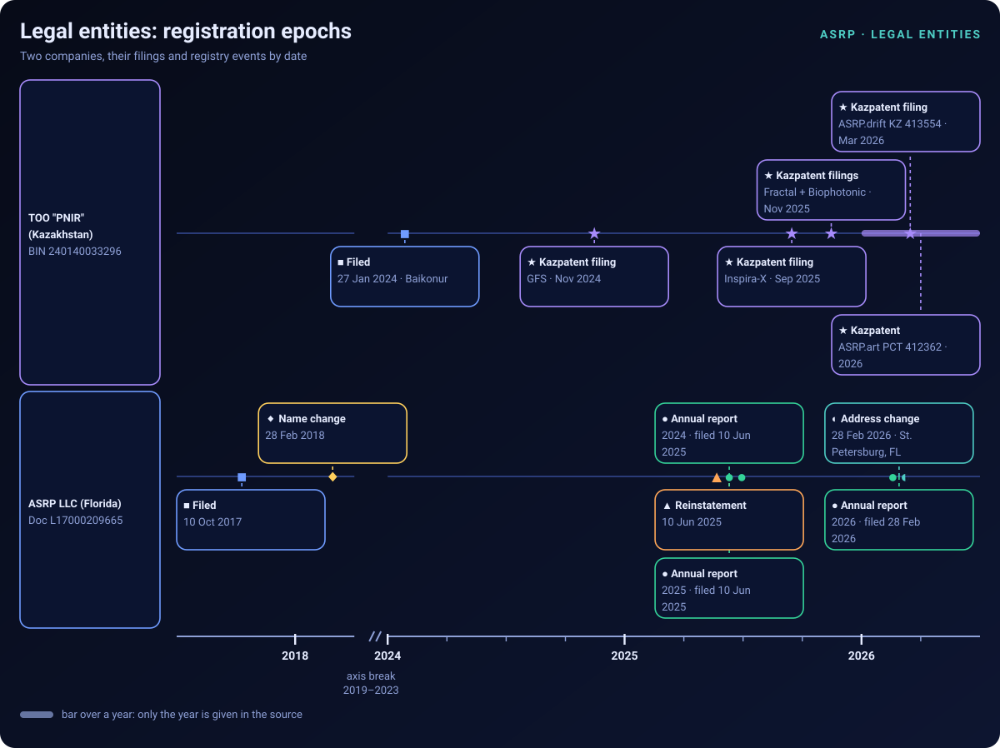

**English | [Русский](LEGAL_ENTITIES.ru.md)**

[← ASRP Ecosystem](../README.md) · [Documentation index](README.md)

# ASRP Ecosystem — Legal Entities and Registry Verification

> Statuses and figures on this page are as of 2026-Q2 unless a date is given, and are stated by the project; they have not been independently re-verified.

---

## Legal Entities & Registry Verification

**ASRP operates as a multi-jurisdiction group.** The three legal entities currently in scope are: the U.S. operational **ASRP LLC** (Florida, active since 2017), the Kazakhstan research-and-patent **ТОО** (Baikonur, 2024), and a **United Kingdom entity** (currently on corporate-status reinstatement). The Florida and Kazakhstan entities are verifiable through public registries; the UK entity is in the reinstatement stage and is documented here as part of the group's ongoing legal consolidation (see UBO note below).

### Advanced Scientific Research Projects LLC (Florida, USA)

| Field | Value |
|---|---|
| **Entity type** | Florida Limited Liability Company |
| **Document #** | L17000209665 |
| **FEI / EIN** | provided to verified counterparties · public via Florida SunBiz registry |
| **Date Filed** | **10 October 2017** |
| **Status** | ACTIVE |
| **Last Event** | REINSTATEMENT — 10 Jun 2025 |
| **Name change** | 28 Feb 2018 |
| **Principal address** | 7901 4th St N, Ste 300, St. Petersburg, FL 33702 (changed 28 Feb 2026) |
| **Registered Agent** | Registered Agents Inc |
| **Authorized Members** | Valeria Ovseannicova · Mykhailo Kapustin · Denis Banchenko |
| **Annual Reports** | 2024 (filed 10 Jun 2025) · 2025 (filed 10 Jun 2025) · 2026 (filed 28 Feb 2026) |
| **Public registry** | [search.sunbiz.org — Florida Division of Corporations](https://search.sunbiz.org/Inquiry/CorporationSearch/SearchResultDetail?inquirytype=EntityName&directionType=Initial&searchNameOrder=ADVANCEDSCIENTIFICRESEARCHPROJ%20L170002096650&aggregateId=flal-l17000209665-9ae2294a-abd3-46c7-944f-b49e0eb2f7f4&searchTerm=ADVANCED%20SCIENTIFIC%20RESEARCH%20PROJECTS%20LLC&listNameOrder=ADVANCEDSCIENTIFICRESEARCHPROJ%20L170002096650) |

### ASRP LLP (Kazakhstan)

| Field | Value |
|---|---|
| **Entity type** | Limited Liability Partnership |
| **BIN** | 240140033296 |
| **Registration** | **27 January 2024** |
| **OKED** | 72199 — Other research and development in natural and technical sciences |
| **Legal address** | Komarova St., 37, apt. 56, Baikonur, Kyzylorda region, 468320, Republic of Kazakhstan |
| **KATO code** | 431910000 (Baikonur) |
| **Director** | Denis Banchenko |
| **Public registries** | [infostats.co](https://infostats.co/companies/kz/3235213) · [kyc.kz](https://kyc.kz/search/bin/240140033296) |

> ⚠️ The English and Russian versions of this passage differ in the source.

> The Kazakhstan entity holds the **patent portfolio** (6 Kazpatent filings + 1 PCT); the Florida LLC is the **operational / commercial** entity (Tesla Business Program, DARPA BAA, USD contracting).

#### Ownership, UBO and corporate-affiliation disclaimer

> This note accompanies the Kazakhstan entity above and applies to the multi-jurisdiction group as a whole (US + KZ + UK).

This confirms that the legal entity registered in the Republic of Kazakhstan is part of the international ASRP group of companies (the "Group"), which also includes legal entities and corporate structures in the **United States** and the **United Kingdom** (including an entity currently undergoing corporate-status reinstatement).

Due to national-law constraints — including founder-residency requirements and specifics of Kazakhstan corporate regulation — the KZ entity is formally registered on **Denis Banchenko**, who currently acts as the nominal founder and/or sole executive body (director).

This registration is strictly of a **legal-technical and operational** character and **does not reflect the actual structure of ownership, control or economic-interest distribution** within the Group.

The **actual beneficial owners (UBO)** — and the persons exercising joint strategic and management control over the Group's assets and activities — are:
- **Valeria A. Ovseannicova**
- **Mykhailo M. Kapustin**
- **Denis Y. Banchenko**

These individuals act as co-owners and partners within a unified corporate and investment strategy of the ASRP Group, independent of the formal distribution of shares in individual jurisdictions.

Any discrepancies between the legal registration of specific companies and the actual ownership structure are attributable to the **current stage of corporate restructuring** and to the need to comply with the applicable legislation of the relevant jurisdictions (including, but not limited to, questions of tax residency, currency control and corporate law).

The ASRP Group is executing a **phased model** of consolidating assets and legal structure — including the possible formation of holding companies, formalisation of cross-jurisdictional links (via share-ownership mechanisms, shareholders' agreements, joint-activity agreements and other instruments), and synchronisation of beneficial control. Until these processes are completed, all legal entities within the Group — regardless of their formal registration — are regarded as interconnected and operating within a unified economic model and in the interests of the ASRP Group.

---

## Evidence status

Checked on 17 November 2026. **VERIFIED** = confirmed by an automated request or by a file in this repository; **STATED** = the project's own statement with a public link a reader can follow, not re-checked; **NOT VERIFIED** = no public evidence in this repository.

| Statement on this page | Evidence | Status |
|---|---|---|
| Florida LLC, Document L17000209665, filed 10 Oct 2017, status ACTIVE, last event reinstatement 10 Jun 2025 | Link to search.sunbiz.org given; returned 403 to the automated request, record not checked | **STATED** |
| Name change 28 Feb 2018; annual reports 2024 and 2025 filed 10 Jun 2025, 2026 filed 28 Feb 2026; principal address changed 28 Feb 2026 | Same SunBiz link (403), not checked | **STATED** |
| Authorized members are Ovseannicova, Kapustin and Banchenko; Registered Agent is Registered Agents Inc | Same SunBiz link (403), not checked | **STATED** |
| FEI / EIN is provided to verified counterparties and is public via SunBiz | none on this page; the number is not shown | **NOT VERIFIED** |
| Kazakhstan entity: BIN 240140033296, registered 27 Jan 2024, OKED 72199, KATO 431910000, Baikonur address, director Banchenko | Registry links not reachable: infostats.co no response, kyc.kz 410 | **NOT VERIFIED** |
| Name of the Kazakhstan entity: ASRP LLP in English, Перспективные Научно-Исследовательские Разработки (ТОО) in Russian | The two language versions differ; see the report linked in the page note; no registry name confirmed | **NOT VERIFIED** |
| A United Kingdom entity exists and is under corporate-status reinstatement | none on this page; no registry link | **NOT VERIFIED** |
| The Kazakhstan entity holds the patent portfolio (6 Kazpatent filings + 1 PCT) | The patent repositories are public (200) but are not linked here and do not show the applicant of record; no Kazpatent record | **NOT VERIFIED** |
| The Florida LLC is the operational entity (Tesla Business Program, DARPA BAA, USD contracting) | none on this page | **NOT VERIFIED** |
| The KZ entity is formally registered on Banchenko because of founder-residency and corporate-law constraints | none on this page; no legal opinion or registry extract | **NOT VERIFIED** |
| The actual beneficial owners (UBO) are Ovseannicova, Kapustin and Banchenko, acting as co-owners | none on this page; no shareholder agreement, register entry or UBO declaration is linked | **NOT VERIFIED** |
| A phased consolidation of assets and legal structure is being executed, including possible holding companies and cross-jurisdiction agreements | none on this page; worded as under way, no agreement or filing shown | **NOT VERIFIED** |
