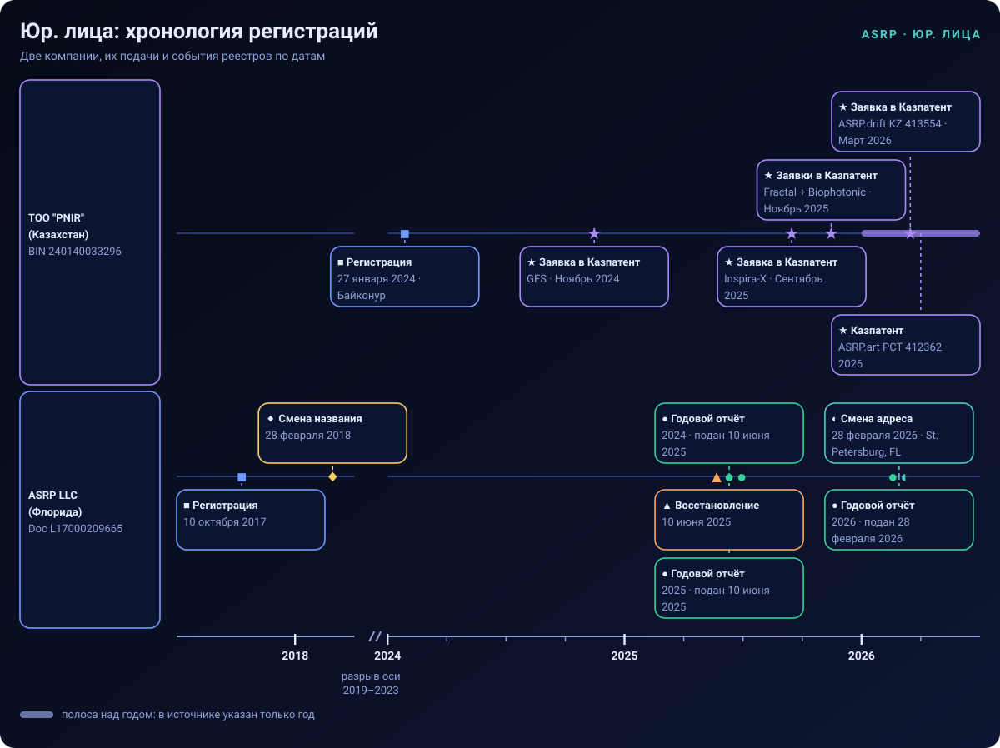

**[English](LEGAL_ENTITIES.md) | Русский**

[← Экосистема ASRP](../README.ru.md) · [Указатель документации](README.ru.md)

# Экосистема ASRP — Юридические лица и публичная верификация

> Статусы и цифры на этой странице приведены на 2 квартал 2026, если не указана другая дата, и даны со слов проекта; независимо они не перепроверялись.

---

## Юр. лица и публичная верификация

**ASRP — мультиюрисдикционная группа.** В текущий периметр входят три юридических лица: операционный US LLC **ASRP LLC** (Флорида, с 2017), исследовательско-патентное **ТОО** (Байконур, 2024) и компания в **Великобритании** (на стадии восстановления корпоративного статуса — reinstatement). Florida LLC и ТОО верифицируются через публичные реестры; UK-компания — на стадии восстановления и отражена здесь в рамках продолжающейся консолидации группы (см. UBO-примечание ниже).

### ООО «ASRP» (Флорида, США)

| Поле | Значение |
|---|---|
| **Тип** | Компания с ограниченной ответственностью штата Флорида |
| **Номер (Document #)** | L17000209665 |
| **FEI / EIN** | предоставляется верифицированным контрагентам · публично доступен через реестр Florida SunBiz |
| **Дата регистрации** | **10 октября 2017** |
| **Статус** | ДЕЙСТВУЮЩАЯ |
| **Последнее событие** | Восстановление — 10 июня 2025 |
| **Смена названия** | 28 февраля 2018 |
| **Юр. адрес** | 7901 4th St N, Ste 300, St. Petersburg, FL 33702 (изменён 28 февраля 2026) |
| **Регистрационный агент** | Registered Agents Inc |
| **Учредители** | Valeria Ovseannicova · Mykhailo Kapustin · Denis Banchenko |
| **Годовые отчёты** | 2024 (подан 10 июня 2025) · 2025 (подан 10 июня 2025) · 2026 (подан 28 февраля 2026) |
| **Публичный реестр** | [search.sunbiz.org — Florida Division of Corporations](https://search.sunbiz.org/Inquiry/CorporationSearch/SearchResultDetail?inquirytype=EntityName&directionType=Initial&searchNameOrder=ADVANCEDSCIENTIFICRESEARCHPROJ%20L170002096650&aggregateId=flal-l17000209665-9ae2294a-abd3-46c7-944f-b49e0eb2f7f4&searchTerm=ADVANCED%20SCIENTIFIC%20RESEARCH%20PROJECTS%20LLC&listNameOrder=ADVANCEDSCIENTIFICRESEARCHPROJ%20L170002096650) |

### ТОО «Перспективные Научно-Исследовательские Разработки» (Казахстан)

| Поле | Значение |
|---|---|
| **Тип** | Товарищество с ограниченной ответственностью |
| **БИН** | 240140033296 |
| **Регистрация** | **27 января 2024** |
| **ОКЭД** | 72199 — Прочие исследования и разработки в естественных и технических науках |
| **Юр. адрес** | ул. Комарова, 37, кв. 56, г. Байконыр, Кызылординская обл., Республика Казахстан |
| **Код КАТО** | 431910000 (Байконур) |
| **Руководитель** | Банченко Денис Юрьевич |
| **Публичные реестры** | [infostats.co](https://infostats.co/companies/kz/3235213) · [kyc.kz](https://kyc.kz/search/bin/240140033296) |

> ⚠️ Русская и английская версии этого места в исходнике расходятся.

> Заявители 6 заявок Казпатент + 1 PCT на этой странице **не названы** (README исследований GFS и ASRP.art называют заявителями трёх физических лиц; заявка не является выданным патентом); Florida LLC — **операционная/коммерческая** компания (Tesla Business Program, DARPA BAA, расчёты в USD).

#### Оговорка о структуре владения, бенефициарном контроле и корпоративной принадлежности

> Это примечание относится к казахстанскому юр. лицу выше и к мультиюрисдикционной группе в целом (US + KZ + UK).

Настоящим подтверждается, что указанное юридическое лицо, зарегистрированное в Республике Казахстан, является частью международной группы компаний ASRP (далее — «Группа»), включающей также юридические лица и корпоративные структуры в **США** и **Великобритании** (включая компанию, находящуюся на стадии восстановления корпоративного статуса — reinstatement).

В силу ограничений национального законодательства, в том числе требований к резидентности учредителей и особенностей корпоративного регулирования в Республике Казахстан, регистрация данного юридического лица осуществлена на **Дениса Банченко**, который на текущий момент выступает формальным учредителем и/или единоличным исполнительным органом (директором).

При этом указанная регистрация носит исключительно **юридико-технический и операционный** характер и **не отражает фактическую структуру владения, контроля и распределения экономических интересов** внутри Группы.

**Фактическими бенефициарными владельцами (UBO)**, а также лицами, осуществляющими совместный стратегический и управленческий контроль над активами и деятельностью Группы ASRP, являются:
- **Валерия Александровна Овсянникова**
- **Михаил Михайлович Капустин**
- **Денис Юрьевич Банченко**

Указанные лица действуют как совладельцы и партнёры в рамках единой корпоративной и инвестиционной стратегии Группы, вне зависимости от формального распределения долей в отдельных юрисдикциях.

Любые расхождения между юридической регистрацией отдельных компаний и фактической структурой владения обусловлены **текущим этапом корпоративной реструктуризации**, а также необходимостью соблюдения требований применимого законодательства в соответствующих юрисдикциях (включая, но не ограничиваясь, вопросами налогового резидентства, валютного контроля и корпоративного права).

Группа ASRP реализует **поэтапную модель** консолидации активов и юридической структуры, включая возможное учреждение холдинговых компаний, оформление межюрисдикционных связей (в том числе через механизмы владения долями, акционерные соглашения, договоры о совместной деятельности и иные инструменты), а также синхронизацию бенефициарного контроля. До завершения указанных процессов все входящие в Группу юридические лица, вне зависимости от их формальной регистрации, рассматриваются как взаимосвязанные и действующие в рамках единой экономической модели и в интересах Группы ASRP.

---

## Статус подтверждений

Проверено 17 ноября 2026. **ПРОВЕРЕНО** — подтверждено автоматическим запросом или файлом в этом репозитории; **ЗАЯВЛЕНО** — утверждение самого проекта с публичной ссылкой, по которой может пройти читатель, повторно не проверялось; **НЕ ПРОВЕРЕНО** — публичного подтверждения в этом репозитории нет.

| Утверждение на этой странице | Подтверждение | Статус |
|---|---|---|
| Флоридская LLC, документ L17000209665, подана 10.10.2017, статус ACTIVE, последнее событие — восстановление 10.06.2025 | Ссылка на search.sunbiz.org приведена; вернула 403 на автоматический запрос, запись не проверялась | **ЗАЯВЛЕНО** |
| Смена названия 28.02.2018; годовые отчёты за 2024 и 2025 поданы 10.06.2025, за 2026 — 28.02.2026; основной адрес изменён 28.02.2026 | Та же ссылка SunBiz (403), не проверялась | **ЗАЯВЛЕНО** |
| Уполномоченные участники — Овсянникова, Капустин и Банченко; зарегистрированный агент — Registered Agents Inc | Та же ссылка SunBiz (403), не проверялась | **ЗАЯВЛЕНО** |
| FEI / EIN предоставляется проверенным контрагентам и публичен через SunBiz | на странице нет; номер не указан | **НЕ ПРОВЕРЕНО** |
| Казахстанское юрлицо: БИН 240140033296, регистрация 27.01.2024, ОКЭД 72199, КАТО 431910000, адрес в Байконуре, руководитель Банченко | Ссылки на реестры недоступны: infostats.co не отвечает, kyc.kz вернул 410 | **НЕ ПРОВЕРЕНО** |
| Название казахстанского юрлица: ASRP LLP по-английски, ТОО «Перспективные Научно-Исследовательские Разработки» по-русски | Языковые версии различаются; см. отчёт по ссылке в пометке; название по реестру не подтверждено | **НЕ ПРОВЕРЕНО** |
| Британское юрлицо существует и находится в процессе восстановления корпоративного статуса | на странице нет; ссылки на реестр нет | **НЕ ПРОВЕРЕНО** |
| Заявители 6 заявок Kazpatent + 1 PCT на этой странице не названы (казахстанское юрлицо как заявитель не показано) | Репозитории патентов публичны (200), но здесь не приведены и не показывают заявителя; записи Kazpatent нет | **НЕ ПРОВЕРЕНО** |
| Флоридская LLC — операционное юрлицо (Tesla Business Program, DARPA BAA, контракты в USD) | на странице нет | **НЕ ПРОВЕРЕНО** |
| Казахстанское юрлицо формально оформлено на Банченко из-за требований к резидентству основателя и корпоративного права | на странице нет; юридического заключения или выписки из реестра нет | **НЕ ПРОВЕРЕНО** |
| Фактические бенефициарные владельцы (UBO) — Овсянникова, Капустин и Банченко, действующие как совладельцы | на странице нет; соглашения акционеров, записи реестра или декларации UBO нет | **НЕ ПРОВЕРЕНО** |
| Выполняется поэтапная консолидация активов и юридической структуры, включая возможные холдинги и межюрисдикционные соглашения | на странице нет; описано как идущий процесс, соглашений и подач нет | **НЕ ПРОВЕРЕНО** |
