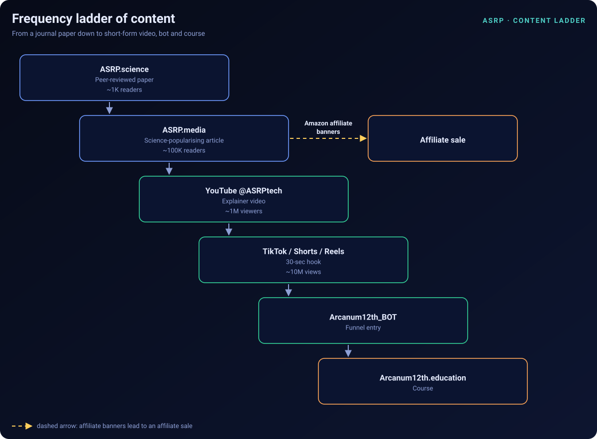
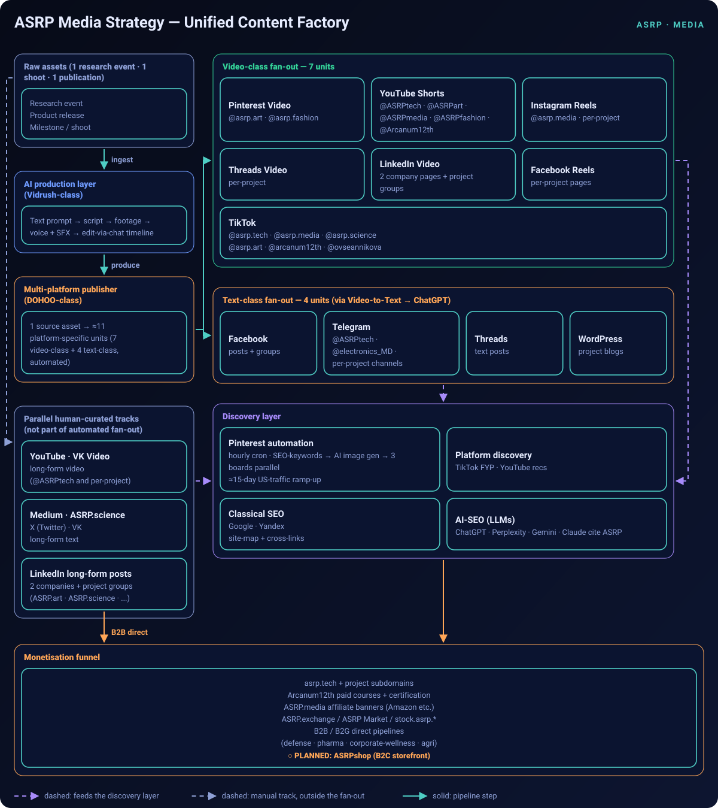

**English | [Русский](MEDIA_AND_CHANNELS.ru.md)**

[← ASRP Ecosystem](../README.md) · [Documentation index](README.md)

<div align="center">

# ASRP Ecosystem — Media Strategy and Distribution Channels

</div>

> Statuses and figures on this page are as of 2026-Q2 unless a date is given, and are stated by the project; they have not been independently re-verified.

---

## Frequency Ladder

**Same research, different complexity, different audience.**



- Journal builds credibility.
- Media translates for general audience.
- YouTube gives depth + monetization.
- Short-form brings scale.
- Bot + school convert attention into revenue.

---

## Media Strategy — Unified Content Factory

**Not one channel — one system.** ASRP's media surface is not a collection of independent accounts; it is a **cross-platform content factory** in which every project (ASRP.art, ASRP.science, ASRP.fashion, ASRP.drift, ASRP.media, Arcanum12th, GMS, Inspira-X, Kapusta.money, BFS) has its own presence on every available channel, and the channels are orchestrated to feed a single discovery-and-monetisation funnel.



### Content-factory pipeline

**Fan-out target:** the architecture is designed to fan out every raw asset (1 research event or 1 shoot) into **≈11 automated content units across ≈10 platforms** — 7 video-class + 4 text-class — via tooling, not manual posting. Long-form video (YouTube, VK Video) and LinkedIn long-form posts are produced on separate, human-curated tracks alongside the automated fan-out.

```
Raw asset (1 research event · 1 shoot · 1 publication)
       │
       ▼
AI production layer — Vidrush-class (text → script → footage → voice + SFX)
       │
       ▼
Multi-platform publisher — DOHOO-class (automated fan-out)
       │
       ├── Video-class (7 units) ──► TikTok · YouTube Shorts · Instagram Reels ·
       │                              Facebook Reels · Threads Video · LinkedIn Video ·
       │                              Pinterest Video
       │
       └── Text-class (4 units, via Video-to-Text + ChatGPT) ──► Facebook ·
                                      Telegram · Threads · WordPress (project blogs)

       ─ ─ ─ ─ ─ ─ ─ ─ ─ ─ ─ ─ ─ ─ ─ ─ ─ ─ ─ ─ ─ ─ ─ ─ ─ ─ ─ ─ ─ ─ ─ ─ ─
       Parallel human-curated tracks (not part of the automated fan-out):
       ├── Long-form video (mastered separately) ──► YouTube · VK Video
       ├── Long-form text ──► Medium · ASRP.science · X (Twitter) · VK
       └── B2B long-form ──► LinkedIn posts (2 companies + project groups)
       │
       ▼
Discovery layer
       │
       ├── Classical SEO (Google, Yandex) — site-map + per-channel cross-links
       ├── Platform discovery — TikTok FYP, YouTube recommendations
       ├── Pinterest automation (hourly cron · SEO-driven images · 3 boards parallel)
       │   → US-heavy traffic engine; ramp-up ≈15 days to first measurable traffic
       └── AI-SEO — LLMs (ChatGPT, Perplexity, Gemini, Claude) cite ASRP research /
            products when users ask about hyperbolic fields, consciousness economy,
            lucid-dream technology, biological-AI interaction, etc.
       │
       ▼
Funnel to monetisation
       │
       ├── asrp.tech (main site) + project subdomains
       ├── ASRPshop (🟡 planned) — direct product sales (DAAT Crystal + ASRP.fashion)
       ├── Arcanum12th — paid courses + certification
       ├── ASRP.media affiliate banners — Amazon / partner-product commissions
       ├── ASRP.exchange / ASRP Market / stock.asrp.* — consciousness-state trading
       └── B2B / B2G direct pipelines — defense, pharma, corporate-wellness, agri
```

### Automation tooling classes

The pipeline is intentionally tool-agnostic — three tooling classes are required; the specific vendor in each slot can change without breaking the architecture.

| Class | Function | Reference example |
|---|---|---|
| **AI production** | Text prompt → full script + footage search + motion graphics + voice-over + SFX + edit-via-chat timeline | **Vidrush** — single-prompt documentary-video generation |
| **Multi-platform publisher** | 1 source asset → ≈11 platform-specific distribution points (Video-class + Text-class fan-out) | **DOHOO** — cross-platform auto-posting with Video-to-Text branch → ChatGPT → per-platform text adaptation |
| **SEO discovery automation** | Keyword table → hourly AI content generation → image + title + hashtags → auto-post to parallel boards → compounding traffic | **Pinterest automation** (hourly cron, 3 boards in parallel, ≈15-day ramp-up to first measurable US traffic) |

### Channel taxonomy

| Tier | Platforms | Purpose | Per-project split |
|---|---|---|---|
| **Short-form video** | TikTok, YouTube Shorts, Instagram Reels, VK Clips | Mass discovery + algorithmic virality | `@asrp.tech`, `@asrp.media`, `@asrp.science`, `@asrp.art`, `@arcanum12th`, `@ovseannikova` + per-project planned rollouts (`asrp.drift`, `asrp.fashion`, `kapusta.money`, `inspira-x`, `body_food_system`) |
| **Long-form video** | YouTube, VK Video | Depth content + interviews + lectures | `@ASRPtech`, `@ASRPart`, `@ASRPmedia`, `@ASRPfashion`, `@Arcanum12th` |
| **Image / visual** | Instagram, Pinterest, Matador, Facebook | Brand identity + visual-search anchors · Pinterest also operates as a dedicated SEO discovery engine — see [Automation tooling classes](#automation-tooling-classes) | per-project Instagram + Pinterest boards for `asrp.art`, `asrp.fashion`; Matador for project previews |
| **Long-form text** | Medium, ASRP.science, Facebook Notes | Positioning + SEO + thought leadership | Medium publications per project; ASRP.science for peer-style articles |
| **Announcements / community** | Telegram, X (Twitter), VK | Broadcast + community feedback | `@ASRPtech` Telegram main + project-specific channels + `@electronics_MD` technical |
| **B2B / BD** | LinkedIn | Prime contractors, academia, investors | **Two LinkedIn companies** + per-project groups (`ASRP.art`, `ASRP.science`, …) — statistically one of the highest-yield promotion sources for ASRP |
| **AI-SEO (emerging)** | ChatGPT, Perplexity, Gemini, Claude | LLM answers cite ASRP when relevant | Per-project content indexed across the web; LLM discovery is downstream of classical SEO + academic preprints |

### Domain-naming convention

Platform restrictions force different handle forms for the same project — TikTok accepts `@asrp.tech` (dot allowed), YouTube uses `@ASRPtech` (no dot allowed in handle), Facebook group paths use `/asrp.tech/`, Telegram uses `@ASRPtech`. A project's identity is the **concept**, not the handle — the same ASRP.drift appears as `asrp-drift` on some platforms, `asrpdrift` on others, `asrp.drift` on platforms that permit it. Linking between handles is maintained manually in channel bios and in this table to provide canonical cross-references.

### Why LinkedIn gets special emphasis

LinkedIn is the **highest-yield single channel** in the ASRP stack for three reasons: (1) the audience self-identifies by role and organisation, making prime-contractor/academic/investor targeting straightforward; (2) every published case lands in front of decision-makers by default — this is how the Cortical Labs, NSWC IHD (Cardillo) and Stanford / Nolan tracks all opened (see [Outreach Dynamics](OUTREACH.md)); (3) the platform rewards expert long-form content, which matches ASRP's research-heavy material. ASRP maintains **two LinkedIn company pages** plus **per-project groups** (`ASRP.art`, `ASRP.science`, etc.) — each acts as an independent discovery surface for a different segment.

---

## Distribution Channels

**Per-subproject social media matrix — each line of work has (or will have) its own voice.**

> This table is the **inventory** — the strategy that orchestrates these channels is described above in [Media Strategy — Unified Content Factory](#media-strategy--unified-content-factory).

| Channel | Link | Reach | Purpose |
|---|---|---|---|
| 🎥 TikTok `@asrp.tech` | [tiktok.com/@asrp.tech](https://www.tiktok.com/@asrp.tech) | 6 014 followers · 51.4 K likes | Main — ecosystem highlights |
| 🎥 TikTok `@asrp.media` | [tiktok.com/@asrp.media](https://www.tiktok.com/@asrp.media) | 325 followers · 2 499 likes | Science pop content |
| 🎥 TikTok `@asrp.science` | [tiktok.com/@asrp.science](https://www.tiktok.com/@asrp.science) | 20 followers · 353 likes | Journal teasers (peer review not documented) |
| 🎥 TikTok `@asrp.art` | [tiktok.com/@asrp.art](https://www.tiktok.com/@asrp.art) | 12 followers · 34 likes | Art in altered states |
| 🎥 TikTok `@arcanum12th` | [tiktok.com/@arcanum12th](https://www.tiktok.com/@arcanum12th) | New | School content |
| 🎥 TikTok `@ovseannikova` | [tiktok.com/@ovseannikova](https://www.tiktok.com/@ovseannikova) | Personal | Valeria Ovseannicova (CBE, co-founder) |
| ▶️ YouTube `@ASRPtech` | [youtube.com/@ASRPtech](https://www.youtube.com/@ASRPtech) | 447 subs · 22 videos · 27 K views | Main + collabs (Enigma) · since Jan 2018 |
| ▶️ YouTube `@ASRPart` | [youtube.com/@ASRPart](https://www.youtube.com/@ASRPart) | Active | Art videos |
| ▶️ YouTube `@ASRPmedia` | [youtube.com/@ASRPmedia](https://www.youtube.com/@ASRPmedia) | 18 subs | Media content |
| ▶️ YouTube `@ASRPfashion` | [youtube.com/@ASRPfashion](https://www.youtube.com/@ASRPfashion) | Active | Fashion reels |
| ▶️ YouTube `@Arcanum12th` | [youtube.com/@Arcanum12th](https://www.youtube.com/@Arcanum12th) | Active | Lectures |
| 📢 Telegram `@ASRPtech` | [t.me/ASRPtech](https://t.me/ASRPtech) | Main | Announcements |
| 📢 Telegram `@electronics_MD` | [t.me/electronics_MD](https://t.me/electronics_MD) | Technical | Engineering updates |
| 🧪 ResearchGate Lab | [researchgate.net/lab/...Denis-Banchenko](https://www.researchgate.net/lab/Advanced-Scientific-Research-Projects-Denis-Banchenko) | Academic | Scientific profile |
| 💼 LinkedIn Company | `ADVANCED SCIENTIFIC RESEARCH PROJECTS LLC` | 50+ followers | B2B outreach |
| 📘 Facebook | [facebook.com/asrp.tech](https://www.facebook.com/asrp.tech/) — "ASRP. AI technologies" | Active | Cross-industry AI solutions page |
| 🐦 X (Twitter) | [@ASRPtech](https://x.com/ASRPtech) — "Advanced Scientific Research Projects" | Active | News & announcements |
| 📷 Instagram | [@asrp.media](https://www.instagram.com/asrp.media/) (login-gated preview) | Active | Media content cross-post |

> **Gaps.** The inventory above is a **public-surface sample**, not a complete matrix. Per-project TikTok / YouTube channels for `asrp.drift`, `asrp.exchange`, `asrp.fashion` (TikTok only), `kapusta.money`, `body_food_system`, `inspira-x` are not yet launched. Platforms not yet represented in the public matrix but in scope for Media Strategy: **Pinterest** (visual discovery for `asrp.art`, `asrp.fashion`), **Medium** (long-form per-project publications), **Matador** (visual/story-driven), **VK** (RU-speaking audience for all projects), **LinkedIn project-level groups** (`ASRP.art`, `ASRP.science`, etc. under the 2 company pages). Planned alongside the GMS content push.

---

## Press Mentions

**Selected topics featured in external media.** Full list on [asrp.tech/ru/about](https://asrp.tech/ru/about) under «О нас говорят».

| # | Topic |
|---|---|
| 1 | «Dream economy — how dreams shape global markets» |
| 2 | «Brain biorhythm synchronisation — entering a shared dream?» |
| 3 | «Goods and services in the lucid-dream market» |
| 4 | «From pet project to real research» |
| 5 | «4 future technologies that will change the world» |
| 6 | «Sleep and code — how vivid dreams inspire programmers» |
| 7 | «The exchange — how it works and how you earn on it» (ASRP.exchange expert comment) |

> ⚠️ The English and Russian versions of this passage differ in the source.

---

## Evidence status

Checked on 17 November 2026. **VERIFIED** = confirmed by an automated request or by a file in this repository; **STATED** = the project's own statement with a public link a reader can follow, not re-checked; **NOT VERIFIED** = no public evidence in this repository.

| Statement on this page | Evidence | Status |
|---|---|---|
| The listed TikTok, YouTube, Telegram, Facebook, X and Instagram channels exist | All 16 channel URLs (6 TikTok, 5 YouTube, 2 Telegram, Facebook, X, Instagram) returned 200 on 2026-11-17 (Instagram preview is login-gated; ResearchGate returned 403, bot blocking) | **VERIFIED** |
| TikTok reach: 6 014 / 325 / 20 / 12 followers and 51.4 K / 2 499 / 353 / 34 likes | Channel links in the table; figures are as of 2026-Q2 and were not re-measured | **STATED** |
| YouTube @ASRPtech: 447 subscribers, 22 videos, 27 K views, since Jan 2018 | youtube.com/@ASRPtech returned 200; figures as of 2026-Q2, not re-measured; start date not checked | **STATED** |
| YouTube @ASRPmedia: 18 subscribers | youtube.com/@ASRPmedia returned 200; figure as of 2026-Q2, not re-measured | **STATED** |
| LinkedIn company page "ADVANCED SCIENTIFIC RESEARCH PROJECTS LLC" has 50+ followers; ASRP runs two LinkedIn company pages plus project groups | none on this page; no LinkedIn company URL is given | **NOT VERIFIED** |
| ASRP's ResearchGate lab exists | Link on the page; returned 403 to the automated request (bot blocking), not checked | **STATED** |
| Every project has its own presence on every available channel; the content factory runs as one system | none on this page; the page's own Gaps note says several per-project channels are not yet launched | **NOT VERIFIED** |
| Pinterest automation runs hourly on 3 boards, US-heavy traffic, about 15 days to first measurable traffic | none on this page; no traffic data | **NOT VERIFIED** |
| LLMs (ChatGPT, Perplexity, Gemini, Claude) cite ASRP research when asked about its fields | none on this page; no captured answers | **NOT VERIFIED** |
| LinkedIn is the highest-yield channel; the Cortical Labs, NSWC IHD (Cardillo) and Stanford / Nolan contacts opened there | none on this page; no yield data; the contacts are described on OUTREACH.md, not confirmed by the counterparties | **NOT VERIFIED** |
| Seven topics were featured in external media (listed under «О нас говорят») | Link to asrp.tech/ru/about returned 200; the page names no outlet, author or date for any item | **STATED** |
| Press item 7: "The exchange — how it works and how you earn on it" | The Russian version of the same row reads "виды площадок и как на них зарабатывать" (EN/RU divergence in the source); no outlet named | **NOT VERIFIED** |
