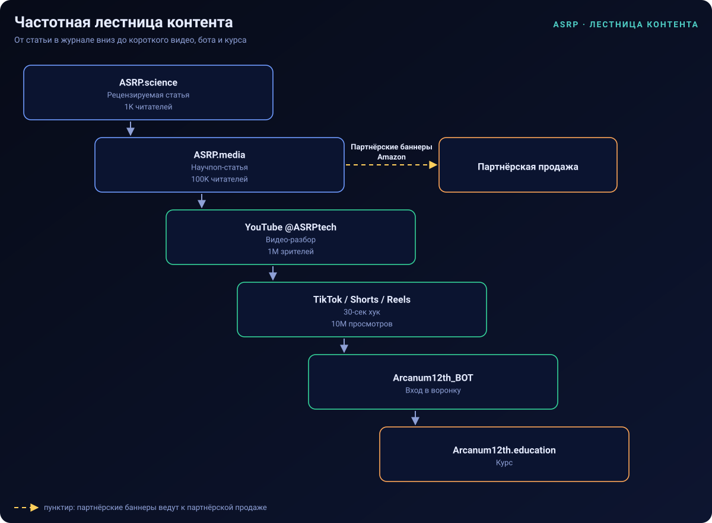
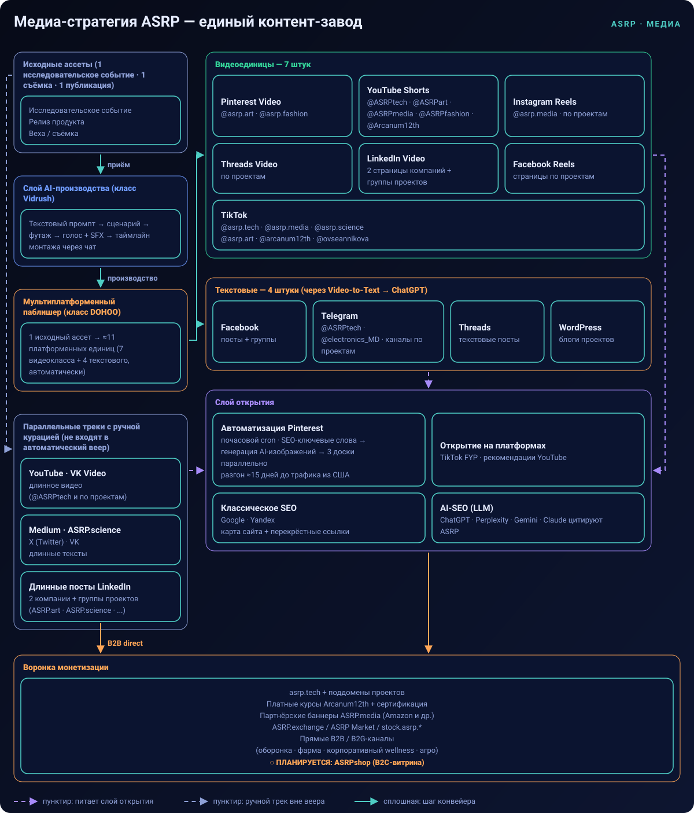

**[English](MEDIA_AND_CHANNELS.md) | Русский**

[← Экосистема ASRP](../README.ru.md) · [Указатель документации](README.ru.md)

<div align="center">

# Экосистема ASRP — Медиа-стратегия и каналы дистрибуции

</div>

> Статусы и цифры на этой странице приведены на 2 квартал 2026, если не указана другая дата, и даны со слов проекта; независимо они не перепроверялись.

---

## Частотная лестница контента

**Одно и то же исследование, разная сложность, разная аудитория.**



- Журнал строит доверие.
- Медиа переводит для массовой аудитории.
- YouTube даёт глубину + монетизацию.
- Короткие форматы дают масштаб.
- Бот + школа конвертируют внимание в деньги.

---

## Медиа-стратегия — единый контент-завод

**Не один канал — одна система.** Медиа-поверхность ASRP — это не набор независимых аккаунтов, а **кросс-платформенный контент-завод**, в котором у каждого проекта (ASRP.art, ASRP.science, ASRP.fashion, ASRP.drift, ASRP.media, Arcanum12th, GMS, Inspira-X, Kapusta.money, BFS) своё присутствие на каждой доступной платформе, а каналы оркестрированы под общую воронку открытия и монетизации.



### Конвейер контент-завода

**Цель фан-аута:** Архитектура спроектирована так, чтобы фан-аутить каждый исходный ассет (1 исследовательское событие или 1 съёмка) в **≈11 автоматических единиц контента на ≈10 платформах** — 7 видеоединиц + 4 текстовых — через инструменты, не ручной постинг. Long-form видео (YouTube, VK Video) и LinkedIn long-form посты идут отдельными, human-curated треками параллельно автоматическому фан-ауту.

```
Исходный ассет (1 исследовательское событие · 1 съёмка · 1 публикация)
       │
       ▼
Слой AI-производства — класс Vidrush (текст → сценарий → футаж → голос + SFX)
       │
       ▼
Мультиплатформенный паблишер — класс DOHOO (автоматический фан-аут)
       │
       ├── Видеокласс (7 единиц) ──► TikTok · YouTube Shorts · Instagram Reels ·
       │                              Facebook Reels · Threads Video · LinkedIn Video ·
       │                              Pinterest Video
       │
       └── Текстовый класс (4 единицы, через Video-to-Text + ChatGPT) ──► Facebook ·
                                      Telegram · Threads · WordPress (блоги проектов)

       ─ ─ ─ ─ ─ ─ ─ ─ ─ ─ ─ ─ ─ ─ ─ ─ ─ ─ ─ ─ ─ ─ ─ ─ ─ ─ ─ ─ ─ ─ ─ ─ ─
       Параллельные human-curated треки (не входят в автоматический фан-аут):
       ├── Long-form видео (мастерится отдельно) ──► YouTube · VK Video
       ├── Long-form текст ──► Medium · ASRP.science · X (Twitter) · VK
       └── B2B long-form ──► посты LinkedIn (2 компании + группы по проектам)
       │
       ▼
Слой открытия (discovery)
       │
       ├── Классическое SEO (Google, Yandex) — карта сайта + перекрёстные ссылки по каналам
       ├── Платформенное открытие — TikTok FYP, рекомендации YouTube
       ├── Автоматизация Pinterest (почасовой cron · SEO-ориентированные изображения · 3 доски параллельно)
       │   → трафик-движок с преобладанием США; разгон ≈15 дней до первого измеримого трафика
       └── AI-SEO — LLM (ChatGPT, Perplexity, Gemini, Claude) цитируют исследования /
            продукты ASRP, когда пользователи спрашивают о гиперболических полях, экономике сознания,
            технологии осознанных снов, взаимодействии биологии и ИИ и т.д.
       │
       ▼
Воронка к монетизации
       │
       ├── asrp.tech (основной сайт) + поддомены проектов
       ├── ASRPshop (🟡 планируется) — прямые продажи продуктов (DAAT Crystal + ASRP.fashion)
       ├── Arcanum12th — платные курсы + сертификация
       ├── Аффилиат-баннеры ASRP.media — комиссии Amazon / партнёрских продуктов
       ├── ASRP.exchange / ASRP Market / stock.asrp.* — торговля состояниями сознания
       └── B2B / B2G прямые пайплайны — оборона, фарма, корпоративный wellness, агро
```

### Классы инструментов автоматизации

Pipeline намеренно tool-agnostic — нужны три класса инструментов; конкретный вендор в каждом слоте можно менять без перестройки архитектуры.

| Класс | Функция | Референсный пример |
|---|---|---|
| **AI-производство** | Текстовый промпт → полный сценарий + поиск футажа + моушн-графика + закадровый голос + SFX + таймлайн с монтажом через чат | **Vidrush** — генерация документального видео по одному промпту |
| **Мультиплатформенный паблишер** | 1 исходный ассет → ≈11 точек дистрибуции под конкретные платформы (фан-аут видеокласса + текстового класса) | **DOHOO** — кросс-платформенный автопостинг с веткой Video-to-Text → ChatGPT → адаптация текста под каждую платформу |
| **Автоматизация SEO-открытия** | Таблица ключевых слов → почасовая AI-генерация контента → изображение + заголовок + хэштеги → автопостинг на параллельные доски → накапливающийся трафик | **Автоматизация Pinterest** (почасовой cron, 3 доски параллельно, разгон ≈15 дней до первого измеримого трафика из США) |

### Таксономия каналов

| Уровень | Платформы | Назначение | По-проектное разделение |
|---|---|---|---|
| **Короткое видео** | TikTok, YouTube Shorts, Instagram Reels, VK Clips | Массовое открытие + алгоритмическая виральность | `@asrp.tech`, `@asrp.media`, `@asrp.science`, `@asrp.art`, `@arcanum12th`, `@ovseannikova` + запланированные по-проектные запуски (`asrp.drift`, `asrp.fashion`, `kapusta.money`, `inspira-x`, `body_food_system`) |
| **Long-form видео** | YouTube, VK Video | Глубокий контент + интервью + лекции | `@ASRPtech`, `@ASRPart`, `@ASRPmedia`, `@ASRPfashion`, `@Arcanum12th` |
| **Изображения / визуал** | Instagram, Pinterest, Matador, Facebook | Визуальная айдентика + якоря для visual-search · Pinterest дополнительно работает как отдельный SEO-движок — см. [«Классы инструментов автоматизации»](#классы-инструментов-автоматизации) | по-проектные Instagram + доски Pinterest для `asrp.art`, `asrp.fashion`; Matador для превью проектов |
| **Long-form текст** | Medium, ASRP.science, Facebook Notes | Позиционирование + SEO + thought leadership | публикации Medium по каждому проекту; ASRP.science для статей в рецензионном стиле |
| **Анонсы / сообщество** | Telegram, X (Twitter), VK | Вещание + обратная связь | `@ASRPtech` — главный Telegram + каналы отдельных проектов + технический `@electronics_MD` |
| **B2B / BD** | LinkedIn | Prime-подрядчики, академия, инвесторы | **Две компании на LinkedIn** + группы по проектам (`ASRP.art`, `ASRP.science`, …) — статистически один из самых результативных источников продвижения ASRP |
| **AI-SEO (зарождающийся)** | ChatGPT, Perplexity, Gemini, Claude | LLM-ответы ссылаются на ASRP по профильным запросам | По-проектный контент, проиндексированный по всему вебу; LLM-открытие идёт вслед за классическим SEO + академическими препринтами |

### Конвенция именования доменов

Ограничения платформ вынуждают использовать разные формы handle для одного и того же проекта — TikTok допускает `@asrp.tech` (точка разрешена), YouTube `@ASRPtech` (точка в handle запрещена), Facebook — путь `/asrp.tech/`, Telegram — `@ASRPtech`. Идентичность проекта — это **концепт**, а не handle: один и тот же ASRP.drift появляется как `asrp-drift` на одних площадках, `asrpdrift` на других, `asrp.drift` там, где это допустимо. Связь между handle поддерживается вручную в био каналов и в таблице ниже.

### Почему LinkedIn — отдельно

LinkedIn — **канал с самой высокой конверсией** в стеке ASRP по трём причинам: (1) аудитория сама себя идентифицирует по роли и организации, что делает таргетинг prime-подрядчик/академия/инвестор прямолинейным; (2) каждый опубликованный кейс по умолчанию попадает к ЛПР — именно так открылись треки Cortical Labs, NSWC IHD (Cardillo) и Stanford / Nolan (см. раздел [Outreach Dynamics](OUTREACH.ru.md)); (3) платформа поощряет экспертный long-form контент, что совпадает с исследовательским профилем ASRP. ASRP держит **две компании на LinkedIn** плюс **группы по проектам** (`ASRP.art`, `ASRP.science`, и т.д.) — каждая работает как отдельная discovery-поверхность для своего сегмента.

---

## Каналы дистрибуции

**Матрица соцмедиа по подпроектам — у каждого направления есть (или будет) свой голос.**

> Эта таблица — **инвентарь**; стратегия, оркестрирующая эти каналы, описана выше в разделе [«Медиа-стратегия — единый контент-завод»](#медиа-стратегия--единый-контент-завод).

| Канал | Ссылка | Охват | Назначение |
|---|---|---|---|
| 🎥 TikTok `@asrp.tech` | [tiktok.com/@asrp.tech](https://www.tiktok.com/@asrp.tech) | 6 014 подписчиков · 51,4 тыс. лайков | Главный — обзор экосистемы |
| 🎥 TikTok `@asrp.media` | [tiktok.com/@asrp.media](https://www.tiktok.com/@asrp.media) | 325 подписчиков · 2 499 лайков | Научпоп-контент |
| 🎥 TikTok `@asrp.science` | [tiktok.com/@asrp.science](https://www.tiktok.com/@asrp.science) | 20 подписчиков · 353 лайка | Тизеры журнала |
| 🎥 TikTok `@asrp.art` | [tiktok.com/@asrp.art](https://www.tiktok.com/@asrp.art) | 12 подписчиков · 34 лайка | Искусство в ИСС |
| 🎥 TikTok `@arcanum12th` | [tiktok.com/@arcanum12th](https://www.tiktok.com/@arcanum12th) | Новый | Контент школы |
| 🎥 TikTok `@ovseannikova` | [tiktok.com/@ovseannikova](https://www.tiktok.com/@ovseannikova) | Личный | Валерия Овсянникова (CBE, со-основатель) |
| ▶️ YouTube `@ASRPtech` | [youtube.com/@ASRPtech](https://www.youtube.com/@ASRPtech) | 447 подписчиков · 22 видео · 27 тыс. просмотров | Главный + коллабы (Enigma), с янв. 2018 |
| ▶️ YouTube `@ASRPart` | [youtube.com/@ASRPart](https://www.youtube.com/@ASRPart) | Активный | Видео об искусстве |
| ▶️ YouTube `@ASRPmedia` | [youtube.com/@ASRPmedia](https://www.youtube.com/@ASRPmedia) | 18 подписчиков | Медиа-контент |
| ▶️ YouTube `@ASRPfashion` | [youtube.com/@ASRPfashion](https://www.youtube.com/@ASRPfashion) | Активный | Fashion-ролики |
| ▶️ YouTube `@Arcanum12th` | [youtube.com/@Arcanum12th](https://www.youtube.com/@Arcanum12th) | Активный | Лекции |
| 📢 Telegram `@ASRPtech` | [t.me/ASRPtech](https://t.me/ASRPtech) | Главный | Анонсы |
| 📢 Telegram `@electronics_MD` | [t.me/electronics_MD](https://t.me/electronics_MD) | Технический | Инженерные апдейты |
| 🧪 Лаборатория ResearchGate | [researchgate.net/lab/...Denis-Banchenko](https://www.researchgate.net/lab/Advanced-Scientific-Research-Projects-Denis-Banchenko) | Академический | Научный профиль |
| 💼 LinkedIn (компания) | `ADVANCED SCIENTIFIC RESEARCH PROJECTS LLC` | 50+ подписчиков | B2B-работа |
| 📘 Facebook | [facebook.com/asrp.tech](https://www.facebook.com/asrp.tech/) — «ASRP. AI-технологии» | Активно | Страница AI-решений для разных отраслей |
| 🐦 X (Twitter) | [@ASRPtech](https://x.com/ASRPtech) — «Advanced Scientific Research Projects» | Активно | Новости и анонсы |
| 📷 Instagram | [@asrp.media](https://www.instagram.com/asrp.media/) (превью доступно только после входа) | Активно | Кросс-посты медиа-контента |

> **Пробелы.** Матрица выше — **публичная выборка**, не полный инвентарь. По-проектные TikTok / YouTube-каналы для `asrp.drift`, `asrp.exchange`, `asrp.fashion` (только TikTok), `kapusta.money`, `body_food_system`, `inspira-x` ещё не запущены. Платформы, которых пока нет в публичной матрице, но которые входят в Медиа-стратегию: **Pinterest** (визуальное открытие для `asrp.art`, `asrp.fashion`), **Medium** (long-form по проектам), **Matador** (visual/story-driven), **VK** (русскоязычная аудитория по всем проектам), **LinkedIn-группы по проектам** (`ASRP.art`, `ASRP.science`, и т.д. под 2 компаниями). Запуск — вместе с контентной кампанией GMS.

---

## Упоминания в прессе

**Темы, освещённые во внешней прессе.** Полный список — на [/ru/about](https://asrp.tech/ru/about) в блоке «О нас говорят».

| # | Тема |
|---|---|
| 1 | «Экономика сновидений — как сны влияют на мировые рынки» |
| 2 | «Синхронизация биоритмов мозга — попасть в общий сон?» |
| 3 | «Товары и услуги на рынке осознанных снов» |
| 4 | «От пет-проекта к настоящему исследованию» |
| 5 | «4 технологии будущего, которые изменят мир» |
| 6 | «Сон и код — как яркие сны вдохновляют программистов» |
| 7 | «Биржа — виды площадок и как на них зарабатывать» (экспертный коммент по ASRP.exchange) |

> ⚠️ Русская и английская версии этого места в исходнике расходятся.

---

## Статус подтверждений

Проверено 17 ноября 2026. **ПРОВЕРЕНО** — подтверждено автоматическим запросом или файлом в этом репозитории; **ЗАЯВЛЕНО** — утверждение самого проекта с публичной ссылкой, по которой может пройти читатель, повторно не проверялось; **НЕ ПРОВЕРЕНО** — публичного подтверждения в этом репозитории нет.

| Утверждение на этой странице | Подтверждение | Статус |
|---|---|---|
| Перечисленные каналы TikTok, YouTube, Telegram, Facebook, X и Instagram существуют | Все 16 URL каналов (6 TikTok, 5 YouTube, 2 Telegram, Facebook, X, Instagram) ответили 200 17.11.2026 (превью Instagram закрыто входом; ResearchGate ответил 403, блокировка ботов) | **ПРОВЕРЕНО** |
| Охват TikTok: 6 014 / 325 / 20 / 12 подписчиков и 51,4 K / 2 499 / 353 / 34 лайков | Ссылки на каналы в таблице; цифры на 2 квартал 2026, повторно не измерялись | **ЗАЯВЛЕНО** |
| YouTube @ASRPtech: 447 подписчиков, 22 видео, 27 K просмотров, с января 2018 | youtube.com/@ASRPtech ответил 200; цифры на 2 квартал 2026, повторно не измерялись; дата начала не проверялась | **ЗАЯВЛЕНО** |
| YouTube @ASRPmedia: 18 подписчиков | youtube.com/@ASRPmedia ответил 200; цифра на 2 квартал 2026, повторно не измерялась | **ЗАЯВЛЕНО** |
| Страница компании в LinkedIn «ADVANCED SCIENTIFIC RESEARCH PROJECTS LLC» имеет 50+ подписчиков; ASRP ведёт две страницы компании и групп проектов | на странице нет; ссылки на страницу компании в LinkedIn нет | **НЕ ПРОВЕРЕНО** |
| Лаборатория ASRP на ResearchGate существует | Ссылка на странице; автоматический запрос получил 403 (блокировка ботов), не проверено | **ЗАЯВЛЕНО** |
| У каждого проекта есть присутствие на каждом доступном канале; контент-фабрика работает как единая система | на странице нет; в примечании «Gaps» самой страницы сказано, что часть каналов проектов ещё не запущена | **НЕ ПРОВЕРЕНО** |
| Автоматизация Pinterest работает ежечасно на 3 досках, трафик из США, около 15 дней до первого заметного трафика | на странице нет; данных о трафике нет | **НЕ ПРОВЕРЕНО** |
| LLM (ChatGPT, Perplexity, Gemini, Claude) цитируют исследования ASRP на вопросы по их темам | на странице нет; снимков ответов нет | **НЕ ПРОВЕРЕНО** |
| LinkedIn — самый результативный канал; контакты с Cortical Labs, NSWC IHD (Cardillo) и Stanford / Nolan начались там | на странице нет; данных о результативности нет; контакты описаны в OUTREACH.md, контрагенты не подтверждали | **НЕ ПРОВЕРЕНО** |
| Семь тем освещены во внешних СМИ (раздел «О нас говорят») | Ссылка на asrp.tech/ru/about ответила 200; на странице не названы издание, автор или дата ни для одного пункта | **ЗАЯВЛЕНО** |
| Пресса, пункт 7: «Биржа — виды площадок и как на них зарабатывать» | В английской версии строка читается «how it works and how you earn on it» (расхождение EN/RU в исходнике); издание не названо | **НЕ ПРОВЕРЕНО** |
