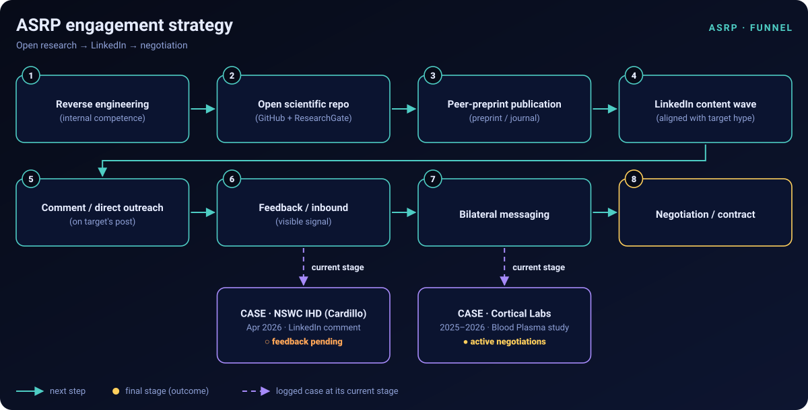

**English | [Русский](OUTREACH.ru.md)**

[← ASRP Ecosystem](../README.md) · [Documentation index](README.md)

# ASRP Ecosystem — Outreach Dynamics

> Statuses and figures on this page are as of 2026-Q2 unless a date is given, and are stated by the project; they have not been independently re-verified.

---

## Outreach Dynamics

**External reactions to ASRP publications — profile-relevant actors who engaged with our repos. Log of observable public signals, updated as new events occur.**

### Engagement strategy

**The same funnel drives every contact — reverse-engineering competence → open scientific repository → preprint / journal publication → LinkedIn content wave timed to the target's own hype window → comment or direct outreach → inbound response → bilateral messaging → negotiation.** The three cases logged below (NSWC IHD, Cortical Labs, Stanford / Nolan Lab) are instances of this pipeline at different stages.

### 1. NSWCIHD (U.S. Navy) — April 2026

| Field | Value |
|---|---|
| **Date observed** | 22 April 2026 |
| **Actor** | Robert Cardillo — Configuration Management (CCMP · CISCM) |
| **Organisation** | **Naval Surface Warfare Center Indian Head Division (NSWC IHD)** — one of 8 NAVSEA Warfare Centers; U.S. Navy RDT&E hub for energetics, EOD, propulsion and CBR defense; parent command NAVSEA / U.S. Department of Defense |
| **Scale / rating** | Tier-1 DoD RDT&E facility · largest energetics R&D laboratory in the U.S. Department of Defense · approx. 1,900 federal employees + extensive contractor base; historic annual operating budget in the **~$1 B range** across RDT&E and working-capital fund lines (public DoD budget disclosures). |
| **Department** | Warfighter Defense & Systems Integration Department (W), Conventional Ammunition Division (W7) |
| **Channel** | [LinkedIn post](https://www.linkedin.com/posts/robert-cardillo-63893234_11-case-cluster-of-missing-and-deceased-scientists-activity-7452502607727845376-sHGl) — "Gabriella Rev A" analytical framework applied to an 11-case cluster of deaths/disappearances among scientists linked to sensitive U.S. nuclear, aerospace and UAP-adjacent research (2022–2026) |
| **Cited institutions** | Los Alamos NL · NASA JPL · Kansas City NSC · MIT Plasma Science & Fusion Center · Caltech/IPAC · AFRL @ Wright-Patterson AFB · FBI / DoE / NNSA "holistic review" |
| **Reaction type** | Public LinkedIn engagement on Cardillo's post thread — **comment-level interaction visible in the post's comment section** (provisional: Denis pointed Kyryl to "look at the comments", which is consistent with a comment-class reaction rather than a silent like/view). |
| **ASRP response** | References to `UAP_Reverse_Engineering_Study` and `Hyperbolic_Field_BloodPlasma_Study` repositories were provided. |
| **Feedback** | Feedback received; further engagement pending. |

### 2. Cortical Labs — ongoing since 2025

| Field | Value |
|---|---|
| **Actor** | Cortical Labs — established biocomputing company (well-known in the biological-AI sector; not a no-name actor — details publicly discoverable) |
| **Organisation** | Melbourne, Australia · biocomputing pioneer (organoid-on-silicon) · DishBrain platform (neuron-silicon hybrid compute) |
| **Channel** | GitHub publication of `Hyperbolic_Field_BloodPlasma_Study` → LinkedIn content distribution aligned with Cortical Labs' own sector hype window |
| **Engagement strategy** | (1) open scientific publication (`Hyperbolic_Field_BloodPlasma_Study`, reproduced by V. Ovseannicova, raw data + analysis public) → (2) LinkedIn content wave during Cortical Labs' own hype window → (3) comment / direct outreach → (4) inbound response → (5) active negotiations. |
| **Trigger** | ASRP plasma-coagulation dataset (reproduced by V. Ovseannicova) surfaced during the hype cycle; alignment with Cortical Labs' biological-substrate work |
| **ASRP entry** | LinkedIn content wave + direct outreach |
| **Signal** | Two-way engagement initiated — bilateral messaging active |
| **Status** | Active negotiations (as of 2026-Q2) |

### 3. Stanford / Nolan Lab — LinkedIn inbound → admin follow-up (Feb 2026)

| Field | Value |
|---|---|
| **Date observed** | 4 February 2026 |
| **Actor** | Dr. Garry Nolan — Stanford University · life sciences, bioinformatics, cancer research; publicly engaged on UAP-related oncology / immunology (notably via *The Phenomenon of Disclosure*). |
| **Channel** | LinkedIn direct message from Denis Banchenko (ASRP CEO) → Nolan reply within 3 minutes. |
| **Trigger** | ASRP positioning around rare cancers with atypical field-mediated pathology (including UAP-associated cases) + documented NCI SBIR FY26 track (see [Track Record #9](TRACK_RECORD.md)). |
| **Denis → Nolan (11:39)** | *"Dr. Nolan, I lead ASRP, researching rare cancers with atypical field-mediated pathology (incl. UAP-associated cases). We sought NCI SBIR FY26 before its cancellation. Would value a brief exchange."* |
| **Nolan → Denis (11:42)** | *"Sounds interesting. You'll have to contact me through my admin. Time is limited. [admin contact provided privately — withheld from public repo]. She manages my time."* |
| **Follow-up to admin** | Same-day detailed scientific-position letter sent to Ms. Dalton outlining ASRP's hypothesis (temporal desynchronization as primary pathogenic factor in UAP-adjacent oncology), NCI submission backstory, and current experimental status (prototypes, documented data, publication deliberately delayed for IP reasons). |
| **Artefact sent** | Photo of three plasma-fibrin test tubes illustrating temporal regimes: `T₀` (control) · `T₊` (accelerated kinetics, Δt > 0) · `T₋` (decelerated kinetics, Δt < 0); relation `T₊ ≫ T₀ ≫ T₋`. Effects reproducible without thermal, chemical or ionizing exposure. This notation maps 1:1 onto ASRP's internal Channel-19 (acceleration) and Channel-21 (deceleration) taxonomy. |
| **Status** | Awaiting response from Dr. Nolan's office (via Ms. Dalton) as of 2026-Q2. |

### 4. Investor outreach log — pending source list

> Parallel log covering investor, venture-capital and family-office meetings (structure mirrors the Cortical Labs / Stanford entries above). Each row will capture: date, fund / individual, channel, ASRP offer, response, status. **Content to be populated once the founder shares the full list** — founder stated on 2026-04-22: «с какими инвесторами провели переговоры, с какими инвестфондами были переговоры, что нам сказали» (English translation: "which investors we held negotiations with, which investment funds we negotiated with, what they told us").

> **Methodology.** Each entry captures an observable public signal (a comment, like, engagement, or documented inbound). Active outreach pipelines (MJFF, cultured-meat companies, etc.) with no public reaction yet are tracked internally and promoted here when a public signal appears.
