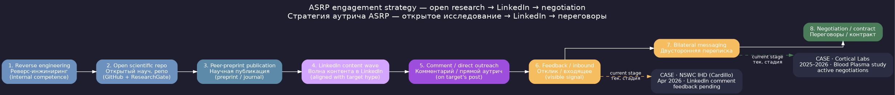

**[English](OUTREACH.md) | Русский**

[← Экосистема ASRP](../README.ru.md) · [Указатель документации](README.ru.md)

# Экосистема ASRP — Динамика аутрича

> Статусы и цифры на этой странице приведены на 2 квартал 2026, если не указана другая дата, и даны со слов проекта; независимо они не перепроверялись.

---

## Динамика аутрича

**Внешние реакции на публикации ASRP — профильные игроки, взаимодействовавшие с нашими репозиториями. Журнал публично наблюдаемых сигналов, обновляется по мере новых событий.**

### Стратегия аутрича

**Одна и та же воронка работает на каждый контакт:** компетенция реверс-инжиниринга → открытый научный репозиторий → препринт/журнальная публикация → волна LinkedIn-контента в момент профильного хайпа цели → комментарий или прямой аутрич → входящий отклик → двусторонняя переписка → переговоры. Три кейса ниже (NSWC IHD, Cortical Labs, Stanford / лаборатория Nolan) — воплощения этой воронки на разных стадиях.

### 1. NSWCIHD (ВМС США) — апрель 2026

| Поле | Значение |
|---|---|
| **Дата наблюдения** | 22 апреля 2026 |
| **Участник** | Роберт Кардилло — управление конфигурацией (CCMP · CISCM) |
| **Организация** | Центр NSWC IHD (подразделение Индиан-Хед) — одно из 8 подразделений NAVSEA Warfare Centers; центр R&D ВМС США по энергетике, EOD, двигательным установкам и защите от ХБР-угроз; вышестоящая структура NAVSEA / Министерство обороны США |
| **Масштаб / рейтинг** | DoD RDT&E центр уровня Tier-1 · крупнейшая энергетическая R&D-лаборатория МО США · ~1 900 федеральных сотрудников плюс обширная подрядная база; исторический годовой операционный бюджет — **порядка $1 млрд** в сумме по линиям RDT&E и оборотного фонда (публичные бюджетные раскрытия DoD). |
| **Подразделение** | Департамент по обороне и системной интеграции боевого применения (W), Подразделение обычных боеприпасов (W7) |
| **Канал** | [пост в LinkedIn](https://www.linkedin.com/posts/robert-cardillo-63893234_11-case-cluster-of-missing-and-deceased-scientists-activity-7452502607727845376-sHGl) — аналитический фреймворк "Gabriella Rev A" по кластеру 11 смертей/исчезновений учёных, связанных с чувствительными ядерными, аэрокосмическими и UAP-adjacent программами США (2022–2026) |
| **Упомянутые институты** | Лос-Аламосская национальная лаборатория · NASA JPL · Kansas City NSC · MIT Plasma Science & Fusion Center · Caltech/IPAC · AFRL на базе Райт-Паттерсон · ФБР / Минэнерго / NNSA «holistic review» |
| **Тип реакции** | Публичное взаимодействие на ветке Cardillo в LinkedIn — **комментарийная реакция, видимая в секции комментариев поста** (предварительно: Денис направил внимание на «смотрите комментарии», что согласуется с реакцией класса комментария, а не с молчаливым like/view). |
| **Отклик ASRP** | Были предоставлены ссылки на репозитории `UAP_Reverse_Engineering_Study` и `Hyperbolic_Field_BloodPlasma_Study`. |
| **Обратная связь** | Обратная связь получена; дальнейшее взаимодействие ожидается. |

### 2. Cortical Labs — с 2025 (в процессе)

| Поле | Значение |
|---|---|
| **Участник** | Cortical Labs — известная компания в биокомпьютерном секторе (не no-name; детали — в открытых источниках) |
| **Организация** | Мельбурн, Австралия · пионер биокомпьютинга (органоид-на-кремнии) · платформа DishBrain (нейрон-кремниевый гибридный вычислитель) |
| **Канал** | Публикация `Hyperbolic_Field_BloodPlasma_Study` на GitHub → LinkedIn-дистрибуция в момент профильного хайпа вокруг Cortical Labs |
| **Стратегия входа** | (1) открытая научная публикация (`Hyperbolic_Field_BloodPlasma_Study`, воспроизведено В. Овсянниковой, сырые данные и анализ открыты) → (2) волна LinkedIn-контента в момент профильного хайпа Cortical Labs → (3) комментарий / прямой аутрич → (4) входящий отклик → (5) активные переговоры. |
| **Триггер** | Плазменный датасет ASRP (воспроизведён В. Овсянниковой) всплыл в момент хайпа; пересечение с работой Cortical Labs по биологическим субстратам |
| **Вход ASRP** | волна LinkedIn-контента + прямой аутрич |
| **Сигнал** | Двустороннее взаимодействие начато — двусторонняя переписка идёт |
| **Статус** | Активные переговоры (на Q2 2026) |

### 3. Stanford / лаборатория Nolan — входящий в LinkedIn → переписка с админом (февраль 2026)

| Поле | Значение |
|---|---|
| **Дата наблюдения** | 4 февраля 2026 |
| **Участник** | Д-р Гарри Нолан — Стэнфордский университет · науки о жизни, биоинформатика, онкология; публично ведёт темы UAP-связанной онкологии и иммунологии (в т.ч. в фильме *The Phenomenon of Disclosure*). |
| **Канал** | Личное сообщение в LinkedIn от Дениса Банченко (CEO ASRP) → ответ Nolan в течение 3 минут. |
| **Триггер** | Позиционирование ASRP по редким формам рака с атипичной field-mediated патологией (включая UAP-associated случаи) + задокументированный трек NCI SBIR FY26 (см. [Track Record #9](TRACK_RECORD.ru.md)). |
| **Денис → Nolan (11:39)** | *"Dr. Nolan, I lead ASRP, researching rare cancers with atypical field-mediated pathology (incl. UAP-associated cases). We sought NCI SBIR FY26 before its cancellation. Would value a brief exchange."* (перевод: «Д-р Нолан, я руковожу ASRP, мы исследуем редкие формы рака с атипичной патологией, опосредованной полем (включая случаи, связанные с UAP). Мы подавались на NCI SBIR FY26 до его отмены. Был бы признателен за краткий обмен мнениями.») |
| **Nolan → Денис (11:42)** | *"Sounds interesting. You'll have to contact me through my admin. Time is limited. [admin contact provided privately — withheld from public repo]. She manages my time."* (перевод: «Звучит интересно. Вам нужно будет связаться со мной через моего администратора. Время ограничено. [контакт администратора передан в частном порядке — не публикуется в открытом репозитории]. Она управляет моим временем.») |
| **Переписка с админом** | В тот же день отправлено развёрнутое письмо Ms. Dalton: научная позиция ASRP (темпоральная десинхронизация как первичный патогенный фактор в UAP-adjacent онкологии), бэкстори подачи NCI, текущее состояние экспериментов (прототипы, задокументированные данные, публикация отложена по IP-соображениям). |
| **Прикреплённый артефакт** | Фото трёх пробирок плазменного фибрина, иллюстрирующих темпоральные режимы: `T₀` (контроль) · `T₊` (ускоренная кинетика, Δt > 0) · `T₋` (замедленная кинетика, Δt < 0); соотношение `T₊ ≫ T₀ ≫ T₋`. Эффекты воспроизводятся без термического, химического или ионизирующего воздействия. Нотация один-к-одному соответствует внутренней таксономии Channel-19 (ускорение) и Channel-21 (замедление). |
| **Статус** | Ожидается ответ офиса д-ра Nolan (через Ms. Dalton) на Q2 2026. |

### 4. Журнал аутрича к инвесторам — ожидает исходного списка

> Параллельный журнал встреч с инвесторами, VC-фондами и family-office (структура соответствует блокам Cortical Labs / Stanford выше). Каждая запись содержит: дата, фонд / лицо, канал, оффер ASRP, ответ, статус. **Контент будет заполнен когда CEO пришлёт полный список** — по состоянию на 2026-04-22: «с какими инвесторами провели переговоры, с какими инвестфондами были переговоры, что нам сказали».

> **Методика.** Каждая запись фиксирует публично наблюдаемый сигнал (комментарий, реакция, engagement, входящее сообщение). Активные аутрич-пайплайны (MJFF, компании клеточного мяса и т.д.) без пока публичной реакции — трекаются внутри и переносятся сюда при появлении публичного сигнала.
