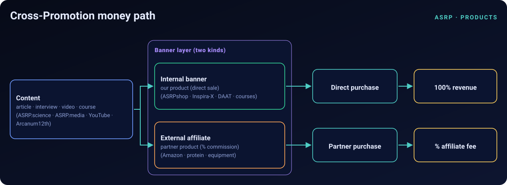
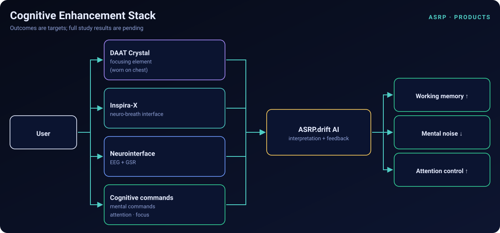
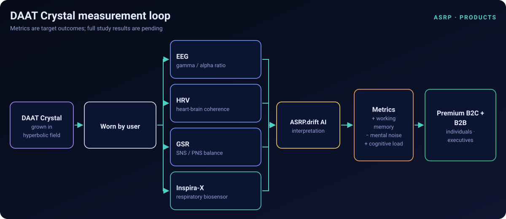
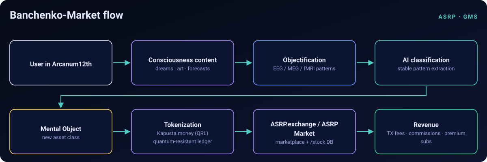

**English | [Русский](PATHS_TO_MONEY_PRODUCTS.ru.md)**

[← ASRP Ecosystem](../README.md) · [Documentation index](README.md)

# ASRP Ecosystem — Paths to Money: Products and Platforms

> Statuses and figures on this page are as of 2026-Q2 unless a date is given, and are stated by the project; they have not been independently re-verified.

---

Research-driven paths (UAP reverse engineering, blood plasma / hyperbolic biomed, agricultural study, GFS) are in [Paths to Money: Research Tracks](PATHS_TO_MONEY_RESEARCH.md).

## ASRP.art → Objective Art Valuation

**Market context.** Global art market turnover ≈ **$600 B / year**. ASRP.art introduces a new measurable layer — *Sensing Platform of Reactions* (SPR) — producing objective, reproducible reaction metrics for artworks. Mental-state imprinting becomes a quantifiable attribute, complementing provenance.

- **Client:** mid-tier artists (fastest entry), galleries (key multiplier), collectors (risk reduction), top-tier international auction houses (later stage; names withheld pre-contact).
- **Offer:** Objective scoring via consciousness-state imprinting measurement; positioned as **an additional valuation layer** (not a market-disruption narrative) — "like provenance, but for state".
- **Proof:** Patent PCT 412362, prototype platform, research base, bilingual podcast on [asrp.tech/projects/asrp.art](https://asrp.tech/ru/projects/asrp.art).
- **Channel:** Bottom-up pressure (artists → galleries → public cases) → private introductions via curators / advisory boards → pilot integration with 5-10 works in auction flow.

**Go-to-Market rollout:**

| Phase | Milestone |
|---|---|
| 🔹 **0–3 mo** — *«Prove it works»* | Pilot cohort of 10–30 artists, 30–50 works · basic SPR (emotional / cognitive reaction, repeatability) · controlled testing with 20–50 viewers · first dataset & case studies («work X triggers response Y in 70% of viewers»). |
| 🔹 **3–6 mo** — *«Enter the market»* | 3–5 gallery partnerships · SPR as a premium pricing layer · public exhibitions with SPR metrics · **paid SPR certification** — first real revenue & brand awareness. |
| 🔹 **6–12 mo** — *«Become the standard»* | Top-tier auction-house institutional partnerships · 500+ certified works, 1000+ users · data layer for collectors, funds, galleries. |

**Target-customer order:**
1. **Artists** (fastest entry, open to experiments) — «you are the first artist with measurable impact».
2. **Galleries** (key multiplier) — «we increase your sales through data».
3. **Collectors** (risk reduction, investment logic) — «it is not just art — it is a measured asset».
4. **Auction houses** (later) — framed as «additional valuation layer», not «we change the market».

**Top-tier auction house — 4-step entry:**
1. **Bottom-up pressure** — artists use SPR → galleries sell with SPR → public cases accumulate.
2. **Public cases** — stories like «work rose in value after SPR» / «SPR explained the value».
3. **Private outreach** — via curators, sales directors, advisory boards.
4. **Pilot** — 5–10 works, SPR-scored, compared to normal sales. If +X% price → we are in.

> Long-term civilizational vision for ASRP.art (inter-species art-as-currency framing, GMS + GFS + Kapusta.money + hyperbolic-field links) is documented in [`whitepaper/README.md`](../whitepaper/README.md) — deliberately kept outside the commercial pitch.

## ASRP.drift → Neurointegrative Platform

- **Client:** Clinical research, sports science, defense (augmentation programs).
- **Offer:** Deep resonant integration of fielded thought — for high-performance teams.
- **Proof:** Patent KZ 413554, R&D prototypes.
- **Channel:** Institutional partnerships after clinical validation.

## ASRP.media → Ads + Affiliate

- **Streams:** Direct ads (CPM/CPC), native/sponsored posts, Amazon-affiliate deep links (sleep masks, neurointerfaces, supplements).
- **Proof:** Own TikTok channel (`@asrp.media` — 325 followers, 2.5K likes) + active content pipeline.
- **Channel:** Organic traffic from journal + YouTube + Telegram funnel.

## Arcanum12th → B2C Learning

- **Streams:** Paid courses ($9–499), premium subs ($5–50/mo), certificates ($29–99), author revenue-share (30–70%).
- **Proof:** ~10 courses in pilot, direct-sales infrastructure ready.
- **Channel:** Email rollouts, YouTube → course landings, bot-to-course upsell + cross-promotion banners (see below).

## Cross-Promotion Pattern

**Every piece of content — article, interview, video, course — carries a targeted banner. Two kinds:**

- 🟢 **Internal banner** — our own product (direct sale, 100% revenue). Examples:
  - ASRP.science article on Inspira-X → banner → purchase via ASRPshop.
  - Arcanum12th course on lucid dreaming → banner → DAAT Crystal purchase.
  - ASRP.media interview on sleep science → banner → Arcanum12th course upsell.
- 🟡 **External affiliate** — partner product (% commission). Examples:
  - Arcanum12th course on bodybuilding → protein-brand banner → affiliate %.
  - ASRP.media article on sleep masks / neurointerfaces → Amazon affiliate link → %.
  - ASRP.science yeast study → lab-equipment vendor banner → B2B affiliate %.

This pattern applies consistently across **ASRP.science, ASRP.media, YouTube, Arcanum12th, ASRP.art** — every content channel becomes a funnel for either own-product sales or commission income.

> **Proof-of-mechanism (already realised):** ASRP.media ran a banner ad for a neurointerface device; a reader clicked through and completed a purchase; ASRP received the affiliate commission. This is the canonical worked example of the cross-promotion model — the mechanism is not theoretical.

## ASRP.dance → Movement Neuroscience

**Concept.** Each body part — fingers, limbs, specific articulations — maps to a distinct cortical representation area; executing complex, algorithmic movement sequences selectively activates those cortical regions and recruits inter-area blood flow. ASRP.dance is a research programme that investigates whether **complex choreographic dynamics and algorithmic movement sequences** can be used to expand and strengthen human cognitive capacity — operating in parallel to the DAAT Crystal pathway: **both target cognitive enhancement, but through different routes** (dance = motor-cortex-mediated activation of otherwise-dormant regions; crystal = field-signature-mediated EEG/autonomic modulation).

- **Client:** Neurology & rehab clinics, high-performance sports teams, wellness studios, cognitive-neuroscience labs.
- **Offer:** Structured movement protocols (Toltec magical passes, Gurdjieff movements, Dervish dances) with real-time EEG / myography / hyperbolic-field monitoring → measurable cortical activation (target: activation of cortical areas normally inactive during routine movement).
- **Proof:** Project page [asrp.tech/ru/projects/asrp.dance](https://asrp.tech/ru/projects/asrp.dance) · connection to ASRP.drift BCI platform · research-project stage (no published study yet).
- **Channel:** Institutional pilots → whitelabel protocols → certification via Arcanum12th.

## ASRP.fashion → Living Biocompatible Textiles

**Concept.** ASRP.fashion produces **fully-living biocompatible textiles** — not biodegradable, but *actively alive* — grown from plants, bacteria and fungal mycelium under hyperbolic- and quantum-field exposure. Garments retain the "field signature" imprint and interact with the wearer's body throughout use; dedicated designers handle the aesthetic layer.

- **Client:** Premium fashion brands, wellness retail, medical textiles (anti-thrombosis apparel), space/defense textile R&D.
- **Offer:** Fabrics grown from plants, bacteria and fungi under hyperbolic + quantum field exposure — bioenergetic, biocompatible, **charge-preserving**.
- **Scientific rationale (founder-stated mechanism):** Synthetic garments accumulate triboelectric positive charge during wear; this charge draws negative charge from skin cells and, by extension, from the surface of erythrocytes in blood. Erythrocytes rely on their native negative surface charge to repel one another and pass single-file through narrow capillaries. Loss of that charge reduces mutual electrostatic repulsion, increases aggregation risk and contributes to thrombotic events (the "anti-thrombosis apparel" positioning follows from this mechanism). Plant/bacterium/mycelium living textiles preserve erythrocyte charge stability by design — "living cloth on living body". Supporting literature citation pending.
- **Proof:** Project page [asrp.tech/ru/projects/asrp.fashion](https://asrp.tech/ru/projects/asrp.fashion) · YouTube [@ASRPfashion](https://www.youtube.com/@ASRPfashion) · scientific base via Fractal Biomedical Hyperbolic Field System patent (KZ 2025/1095.1).
- **Channel:** Pilot collections with independent designers → bio-fabric technology licensing.

## DAAT Crystals → Premium Cognitive Enhancement

**Positioning.** DAAT crystals are **not** an optical or aesthetic product — they are the focusing element of a cognitive-enhancement stack (crystal + Inspira-X neurobreath + neurointerface + ASRP.drift AI).

- **Client:** Premium B2C (high-load professionals, tech visionaries) + B2B corporate (executive wellness programs for top management, high-performance teams).
- **Offer:** Certified DAAT crystal (grown over ~1 month from copper sulfate in a non-stop hyperbolic-geometry field, preserves "field signature") integrated with Inspira-X respiratory biosensor + neurointerface (EEG, electrodermal/skin-galvanic response) + ASRP.drift AI interpretation. **Measured endpoints** (monitored during use): EEG waveform analysis (gamma/alpha ratio), heart-rate variability (HRV), electrodermal response, autonomic nervous system (SNS/PNS) balance, pre/post cognitive tests. **Target outcomes: working-memory expansion, mental-noise reduction, cognitive-load capacity increase** — still pending full study results, but measurement instrumentation is concrete, not aspirational.
- **Pricing tier:** Premium tier — the crystal is **not a low-cost product**. Individual B2C purchase for high-load professionals; emerging corporate-buyer pattern where companies acquire crystals for their top-manager cohort (so executives can sustain elevated cognitive load). Specific dollar range pending founder confirmation.
- **B2B pilots (public signal):** Bank-executive testing programme — crystals already acquired by top-management at a financial institution (institution name undisclosed; testing phase). Individual wearers include persons **on the Forbes list** (publicly announced by the founder in a broadcast Telegram post on 2026-04-20, views:288 · forwards:2 — names not disclosed). These are early pilot signals, not revenue-stage pipelines.
- **Scientific basis:** neuroplasticity (LTP, gamma oscillations, synaptic reinforcement), adult neurogenesis (BDNF, NGF, IGF-1, VEGF surrogate markers), heart-brain coherence (HRV), neuroendocrine axes (pineal, pituitary, thalamus, vagus nerve).
- **Proof:** [Hyperbolic_Field_DAAT_Crystal_Study](https://github.com/AdvancedScientificResearchProjects/Hyperbolic_Field_DAAT_Crystal_Study) (recruitment phase), patents KZ 2025/1095.1 (FBHFS) + KZ 413554 (ASRP.drift).
- **Channel:** Premium direct sales via `asrp.tech` + **ASRPshop** (🟡 domain reportedly acquired, final URL pending · B2C storefront for crystals and ASRP.fashion items) + Arcanum12th community + ASRP.media / ASRP.art content marketing.
- **Strategic positioning:** As AI advances displace cognitive-routine labour, DAAT Crystal + Inspira-X + neurointerface becomes a **mass-market candidate for biological-intelligence amplification** — one of the highest-potential monetisable technologies inside ASRP's portfolio.

## GMS → Banchenko-Market

**Driver.** As AI and robotics progressively displace mid-skill labour, cognitive and consciousness states become the new scarcity-anchored value class. GMS is ASRP's infrastructure bet on that shift.

**Concept.** *Banchenko-Market* — the internal name for the Global Market of Lucid Dreams and Other Transcendental States of Consciousness. Consciousness states are recorded via neurointerface, objectified as stable neural patterns (EEG / MEG / fMRI), classified by AI, tokenized on a quantum-resistant ledger and traded on the marketplace layer. **Naming.** `ASRP.exchange`, `ASRP Market` and `stock.asrp.*` are three public aliases used interchangeably for the **same product** (the CEO uses all three in conversation; unified branding to be fixed later). A Mental Object is framed as a **proposed new asset class** — conceptually analogous to tokenized real estate or securities, but with consciousness state as the underlying asset (priced similarly to how tokenized music or tokenized real estate is traded).

- **Client:** End-users (dreamers, artists, forecasters), platforms buying mental-state content, enterprises running GMS-based internal programs.
- **Offer:** Unified marketplace (ASRP.exchange / ASRP Market) + crypto settlement layer (Kapusta.money, quantum-resistant) + education & certification (Arcanum12th) + forecast layer (GFS) + art certification (ASRP.art).
- **Proof:** All 5 components live or in active development; scientific foundation in the [whitepapers](RESEARCH_AND_IP.md); GMS umbrella page at [asrp.tech](https://asrp.tech/ru/projects/gms).
- **Channel:** Transaction fees on Kapusta.money + exchange commissions + Arcanum12th certification fees + premium content subscriptions.

---

## Evidence status

Checked on 17 November 2026. **VERIFIED** = confirmed by an automated request or by a file in this repository; **STATED** = the project's own statement with a public link a reader can follow, not re-checked; **NOT VERIFIED** = no public evidence in this repository.

| Statement on this page | Evidence | Status |
|---|---|---|
| Global art market turnover is about $600 B / year | none on this page; no source cited | **NOT VERIFIED** |
| ASRP.art is covered by Patent PCT 412362 | listed with its public patent repository (200) in RESEARCH_AND_IP.md, where the status is "Substantive exam"; no registry record is linked | **STATED** |
| ASRP.art has a prototype platform, research base and bilingual podcast | asrp.tech project page returned 200; content not re-checked; the Axionetic_Sensing_Reactions_Platform_in_Art study repository returned 404 | **STATED** |
| SPR yields objective, reproducible reaction metrics for artworks | none on this page; no data or protocol linked | **NOT VERIFIED** |
| ASRP.drift: Patent KZ 413554 | listed in RESEARCH_AND_IP.md with a public patent repository (200) and status "Registration pending"; the page words it as a patent | **STATED** |
| ASRP.drift has R&D prototypes | none on this page | **NOT VERIFIED** |
| TikTok @asrp.media has 325 followers and 2.5K likes | tiktok.com/@asrp.media returned 200; counts not re-checked and can change | **STATED** |
| Arcanum12th has about 10 courses in pilot, direct-sales infrastructure ready, listed price ranges | arcanum12th.education returned 200; courses and prices not re-checked | **STATED** |
| A reader clicked an ASRP.media banner for a neurointerface device, bought it, and ASRP received the affiliate commission | none on this page; no commission statement or record | **NOT VERIFIED** |
| ASRP.dance is at research-project stage with no published study; target is activation of normally inactive cortical areas | asrp.tech project page returned 200; the page itself says no study is published; activation is a target, not a result | **STATED** |
| ASRP.fashion produces fully living biocompatible textiles grown from plants, bacteria and mycelium under hyperbolic and quantum fields | project page and YouTube @ASRPfashion returned 200; existence of the textiles not re-checked | **STATED** |
| Synthetic garments strip charge from erythrocytes, raising thrombosis risk; living textiles preserve it ("anti-thrombosis apparel") | none on this page; the page says the supporting literature citation is pending and calls it a founder-stated mechanism | **NOT VERIFIED** |
| Scientific base for ASRP.fashion is Patent KZ 2025/1095.1 (FBHFS) | listed in RESEARCH_AND_IP.md with a public patent repository (200), status "Formal exam done → Substantive" | **STATED** |
| DAAT crystal is grown in about one month from copper sulfate in a non-stop hyperbolic-geometry field and preserves a "field signature" | none on this page; no protocol or measurement of a "field signature" | **NOT VERIFIED** |
| DAAT crystal study (recruitment phase); target outcomes are working-memory expansion, noise reduction, cognitive-load capacity, results pending | Hyperbolic_Field_DAAT_Crystal_Study repository not publicly reachable (404); no results exist on this page | **NOT VERIFIED** |
| Crystals already acquired by top management at a bank (testing phase, name undisclosed) | none on this page; institution unnamed, no purchase record | **NOT VERIFIED** |
| Individual wearers include persons on the Forbes list (founder's Telegram post of 2026-04-20, 288 views, 2 forwards; names not disclosed) | no link to the post on this page; names withheld | **NOT VERIFIED** |
| Scientific basis: neuroplasticity, neurogenesis (BDNF, NGF, IGF-1, VEGF), heart-brain coherence, neuroendocrine axes | none on this page; no citation links these mechanisms to the crystal | **NOT VERIFIED** |
| ASRPshop domain reportedly acquired | none on this page; the page itself marks the URL as pending | **NOT VERIFIED** |
| GMS: all 5 components are live or in active development | asrp.tech GMS page returned 200; component status not re-checked | **STATED** |
