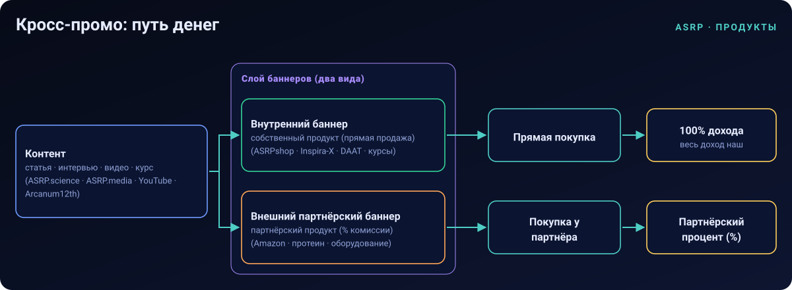
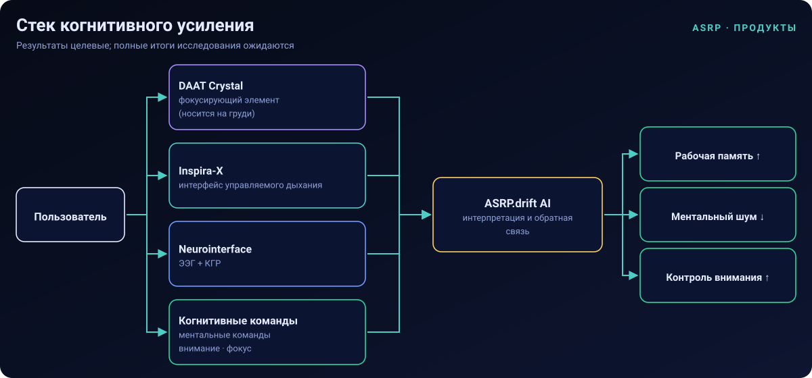
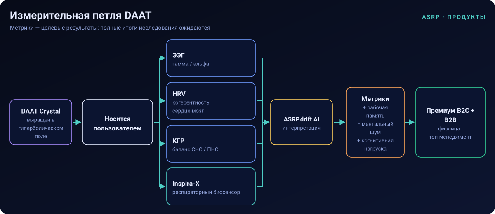
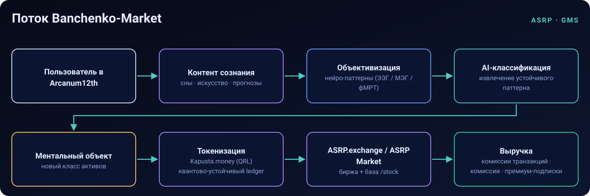

**[English](PATHS_TO_MONEY_PRODUCTS.md) | Русский**

[← Экосистема ASRP](../README.ru.md) · [Указатель документации](README.ru.md)

# Экосистема ASRP — Пути к деньгам: продукты и платформы

> Статусы и цифры на этой странице приведены на 2 квартал 2026, если не указана другая дата, и даны со слов проекта; независимо они не перепроверялись.

---

Исследовательские пути (реверс-инжиниринг UAP, плазма крови / гиперболическая биомедицина, сельскохозяйственное исследование, GFS) — на странице [Пути к деньгам: исследовательские треки](PATHS_TO_MONEY_RESEARCH.ru.md).

## ASRP.art → Объективная оценка искусства

**Контекст рынка.** Оборот мирового арт-рынка ≈ **$600 млрд / год**. ASRP.art вводит новый измеримый слой — *Sensing Platform of Reactions* (SPR) — производящий объективные, воспроизводимые метрики реакции на произведения. Отпечаток ментального состояния становится квантифицируемым атрибутом, дополняющим provenance.

- **Клиент:** Художники mid-tier (быстрый вход), галереи (ключевой мультипликатор), коллекционеры (снижение риска), аукционные дома высшего эшелона (поздняя стадия; имена не раскрываются до первого контакта).
- **Оффер:** Объективная оценка через измерение отпечатка состояния сознания; позиционируется как **дополнительный слой оценки** (не как disruption-нарратив) — «как provenance, но для состояния».
- **Доказательство:** Патент PCT 412362, прототип платформы, исследовательская база, двуязычный подкаст на [asrp.tech/projects/asrp.art](https://asrp.tech/ru/projects/asrp.art).
- **Канал:** Давление снизу (художники → галереи → публичные кейсы) → private-introductions через кураторов и advisory boards → пилотная интеграция 5–10 работ в аукционном потоке.

**Таймлайн выкатки:**

| Фаза | Веха |
|---|---|
| 🔹 **0–3 мес** — *«Доказать, что это работает»* | Пилот на 10–30 художниках, 30–50 работах · базовый SPR · контролируемые тесты с 20–50 зрителями · первый датасет и кейсы. (Базовый SPR — эмоциональная / когнитивная реакция, повторяемость; кейсы вида «работа X вызывает реакцию Y у 70% зрителей».) |
| 🔹 **3–6 мес** — *«Выйти на рынок»* | 3–5 партнёрств с галереями · SPR как премиум-слой ценообразования · публичные выставки с SPR-метриками · **платная SPR-сертификация** — первые реальные деньги и узнаваемость. |
| 🔹 **6–12 мес** — *«Стать стандартом»* | Институциональные партнёрства аукционных домов высшего эшелона · 500+ сертифицированных работ, 1000+ пользователей · data-layer для коллекционеров, фондов, галерей. |

**Порядок атаки клиентов:**
1. **Художники** (быстрый вход, открыты к экспериментам) — «ты первый художник с измеряемым воздействием».
2. **Галереи** (ключевой мультипликатор) — «мы увеличим ваши продажи через данные».
3. **Коллекционеры** (снижение риска, инвестиционная логика) — «это не просто искусство — это измеренный актив».
4. **Аукционные дома** (позже) — подаётся как «дополнительный слой оценки», не как «мы меняем рынок».

**Как зайти в аукционный дом высшего эшелона за 4 шага:**
1. **Давление снизу** — художники используют SPR → галереи продают с SPR → накапливаются публичные кейсы.
2. **Публичные кейсы** — истории вида «работа выросла в цене после SPR» / «SPR объяснил ценность».
3. **Private-подход** — через кураторов, директоров по продажам, advisory boards.
4. **Пилот** — 5–10 работ с SPR-оценкой, в сравнении с обычными продажами. Если +X% к цене → мы внутри.

> Долгосрочное цивилизационное видение для ASRP.art (art-as-currency для межвидового обмена, связка GMS + GFS + Kapusta.money + гиперболические поля) задокументировано в [`whitepaper/README.md`](../whitepaper/README.md) — намеренно вынесено за пределы коммерческого питча.

## ASRP.drift → Нейроинтегративная платформа

- **Клиент:** Клинические исследования, спортивная наука, оборонка (программы усиления).
- **Оффер:** Глубокая резонансная интеграция полевой мысли — для высокоэффективных команд.
- **Доказательство:** Патент KZ 413554, R&D-прототипы.
- **Канал:** Институциональные партнёрства после клинической валидации.

## ASRP.media → Реклама + партнёрка

- **Потоки:** Прямая реклама (CPM/CPC), нативные/спонсорские посты, Amazon-партнёрские deep-линки (маски для сна, нейроинтерфейсы, БАДы).
- **Доказательство:** Собственный TikTok-канал (`@asrp.media` — 325 подписчиков, 2.5K лайков) + активная контентная воронка.
- **Канал:** Органический трафик из журнала + YouTube + Telegram-воронка.

## Arcanum12th → B2C-образование

- **Потоки:** Платные курсы ($9–499), премиум-подписки ($5–50/мес), сертификаты ($29–99), revenue-share с авторами (30–70%).
- **Доказательство:** ~10 курсов в пилоте, инфраструктура прямых продаж готова.
- **Канал:** Email-рассылки, YouTube → лендинги курсов, upsell из бота в курсы + кросс-промо баннеры (см. ниже).

## Паттерн кросс-промо

**Каждая единица контента — статья, интервью, видео, курс — несёт таргетированный баннер. Двух видов:**

- 🟢 **Внутренний баннер** — собственный продукт (прямая продажа, 100% дохода). Примеры:
  - Статья в ASRP.science про Inspira-X → баннер → покупка через ASRPshop.
  - Курс в Arcanum12th про осознанные сновидения → баннер → покупка DAAT-кристалла.
  - Интервью в ASRP.media про науку сна → баннер → допродажа курса Arcanum12th.
- 🟡 **Внешний партнёрский** — партнёрский продукт (процент с продаж). Примеры:
  - Курс в Arcanum12th про бодибилдинг → баннер протеинового бренда → партнёрский %.
  - Статья в ASRP.media про маски для сна / нейроинтерфейсы → Amazon affiliate-линк → %.
  - Дрожжевое исследование в ASRP.science → баннер поставщика лабораторного оборудования → B2B-партнёрский %.

Этот паттерн применяется единообразно ко всем контентным каналам ASRP: каждый канал превращается в воронку либо прямых продаж, либо комиссионного дохода. Каналы: **ASRP.science, ASRP.media, YouTube, Arcanum12th, ASRP.art**.

> **Доказательство механизма (уже реализовано):** В ASRP.media размещён баннер на нейроинтерфейс; читатель перешёл по ссылке и купил; ASRP получила партнёрскую комиссию. Это канонический рабочий пример кросс-промо — механизм не теоретический.

## ASRP.dance → Нейронаука движений

**Концепция.** Каждая часть тела — пальцы, конечности, отдельные артикуляции — имеет выделенное представительство в коре головного мозга; выполнение сложных алгоритмических последовательностей движений избирательно активирует эти корковые зоны и подключает межзональный кровоток. ASRP.dance — исследовательская программа, изучающая можно ли использовать **сложную хореографическую динамику и алгоритмические движенческие последовательности** для расширения и усиления когнитивных способностей человека — параллельно треку DAAT Crystal: **обе линии нацелены на когнитивное усиление, но разными путями** (танец — через моторно-кортикальную активацию обычно-неактивных областей; кристалл — через EEG- и автономно-нервную модуляцию подписью поля).

- **Клиент:** Клиники неврологии и реабилитации, спортивные команды высокого уровня, wellness-студии, лаборатории когнитивной нейронауки.
- **Оффер:** Структурированные движенческие протоколы (магические пасы Толтеков, Движения Гурджиева, Танцы Дервишей) с real-time мониторингом ЭЭГ / миографии / гиперболических полей → измеримая активация коры (целевой маркер: активация областей, обычно неактивных при рутинном движении).
- **Доказательство:** Страница проекта на [asrp.tech/ru/projects/asrp.dance](https://asrp.tech/ru/projects/asrp.dance) · связь с платформой BCI ASRP.drift · стадия научно-исследовательского проекта (публикаций пока нет).
- **Канал:** Институциональные пилоты → whitelabel протоколов → сертификация через Arcanum12th.

## ASRP.fashion → Живые биосовместимые ткани

**Концепция.** ASRP.fashion создаёт **полностью живые биосовместимые ткани** — не биоразлагаемые, а *живые* — выращенные из растений, бактерий и мицелия грибов под воздействием гиперболических и квантовых полей. Одежда сохраняет «подпись поля» и взаимодействует с телом носителя в процессе носки; специальные дизайнеры отвечают за эстетический слой.

- **Клиент:** Премиум fashion-бренды, wellness-ритейл, медицинский текстиль (антитромбозная одежда), космический/оборонный textile R&D.
- **Оффер:** Ткани, выращенные из растений, бактерий и грибов под гиперболическими и квантовыми полями — биоэнергетические, биосовместимые, **сохраняющие заряд**.
- **Научное обоснование (механизм по CEO):** Синтетическая одежда накапливает трибоэлектрический положительный заряд при носке; этот заряд вытягивает отрицательный заряд из клеток кожи и — по цепочке — с поверхности эритроцитов в крови. Эритроциты удерживают своё движение в капиллярах за счёт собственного отрицательного заряда, отталкиваясь друг от друга. Потеря этого заряда снижает взаимное электростатическое отталкивание, повышает риск агрегации и вклад в тромботические процессы (позиционирование «антитромбозной одежды» вытекает из этого механизма). Живые ткани из растений, бактерий и мицелия сохраняют устойчивость заряда эритроцитов — «живое на живом выносит». Ссылки на литературу — следует дополнить.
- **Доказательство:** Страница проекта [asrp.tech/ru/projects/asrp.fashion](https://asrp.tech/ru/projects/asrp.fashion) · YouTube [@ASRPfashion](https://www.youtube.com/@ASRPfashion) · научная база по патенту Фрактальной Биомедицинской Системы Гиперболических Полей (KZ 2025/1095.1).
- **Канал:** Пилотные коллекции с независимыми дизайнерами → лицензирование технологии биотканей.

## DAAT-кристаллы → Премиум когнитивное усиление

**Позиционирование.** Кристаллы DAAT — **не** оптический или эстетический продукт, это фокусирующий элемент стека когнитивного усиления (кристалл + нейродыхание Inspira-X + нейроинтерфейс + AI ASRP.drift).

- **Клиент:** Премиум B2C (профессионалы высокой нагрузки, технические визионеры) + B2B корпоративный сегмент (wellness-программы для топ-менеджмента, высокоэффективные команды).
- **Оффер:** Сертифицированный кристалл DAAT (выращивается ~1 месяц из медного купороса в нон-стоп поле с гиперболической геометрией, сохраняет «подпись поля») в связке с респираторным биосенсором Inspira-X + нейроинтерфейсом (ЭЭГ, кожно-гальваническая реакция) + AI-интерпретацией ASRP.drift. **Измеряемые endpoint-ы** (мониторинг при использовании): ЭЭГ (соотношение гамма/альфа), вариабельность сердечного ритма (HRV), кожно-гальваническая реакция, баланс автономной нервной системы (СНС/ПНС), когнитивные тесты до/после. **Целевые результаты: расширение рабочей памяти, снижение ментального шума, рост способности нести когнитивную нагрузку** — полные результаты исследования ожидаются, но инструментарий измерений конкретен, а не декларативен.
- **Ценовая категория:** Премиум-категория — кристалл **не дешёвый продукт**. Индивидуальные B2C-покупки у профессионалов высокой нагрузки; формирующийся B2B-паттерн: компании закупают кристаллы для своих топ-менеджеров (чтобы те могли выдерживать повышенную когнитивную нагрузку). Конкретный ценовой диапазон — ожидает подтверждения (диапазон в долларах; подтверждение — от основателя).
- **B2B-пилоты (публичный сигнал):** Программа тестирования топ-менеджерами банка — кристаллы уже закуплены руководством финансового учреждения (название не раскрывается; этап тестирования). Среди индивидуальных носителей — люди **из списка Forbes** (публично объявлено основателем в Telegram-канале 2026-04-20, просмотры:288 · форварды:2 — имена не раскрыты). Это ранние пилотные сигналы, не revenue-стадия.
- **Научная база:** Нейропластичность (LTP, гамма-осцилляции, синаптическое усиление), взрослый нейрогенез (маркеры BDNF, NGF, IGF-1, VEGF), когерентность сердце-мозг (HRV), нейроэндокринные оси (эпифиз, гипофизарная ось, таламус, блуждающий нерв).
- **Доказательство:** Репозиторий исследования [Hyperbolic_Field_DAAT_Crystal_Study](https://github.com/AdvancedScientificResearchProjects/Hyperbolic_Field_DAAT_Crystal_Study) (фаза набора), патенты KZ 2025/1095.1 (ФБСГП) + KZ 413554 (ASRP.drift).
- **Канал:** Премиум прямые продажи через `asrp.tech` + **ASRPshop** (🟡 домен предположительно куплен, финальный URL — позже · B2C-витрина для кристаллов и изделий ASRP.fashion) + сообщество Arcanum12th + контент-маркетинг через ASRP.media / ASRP.art.
- **Стратегическое позиционирование:** По мере того как ИИ вытесняет когнитивно-рутинный труд, связка DAAT Crystal + Inspira-X + нейроинтерфейс становится **кандидатом на массовый продукт усиления биологического интеллекта** — одной из наиболее монетизируемых технологий портфеля ASRP.

## GMS → Banchenko-Market

**Драйвер.** По мере того как ИИ и робототехника вытесняют труд среднего уровня, когнитивные состояния и состояния сознания становятся новым классом ценности, привязанным к дефициту. GMS — инфраструктурная ставка ASRP на этот сдвиг.

**Концепция.** *Banchenko-Market* — внутреннее название глобального рынка осознанных сновидений и иных трансцендентальных состояний сознания. Состояния сознания снимаются нейроинтерфейсом, объективизируются как устойчивые нейро-паттерны (ЭЭГ / МЭГ / фМРТ), классифицируются AI, токенизируются на квантово-устойчивом ledger-е и торгуются на маркет-слое. **Названия.** `ASRP.exchange`, `ASRP Market` и `stock.asrp.*` — три публичных алиаса, используемых взаимозаменяемо для **одного и того же продукта** (CEO использует все три в разговоре; единый бренд будет закреплён позже). Ментальный Объект позиционируется как **предлагаемый новый класс активов** — концептуально аналогичен токенизированной недвижимости или ценным бумагам, но базовым активом является состояние сознания (ценообразование аналогично торгуемой токенизированной музыке или недвижимости).

- **Клиент:** Конечные пользователи (сновидцы, художники, прогнозисты), платформы, закупающие контент ментальных состояний, корпорации с GMS-программами.
- **Оффер:** Единая биржа (ASRP.exchange / ASRP Market) + расчётный крипто-слой (Kapusta.money, квантово-устойчивый) + обучение и сертификация (Arcanum12th) + слой прогнозов (GFS) + сертификация искусства (ASRP.art).
- **Доказательство:** Все 5 компонентов работают или в активной разработке; научная основа — в [научных статьях](RESEARCH_AND_IP.ru.md); зонтичная страница на [asrp.tech](https://asrp.tech/ru/projects/gms).
- **Канал:** Комиссии транзакций Kapusta.money + комиссии биржи + комиссии за сертификацию Arcanum12th + премиум-подписки на контент.
