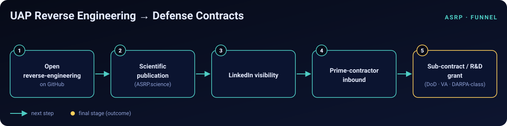
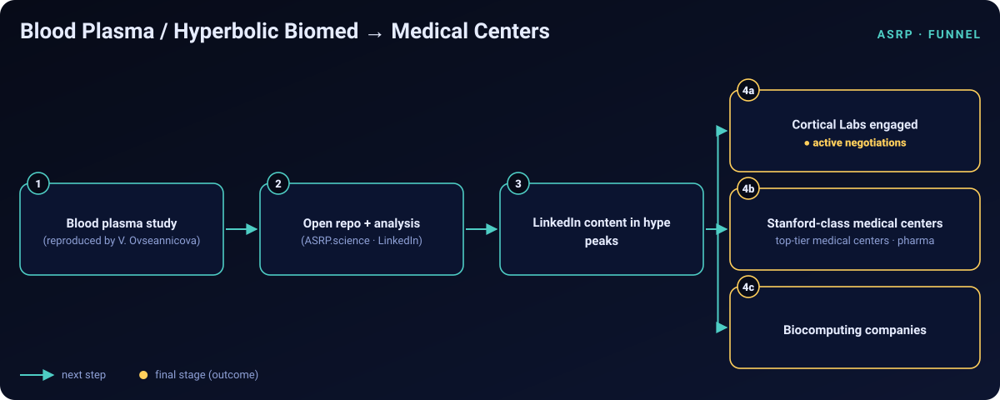
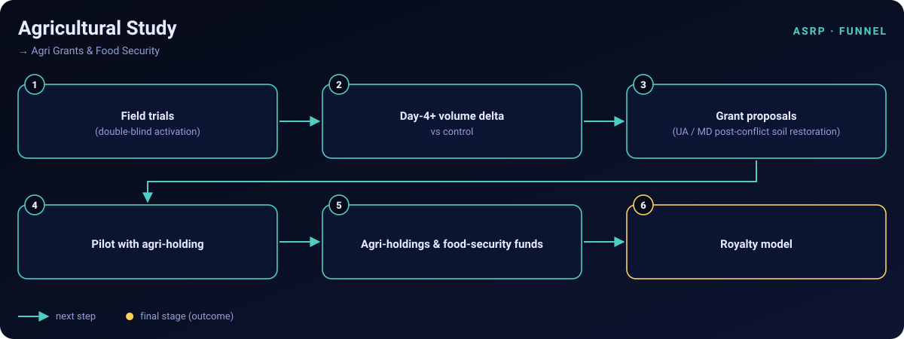
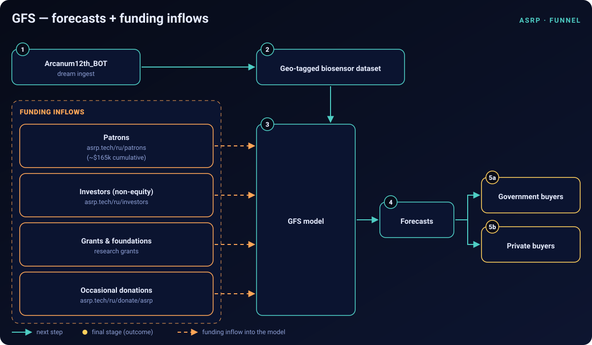

**English | [Русский](PATHS_TO_MONEY_RESEARCH.ru.md)**

[← ASRP Ecosystem](../README.md) · [Documentation index](README.md)

# ASRP Ecosystem — Paths to Money: Research Tracks

> Statuses and figures on this page are as of 2026-Q2 unless a date is given, and are stated by the project; they have not been independently re-verified.

---

## Paths to Money

**Each direction has a concrete monetization funnel — not theory, but a documented route from research to revenue.**

Product and platform paths (ASRP.art, ASRP.drift, ASRP.media, Arcanum12th, cross-promotion, ASRP.dance, ASRP.fashion, DAAT Crystals, GMS → Banchenko-Market) continue in [Paths to Money: Products and Platforms](PATHS_TO_MONEY_PRODUCTS.md).

### UAP Reverse Engineering → Defense Contracts

- **Client:** DoD primes — named engagement tracks: **Boeing** (reverse-engineering patents and DoD reverse-engineering spend under congressional scrutiny), **Stanford (Nolan Lab)** for Gulf War Syndrome veterans treatment, **DoE / Los Alamos National Laboratory** (UAP-adjacent reverse-engineering side that funded IBM-supercomputer simulations), plus DARPA-class R&D funds and VA (Gulf War Syndrome programs).

  > ⚠️ The English and Russian versions of this passage differ in the source.
- **Offer:** Proven reverse-engineering capability — demonstrated through **open public research** (UAP study + Hyperbolic Field Blood Plasma) rather than claimed competence → subcontracts on engineered-object research.
- **Proof:** `UAP_Reverse_Engineering_Study` repo, Hyperbolic Field Blood Plasma study, ECP-2026-04-04 session results; **U.S. Department of Energy read the UAP repository within hours of publication** (first tracked federal reader) — independently confirms the work is read at target level.
- **Channel:** LinkedIn + direct intros + scientific publications + public repositories timed to industry hype windows.
- **Scale context (illustrative, per founder):** Boeing-class DoD reverse-engineering spend is tracked to **~$40 M / year** on single technology lines (per congressional disclosure patterns); a first-tier subcontractor in the same flow can realistically target **~$2 M / year** on entry-level R&D subcontracts. Figures are order-of-magnitude indicators, not committed amounts.

### Blood Plasma / Hyperbolic Biomed → Medical Centers

- **Client:** Biocomputing companies (**Cortical Labs — active negotiations, 2026-Q2 under review** · contact: Natasha), top-tier medical centers, pharma.
- **Offer:** Hyperbolic-field modulation protocols for coagulation and regeneration research (acceleration / deceleration kinetics tracks), plus bio-signal layer for neural compute platforms.
- **Proof:** `Hyperbolic_Field_BloodPlasma_Study` — reproduced by V. Ovseannicova (after extended training; initial attempts failed); raw data → analysed by K. Zmiienko; unified public repository published on GitHub.
- **Channel — canonical ASRP engagement playbook (Cortical Labs template):** (1) internal capability built (Valeria trained on the protocol) → (2) reproduction attempts (initial failures; protocol successfully reproduced after extended training) → (3) raw data → analysis by team → (4) public GitHub repository published → (5) direct outreach to target (Cortical Labs) — **no response** initially → (6) wait for target's own hype-window (Cortical Labs' DishBrain neuron-silicon game announcement) → (7) **post repository as LinkedIn content during the hype peak** → (8) target engages → negotiation (ongoing, Q2 2026). This same algorithm is used for every defense / biotech engagement track — see [Engagement funnel diagram](OUTREACH.md).

#### Primary pathogenic-factor hypothesis — temporal desynchronization

> For the UAP-adjacent oncology and pre-oncology subclass, ASRP proceeds from the working hypothesis that the **primary pathogenic factor is temporal desynchronization of biological processes**, not classical mutagenic damage. Therapy is therefore framed as **targeted correction of process kinetics** (restoration of coherence at the biofield ↔ spacetime interface), not cytotoxic intervention. Preliminary internal experimental observations (not yet peer-reviewed; pending IP resolution) suggest the approach warrants further investigation. ⚠️ These are pre-publication research observations under a working hypothesis; **no regulatory or clinical-efficacy claim is made** in this document. This is the same hypothesis carried into the Dr. Garry Nolan / Stanford dialogue (see [Outreach Dynamics #3](OUTREACH.md)).

> ⚠️ The English and Russian versions of this passage differ in the source. The Russian original of this passage lists specific preclinical observations and has no caveat; the English wording above, with its explicit "no regulatory or clinical-efficacy claim", is the more conservative of the two.

**Temporal-regime notation (ASRP → external):**

| Sample | Temporal regime | Internal taxonomy |
|---|---|---|
| `T₀` | Control — baseline temporal flow | — |
| `T₊` | Accelerated kinetics (Δt > 0) | **Channel 19** (acceleration) |
| `T₋` | Decelerated kinetics (Δt < 0) | **Channel 21** (deceleration) |

**Relation:** `T₊ ≫ T₀ ≫ T₋` — reproducible plasma-fibrin clot phenotypes obtained **without thermal, chemical or ionizing exposure**. The T-notation is the public-facing label used in external correspondence (e.g. the Nolan LinkedIn follow-up, 4 Feb 2026); the Channel-19 / Channel-21 taxonomy is the equivalent internal label used within the rest of this document.

**Theoretical anchor:** The temporal-kinetic framework above is formally tractable within the *Three-Dimensional Time* mathematical apparatus (World Scientific, [DOI 10.1142/S2424942425500045](https://www.worldscientific.com/doi/epdf/10.1142/S2424942425500045)) — an external peer-reviewed framework that extends physical time from one dimension to three, giving "localized spacetime curvature at biological scales" a rigorous physics backbone rather than a metaphorical one. See [whitepaper/README.md → External scientific references](../whitepaper/README.md#-external-scientific-references--внешние-научные-ссылки) for the citation.

**Geophysical-correlation context (research input, not product claim):** Kazakhstan — where ASRP's core field work is registered — overlaps historically with a cluster of documented radiation and geophysical anomalies: Semipalatinsk test-site legacy, Baikonur-area military infrastructure, and active geofault zones. Mainstream geophysics literature documents physical mechanisms in these conditions — radon-driven ionization, plasma formation along geofaults, pre-seismic electromagnetic anomalies — which overlap directly with ASRP's hyperbolic-field research domain. The overlap motivates the specific regional focus of our field studies; it is cited here as **environmental context** for the research programme, not as a product-level claim. Alongside the geophysics baseline, Soviet-era and post-Soviet ufology catalogues list the same region as a high-density UAP-observation zone (secondary, ufology-literature context: [UFO Sightings Over Kazakhstan](https://nexusmagazine.com/product/ufo-sightings-over-kazakhstan/) · [r/UFOs_Archive discussion thread](https://www.reddit.com/r/UFOs_Archive/comments/1qaqibp/ufos_in_kazakhstan/)).

### Agricultural Study → Agri Grants & Food Security

- **Client:** UA/MD post-conflict soil-restoration grants, agri-holdings, food-security funds.
- **Offer:** Hyperbolic-field treatment increases germination and yield (early data: Day-4 volume delta vs control).
- **Proof:** `Hyperbolic_Field_Agricultural_Study` field trials (ongoing, double-blind activation).
- **Channel:** Grant proposals → pilot with agri-holding → royalty model.
- **Scale example (projected):** +10% soy yield on a 1 M-person food base = projected extra supply for ~100 k people (city-district scale).

### GFS — Global Forecasting System → Forecast Sales

> Extended funnel: GFS forecasts flow right to buyers; patrons, investors, grants and occasional donations flow into the model itself (left, dashed).

- **Client:** governments (geophysical / military threat forecasts), private desks (markets, commodities, securities), and individual users placing bets on the Market.
- **Offer:** High-signal forecasts based on distributed human bio-sensors (Arcanum12th_BOT data stream is **non-optional** — GFS cannot function without the bot's dream/biosensor input) + open environmental data.
- **User funnel:** Arcanum12th_BOT + Arcanum12th courses collect dream and biosensor data (genetic, EEG, electrodermal, autonomic nervous-system) → GFS ingests → **Kapusta rating substrate** motivates, stimulates and filters: accurate forecasts raise contributor status + credit more Kapusta, inaccurate ones lower status → validated forecasts publish to **ASRP.exchange / ASRP Market** → users place stakes → on fulfilment, payouts split across taxes, team premiums, shareholders, and contributor rewards. Over large data the mechanism yields (a) accurate forecasts, (b) high-precision biological sensors, (c) system reliability — all documented in the GFS patent.
- **Proof:** Historical forecast track with early flags on geopolitical events — **two non-trivial forecasts are currently on trajectory: (a) tactical-nuclear weapon employment risk, (b) extraterrestrial-contact signal**. Both were dismissed as fantasy when originally logged; current geopolitical context shows gradual convergence toward both (see Case Studies).
- **Channel:** B2G direct, B2B terminal-style API, and B2C via the ASRP.exchange/Market betting UI.

---

## Evidence status

Checked on 17 November 2026. **VERIFIED** = confirmed by an automated request or by a file in this repository; **STATED** = the project's own statement with a public link a reader can follow, not re-checked; **NOT VERIFIED** = no public evidence in this repository.

| Statement on this page | Evidence | Status |
|---|---|---|
| UAP_Reverse_Engineering_Study repository is published | GitHub URL returned 200 on 2026-11-17 (repository now at ASRP_UAP_Reverse_Engineering_Study) | **VERIFIED** |
| The U.S. Department of Energy read the UAP repository within hours of publication ("first tracked federal reader") | none on this page; GitHub does not show reader IP addresses to repository owners, so no checkable source exists | **NOT VERIFIED** |
| Named engagement tracks exist with Boeing, Stanford (Nolan Lab), DoE / Los Alamos and VA | none on this page; no contract, correspondence or public statement by any of these parties is linked | **NOT VERIFIED** |
| Passage on client tracks (EN and RU versions differ) | the two language versions differ; see the divergence note on the page | **NOT VERIFIED** |
| DoD reverse-engineering spend of about $40 M / year per technology line; a subcontractor could target about $2 M / year (illustrative, per founder) | none on this page; "congressional disclosure patterns" are not cited | **NOT VERIFIED** |
| Cortical Labs: active negotiations, contact "Natasha" (2026-Q2, under review) | none on this page; private correspondence, no public statement by Cortical Labs | **NOT VERIFIED** |
| Hyperbolic_Field_BloodPlasma_Study repository is public | GitHub URL returned 200 on 2026-11-17 (repository now at ASRP_Hyperbolic_Field_BloodPlasma_Study) | **VERIFIED** |
| Plasma protocol reproduced by V. Ovseannicova after failed first attempts; raw data analysed by K. Zmiienko | public repository named on the page; contents not re-checked | **STATED** |
| Cortical Labs did not respond to outreach, then engaged after a LinkedIn post timed to its announcement | none on this page; no post URL, message or reply is linked | **NOT VERIFIED** |
| Working hypothesis: temporal desynchronization is the primary pathogenic factor in UAP-adjacent oncology; preliminary internal observations support further study (page states no regulatory or clinical-efficacy claim) | none on this page; observations are unpublished and not peer-reviewed, per the page itself | **NOT VERIFIED** |
| Reproducible plasma-fibrin clot phenotypes (T+, T0, T-) obtained without thermal, chemical or ionizing exposure | public plasma repository (200); data not re-checked; the photo sent to Stanford is not in this repository | **STATED** |
| Three-Dimensional Time paper is published in World Scientific (peer-reviewed) | DOI link on the page returned 403 on 2026-11-17 (publisher blocks automated clients; existence not confirmed) | **STATED** |
| That framework gives "localized spacetime curvature at biological scales" a rigorous physics backbone | none on this page; the cited paper's applicability to biology is the project's own interpretation | **NOT VERIFIED** |
| Kazakhstan hosts documented radiation and geophysical anomalies that overlap with hyperbolic-field research (radon ionization, geofault plasma, pre-seismic anomalies) | none on this page; no geophysics source is cited | **NOT VERIFIED** |
| Ufology catalogues list the region as a high-density UAP-observation zone | two secondary links (nexusmagazine.com and a Reddit thread) returned 200; they prove the pages exist, not the claim | **STATED** |
| Hyperbolic_Field_Agricultural_Study repository is public | GitHub URL returned 200 on 2026-11-17 (repository now at ASRP_Hyperbolic_Field_Agricultural_Study) | **VERIFIED** |
| Hyperbolic-field treatment increases germination and yield (early Day-4 volume delta vs control; double-blind trials ongoing) | public agricultural repository (200); data and blinding not re-checked; no yield result is stated | **STATED** |
| +10% soy yield on a 1 M-person food base gives extra supply for about 100 k people (projected) | none on this page; a projection with no stated inputs | **NOT VERIFIED** |
| Two GFS forecasts are on trajectory: tactical-nuclear weapon employment and an extraterrestrial-contact signal; both were logged earlier and dismissed | none on this page; no dated forecast log is linked, and the gfs-model repository returned 404 (not publicly reachable) | **NOT VERIFIED** |
| GFS mechanism yields accurate forecasts, high-precision biological sensors and system reliability ("documented in the GFS patent") | none on this page; a patent filing describes a design and does not show forecast accuracy | **NOT VERIFIED** |
