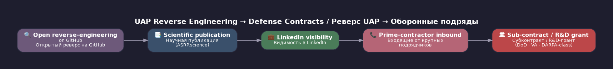
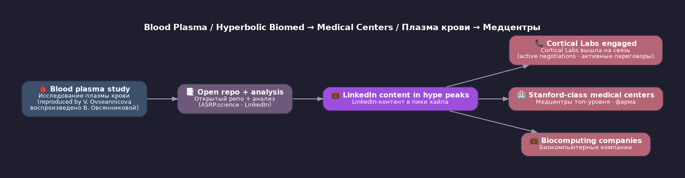
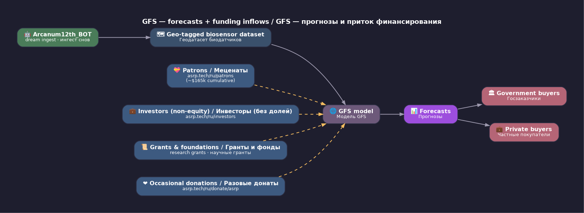

**[English](PATHS_TO_MONEY_RESEARCH.md) | Русский**

[← Экосистема ASRP](../README.ru.md) · [Указатель документации](README.ru.md)

# Экосистема ASRP — Пути к деньгам: исследовательские направления

> Статусы и цифры на этой странице приведены на 2 квартал 2026, если не указана другая дата, и даны со слов проекта; независимо они не перепроверялись.

---

## Пути к деньгам

**У каждого направления есть конкретная воронка монетизации — не теория, а задокументированный путь от исследования к выручке.**

Продуктовые и платформенные пути (ASRP.art, ASRP.drift, ASRP.media, Arcanum12th, кросс-промо, ASRP.dance, ASRP.fashion, DAAT Crystals, GMS → Banchenko-Market) продолжаются на странице [Пути к деньгам: продукты и платформы](PATHS_TO_MONEY_PRODUCTS.ru.md).

### Реверс UAP → Оборонные подряды

- **Клиент:** Подрядчики Минобороны США с конкретными треками: **Boeing** (патенты по реверс-инжинирингу под парламентским расследованием), **Stanford (лаборатория Nolan)** по программе Gulf War Syndrome, **DoE / Лос-Аламосская национальная лаборатория** (UAP-adjacent сторона, финансировавшая симуляции на суперкомпьютерах IBM), R&D-фонды уровня DARPA и VA (программы Gulf War Syndrome).

  > ⚠️ Расхождение EN/RU в исходнике — см. [открытые вопросы](../reports/MARKETING_UPDATE_REPORT.md#open-questions).
- **Оффер:** Подтверждённая компетенция по реверс-инжинирингу — доказанная **через открытые публичные исследования** (UAP + плазма крови), а не заявленная на словах → субконтракты на исследование инженерных объектов.
- **Доказательство:** Репозиторий `UAP_Reverse_Engineering_Study`, исследование плазмы крови, результаты сессии ECP-2026-04-04; **Министерство энергетики США прочитало UAP-репозиторий в течение нескольких часов после публикации** (первый зафиксированный федеральный читатель) — независимо подтверждает, что работа читается на целевом уровне.
- **Канал:** LinkedIn + прямые контакты + научные публикации + публичные репозитории, синхронизированные с хайп-окнами отрасли.
- **Масштаб (иллюстративно, по CEO):** DoD-расходы класса Boeing на реверс-инжиниринг отдельных технологических линий оцениваются в **~$40 млн/год** (по паттернам парламентских раскрытий); подрядчик первого уровня в этой цепочке реалистично целится на **~$2 млн/год** на входные R&D-субконтракты. Цифры — ориентировочные, не подтверждённые контракты.

### Плазма крови / Гиперболический биомед → Медцентры

- **Клиент:** Биокомпьютерные компании (**Cortical Labs — активные переговоры, на Q2 2026 под рассмотрением**, контакт: Natasha), медцентры топ-уровня, фарма.
- **Оффер:** Протоколы модуляции гиперболическим полем для исследования свёртывания и регенерации (треки кинетики ускорения / замедления), плюс слой биосигнала для нейрокомпьютерных платформ.
- **Доказательство:** Репозиторий `Hyperbolic_Field_BloodPlasma_Study` — воспроизведён В. Овсянниковой (после длительного обучения; первые попытки не удавались); сырые данные проанализированы К. Змиенко; единый публичный репозиторий опубликован на GitHub.
- **Канал — канонический playbook аутрича ASRP (шаблон Cortical Labs):** (1) внутренняя компетенция выстроена (Валерия обучена протоколу) → (2) попытки воспроизведения (первичные провалы; после длительного обучения протокол успешно воспроизведён) → (3) сырые данные → анализ командой → (4) публикация на GitHub → (5) прямой аутрич к цели (Cortical Labs) — **без ответа** в первый раз → (6) ожидание профильного хайп-окна цели (анонс игры Cortical Labs на нейрон-кремниевой платформе DishBrain) → (7) **публикация репозитория как LinkedIn-контента в пик хайпа** → (8) цель выходит на связь → переговоры (идут, Q2 2026). Этот же алгоритм применяется для каждого оборонного/биотех-трека — см. [диаграмму воронки аутрича](OUTREACH.ru.md).

#### Гипотеза первичного патогенного фактора — темпоральная десинхронизация

> Для UAP-adjacent онкологического и предонкологического подкласса ASRP исходит из рабочей гипотезы, что **первичный патогенный фактор — темпоральная десинхронизация биологических процессов**, а не классическое мутагенное повреждение. Терапия поэтому формулируется как **целевая коррекция кинетики процессов** (восстановление когерентности на интерфейсе биополе ↔ пространство-время), а не цитотоксическое воздействие. Предварительные доклинические наблюдения — измеримая регрессия опухолей в экспериментальных моделях, нормализация иммунных сигнальных путей, отсутствие цитотоксических побочных эффектов, характерных для стандартных методов, — пока не опубликованы (ожидается закрытие IP-вопросов). Та же гипотеза перенесена в диалог с д-ром Гарри Ноланом / Stanford (см. [Outreach Dynamics #3](OUTREACH.ru.md)).

> ⚠️ Расхождение EN/RU в исходнике — см. [открытые вопросы](../reports/MARKETING_UPDATE_REPORT.md#open-questions). Английский оригинал этого абзаца не перечисляет конкретных наблюдений и содержит оговорку, которой нет в русском тексте: наблюдения не рецензированы, никаких регуляторных утверждений и утверждений о клинической эффективности не делается. Из двух формулировок английская более осторожная.

**Нотация темпоральных режимов (ASRP → внешняя):**

| Образец | Режим | Внутренняя таксономия |
|---|---|---|
| `T₀` | Контроль — базовый темпоральный поток | — |
| `T₊` | Ускоренная кинетика (Δt > 0) | **Channel 19** (ускорение) |
| `T₋` | Замедленная кинетика (Δt < 0) | **Channel 21** (замедление) |

**Соотношение:** `T₊ ≫ T₀ ≫ T₋` — воспроизводимые фенотипы сгустков плазмы/фибрина, получаемые **без термического, химического или ионизирующего воздействия**. Нотация T — публичная, используется во внешней переписке (например, в follow-up Nolan 4 фев. 2026); таксономия Channel-19 / Channel-21 — эквивалентная внутренняя, используется в остальной части этого документа.

**Теоретическая опора:** Темпорально-кинетическая рамка выше формально разрешима в рамках математического аппарата *Three-Dimensional Time* (World Scientific, [DOI 10.1142/S2424942425500045](https://www.worldscientific.com/doi/epdf/10.1142/S2424942425500045)) — внешней рецензируемой работы, расширяющей физическое время с одной до трёх размерностей, что даёт «локализованной кривизне пространства-времени на биологических масштабах» строгую физическую, а не метафорическую основу. Цитирование — в [`whitepaper/README.md` → «External scientific references»](../whitepaper/README.md#-external-scientific-references--внешние-научные-ссылки).

**Геофизический контекст (исследовательский ввод, не продуктовая претензия):** Казахстан — где зарегистрированы основные полевые работы ASRP — исторически пересекается с кластером задокументированных радиационных и геофизических аномалий: наследие Семипалатинского полигона, инфраструктура вокруг Байконура, активные георазломные зоны. Мейнстрим-геофизическая литература описывает в этих условиях конкретные физические механизмы — радоновую ионизацию, формирование плазмы вдоль георазломов, пресейсмические электромагнитные аномалии, — которые напрямую пересекаются с исследовательским доменом ASRP по гиперболическим полям. Это пересечение мотивирует конкретный региональный фокус наших полевых работ; приводится как **средовой контекст** исследовательской программы, не как продуктовая претензия. Параллельно с геофизической базой советские и постсоветские уфологические каталоги указывают тот же регион как зону высокой плотности UAP-наблюдений (вторичный уфологический контекст: [Nexus Magazine](https://nexusmagazine.com/product/ufo-sightings-over-kazakhstan/) и [ветка r/UFOs_Archive](https://www.reddit.com/r/UFOs_Archive/comments/1qaqibp/ufos_in_kazakhstan/)).

### Агро-исследование → Агро-гранты и продовольственная безопасность

- **Клиент:** Гранты UA/MD на восстановление почв после конфликта, агрохолдинги, фонды продовольственной безопасности.
- **Оффер:** Обработка гиперболическим полем повышает всхожесть и урожайность (ранние данные: дельта объёма на 4-й день против контроля).
- **Доказательство:** Полевые испытания `Hyperbolic_Field_Agricultural_Study` (в процессе, двойная слепая активация).
- **Канал:** Грантовые заявки → пилот с агрохолдингом → роялти-модель.
- **Пример масштаба (оценочно):** +10% урожая сои при базовом потреблении 1 млн человек = проекция дополнительного питания на ~100 тыс. (масштаб городского района).

### ГСП — Глобальная Система Прогнозирования → Продажа прогнозов

> Расширенная воронка: прогнозы GFS уходят направо к покупателям; меценаты, инвесторы, гранты и разовые донаты — налево в саму модель (пунктир).

- **Клиент:** Государства (геофизические / военные прогнозы угроз), частные дески (рынки, сырьё, ценные бумаги), индивидуальные пользователи, делающие ставки на Market.
- **Оффер:** Высокосигнальные прогнозы на основе распределённых биосенсоров (поток данных из Arcanum12th_BOT **не является опциональным** — без бота GFS не работает) и открытых данных окружающей среды.
- **Пользовательская воронка:** Arcanum12th_BOT + курсы Arcanum12th собирают сны и биосенсорные данные (генетика, ЭЭГ, кожно-гальваника, вегетативная нервная система) → GFS принимает → **Kapusta как субстрат рейтингов** мотивирует, стимулирует и фильтрует: точные прогнозы поднимают статус контрибьютора и начисляют больше Kapusta, неточные понижают статус → проверенные прогнозы публикуются на **ASRP.exchange / ASRP Market** → пользователи делают ставки → при исполнении выплаты распределяются между налогами, премиями команды, акционерами и вознаграждениями контрибьюторов. На больших данных механизм даёт (а) точные прогнозы, (б) высокоточные биологические датчики, (в) надёжность системы — всё задокументировано в патенте GFS.
- **Доказательство:** Исторические прогнозы с ранними флагами по геополитическим событиям — **два нетривиальных прогноза сейчас на траектории исполнения: (a) риск применения тактического ядерного оружия, (b) сигнал контакта с внеземной цивилизацией**. Оба изначально расценивались как фантазия; текущий геополитический контекст показывает постепенную сходимость к обоим (см. раздел Кейсы).
- **Канал:** B2G напрямую, B2B API в стиле терминала, B2C через UI ставок ASRP.exchange/Market.
