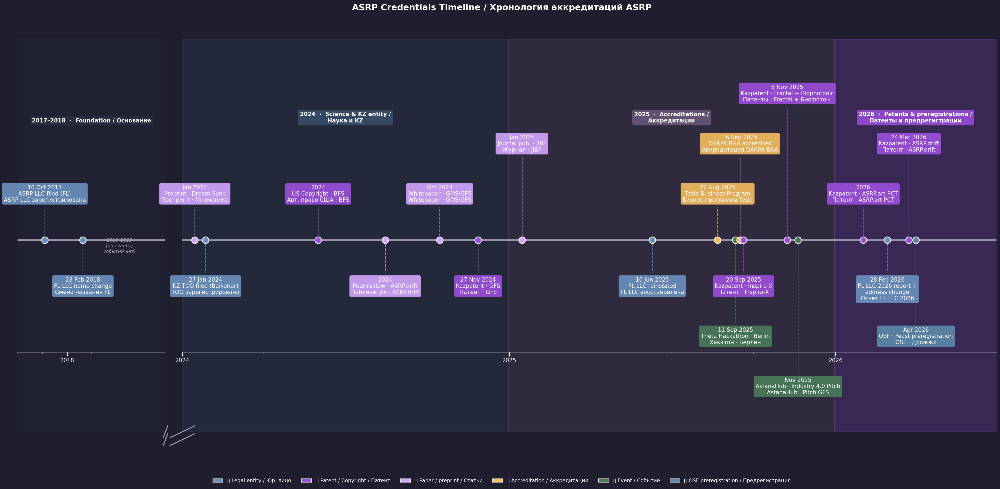

**English | [Русский](RESEARCH_AND_IP.ru.md)**

[← ASRP Ecosystem](../README.md) · [Documentation index](README.md)

# ASRP Ecosystem — Research, Patents and Accreditations

> Statuses and figures on this page are as of 2026-Q2 unless a date is given, and are stated by the project; they have not been independently re-verified.

---

## Scientific whitepapers

The ASRP business model and scientific foundation are documented across **a family of peer-reviewed publications on ResearchGate** — each carrying a complete history of rejections (typically 4–5) before acceptance. Every canonical work has been published in a journal **except the BCI / Neural-Interfaces Technical Report**, which is currently issued as a report and will be released as a journal article shortly. Three flagship works are summarised below; the complete publication list (8+ canonical works including multiple versions) lives in [`whitepaper/README.md → Complete publication list`](../whitepaper/README.md#-complete-publication-list--полный-список-публикаций).

**GMS / GFS architectural whitepaper (October 2024 → January 2025):**
> Banchenko D., Kapustin M., Bilovodenko V., Ovseannicova V., Savelev I., Sepehri A., Grivtsova I. *«Technological transformations, formation of GMS (Global Mental System) and GFS (Global Forecasting System) — right-brain technologies based on biological entities with consciousness, artificial intelligence, quantum computing, and blockchain: Banchenko-Market (Global Market of Lucid Dreams and Other Transcendental States of Consciousness)»* · Preprint: [RG 384668260](https://www.researchgate.net/publication/384668260) (October 2024) · Extended preprint: [RG 384706504](https://www.researchgate.net/publication/384706504) · **Published article: [RG 388438082](https://www.researchgate.net/publication/388438082)** in *Journal of Investment Banking and Finance*, January 2025 · [DOI: 10.17605/OSF.IO/P9KHU](https://doi.org/10.17605/OSF.IO/P9KHU) · License: CC BY-NC-ND 4.0.

**Banchenko-Market economic whitepaper (2024):**
> Banchenko D., Ovseannicova V., Kapustin M., Bilovodenko V., Savelev I., Grivtsova I. *«Funding for Fundamental Science Research Based on Blockchain Technologies — Banchenko-Market (Global Market of Lucid Dreams and Other Transcendental States of Consciousness Market)»* · [RG 378492156](https://www.researchgate.net/publication/378492156) · License: CC BY-NC-ND 4.0.
> *Publication note. This paper describes the blockchain-funding model for fundamental-science research and was refused by mainstream venues (KZ, UA, US Stanford-affiliated, UK Oxford-affiliated) before being accepted by the journal that agreed to publish the unconventional framing.*

**Dream-synchronisation methodology (January 2024 preprint → published article):**
> Banchenko D., Kapustin M., Burilova T., Shishkin L. *«Application of the Banchenko Dream Synchronization Mnemonics Method for Joint Synchronization of Dream Elements (including Lucid Dreams) within the Blokhin Dream Network Concept and Analysis of Results based on the Kapustin Dream Match Search AI Model»* · Preprint: [RG 377492383](https://www.researchgate.net/publication/377492383) (January 2024) · **Published article: [RG 378492219](https://www.researchgate.net/publication/378492219)** · License: CC BY-NC-ND 4.0.

See [`whitepaper/README.md`](../whitepaper/README.md) for the **complete publication list**, full bilingual abstracts, author roles, README-section mapping and foundational methods list.

---

## Research & Patents Portfolio

**All patents are filed through Kazpatent (Republic of Kazakhstan).** Public documentation repositories for each patent are listed below.

| # | Patent | App № | Status | Public Repo |
|---|---|---|---|---|
| 1 | **GFS — Global Forecasting System** | KZ 2025/1096.1 | ✅ Formal exam done → Substantive exam | [patent repo](https://github.com/denisbanchenko/Kazpatent_Global_Forecasting_System_Patent) |
| 2 | **ASRP.drift — Advanced Synchro Resonance Platform** | KZ 413554 | 🟡 Registration pending | [patent repo](https://github.com/denisbanchenko/Kazpatent_Advanced_Synchro_Resonance_Platform_For_Deep_Resonant_Patent) |
| 3 | **ASRP.art — Axionetic Sensing Reactions Platform in Art** | KZ 2025/0592.1 + PCT 412362 | ✅ Substantive exam | [patent repo](https://github.com/denisbanchenko/Kazpatent_Axionetic_Sensing_Reactions_Platform_in_Art_Patent) |
| 4 | **Biophotonic Neurodiagnostic System** | KZ 2025/1097.1 | ✅ Formal exam done → Substantive | [patent repo](https://github.com/denisbanchenko/Kazpatent_Biophotonic_Neurodiagnostic_System_Patent) |
| 5 | **Fractal Biomedical Hyperbolic Field System** | KZ 2025/1095.1 | ✅ Formal exam done → Substantive | [patent repo](https://github.com/denisbanchenko/Kazpatent_Fractal_Biomedical_System_Patent) |
| 6 | **Inspira-X — Respiratory Analysis** | KZ 2025/0914.1 (399693) | ✅ Formal exam done → Substantive pending | [patent repo](https://github.com/denisbanchenko/Kazpatent_Inspira-X_Respiratory_Analysis_Patent) |
| 7 | **Body Food System** | US Copyright TXu002116250 | ✅ Registered (US) | [patent repo](https://github.com/denisbanchenko/Kazpatent_Body_Food_System_Patent) |

> ⚠️ EN/RU divergence in the source — see [open questions](../reports/MARKETING_UPDATE_REPORT.md#open-questions).

**Inventors on patents:** Ovseannicova V.A. (MD), Kapustin M.M. (DE), Banchenko D.Y. (KZ).

---

## Accreditations & Credentials

**External credentials we hold — these are the trust signals an investor or prime contractor verifies before the first serious conversation.** The top-line headline is **active DARPA BAA proposal-portal access (U.S. defense R&D solicitations)** paired with a **Tesla Business Program accreditation (U.S. corporate enterprise)** — plus patent-office, copyright and peer-review signals below. The DARPA item grants authenticated access to submit and track Broad Agency Announcement proposals; it is not a merit-based award and should not be presented as one.

| Authority | Program | Date | Reference |
|---|---|---|---|
| 🇺🇸 **DARPA** (U.S. Defense Advanced Research Projects Agency) | BAA Proposal-Portal Access | **16 Sep 2025** | Extranet account active (login provided under NDA) |
| 🇺🇸 **Tesla, Inc.** | Tesla Business Program | **22 Aug 2025** | Registered entity: ASRP LLC (FL) · Email: `info@asrp.tech` |
| 🇰🇿 **Kazpatent** (Ministry of Justice of RK) | 6 patent filings + 1 PCT | 2024–2026 | See [Research & Patents Portfolio](#research--patents-portfolio) |
| 🇺🇸 **U.S. Copyright Office** | Body Food System | 2024 | TXu002116250 |
| 🌐 **OSF Registry** | Yeast study preregistration | 2026 | [osf.io/Jgt3h](https://osf.io/Jgt3h) |
| 📝 **International Internal Medicine Journal** | ASRP.drift peer-reviewed publication | 2024 | Linked from [asrp.tech/projects/asrp.drift](https://asrp.tech/ru/projects/asrp.drift) |
| 🧪 **ResearchGate** | Institutional lab page | Active | [researchgate.net](https://www.researchgate.net/lab/Advanced-Scientific-Research-Projects-Denis-Banchenko) |

### Epochs — chronology of registrations, filings and events

> The timeline below tracks **five event classes** — company registrations and re-instatements (SunBiz/KZ registries), patent filings and copyright registrations, scientific publications and preregistrations, accreditations (DARPA · Tesla · OSF), and public events (hackathons, pitch battles).

