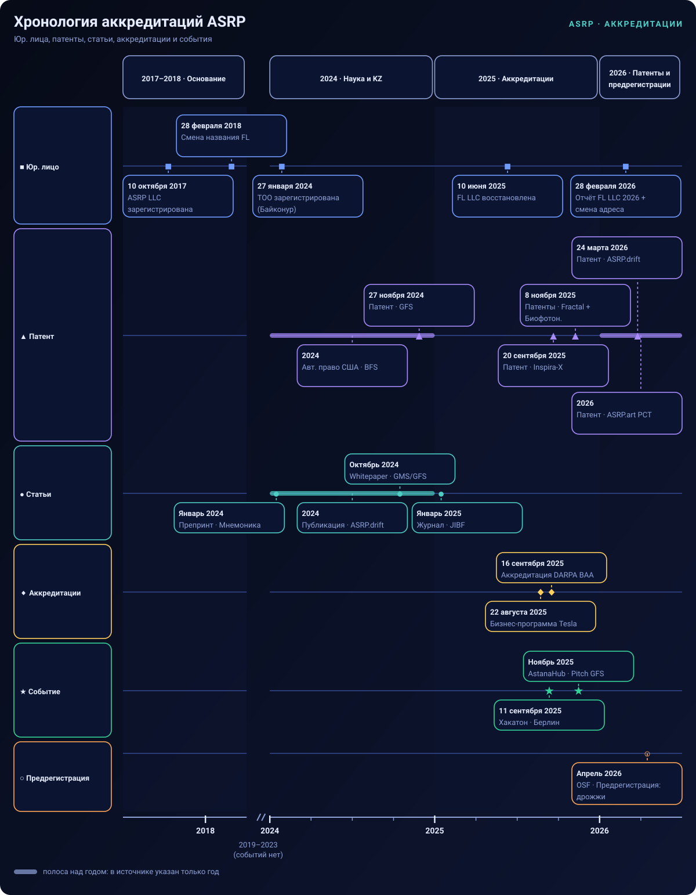

**[English](RESEARCH_AND_IP.md) | Русский**

[← Экосистема ASRP](../README.ru.md) · [Указатель документации](README.ru.md)

# Экосистема ASRP — Исследования, патенты и аккредитации

> Статусы и цифры на этой странице приведены на 2 квартал 2026, если не указана другая дата, и даны со слов проекта; независимо они не перепроверялись.

---

## Научные статьи

Бизнес-модель и научная основа ASRP задокументированы **семьёй рецензируемых публикаций на ResearchGate** — у каждой работы полный историй отказов (обычно 4–5 штук) до принятия в журнал. **Все канонические работы опубликованы в журналах**, кроме **технического отчёта по BCI / нейроинтерфейсам**, который сейчас выпущен как отчёт и в скором времени будет опубликован как статья. Три флагманских работы — ниже; полный список публикаций (8+ канонических работ с учётом разных версий) — в [`whitepaper/README.md → Полный список публикаций`](../whitepaper/README.md#-complete-publication-list--полный-список-публикаций).

**Архитектурная статья GMS / GFS (октябрь 2024 → январь 2025):**
> Banchenko D., Kapustin M., Bilovodenko V., Ovseannicova V., Savelev I., Sepehri A., Grivtsova I. *«Technological transformations, formation of GMS (Global Mental System) and GFS (Global Forecasting System) — right-brain technologies based on biological entities with consciousness, artificial intelligence, quantum computing, and blockchain: Banchenko-Market (Global Market of Lucid Dreams and Other Transcendental States of Consciousness)»* · Препринт: [RG 384668260](https://www.researchgate.net/publication/384668260) (October 2024) · Расширенный препринт: [RG 384706504](https://www.researchgate.net/publication/384706504) · **Опубликованная статья: [RG 388438082](https://www.researchgate.net/publication/388438082)** в *Journal of Investment Banking and Finance*, January 2025 · [DOI: 10.17605/OSF.IO/P9KHU](https://doi.org/10.17605/OSF.IO/P9KHU) · Лицензия: CC BY-NC-ND 4.0.

**Экономическая статья Banchenko-Market (2024):**
> Banchenko D., Ovseannicova V., Kapustin M., Bilovodenko V., Savelev I., Grivtsova I. *«Funding for Fundamental Science Research Based on Blockchain Technologies — Banchenko-Market (Global Market of Lucid Dreams and Other Transcendental States of Consciousness Market)»* · [RG 378492156](https://www.researchgate.net/publication/378492156) · Лицензия: CC BY-NC-ND 4.0.
> *Примечание к публикации. Статья описывает блокчейн-модель финансирования фундаментальных исследований; ряд крупных журналов (КЗ, UA, US Stanford-affiliated, UK Oxford-affiliated) отказались её публиковать — вышла в журнале, согласившемся с нестандартной рамкой.*

**Методология синхронизации сновидений (препринт, январь 2024 → опубликованная статья):**
> Banchenko D., Kapustin M., Burilova T., Shishkin L. *«Application of the Banchenko Dream Synchronization Mnemonics Method for Joint Synchronization of Dream Elements (including Lucid Dreams) within the Blokhin Dream Network Concept and Analysis of Results based on the Kapustin Dream Match Search AI Model»* · Препринт: [RG 377492383](https://www.researchgate.net/publication/377492383) (January 2024) · **Опубликованная статья: [RG 378492219](https://www.researchgate.net/publication/378492219)** · Лицензия: CC BY-NC-ND 4.0.

Полный список публикаций, полные двуязычные абстракты, роли авторов, карта соответствия с README и список фундаментальных методов — в [`whitepaper/README.md`](../whitepaper/README.md).

---

## Портфель исследований и патентов

**Все патенты поданы через Казпатент (Республика Казахстан).** Публичные репозитории с документацией ниже.

| # | Патент | № заявки | Статус | Публичный репо |
|---|---|---|---|---|
| 1 | **ГСП** (GFS — Global Forecasting System) | KZ 2025/1096.1 | Ответ на формальную экспертизу отправлен | [репозиторий патента](https://github.com/denisbanchenko/Kazpatent_Global_Forecasting_System_Patent) |
| 2 | **ПНИР.дрифт** (ASRP.drift — Advanced Synchro Resonance Platform) | KZ 413554 | 🟡 Ожидает регистрации | [репозиторий патента](https://github.com/denisbanchenko/Kazpatent_Advanced_Synchro_Resonance_Platform_For_Deep_Resonant_Patent) |
| 3 | **ПНИР.искусство** (ASRP.art — Axionetic Sensing Reactions Platform in Art) | KZ 2025/0592.1 + PCT 412362 | ✅ Экспертиза по существу | [репозиторий патента](https://github.com/denisbanchenko/Kazpatent_Axionetic_Sensing_Reactions_Platform_in_Art_Patent) |
| 4 | **Биофотонная Нейродиагностика** (Biophotonic Neurodiagnostic System) | KZ 2025/1097.1 | ✅ Формальная → по существу | [репозиторий патента](https://github.com/denisbanchenko/Kazpatent_Biophotonic_Neurodiagnostic_System_Patent) |
| 5 | **ФБСГП** (Fractal Biomedical Hyperbolic Field System) | KZ 2025/1095.1 | ✅ Формальная → по существу | [репозиторий патента](https://github.com/denisbanchenko/Kazpatent_Fractal_Biomedical_System_Patent) |
| 6 | **Инспира-Х** (Inspira-X — Respiratory Analysis) | KZ 2025/0914.1 (399693) | Ожидает | [репозиторий патента](https://github.com/denisbanchenko/Kazpatent_Inspira-X_Respiratory_Analysis_Patent) |
| 7 | **Система Питания Тела** (Body Food System) | US Copyright TXu002116250 | ✅ Зарегистрировано (США) | [репозиторий патента](https://github.com/denisbanchenko/Kazpatent_Body_Food_System_Patent) |

> ⚠️ Расхождение EN/RU в исходнике — см. [открытые вопросы](../reports/MARKETING_UPDATE_REPORT.md#open-questions).

**Авторы патентов:** Овсянникова В.А. (MD), Капустин М.М. (DE), Банченко Д.Ю. (KZ).

---

## Аккредитации и регистрации

**Внешние регистрации и аккредитации — это доверительные сигналы, которые инвестор или подрядчик проверяет до первого серьёзного разговора.** Главный заголовок — **активный доступ к порталу подачи заявок DARPA BAA (оборонные R&D-конкурсы США)** плюс **аккредитация Tesla Business Program (корпоративный сегмент США)** — плюс патентные, авторско-правовые и рецензионные сигналы ниже. DARPA-пункт даёт аутентифицированный доступ для подачи и трекинга предложений по BAA; это не merit-based награда и не должно подаваться как она.

| Орган | Программа | Дата | Идентификатор |
|---|---|---|---|
| 🇺🇸 **DARPA** (Агентство передовых оборонных исследовательских проектов США) | Доступ к порталу подачи заявок BAA | **16 сен. 2025** | Экстранет-аккаунт активен (логин предоставляется под NDA) |
| 🇺🇸 **Tesla, Inc.** | Бизнес-программа Tesla | **22 авг. 2025** | Зарегистрированное юр. лицо: ASRP LLC (FL) · Email: `info@asrp.tech` |
| 🇰🇿 **Казпатент** (Минюст РК) | 6 патентных заявок + 1 PCT | 2024–2026 | см. раздел [«Портфель исследований и патентов»](#портфель-исследований-и-патентов) |
| 🇺🇸 **Бюро по авторским правам США** | Система Питания Тела | 2024 | TXu002116250 |
| 🌐 **Реестр OSF** | Предрегистрация дрожжевого исследования | 2026 | [osf.io/Jgt3h](https://osf.io/Jgt3h) |
| 📝 **Международный журнал внутренней медицины** | Рецензируемая публикация ASRP.drift | 2024 | ссылка с [asrp.tech/projects/asrp.drift](https://asrp.tech/ru/projects/asrp.drift) |
| 🧪 **ResearchGate** | Страница лаборатории | Активно | [researchgate.net](https://www.researchgate.net/lab/Advanced-Scientific-Research-Projects-Denis-Banchenko) |

### Эпохи — хронология регистраций, подач и событий

> Ниже показаны **пять классов событий** — регистрации и восстановления компаний (реестры SunBiz и КЗ), подачи патентов и регистрации авторских прав, научные публикации и предрегистрации, аккредитации (DARPA · Tesla · OSF), публичные события (хакатоны, pitch-battle).

